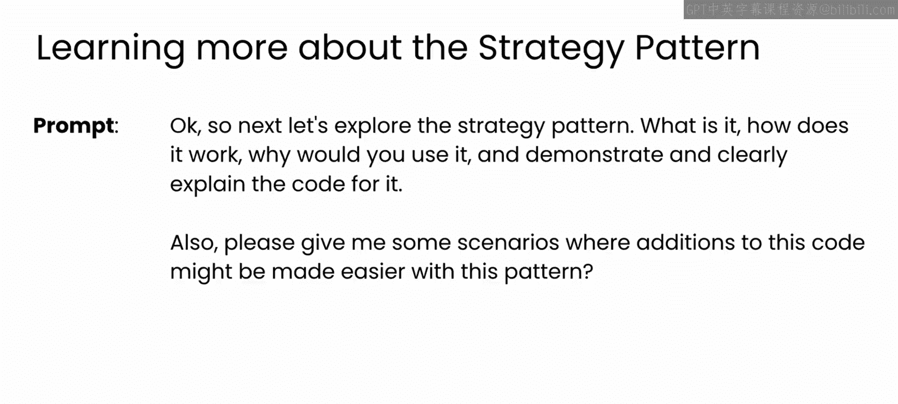
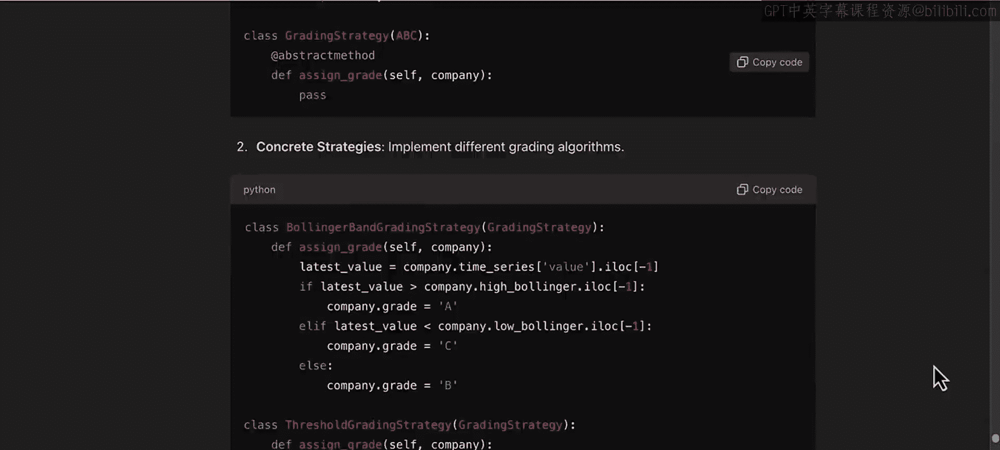
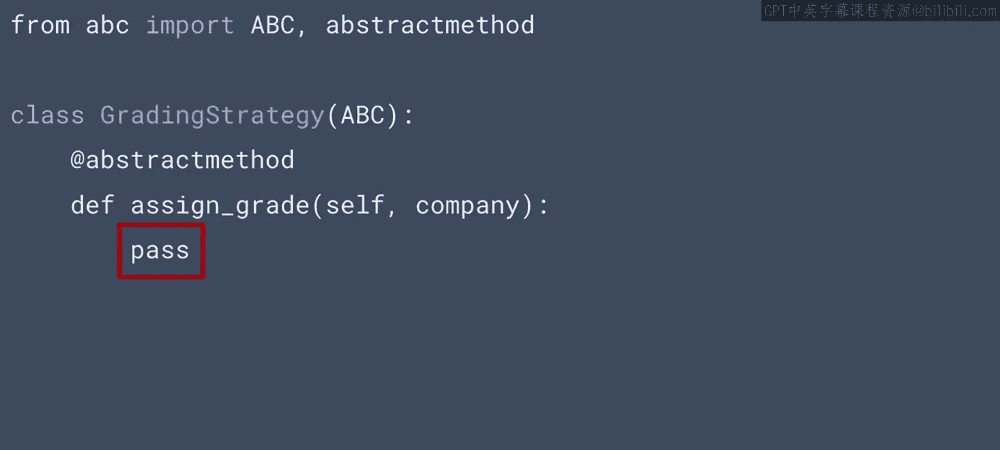
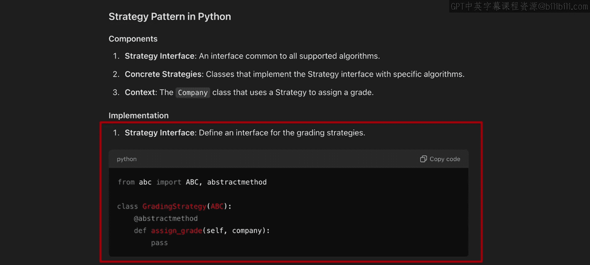
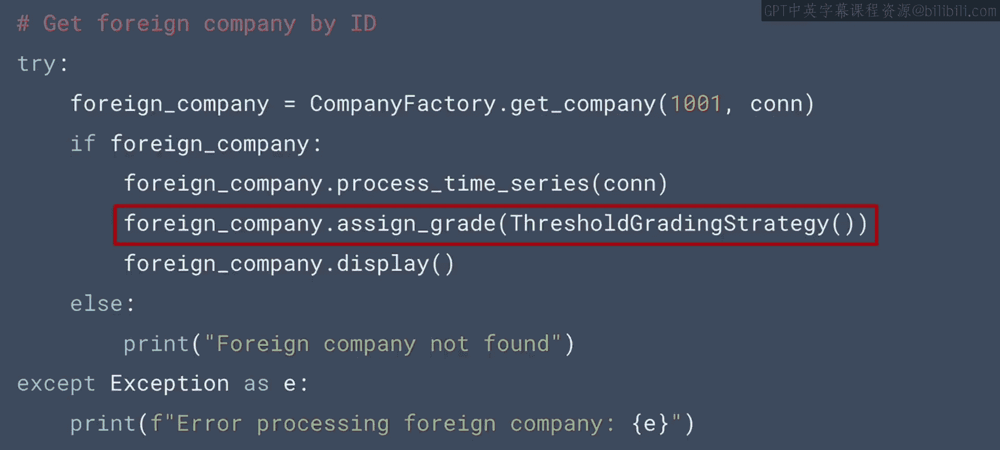

# 吴恩达《软件开发的生成式AI技能（简介、结对编程、数据库设计-3课全）Generative AI for Software Development Skill》 - P74：24_策略模式.zh_en - GPT中英字幕课程资源 - BV1ucxLeUEHD

Okay， you've seen how to implement three different patterns already。 The Sleton。

 factory and template method patterns。 So it's time to take on a fourth and final one。

 The strategy pattern。 When the LLM suggested patterns to implement originally。

 All it told you about here is strategy pattern for different grading strategies。 It is pretty broad。

 So let's start asking for some more clarification about what this pattern is and where we'll use it。

 GT responds that the strategy pattern is a pattern that allows you to create a family of interchangeable algorithms and then use the one that's most appropriate。

 So if you wanted to have different ways of assigning grades to accompany these grading algorithms could be easily interchangeable。

😊。

And just to remind you， the grade is a property of the company that refers to the assessment of its market position。

To implement this pattern， GPT says that you need to define a strategy interface。

 implement the concrete strategies， and then modify the company class and the code using it to appropriately select which strategy that you want to use。

Okay， so I think that that high level plan makes sense。

 but now let's take a look at the code that was generated。First。

 GPT has added an import from a library called ABC。 If you are unfamiliar with this class。

 you could ask yourLLM about it， in short， though it's a class for defining abstract base classes and abstract methods for instances。

 when you plan on making subclasses just like we're going to be doing here。Below that。

 a class called grading strategies is defined， and it has a single method called a s grade。

 Notice that that method just includes a single pass and has an abstract method decorator on it。

 This means that the method isn't actually implemented in this class。

 but it's designed to be overwritten in subclass。😊。

This approach may be new to you， but it's lining up with what the LLM told us about the strategy pattern。

 You'd expect to create an interface for the strategy and then several concrete implementations of that strategy。

 and this is our template。

And here's the first concrete strategy the LLM suggested。 the Ballinger band grading strategy。

 notice that this is a class that inherits from the grading strategy class that you just saw created。

 and it also overrides the assigned grade method in that class。😊。

The logic inside this method is super simple。 Basically。

 if the latest value in the time series is above the high band， you'll give it an A。

 If it's below the low band， you'll give it a C。 Otherwise， you'll give it a B。Now。

 I don't think I would want to use an algorithm this simple to make investment decisions。

 but it will take a company and return a grade， which is good for our example。

Here's a second example grading strategy that's called threshold grading。

This class also inherits from the grading strategy interface。

 and it also overrides the assigned grade method。 This strategy seems to be based off of numeric thresholds。

 So if the latest value is above 200， it gives us an A。 If it's lower than 100， we get a C。

 Otherwise it's a B。 Again， this is perhaps a naive grading。

 but it shows how the strategy pattern allows two different approaches to be written to the same interface。

😊，Now， how would you use these strategies in your code？ Well， that's pretty straightforward。

 Let's take a look。So， for example， if you want to use the Bollinger band grading strategy for the domestic company is very straightforward。

 Here's where you retrieve the company details and displayed them。But on this line。

 when I assign a grade， I'll just pass in the strategy and the grading will be done with the Boinger band grading strategy for me。

Or if I'm using a foreign company and want to use a different strategy for its grade。

 I could just pass the threshold grading strategy to that， li you can see here。

Thanks to the interface created by the strategy pattern。

 I have this very flexible way of switching grading strategies。

That's the last pattern I'll be showing， though， of course， there are many， many more。

 I hope you can see how useful L L Ns can be for analyzing your code and identifying design patterns that you can try。

 This can be a powerful way to improve the quality of the code that you write and ultimately help you build better software。

 After all， that's what this is really all about using all of the tools at hand so that you can be a better coder。

😊。