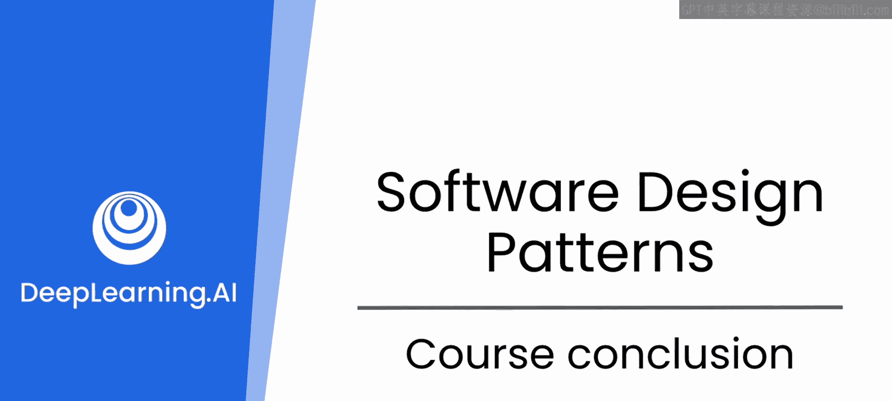

# 吴恩达《软件开发的生成式AI技能（简介、结对编程、数据库设计-3课全）Generative AI for Software Development Skill》 - P75：25_课程总结.zh_en - GPT中英字幕课程资源 - BV1ucxLeUEHD

Congratulations on completing this course。 Over the past three modules。

 you've gained valuable skills to enhance your coding capabilities。

 And you learned how to work with an LLM like Chay P as your reliable hair programmer。😊。

In the first module， you saw how an LLM can help you think through data serialization and its role in a software design paradigm called configuration driven development。

You saw how Json files can be used to externalize the configuration of an app so that settings that might change are separated from the core logic of the app itself。

You also saw how you could use something like pickle to serialize complex objects or preserve application states。

 You leverage Chat Ept's deep knowledge of these concepts to implement a prototype configurable app that generates images using Doli。

😊，The second module took you into the world of databases。

 You discovered how to design robust and efficient databases using Chat EPT to design a schema and implement Crd operations。

 usingsing an LLM as a database expert gives you a powerful tool to build and manage databases that are both scalable and maintainable。

😊，GPT's ability to offer real time insights and suggestions help you navigate complex database challenges。

 making you a more proficient database developer， and while the example you worked on used SQL。

 alchemy and Python， the prompting skills you learned will apply to other implementations like PostgresSQL。

 MySQL， or indeed any other database management system。😊，In the final module。

 you looked into the realm of design patterns， focusing on those from the G of 4。

 You worked with an LLM to build out a financial services application。

 and you applied patterns like Singleton factory and template methods to improve the app design and solve real world problems。

GPT was there to guide you through each step， providing examples and clarifications to solidify your understanding。

You now have a strong foundation in using an L L M to think through design patterns and to create flexible。

 reusable and maintainable code。 as you move forward in your coding journey。

 remember that the skills and knowledge you've gained here are just the beginning。

 L L Ms like Chaty P， Claude or Gemini will continue to be powerful allies。

 helping you tackle new challenges and refine your craft。😊，But I will encourage you to remember this。

 Don't let the L L M dictate your code。 I'm seeing increasing sentiment about junior developers taking code from an L L M and just using it without fully understanding it。

 The more senior developers then have to take on the technical debt of fixing the bugs and issues that arise。

 Remember， some day， you might be that more senior developer。

 When we see lots of code generated for us， it's tempting to use it and then just move on to the next problem。

😊，But please don't。 It's sacrificing the future to save the present。Instead， keep experimenting。

 keep learning。 and most importantly， keep coding。 Your future as a proficient and efficient developer。

 Look bright。 Thank you for being a part of this course and happy coding。😊。

