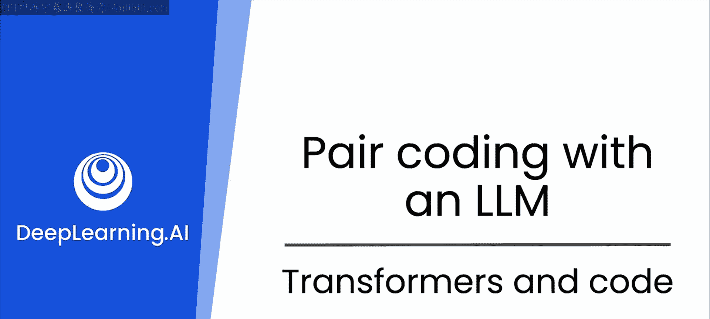
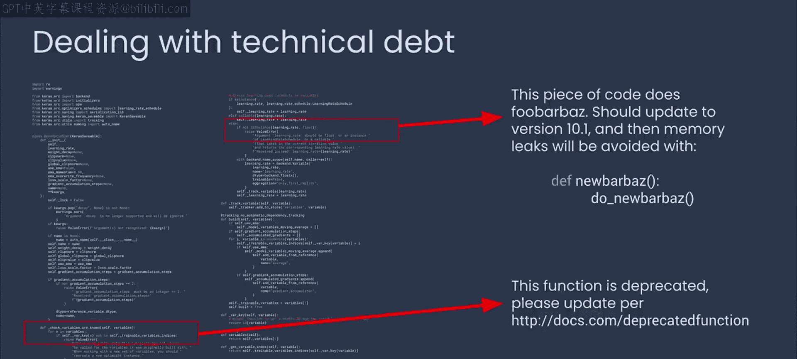

# 吴恩达《软件开发的生成式AI技能（简介、结对编程、数据库设计-3课全）Generative AI for Software Development Skill》 - P8：7_Transformer与代码.zh_en - GPT中英字幕课程资源 - BV1ucxLeUEHD

Building on what you just learned about transformer architectures。

 let's explore how large language models can act as your partner in coding and development these AI models can transform your approach to common programming challenges and help you in your day to day jobs。

You previously saw how transformers excel at processing data in parallel and understanding context with precision。

This revolutionary technology underpins LLMs enabling them to quickly read and analyze vast amounts of texts。

Now let's consider how you can apply this to the coding world。😊。

Imagine having an assistant that could scan your entire code base， not just for syntax errors。

 but also for bugs and potential inefficiencies。LLMs can analyze your code to suggest better algorithms or refactor your code to enhance performance。

 they can also help trace through the execution to pinpoint where things go awry。

 significantly reducing your debugging cycle。😊，Managing dependencies is often a headache for developers。

 LLMs can assist in this task by analyzing project files and code imports and then suggesting updates or identifying incompatible versions This capability ensures that your project stays up to date and minimizes the risk of conflicts or deprecated library use。

Writing documentation is a crucial， yet often neglected task for developers。

 LLMs can automatically generate comments and documentation by understanding the structure and purpose of your code。

This not only saves time， but also enhances code readability and maintainability for future revisions or team collaborations。

Technical debt accumulates fast， and it's often hard to track and manage When you inherit code that's extremely complex and likely only understood by the original developers who may no longer be around。

 L L Ms can review the code to help you understand it and suggest refactoring or redesign strategies。

 They can even prioritize debt reduction task so that anyone who inherits the code from you in the future will always have an easier task。

 It's always good to maintain a healthy code base。

With LLMs， the scope goes beyond everyday coding tasks。

 you can brainstorm creative solutions to complex problems， propose innovative features。

 and even simulate how new modules could integrate with existing systems。

Using an LLM as a thought partner sparks innovation and pushes projects beyond conventional boundaries。

 giving you the ability to experiment quickly and explore things with code that you may not have had the time or the scope to do previously。

Integrating LLMs into your development process doesn't just change how you tackle tasks。

 it revolutionizes them。These AI partners extend the capabilities of every software developer。

 allowing you to focus more on the creative and strategic aspects of development。

 I hope you'll use these models as I do， not just as tools but as integral members of your development team Okay。

 so now you're at the point where you can go beyond theory and start getting hands on。😊。

In the next section， you'll use simple chat based interfaces like ChattP or Gemini to begin your journey of pair programming with an AI assistant。

