# 吴恩达《软件开发的生成式AI技能（简介、结对编程、数据库设计-3课全）Generative AI for Software Development Skill》 - P9：8_使用聊天机器人生成代码.zh_en - GPT中英字幕课程资源 - BV1ucxLeUEHD

In this lesson， you'll see how you can use an LLM in this case GPT 40 via the chat GPT interface to write code and to begin automating and speeding up your development process。

First， let's ask Cha EptT to write a simple Python function that adds two numbers Here's how I phrase the prompt to ensure clarity and specificity。

😊。

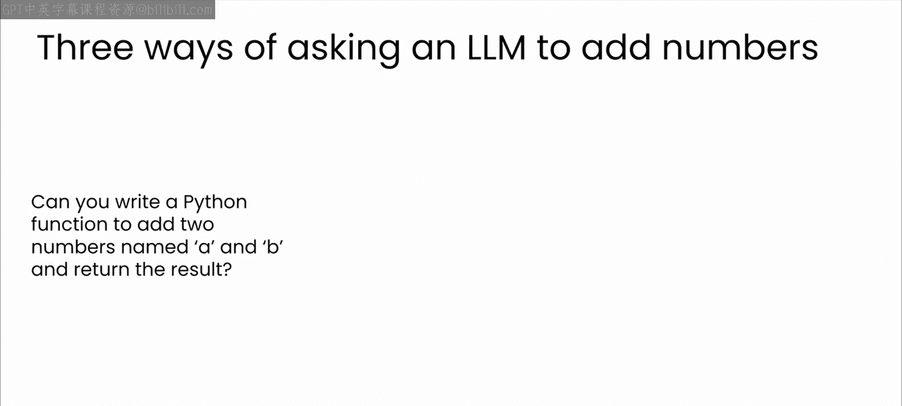

Can you write a Python function to add two numbers named A and B and return the result？

And you can see the code that it returned。ChattBT has written a function called Add2 numbersumbers that does just that。

 and it also includes an example of how that function could be used。

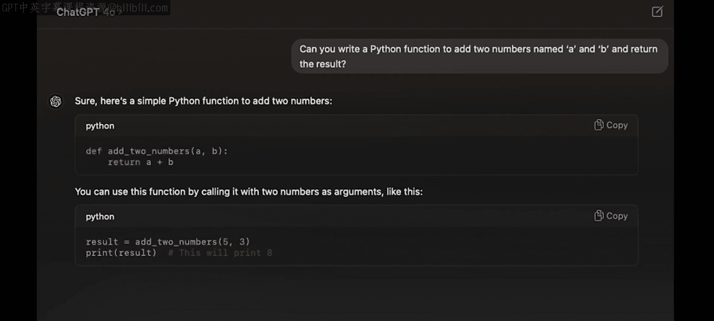

It's a pretty neat and straightforward function。What if you wanted to do this for JavaScript or C sharpharp？

You could ask the model to create a JavaScript function that adds two numbers。

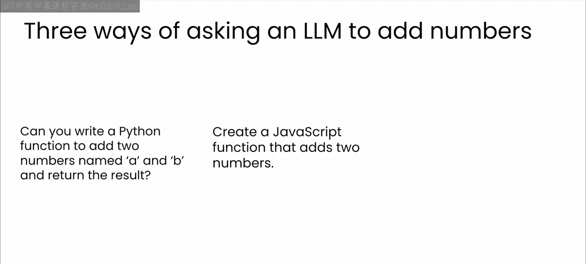

And here's the response。This looks good。You can see from the different syntax here that the model is now generating JavaScript and now Python。

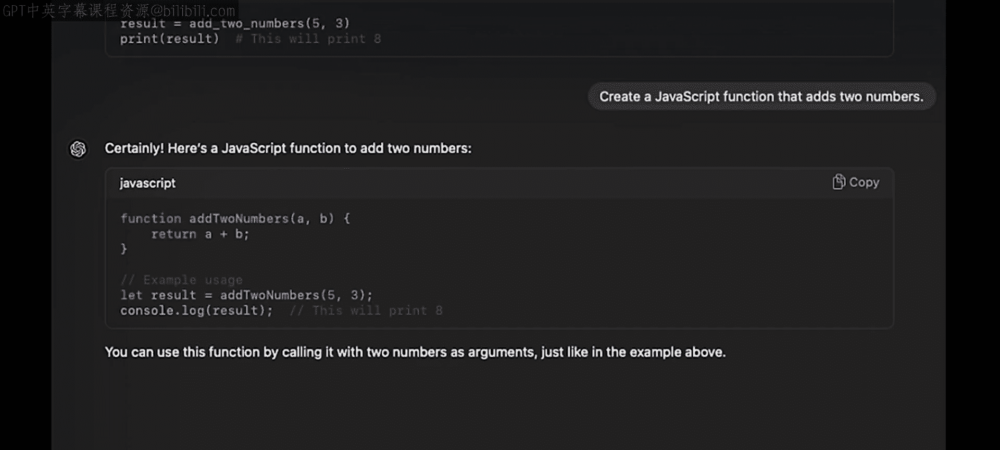

Lastly， let's ask the model to write the same function in C sharpharp。

And again， this output looks like pretty good C sharp。 C sharp is a more verbose language。

 but you can still see that the model has created a function called add2 numbers。 And then later。

 it includes a main method that calls this function and prints the results。

 The model even gives a brief explanation of the code that it wrote for you。😊。

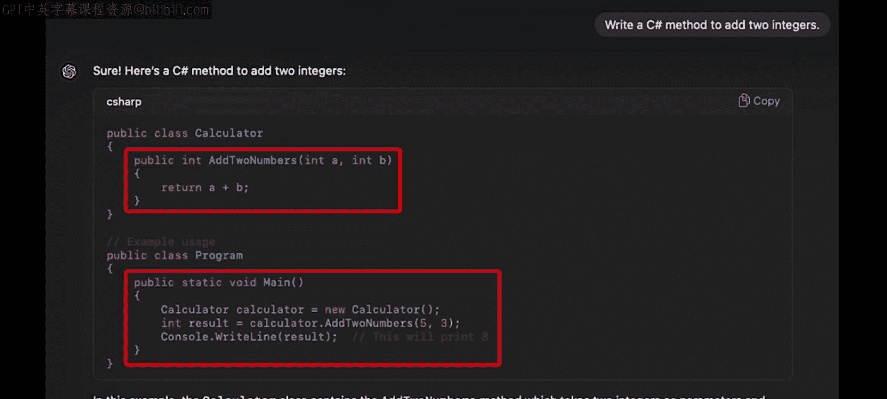

Notice how I adjusted the prompts slightly for each language。

 reflecting typical naming and syntax conventions， such as calling it a method in C sharpp。

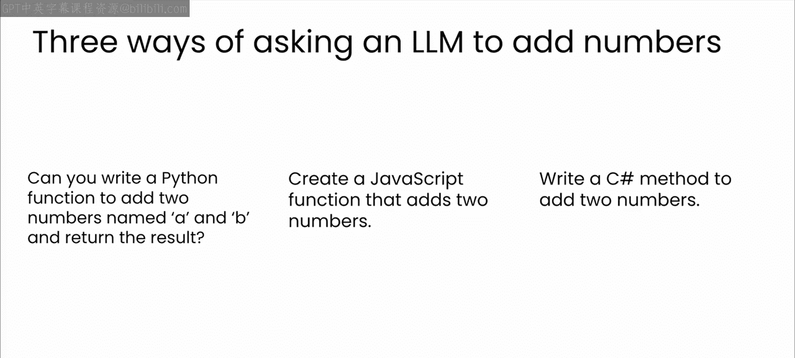

This is an important nuance。 Does the impression that prompting like this can do away with developers altogether。

 but I disagree。 It's the domain knowledge of the language。

 the As and the supporting libraries that make you a better developer and will make you a better prompter。

Also， I really think that the domain knowledge of the business problem you're trying to solve will give you better ways of expressing the solution in either prompts or code。

 so your skills and knowledge are extremely valuable， even in the age of prompt generated coding。😊。

So let's take this a little deeper by making your prompts more specific and detailed。

Specifying parameters and conditions helps the model to refine its output。

Let's ask for a Python function that uses nupyy to add two arrays。Notice that a specified numpy。

By mentioning Nmy， chat GPT knows to include the appropriate import and to use the library's functions。

 For example， here， it's using the N dot addd function to add the two arrays。

 Then it includes an example of how this function could be used。 And finally。

 a quick explanation of the code that it generated。And now。

 let's consider the concept of interactive coding to continuously update your code。

 It doesn't have to be a one shot situation where you take the code from GT and use it as is。

You can continue to prompt the model to create better code。

 Let's see this in action by iteratively improving a function。😊。

You'll start by asking the model to write a basic JavaScript function to check if a number is prime。

Okay， so the model responded with some code， it looks like first the function checks if the number is less than two。

 next it checks to a potential factor starting at2 and going all the way up to the square root of the number。

 if it ever finds a factor it will return false， but otherwise it'll return true。😊，Now。

 while this isn't the most efficient algorithm， it'll definitely work。For now， however。

 I want to address a different problem， which is the lack of error handling。😊。

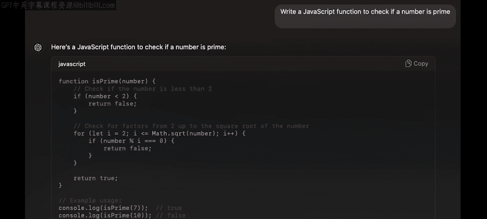

So let's ask the model to add some to make sure that the input is a positive integer。

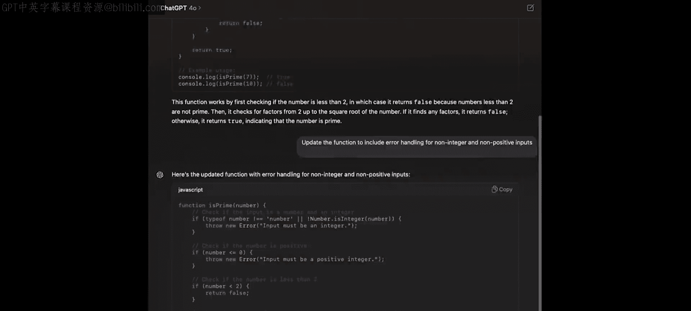

All right， so the model has updated its code to add that error handling in。 First。

 it checks if the input is an integer， and then it checks that the input is positive。

 If either check fails， the new function will throw an error。

Notice that the rest of the function is identical to what we had before。Below that， the example。

 usage code has been updated to use try and catch to test the error handling that was just added。

 That's pretty useful， as well。In general， vague prompts can lead to ambiguous outputs。 For example。

 consider this prompt。 I'm just going to type make a function。And just like a human colleague would。

 the model responds with a follow up request for more details because I didn't specify what the function should do。

Let's correct that by updating the prompt with the required instructions。And as you can see。

 the model is now able to help me with that task。So when using prompts for code or for anything really。

 but maybe especially for code， you should be specific。

 use clear language and provide as much context as necessary for the model to successfully complete the task。

Here's another example。 Let's instruct Chat E to build a Web API endpoint using flask。

 a popular Python web framework。 This prompt is very detailed。

 You're telling chatt ET exactly what you need， the framework， the type of request， the endpoint URL。

 the parameters， the expected output and all of that。And here's the result。As you can see。

 the model has written a full flask gap with an endpoint that multiplies two integers。

 including error handling like checking if the inputs exist。

 and of course ensuring that they're integers。

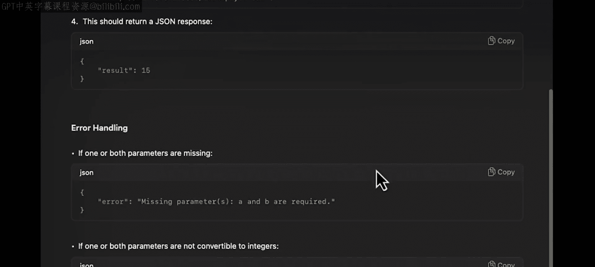

This example demonstrates that by providing clear and detailed instructions。

 you can get the model to generate functional and ready to use code。Remember。

 the more context and clarity you provide， the more accurate and relevant the output will be。

 code never comes without bugs， whether it's AI generated or human written。

 So let's take a quick look at how you can use an LLM to help you debug。

Let's start by giving Cha EP some code。There's a bug in this code。 Can you spot it？If you want。

 pause the video for a few seconds and see if you can come up with some situations where this code might not work as expected。

It's pretty subtle， but if the list is empty， the count will be 0。

So you'll get a divide by0 error on this slide。

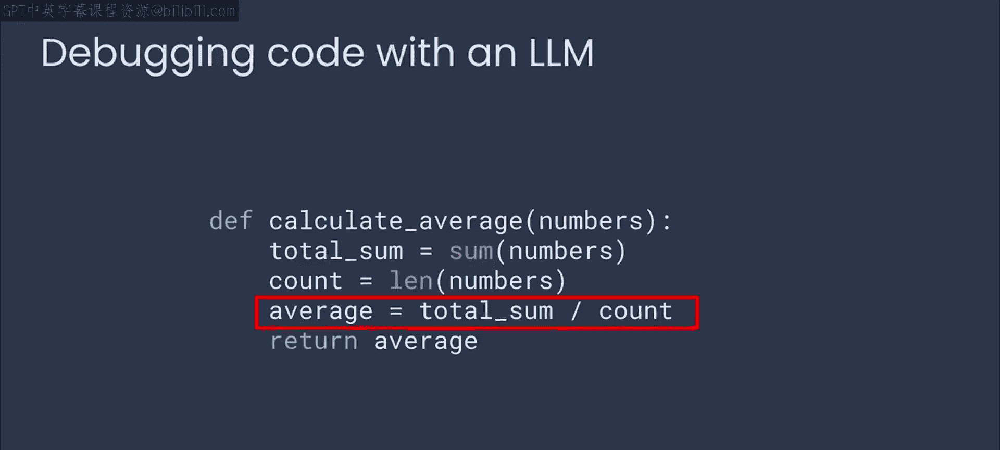

So you can include your code in your prompt to the model and ask it to find any errors。

And as you can see， the model spot it right away and gives you suggestions for how to handle it and how to improve the experience for whomever's calling the function。

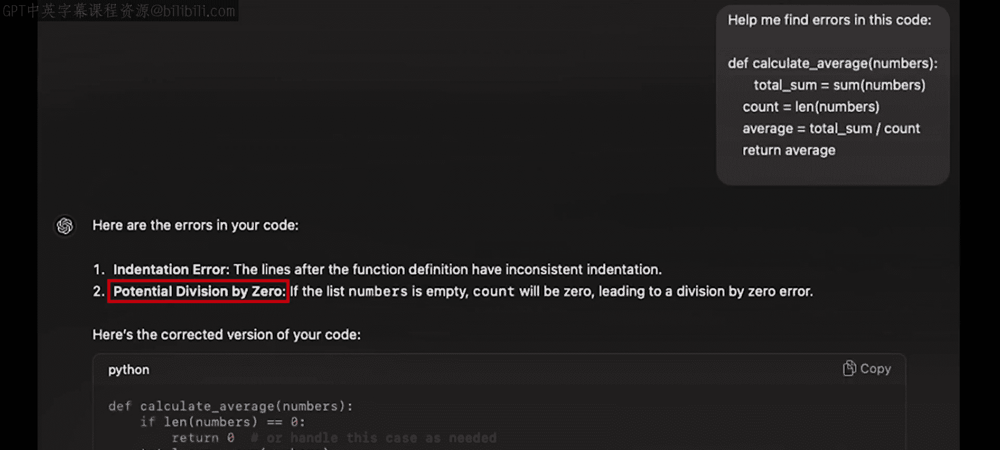

Okay， so now that you've seen a few ways that you can use a model to help you with coding tasks。

 try a little exercise on your own。😊，Ask Chat EPT to write a function that calculates the area of a circle。

 given the radius of that circle。Pause the video， give it a try， and come back when you're done。

This was an interesting one， because you might wonder if you need to tell Chad GT the equation that calculates the area of a circle。

 The area is pi or squared。 General information like this is already present in the data that the model was trained on。

 so you don't have to provide it explicitly。😊，Here's my prompt。

 Notice I'm including details like the fact that it should take the radius of the circle as an argument。

 I also ask it to add error handling for non numeric inputs and to add commentss explaining each step。

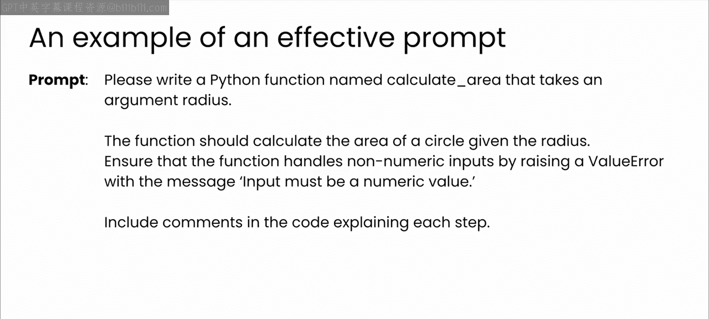

Here's the output that Chat E produce for me。 The function takes the radius as an input。

 just like I asked it。 It also includes error handling for nonnumeric inputs。

 and the entire function is nicely commented。 Better prompts， better code。

 If you didn't include details for error handling。 And the model didn't provide them。

 Try going back in refining your prompts to include those new instructions。😊。

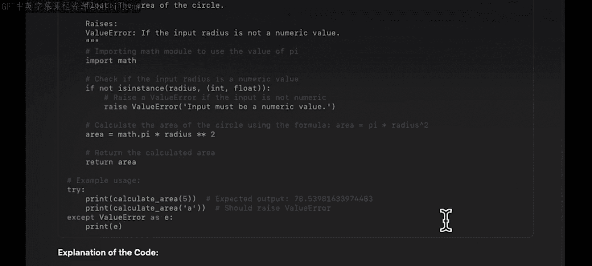

And once you've done， I'll see you in the next video。

