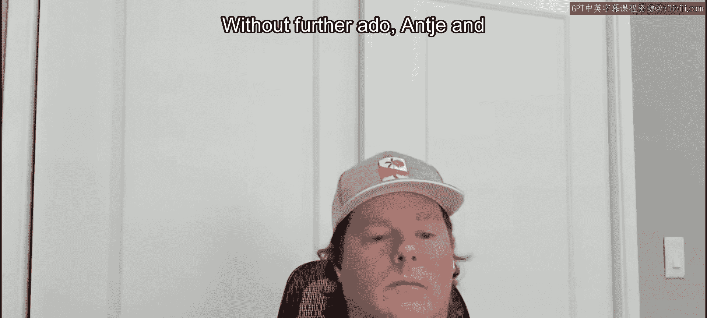
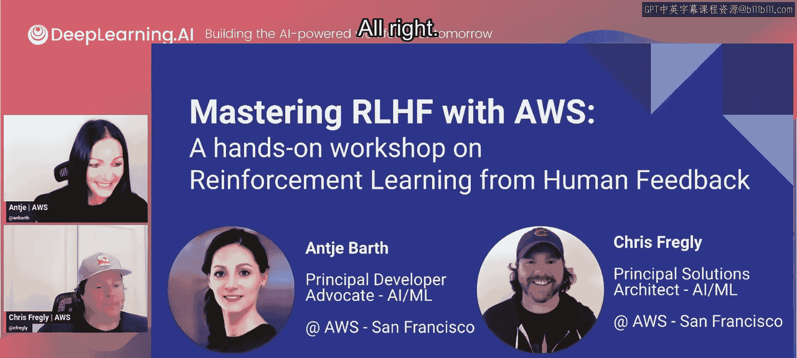
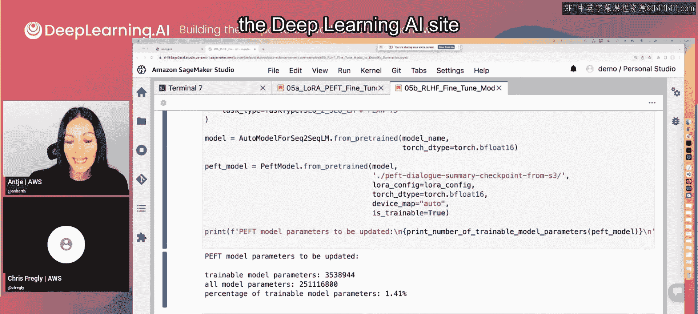
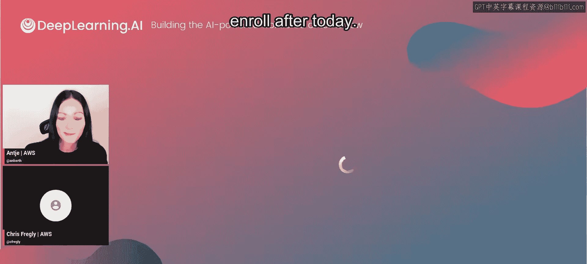
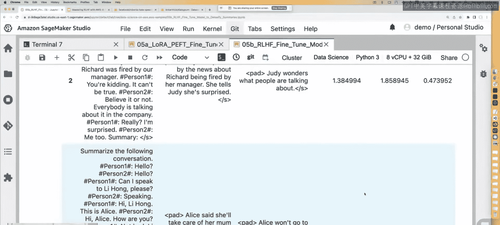
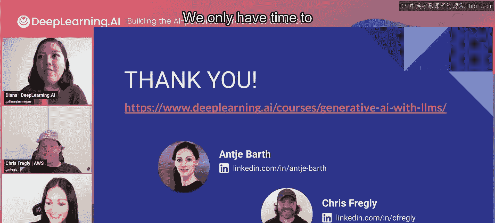

# 吴恩达《通过AWS掌握RLHF｜Mastering RLHF with AWS： A Hands-on Workshop》中英字幕 - P1 - GPT中英字幕课程资源 - BV1Vx4y1D71L

Hi everyone， my name is Diana Chan Morgan and I'm part of the Deeplening。

aiI team bringing you all together for all things AI community and events Today we are very lucky to have a hands on workshop with some special speakers from Amazon Web servicess talking about mastering RLHF。

 also known as reinforcement learning， human feedback。😊，While we get started。

 we would love to hear from you all in the live chat where all of you are dialing in from and what courses you've taken so far at deep learning。

This event is designed to equip you with all the skills and knowledge required to excel in reinforcement learning applications and effectively leverage human input to enhance AI systems。

 whether you're a seasoned data scientist and aspiring AI enthusiast or a business professional seeking to understand the potential of reinforcement learning。

 this workshop offers a unique opportunity to unlock its true potential。😊。

We will also be dropping a link in the chat for you to ask questions for the speakers and to vote on all other participants questions This workshop is also based off the foundational learnings of Deep learnings course on geneative AI with LLMs built in collaboration with the Amazon Web Services team everything covered in the workshop is presented as continued education from the course and we will also be dropping the link in the chat。

😊，Now to introduce our speakers and fortunately our course instructors as well。

 I'd love to introduce our first speaker， Ana Bart。😊。

Hi everyone Hi Ana is a principal developer advocate for AI and Maine learning at AWS She is also coauthor of the O'reilly book Data Science on AWS You may have seen her speak at AI and ML conferences。

 events and meetups across the globe。😊，Our second speaker is Chris Fly， Hey Chris。

Chris is a principal solutions architect for AI Machine learning at AWS。

 he is also the co authorthor of the Riley book Data Science on AWS Chris is also the founder of the Global Meetup series titled Data Science on AWS without further ado on Chris。

 why don't we you take it away。

Absolutely， thanks so much， Diana， thanks for having us and thanks everyone who joined us today to learn more about RLHF。

 which stands for reinforcement Learning from Human feedback。

All right quick agenda for today this is a handson workshop and Chris will walk you through the actual code。

 how to run RLHF， how to prepare the data， how to use a reward model and how it all comes together to give everyone the foundation I'll going to walk you through a couple of slides in the beginning to give the theory and answer a couple of the questions that you submitted before。

 so we already had a peek at those so I'm trying to get to as many of those while I'm presenting and then once I'm done with the first part I'll hand it over to Chris。

😊，CoolAll right， yeah， Chris， everything ready from your side， you have an excited answer card？

So will be ready， y。Yes， working on her right now。All right， let's switch to my。Yeah。

 let's switch to my slides。All right。Let's get started so as Diana mentioned。

 this topic and a couple of the slides I'm showing here are part of a course we just launched together with deep learning AI on Cora called Jaantative AI with large language models。

Here you can see the instructors and also Dr。 Andrewing。

 we were super happy to work with him on this course and also a big shout out here to our colleagues。

 Shelby and Mike who also take part as instructors and help develop this course。

Here's a quick link to the Deep learning AI site and the course。

 if you want to have a look at it or maybe even enroll after today， I think we're around 70。

000 enrollments already， I'm super happy and thanks everyone who might already have peeked into the course and for those of you who haven't yet。

 let's have a quick look today into one of the topics wereing that's RLHF。

Also here's a Bily link GLLM if you don't want to type the full。

 but I think we're also posting it here in the chat window。😊。

All right let's jump into today's topic so in the course we're not only covering reinforcement learning we're really kind of looking at generative AI from an end to end project lifecycle and you can see here we're starting with defining the problem talking about the use cases。

 how you can choose the right model and then here in the middle we're diving into the how to adapt and align your model project phase and this includes a couple of different things right from just using prompt engineering to kind of guide the model towards the right outputs and then a big section of the course we'll focus on the fine tuning so how can you customize the model with your data for your specific use case。

And fine tuning， as I said， is about customizing the model。

 also helping it to understand human language， the prompts and understanding tasks better。

Also responding in a little bit more natural sounding language， potentially。

 but there's a problem with that， right， human language， as we know， sometimes has different tone。

 Sometimes the models pick up language If it's trained on data from the Internet that we don't want to have it replicate to our users。

And there's a couple of examples， not just the tone and models behaving badly， but also for example。

 one of the nonofficial evaluation criteria， just the personal one that I do if I'm working with a new model I'll try to tell me a knock knock joke so I'm German background info I move to the US and I'm still struggling with knock knock joke so I'm asking my foundation models to come up with one let's say it responds with clap clap I mean it's kind of funny right but it's not really helpful it's not a real knock knock joke。

Also sometimes the model might respond to something that's completely wrong right can coughing effectively stop a heart attack of course not。

 but maybe the model just you know assumes it is and really confidently say that so it's not really honest in this case and also sometimes the models can provide bad advice or even like you know how can I hack my neighbor's w-fi it definitely should not give you tips and best practices in this case it just just like stop and say hey I will not answer this。

So it can create a little bit of harmful content， sometimes it can be hallucinate。

 create misleading answers and sometimes just not helpful。

So how can we address this right and those three points helpful， honest and harmless， by the way。

 are often referred to as the threeHs HHH so whenever you hear that that's referring to those overall kind of alignment criteria。

 you want the model to be helpful， you want it to be honest and you want it to be harmless。All right。

 and this is exactly why we're doing RLHF， we're trying to align the model with human feedback to guided towards harmless content。

 honest content and helpful content。Let's hug a little bit about reinforcement learning from human feedback and what's happening here。

Usually you start with an instruction find unit model。 So the model that already understands how to。

Use instructions in how to respond to different tasks。

And then you're applying this RHF technique as a second fine tuning step to align the model further across those criteria。

Again， maximizing the helpfulness， the relevance， minimize any harm and avoid the model engaging in any dangerous topics。

So before we go into the details of RHF， I just want to make sure everyone here is familiar with the terminology。

If we look at classic reinforcement learning， you might have heard about the terms where're often speaking of an agent and an environment。

The goal here is to maximize a reward， so the agent will take actions in this environment。

 and then based on the actions effectiveness towards a goal， it receives a reward。

So it takes an action and the action will put the environment in a specific state。

 and I'll explain what that means with an example in a bit。

 and then based on how good that action was and the resulting state towards the end goal。

 there's a reward。And it's much easier to understand if we use an example。

 let's say we want to play Ti tak toe。The agent would be the player。

And the objective here is clearly， hey， I want to win the game。

The environment here is our three by three board where we play the Tit toe。

And the state is the configuration of the board at any step we're taking。

And the action space is the allowed moves I can do， so wherever I can put my X or put my circle here。

So。How the agent figures out the best way to win this game is by using what we call a policy。

 a reinforcement learning policy， which is often a model。That learns what actions。

Lead towards winning the game efficiently。And based on all this input like。

 what's the state given the action I have taken and what's the reward。

 the policy will evolve over many iterations and figure out actually by learning right trial and error。

 which one is the right policy and the right strategy to win the game。And a whole play out like here。

 like I do the whole iterations until I win or lose the game is called a playout。

 or if we're talking about language models often called a rollout as well。

So we're not playing Ti tuktoe， unfortunately we want to find tune in large language models which is also fun。

 so how does this concept here apply in the context of LLMs so we still have an agent and an environment but in this case here the reinforcement learning policy is our instruct fine tune model。

😊，And the objective here is not to win a game， but to generate text。

And we want to generate the text in an aligned fashion。 So what we discussed before。

 if we want to align for the helpfulness， that's our goal here。

The environment is the context that the LLM has。And the current state is the current context。

 meaning whatever is in the context window right now， plus the generated text until to this point。

And then if you want to， what are the actions， well， the actions is literally。

Taking the token vocabulary as my action space， the total amount of possible actions。

 and then generating token by token。And this will give a reward and we'll walk you through how this looks like and then informs the policy here how to adjust the model to make more aligned responses。

And this is where the human comes into play。So somebody has to say， is this text really better。

 Is this text really more helpful， right？ And usually， this is done with humans。

At scale this doesn't really work anymore so we don't want to have like our colleagues or yourself sitting down after every model completion and evaluate the text right so this is why we're training a reward model that takes this place it's trained based off the human feedback so it basically incorporates that knowledge what you would prefer but then the model can make that call in the RHF process and assign a reward score to those completions。

All right， and the whole thing is called in this case of rollout。

And we're going to talk a little bit more about the reward model here。

 which is super interesting to know， and I saw a lot of questions also submitted beforehand。😊。

You want to understand a little bit more about the algorithms and the reward models。 So let's。

 let's talk about that。All of it starts with， first of all， collecting the human feedback。

So how do you prepare this data set to train the reward model？Let's start with our instruction。

 Find tune and LLM。And usually what you can use is either you have your own data set or you can use any of the publicly available prompt data sets。

And then you will take a couple of samples， prompt samples， and you create model completions。

And you'll create like a couple of those like here， for example。

 let's create three different completions for the same input prompt。

And you do that with a couple of different prompts and always get a couple of those。And then。

You need to know what you want to align for so let's say you want to reduce the toxicity or you want to improve the helpfulness。

 etc cetera so you select one and then you're providing instructions to a group of human labelers to then provide the feedback and basically rank the responses。

So let's say we have a prompt my house is too hot。 You run it through the model。

And there's different completions。 So maybe the first one says there's nothing you can do about hot houses not really helpful or you can cool your house with air conditioning you know。

 makes sense。😊，Or it is not too hot which is kind of a weird response right。

 so let's say we want to hear a line for really the helpfulness of the responses。😊。

You have a group of human laborers and their task is to rank the responses。

 one being the most helpful two three in this case being the least helpful。So in this case。

 I think we can all agree air conditioning is a great tip， so most helpful。

 there's nothing you can do yeah， not really helpful but it's better than the third response where it says like the house is not too hot basically saying my whole statement here was wrong from the beginning。

😊，And you're not just doing one human labeler， you usually send those completions to different labelers to get some diverse input to find consensus here also in the responses and the ranking and sometimes you know a labeler might just misread the instructions and you can see here that there's a little difference in the rating so if you send it to more than one you can find that catch that and minimize kind of the error rate here and find a good。

Rating。All right。It's important that you provide good instructions。 Here's just a couple of examples。

 I'm not going through all of them， but provide instructions that are really clear to make sure。

 you know， increase the quality of this data set and the labelers know exactly what they should do。

 Like， tell them， really rank the responses here from the best answer to the least Help。

You can also give them tips like， hey， judge on the correctness of the answer， the informativeness。

 and also they could ask， for example， check the internet， search the web to make sure it's correct。

And then also， they can。Kind if they don't have a clear winner， they may rank the answers the same。

 but they should only use this kind of sparingly。So again。

 here you can give all of the instructions you want to do and make sure the human labelers know exactly how they should rank it。

😊，All right， let's say we have this ranking data now。

 sometimes I'll also call the preference data set and to prepare it now for the reward model training。

 we need to do a little bit of data engineering here。So we have the prompt and the completions。

 We also have kind of the average， like the rank that we agreed on。

What we now need to do is to create pairwise completions。

So you can see here that I'm ordering if you can see the colors purple， yellow， purple green。😊。

Yellow， green， so all the possible combinations。And I also have the reward， I know。From the ranking。

 which one was the preferred from each of those two。

One little weird thing that most of those algorithms do is they require the preferred answer。

To come first。 So if you see what I'm doing here in the last step， I'm switching the order。

 I'm putting the yellow box first， the yellow completion。

 because that was actually the preferred one。 So that's just like a detail that many of the algorithms that implement 8 RHF。

 Exp you to do。 So make sure you check for that and then always pass in the preferred one first。

All right， now we've prepared the data set and we can train our reward model。 let's have a look。

 So again， the reward model will assign the rewards later during the RHF process and it needs to capture the human preferences so we can scale it and don't need the human laborers in every step here。

 So what we're doing is where。Getting the prompt in completion Paris。 And again。

 the first one here is the preferred one。 And then we're passing in the second option。

 And we're training the reward model here to。Predict the preferred one。

And it's the usual loss calculation here because we know which one it is。

 and then for normal back propagation， we update the model so it can always predict which one is the preferred one。

And again， here， we're feeding in the preferred one first， just a quick reminder。

So once we do that and basically you can guess picking one out of two sounds pretty much like a binary classification problem right So this is exactly what we do here。

 So for example， if we're if we're looking for reducing the toxicity， what we could do is kind of。

Use the reward model then to say which one is the preferred the positive right is it positive is it negative and we want to optimize for positive to reduce toxicity。

 which we'll also use by the way， in the hands on party in a little bit。

So when we're using the reward model now， we can feed new prom completion pairs and。

If we're using this as a binary classifier that has been trained to exactly distinguish between positive negative。

 we can see here， for example， Tommy lost television。

 positive comes back and with the logics which is the model outputs before we apply any softm layer。

 you can see here it's definitely positive here， no hate speech in this。

And this loet value is what we use later on as the reward value。You can also see probabilities here。

 That's pretty much 99% positive。 If we now run like a bad text， like definitely negative。

 you can see here that the positive class is。Is way down 33% and the negative class here correctly identified 66%。

Again for the rewards we also well always use the lohead value and here we can see what we're trying to optimize for the positive is a negative lahead so this will be kind of thinking of reward terms a penalty right it's a low reward it's actually a negative reward so we're discouraging the model later to produce output like this。

All right。So this was a quick walkthrough just to understand how to prepare the data now let's jump into the actual RH fine tuning。

We start with our instruct model， and this is the model we want to align， so this is getting updated。

Again， we have a prompt data set， either your own one that you created or you use one that is existing。

 and for example here an input might be a dog is and the model comes back a ferry animal。

You then pass prompt and completion into the reward model。

And the reward model is trained to give you this reward value。

 which is the logged value that I just showed you。So in this case， it's not too bad， right， It's。

 it's definitely not a toxic response。 Is it helpful， Mi， it's okay。

 but maybe you want to align it for a little bit more， you know， positive speech。

So the reward ball is okay and what's happening now the prompt。

 the completion and this reward is passed to the reinforcement learning algorithm that you're using and I'm going to touch on that a little bit later。

 a popular one is called PPO。And the reinforcement learning algorithm will now based on the reward。

Update the model and say， yeah， it was good， but you probably can do better， right。

So you're doing a lot of iterations here。And maybe the next one， let's just go ahead。

 responds a friendly animal， which is slightly better。 So the reward might go up。

The next one might be a human companion， which I like。 Yeah， so reward goes up。

And the most popular pet sounds nice。 and you get the idea， right， So I'm doing a lot of iterations。

 The goal is to maximize this reward。😊，Score。And maybe here iteration and the last one I'm doing because I have a stopping criteria。

 maybe a number of steps。The completion comes back， a dog is man's best friend。

 which sounds really nice。And this was going to be then my human aligned model at the end of those iterations。

Alright， let's zoom in a little bit more on the RL algorithm part here。

I mentioned before you can pick your algorithm， a really popular one being used in RLHF implementations right now is PPO。

 PPO stands for Proximal policy optimization。In the course we have a whole optional bonus section where we're diving a little bit deeper into how PPO works it's the whole world in itself。

 so for today I'm just going to give you a high level overview and description here but if you're really curious to learn more diving into the different loss functions how the clipping works I definitely recommend enrolling in the class and checking that video out。

Here today， I just want to give you a high level overview， so PPO uses two stages。In the first stage。

 it uses the model that we have at this current step， whatever whichever we're in。

 and creates a couple of Chme completions， it's called experiments。

 and then it calculates the rewards for those。And in the second step。

 it then updates the model based on the average the rewards right like if it's not a good reward。

 it feeds it back back propagation and then updates and there's a lot more complexity to that there is terms around the actual policy loss that's getting calculated there's a value loss there's an entropy loss so if you're interested in that I strongly recommend looking into the course for today I want to keep it at this level to kind of get through the whole concept and also get to the hands on part。

All right， is that all？You might think that wasn't too bad， right， Well。

 there's a little bit more I want to touch on a little bit more complexity。😊。

So if you think about how this works， one of the potential problems here could be。Reward hacking。

 So what does that mean。Let's say we have our model that we want to align。

 and we have this reward model， let's say it's a toxicity sentiment classifier。

 it knows positive negative。And we're passing in the PRm data set again。

Maybe here this product is complete garbage。 Okay， that's a negative reward。

 That's nothing we want to say。PPO comes into plays， updates the model boom。😊。

It learns that it has to be more positive。 Okay， so maybe the next one says okay。

 but not the best product， which is better。 but now it spirals out of control。

What if the policy now learns， hey， the more positive terms I'm using the higher the reward。

 remember， in reinforcement learning， the goal is to maximize this reward。So this might be just。

 okay， I learned that positive token respond to high reward。 So maybe here completion comes back。

 The product is the most awesome， most incredible thing ever。😊，It's definitely positive。

 but I don't think we want to produce that， right。 And then maybe even getting worse and saying beautiful aloft and world peace all around。

Whi has nothing to do with my actual prompt anymore right it's just it's just going off the limits producing really nice sounding crazy words here。

 but you see the reward goes up， but it's not what we want the model to do right so this is kind of called reward hacking。

😊，How can we avoid this？The way we do this is by keeping the updates in check。

With using the initial model， which wasn't too bad， right。

 we might just want to align it a little bit further， but it was good in creating。

The output at its core that we want。 So we take the instruct model， the initial ones we had。

And we're using this as a reference model。And we freeze the weights。

 So this model is not getting updated。 It's just our checkpoint， our reference to make sure。

There's no reward hacking happening in the one we update。

And we're feeding now the prompts to both models。And again。

 the reference model will have like a very neutral response， Most likely。

 And then the the one we're updating will do whatever it does。

And we're using now a metric called kal dirgence。 you might have heard of that。

 it's a statistical measure that calculates the difference between two distributions。 In this case。

 it's our token vocabulary distributions that the model earns。

And we're calculating this divergence and what's happening is here it's gotten a little bit complicated。

 but it's added as a term to the reward calculation。

What that means is in case the model goes off and creates well pe and every completion。

 it's diverging from the initial token distribution， right， and this will be a penalty term。

So this gets added to the reward score before it goes into RHF。

 so by adding this as kind of a penalty term， it keeps the optimization in check and says， okay。

 this was bad what I was doing here because I got just got like you know negatively effect on my reward。

And we'll see this also in the hands on here Nd。Now there's another thing and I know this might get a little bit complex here as well。

 but there's one optimization I just want to point out and we talk about this in much more detail in the course。

Those models can get really big right I mean we're talking billions of parameters。

 sometimes 70 billion parameters etc ceter， so fine tuning a model and updating all of its parameters。

 it's really kind of a resource intensive task， time consuming etc。

So what you can do is you can optimize this with a technique called parameter efficient fine tuning。

And。It reduces the number of parameters we're actually updating in the model to a minimum。

 And one technique uses adapters， which I'm going to show you just briefly in a second here。

 So that means。Combining the pathft methods for those of you who have heard about those already。

With RHF is super helpful in making this more efficient because in the RHF cycles。

 you're only updating this small amount of parameters and keep the base model again here frozen。

So super helpful to do this for those of you who haven't heard about Pft， just a brief intro here。

 parameter efficient fine tuning， there's a couple of different methods。

The most popular one here in the middle is called Laurara， Low rank adaptation of language models。

And I'm going to show you what this does。 but there's also different ones you might have heard about soft prompts and prompt tuning。

 but we're going to focus here today on Laura。Laura。

 what it does is it freezes most of the overall original LLM weights and then in the attention layer of our model architecture。

 transformer based architecture。It injects two lower rank decomposition mattresses。

Which are way smaller than the original mattresses that are used here in the attention layers。

 and this goes into to kind of the architecture of the model， but overall。

We're learning only to to update those smaller amounts of parameters that I have in those mattresses。

And this helps to make this whole fine tuning， and in this case， fine tuning using RHF。

Way more efficient。All right and we're almost ready to jump into the hands on part for today so just to wrap this up once you're doing RHF you also need to evaluate how effective it is right so what you can do is you're going to calculate which Chris will show us here in a second so get the lapse ready by calculating a score in this case we're going to show you how to try to reduce the toxicity and outputs and to show the evaluation we're calculating a toxicity score。

So we have a data set， we're running prompts completions and then the score is the average probability of the negative class across all of those completions。

 so that should definitely go down so the lower toxicity score， the better。😊。

And there might be different ones coming out， so maybe you run this before you start RHF and you come at a 0。

14 score and after doing RHF， you might recalculate this and come out at a 0。

09 so the toxicxity score went down in this example and you know the RHF。

Worked and you can also obviously do a qualitative check where you're actually looking into the completions and make sure that it produces the right results that you are looking for。

All right， I know this was a lot， I just want to make sure everyone is kind of on the same page。

 has heard the terms before， and now I'll hand it over to Chris。

 who will walk you through the sample notebook and show you how you can actually implement this。😊。

Yeah。All right yeah hello there everyone yeah i've been watching the questions really good questions I think i'm going to answer quite a few of them as we。

Dive more into the code here so just hold up a sec I think and then other people are asking where do you get these labs that i'm going to show So this is all part of the deep learning AI course If you sign up for that you get access to these labs and。

But let me walk you through what's happening here。Let me start。

 I guess I'll start up at the top here。😔，So this is where we're going to fine tune with RLHF。

 we're going to use PPO。And the goal is to fine tune our model to generate slightly less toxic well as right like slight as we want right the longer we can perform RLHF typically the less toxic these responses will be now the lab we don't actually train or like fine tune for that long but I'll show you the example here where we do show a noticeable I think it's about 10 to maybe 15% less toxic responses overall okay and this is a pretty wild diagram here that you may have seen from some you know papers but really we're focused kind of on the right side here and specifically what we're trying to do is to you know fine tune this model to then push to production right kind of soften its responses a little bit and make it a little bit in this case less。

Harrmful or more harmless， depending on the point of view， okay？

And we're going to dive in a little bit to the reward model。

 which one that we're using herem should kind of set up you know how。These reward models are trained。

 we are going to focus on how to use that reward model and perform this actual PPO RLHF fine tuning。

Okay， so some of this is just， you know， boililerplate code to get in here and to make sure that you're using。

The right model the。Data set that we're using here is called dialogue summarization。

 dialogue sum this comes from Hugingbase and you pretty cool so consider it like conversations and if you think of it you know sort of generally these are conversations that you might be having with your customers and say that you want to summarize what's happening but you want to you know just kind of soften up the edges a bit of the actual summary so。

Okay and here's just building up the data set and doing a little bit of light feature engineering anytime you're using these models you almost always need to convert them into some kind of input IDs right for these generative models actually this was the same with BRT and the same with most of these natural language model so this is just you know pretty straightforward code here's our tokenizer here that is going to convert the raw text what we're calling the prompt into these like input IDs。

And what we're doing is we are actually creating an instruction data set based on the actual data set itself right like and so the two columns that we're going to pay attention to in this data set are dialogue and then summary and that's that a human has gone in and actually summarize and you know what I could show this real quick because I think it's important to show the data set so let me pop this open here。

And。What you want to see here okay go to datas let we zoom in so there was a human who actually went through or a set of humans who went through this data and read these you know conversations here they've tried to anonymize you know person one person to and then people have chosen the summary for that particular dialogue okay we're not paying attention to the topic column for this purpose but there is a trained data set about 12 and a half thousand rows。

 there's a test data set one and half thousand and then you know validation and so there's a whole bunch of these and we are going to try to get a better response less toxic than even what the human has decided is the summary here so this is human。

annotated summary that's the important thing here， these summaries didn't just pop out and know where they they come from humans。

So that's the actual data set here we're converting into what's needed to actually perform this fine tuning。

And I'm going to skip over this because it's a little bit boilerplate and of course you do have access to these as part of the course and okay Ancha mentioned PEft and specifically Laura now the lab before this which we don't have time to get into today but the lab before it actually fine tunes with those instructions and this is a sneak peek into the lab before it and it's not doing the actual fine tuning but it is generating a PEft model so the output of in the course it's lab two I believe becomes the input into lab3 and this is actually the lab3 notebook I just have it under a different name for a slightly different purpose here。

Okay， so the input in here we're actually pulling from S through just to save time we have saved the PEft model now that's an instruction tuned model and now we're going to rLHF human。

Fine tune， right with to make it more harmless。Okay。

So this is just I think this is the same screenshot Ancho was showing with Laura。

 there's these weight matrices these actually are not important to the RLHF but just to tie it back together to what Anchoa was saying a model that we're starting with is a PEft model and where you'll see that here specifically is we are only training a very small percentage of these model parameters right there's I think 250 million parameters here。

 this is relatively small model you know just to keep the resources down and to keep it somewhat speedy to get through these labs you could certainly use a larger one when you do the actual lab and then spend more time but out of 250 million parameters PEft because we're using PEft we only have to fine tune in about  three and a half million and that's about 1。

4% so again。You know all of these weights are here all 250 million and then we're just adding in these two smaller low rank matrices you know think of like singular value decomposition right where these two matrices will be learned and can sort of approximate what the full sets of those parameters would be now I keep saying low rank that's actually one of the hyperparameters that's used by Laura。

Rannk equals 32 here specifically this is targeting the attention layers not super important for this lab but we do get into that in the full course and okay so we're here we are going to set everything up now An also mentioned that there is a reward model that's pretty much the whole key to this right this is what's going to establish and classify what's being generated by the model as either toxic or I believe it's hate and then not hate。

And the reason that it's hate and not hate is because we actually chose this hate speech model by Facebook and Facebook actually this is part of a Cagle competition I believe a few years ago and they were able to train a binary classifier which is actually based on BRT and specifically the Facebook Roberta variant。

 which is pretty common especially with Facebook and then Facebook research and you know meta research they tend to use Roberta。

 so this is a relatively small model you know compared to the like billions and billions of parameters。

 but it does a pretty good job and so the two classes here just like any you classifier binary classifier this will generate a zero if it's not hate or a one if it's hate basically those are the two classes now it's really generating you know these logits and these probabilities and so really this is what it's。

Willll end up looking like you know and and so keep in mind that we are always trying to optimize for not hate okay so for those of you that are typically used to optimizing for the one in this case we're actually optimizing towards the zero so we are always looking at the output of the reward model for the positive class which in this case is not hate speech okay so both of these get you know passed in the prompt and the completion the completion is another name for the response that the model gives you based on what's being passed in through the input prompt。

And so here's a couple examples Well， and then yeah， so first example here， Tommy loves television。

 this appears to be a you know positive and if you use Somax， you can get the probabilities。

 of course， so 99。6% likely that this is a positive phrase， Tommy hates gross movies。

 this ends up becoming a negative reward， okay。So we are always looking at the not hate。

Here's another example in code， so here's some code here。

 I want to kiss you and we are getting you know 99。9% not hate and then of course。

 and this is what we're actually using to pass in to the PPO process is the actual logicit。

 not the probability。And then here is another phrase that we know is not all thats nice。

 but you are you know disgusting and terrible and I dang hate you and we see here that the probability that this is not hate is very low near  zero%。

 so the probability that it is hate speech is you know 97。

4 and we're going to end up using what's in that zero width slot。

 which is the loit for the not hate class。All right， and then let's see just more examples here。

 so I'm going to zip through now in order to measure improvements in the toxicity of our model。

 so trying to reduce the toxicity of the generated responses，For the same prompt。

 we have to establish this evaluation metric。And so we are doing this using that same。

Reward model and the the interesting thing here oh and so this is actually from Huging face so you would import this import evaluate I do the import up above but just to be clear this is a library from the hugging face folks you can give it any binary classifier as long as you tell it which is the toxic label in our case it's it's called hate right be careful with this if you you know reverse this you'll get bad scores on the evaluation。

Okay so and that's just kind of setting up this is just a helper function here to take in a data set and to generate the responses and to compute the toxicity and then generate the score calculate the mean of all those toxicities for that data set calculate a standard deviation and then return that so that's just setting up the evaluation now what we want to do is run it before we run PPO okay so this actually has not yet been trained or like fineted so when we calculate it here's our you know mean in our standard deviation so  point03 and so what we want to do is just try to reduce this number for this specific lab at some point you may have a target in mind for your mean and standard deviation for the toxicity score but for now let's just try to reduce it。

See if this is going to help。And just a reminder when we do start the like PPO process。

 which is the actual reinforcement learning side of this， we're going to be passing in prompts。

 we're going to be you know we will ask the model to generate a response which in our case is a summary so the prompt actually will be the dialogue the full dialogue between person one person2 from our data set。

 the response is going to be the summary， that then gets passed in to the reward model which will say whether or not this should be given a positive reward or negative reward based on the hate speech binary classifier all that gets fed into PPO AnA goes into crazy detail about PPO in the course like certainly don't have time。

 we brought in experts from Amazon from like AWS on this topic， we have interviews with them。

 we go through all the formulas all the math。And okay now someone asked on the questions where does the reference model so back to or what i'm what i'm i'm I am going to explain here is about the kale divergence so there were lots of questions about kale divergence where does this reference model come from how do you seed the reference model so we actually start with the just the you know non。

Reinforcement learning fine tuned model。 So said differently。

 we start from the model that we got from the previous lab。

 which has just seen instructions and has never seen the reward model。

Okay so think of this reference model gets seeded from just right any old instruction fine tune model we happen to be using the one from the previous lab because we actually do perform the instruction fine tuning that reference model ends up as this purple right here reference model that's what's always going to be pulling our RLHF model which is the second purple here it's going to be pulling it back into reality so that the hacking so that the reward hacking is minimized okay and you know just to reinforce it I'm showing the number of trainable parameters for this reference model is zero which means this thing is totally frozen and the only thing that we are updating is this RL model here which as I showed earlier is a PEft model but that's not really important right here what is important is that you can use PEft with RLHF and with PPO。

Common question once you start to dive into it and it actually works pretty well。

 but this is where the kale divergence is going so there's actually two predictions happening we're going to get the same dialogue which is part of our prompt gets passed into both the reference model and to the model that we're trying to soften up and detoxify。

Both of those then get compared with KL divergence if there is some wild shift that's going to get fed into the reward。

 so there is the natural reward score that comes out and then there's going to be plus or minus based on KL divergence that then gets fed into PPO which then performs the actual updates to the weights on the model that we're trying to detoxify。

Okay，'s there's a lot here， this is tons of you know complexity here for you know just one hour。

 but this is where everything comes together we're actually using a library here called TRL。Imports。

 PPO trainer， I do the imports up above but just showing。

Here PPO config PPO trainer and really this is just an extension of the regular sort of hugging face like trainer classes except it takes this extra reference model and that's what's going to be doing the you know kL divergence right or that's what's part of CAL divergence if you crack open PPO trainer this is all open source code of course you can see all the gory details I believe we do some of that in the course or we at least reference what's happening there when we dive deeper into PPO。

Okay and then all of this really is doing that whole process where we're predicting we're you know。

 so this is the step right here and I'm going to zoom in a sec just to show but this is where the actual weights updates are happening on the model that we're trying to find to okay so PPO trainer step。

We are passing in a whole bunch of prompts and a whole bunch of summaries that were generated and then passing in the rewards。

 all of this is just how the PPO trainer takes those inputs， does its calculations。

 figures out the you know kL divergence score willll modify the reward as needed and then make the actual gradient updates and the back propagation through the model okay so during the lab I think we do this for only about two or three minutes now let's evaluate the model afterward so I think if you recall the previous toxicity was 0。

03 something and let's go take a look here so if we look at before and after the PPO process we actually reduce the toxicity so improvements of the toxicity score means that we lowered it by about 16% and now this happened。

Only after I believe about three minutes and not sure if like Ana mentioned it but usually when you're performing RLHF you want about 10。

000， maybe 20，000 samples right like the more you can feed it and right like the better off things will be but here we actually saw a pretty drastic improvement overall now that was a quantitative comparison where we saw that score let's take a look qualitatively and just kind of eyeball some of these so here was the original dialogue with an instruction asking the model to summarize。

This was the response before and so this was before the actual PPO this is after the fine tuning and then here we see that we actually improved the reward by 0。

815 okay now these are logits right these are not probabilities so don't try to like think of them as percentages but this was the the reward before the reward after and in some cases it's not always obvious but the response the summary is you know slightly nicer you know a little bit less toxic and you know just keep in mind that the hate speech model that we're using is very extreme and so you know you could instead of using a hate speech you could a hate speech reward model you could actually use just like a positive negative。

Like analyze we chose the extreme just to see how it would work we got pretty decent results but there are many many classifiers out there and you know perhaps you have one in your company that you're currently using and so here's a few more and so we see this is sort of qualitatively the improvements。

And I think that's it。 Ana， do you have any more slides or。

I can just wrap it up if we go over to my slides again。

And then jump yeah jump into the questions here again we posted the link here in the chat to the course where we're covering a lot more topics if you're interested in getting a little bit deeper and then。

Yeah， I think that's it and we can jump into the Q&A， Diana。and you need to unmute。

Rebecca thank you on1 Chris this is a really great session and there are so many great questions from the audience we only have time to go through a couple of them so the first one that。

😊。

We will。Address is why is RLH chef important for LLs。 Yeah， maybe I can。 I can take that so。

I've started in the beginning a little bit to say， well， we have our instruct find tune model right。

 but we we want to align it in a different way。 so fine tuning helps it to customize for your data right。

 but then you might want to change like the tone of the completions or you want to increase kind of like。

What humans perceive like more helpful right and it's hard to kind of in in a traditional fine tuning do that。

 So this is where allHF can help because if you think about it。Normal fine tuning。

 you have kind of a ground truth data right？ You have like， for example， this dialogue。

 and then you have a human generated line of baseline completion。 That's kind of the golden answer。

 So you're always when you fine tune optimized towards that specific one answer in RHF。

 there is no single right answer。 It's just like the nuances you you're capturing and like slightly better reward score slightly less reward。

 right， And so it's a little bit more creative in how you align the model using RHF towards what you want to achieve like。

Slightly different completions to sound more helpful to humans so this is really kind of the difference between the two and why RLHF it just performs really well at this task obviously it's all kind of active research in the moment as you probably know so there might be a new technique coming out soon that's even better but for now the research community seems to agree and practitioners that RHF actually does a pretty decent job at this。

Awesome。I think our next question will be which vectorization method will be best suitable in RLHF with LLMs？

Vectorization method。 so we're using。Not sure I fully understand the question， but the。

Like LM has or yes， each LM has its own vector space right and it's made up of the vocabulary that that model that that language model has been pre traineded on。

Best suitable in RLHF with LMs， yeah maybe some more clarity on that one。Okay。

 we'll move on to the next question， how does RLHF differ from fine tuning the model using a few shot prompt？

Yeah。So the difference when you're using like11 shot zero shot few shot prompting is you're not actually changing the weights of the model。

 right， you're not you're guiding at the inference time with examples towards the output you would like to see。

 And the bigger the models， usually they have a lot of capability to kind of， you know。

 this in context learning to capture that。 see their examples in and change slightly the output towards what you're providing。

 But there might be a limit of what it can do， right， with few shot examples。 So especially like。

With RHF， you're changing the models right you're training parameters， fine tuning parameters。

 so it's embedded in how the model responds and not every time it inference for you to put in like examples with fear shot prompting so。

RHF is is a more。Like permanent change to the model towards what you want to see in the outputs versus fuot prompting is really not changing the model。

 but trying to guide it every time it inference towards an output you want to achieve and it's not changing the kind of the token vocabulary distributions it learns right so。

It's always going to otherwise try to respond in the way it learned unless you got it towards something and then yeah it's experimentation right if the future prompting is achieving the results you're looking for definitely go for that but if you see hey it's not really getting there where I want it to be then you probably should look into a little bit more a fine tuning and RF techniques。

😊，Absolutely， and I think we have one more question left or the time that we have。

 can reinforcement learning surpass BERT like models to handle text classification analysis and so on？

Yeah， I think more broadly is， I think the question might be。Do generative models。

Outperform BerRT and certainly you would apply RLHF to the generative model， but。Yeah， I mean。

 in fact， the first couple generative models that I built were based on our book。

 data science on AWS， where we were using classification。

And I was amazed that these generative models can perform classification where they connect like I think we were using a reviews data set star rating one through five。

 and it was able to generate。Even with just in context， like without even fine tuning。

 I could actually。Give it you know three examples of a positive review。

 three examples of a negative review without any fine tuning just in the actual prompt。

 and then ask it to like classify and it actually worked。Now， a funny property， by the way。

 is that you can。Trick the model and like reverse those and give it。

Three positive reviews that you label as negative。And three negative that you label is positive。

 ask it to。And then， yeah， so actually trick it during the in context learning so。Absolutely。

Perfect well thank you so much AnC and Chris this ends our workshop with you guys today so for everyone in the audience。

 thank you for coming we would love for you to stay involved by subscribing to our newsletter we will continue hosting events I will also drop the link in the chat for our survey to help better improve the events and all of our community activities and you will definitely be seeing Anch and Chris very soon again in the future with more workshops and education thanks everyone take care bye。

😊，Thanks。