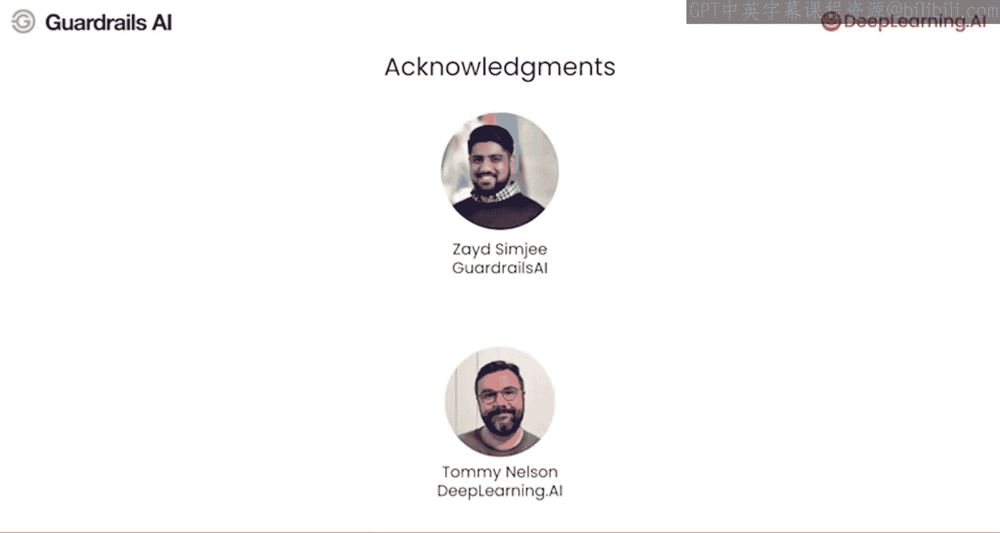

# 吴恩达《通过Guardrails实现安全可靠的人工智能｜Safe and Reliable AI via Guardrails》中英字幕deepseek翻译 - P1：1.intro.zh_en - GPT中英字幕课程资源 - BV1kEUtY5ELM

Welcome to Safe and Re AI via Godrails， built in partnership with Goddrail's AI。

Godrails are safety mechanisms and validation tools built into AI applications。

 especially those that use large language models or LMs。

 to ensure at runtime that the application follows specific rules and operates within predefined boundaries Godrails act as a protective framework。

 preventing unintended outputs from LMs in aligning the behavior with the developers' expectations。

They also provide a critical layer of control and oversight within your application and supports building safe and responsible AI。

This course will show you how to build robust guardrails from scratch that mitigate common failure modes of LM powered applications like hallucinations or inadvertently reviewing personally identifiable information I'm delighted to introduce Sa Rajp。

 who is CO and cofounder of Godrails AI and your instructor for this course。

Australia has been working on AI reliability problems for most of a career。

 including but selfja systems where reliable behavior is critical for the safety of pedestrians and riders and that's when Shia had first met many years ago。

She has also found the engineer at Prebase and so she's deeply familiar with building LM systems Welcomereya Thanks Andrew。

 it's great to be here I'm really excited to show you how guardrails can help you create reliable chatbot applications and help you realize the full potential of LLMs to power your projects I've told many teams are working to build innovative applications using OMs The availability of APIs to access powerful models like G4 cloudude。

 Gemni and many others has allowed developers quickly build prototypes which is great for early stage development。

😊，But when you want to move beyond the proof of concept。

 teams often encounter problems with the reliability of EOM that lies at the heart of their application。

The core challenge is that the output of LMs is hard to predict in events while there are techniques that have helped significantly things like prompting techniques or modify tuning or alignment methods like RHF or RAG techniques。

 all of these techniques have helped， but the core problem is they still can't fully eliminate output variability and unpredictability。

So this can lead to significant challenges， especially when developing applications for industry with strict regulatoryt requirements or for clients that demand high levels of consistencyDevelop often find that techniques like RLHF and Ra are insufficient on their own to meet the stringent reliability and compliance standards that are required from many realw world applications at Godriil's AI we work with many clients in sectors like healthcare。

 government and finance were really excited about the possibilities of LMs for their businesses but they can't use them in their products because on their own LLMs aren't trustworthy enough This is where Godrails come in These additional components of AI applications work to check that the output or input of an LLM conforms to a set of rules or guidelines。

 and this can be used to prevent incorrect， irrelevant or sensitive information from being revealed to users。

Implementing guardrails in your applications can really help you move out beyond the proof of concept phase and get your application ready for production at the heart of the guardrails implementation you learn in this course is a component called the validator this is a function that takes its input a user prompt and or the response from an OM and checks to make sure that it conforms to a predefined rule。

Validators can be quite simple， for example， if you want to build a validator that checks if the text contains any personally identifiable information or PII。

 you can maybe use a simple rex expression to check the phone numbers or emails or similar types of PII data。

And if any are present， then have the application thrown an exception to prevent the information from being reviewed to the user。

You can also create more advanced validators that use machine learning models like transformers or even other LMs to carry out more complex analyses of the text This will help you build systems that。

 for example， can help with chatbot stay on topic by checking against a list of allowed discussion subjects or prevent specific words from being included in anLMs response which is useful for avoiding trademark terms or mentions of competitive names。

 you can even use guardrails to help reduce hallucinations from LMs。

In one of the lessons in this course， you'll use a natural language inference or NI model to build a hallucination validator that checks whether the answer to a question in a rag system is actually grounded in the words of the retrieve text。

 This means that the source text actually confirms the truthfulness of whatever the Lm is generated。

 guardrails are very flexible， and you can make use of many smaller machine learning models to carry out validation tasks。

 This helps keep your application performant and actually results in higher reliability。

 than using Lms alone for some failure modes。 This course will walk you through the codinging pattern that we use to build guardrails and our company。

 And you'll implement individual guardrails for a number of failure modes。

 You'll also learn how to access many prebuil guardrails that are available on the guardrails hub。

 After completing the course， you'll be able to modify this pattern。😊。

And build your own guardrails that are customized for your specific product or use case。

 I'd like to thank Zed Simji from Godrail's AI and Tommy Nelson from DeepL AI。

 who have worked to create this course A lot of the companies worry about safety and reliability of LM based systems and this is slowing down investments in building such systems。

Fortunately， putting guardrails on your system makes a huge difference in terms of creating safe。

 reliable applications， so I think the tools in this course will unlock for you more opportunities to build and deploy OEMM powered applications。

Specifically， the next time someone expresses a worry to you about safety， reliability。

 or hallucinations of LM based systems， I think this course will help you answer in a way that helps reassure them。

So that let's go on the next video where you explore the basic failure modes of a chatbot。

