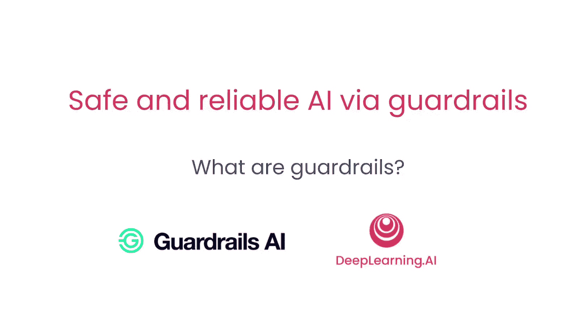
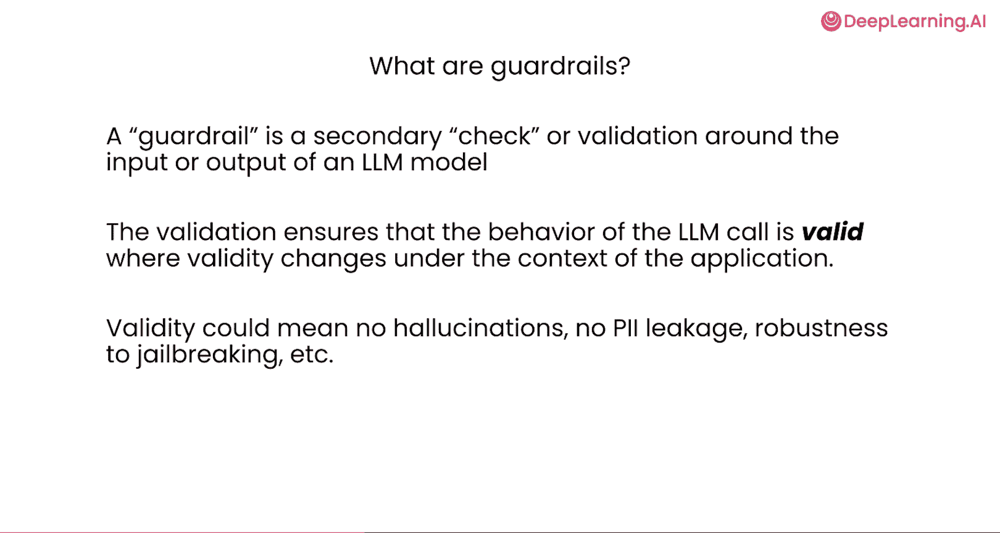
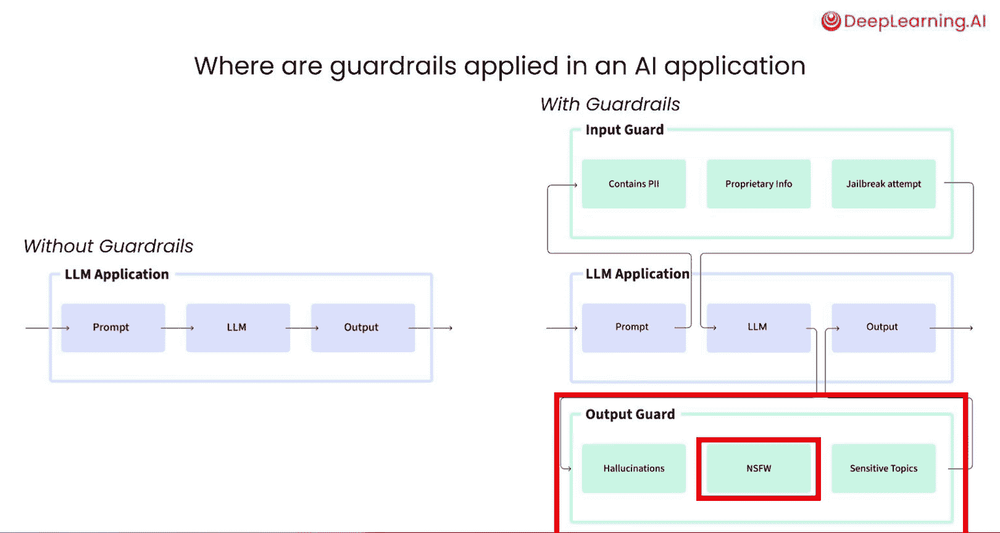
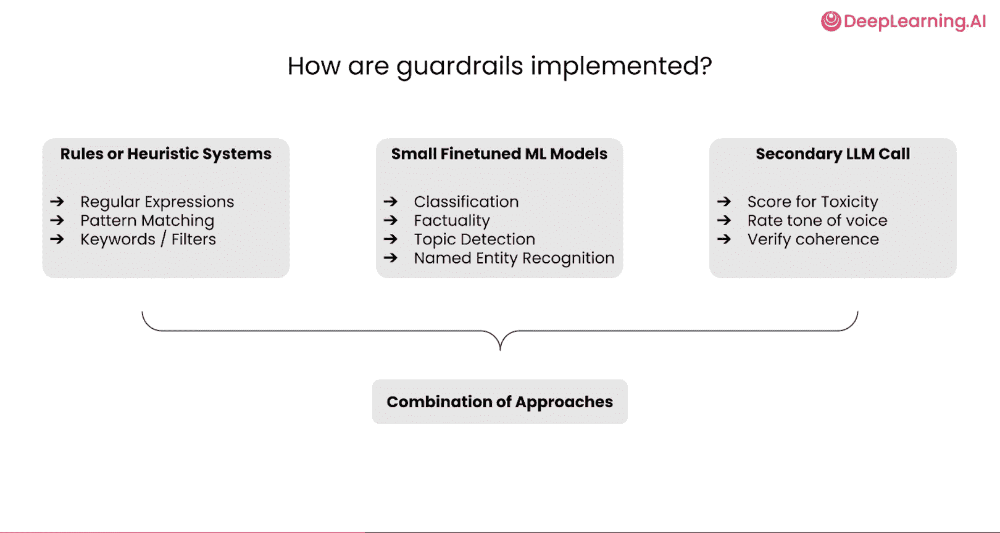
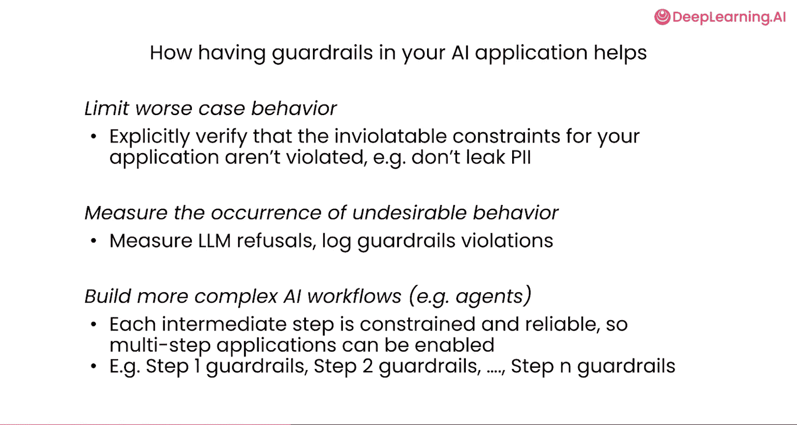
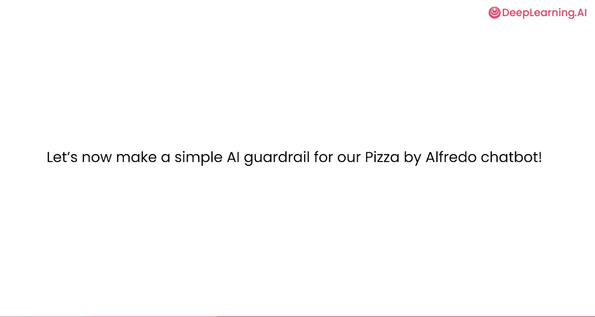

# 吴恩达《通过Guardrails实现安全可靠的人工智能｜Safe and Reliable AI via Guardrails》中英字幕deepseek翻译 - P3：3.what are guardrails.zh_en - GPT中英字幕课程资源 - BV1kEUtY5ELM

So you just saw a sample of the kinds of unreliable LM behaviors that can affect your proof of concept Jen I application。

 In this lesson， you'll take a deeper look at how AI guardrails can help you mitigate these problems by validating and verifying everything your application does。

 The first question we have is what are guardrails。

 guardrails are secondary checks or validations that ensure that inputs or outputs often Lm call is as expected when you're looking at like what an expectation might be you might be checking know something very。

 very trivial， like is my L output formatted correctly if it's like a simple string。

 does is it split into you like a list or something or if it's know maybe a Json output。

 like does it look like a Json output off the schema that I expect or it might end up being like a very。

 very complex expectation， which is making sure that your AI output isn't hallucinated and there are no jailbreak attempts that are detected。

 But essentially its。Not blindly trusting the LLM to do the right thing。

 but explicitly verifying whatever your expectation or whatever your success criteria out of that LLM maybe。

The previous lesson looked at your standard drag chatbot。

 If now you want to take that drag chatbot to a production ready stage。

 Where would you go ahead and apply your AI guardrails， So on the left。

 what we have is a very standard straightforward bare bones of an LM call where what you have fundamentally is。

 you know， you start with a prompt And if you're doing rag or something complicated。

 your retrievals from your recive database and your system prompt and everything else goes into this little box here。

 And then once you have this prompt， you send it over to your Lm， your LM will。

 you know do some nice next token prediction and then get an output。

 which you will end up sending back to the rest of your Jeni application， right。Now。

 the core idea behind guardrails is very， very straightforward。

 which is once again explicitly verifying whatever your Lm does。

 So now before you send your prompt over to your Lm。

 what you would do is send this prompt over to force this explicit input verification suite or input guard where that guard contains a number of guardrails that explicitly validate your expectations right。

 So once again， these expectations can be a lot of different things depending on what your building。

 maybe your expectation is if my prompt contains any P。

 I don't want to send it over right So that is an expectation that you can explicitly check or using a guardrail maybe youre to check like is this question or is this prompt something that is off topic and not what my chatbot is intended for Maybe even something more sophisticated。

 Like is there a jail break attempt that is detected in my prompt once you know that。😊。

Your prompt doesn't contain sources of unreliable behavior that will in turn make your application unreliable。

 Let's say you send that prompt over to your Lm once it passes through this verification suite your Lm does a thing and then ends up getting an output which once again you will first pass through do this explicit output verification suite or output guard which contains a number of guardrails that check for different types of criteria that you may have So the output side。

 maybe something else that you care about is like are there any hallucinations that are present in my text right so thats something you can test for Are there once again off topic responses or are there maybe profanity or unsafe outputs So you can explicitly test for any of these types of criteria failures So how does a guardrail really work under the hood they might be something as simple as a rules engine which might contain let's say regx rules I there this type of text that's present in my Lm output they might end up being something。

More sophisticated than that where there are small finetd machine learning models that are actually running within the process of your guardrail。

 maybe they're looking at named entities that are present in any text that you're passing to the guardrail。

 maybe there are specific topics or prone outputs etc that are present that you know you're checking via fine tuned ML model。

Some guardrails might also end up being secondary LM calls。 So you know。

 you might end up seeing a lot of like score this output on how well it answers the user's questions or how much it aligns with you know some rules that you have So that might be done within the scope of a guardrail very commonly though a guardrail might end up being a combination of all of these above technologies where you can mix and match what tools you use so then you can very accurately capture the behavior that you want from your LM application So with this lesson we looked at a lot of what guardrails are。

 how they really were。 But let's dive back to our first lesson where we really look at。

 you know how do guardrails help mitigate a lot of the unreliable behavior that exists in modern generative AI applications The first way they help is that they can explicitly verify what are the inviollatable constraints that are too high cost for your system to get wrong such as never leak P right There's actual financial。

s and risks for leaking PI in a system that shouldn't。

 And then guardrails can make sure that you know you're not just relying on your AI system。

 you're explicitly verifying that that invioltable constraint of not leaking PI is never violated Second is that even a few guardrails are running along with your system they can really measure the occurrence of undesirable behavior in your system such as you know how many times did my LLm refuse to answer a question or how many times did my LLm know get questions about like specific topics in my system So it's taking this idea of something that's very hard to measure。

 which is you know how well does my chatbot help resolve my customer questions and then really break that down into specific small checks that give you an idea of the overall performance of that system。

 The third key technique， especially necessary for as we move towards agent and multistep complex applications is that you can contain the cascading error that happens in a lot of these multistep applications and make sure that you really。

drawing a bounding box around what that AI model can do so that as you combine a lot of these LM calls in sequence you know their error is contained and you don't get that same compounding effect and then using all of this you know you really end up limiting the worstcase risk for your GenI application So now that you understand what guardrails are and how they increase the reliability of your application let's head on to the next lesson and implement your first guardrail this will be a very very simple example where we constrain the chatbot that we've been building to not reveal this exciting secret project that the Peria has been working on。

