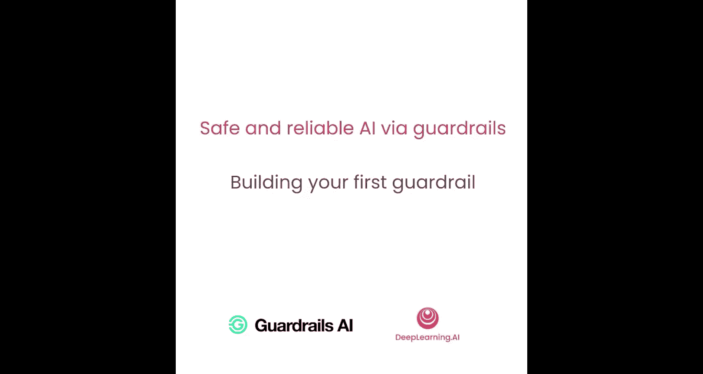
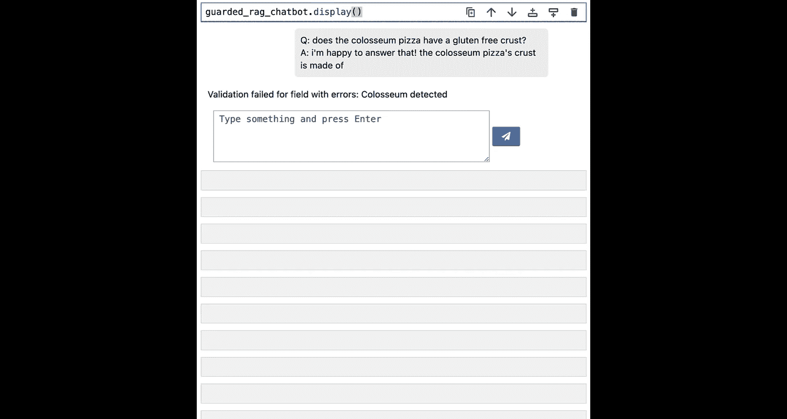

# 吴恩达《通过Guardrails实现安全可靠的人工智能｜Safe and Reliable AI via Guardrails》中英字幕deepseek翻译 - P4：4.Lesson 3 - Building your first guardrail.zh_en - GPT中英字幕课程资源 - BV1kEUtY5ELM

Now that you're familiar with the idea of AI validation and you've seen how guardrails are applied in applications。

 let's implement your force guardrail in this lesson。

 we will build a simple validator and a guard to make sure that your customer chatbot doesn't mention a very special project that your pizza shop is working on。

 we are just going to do a little bit of quick setup as we are getting into implementing our validator making sure that we are ignoring all warnings making sure that we have all the right libraries imported。

 you know， I'm just going to call out that for a lot of our coding views type hints。

 This is basically to make sure that your code is very。

 very readable for anybody else that comes onto your code and it's generally a good python coding practice that I recommend。

 You'll once again import openaiI to uses the Lm client and import the helper functions for the ragg chatdbot and vector database。

 And these last set of imports will help us set up a guardrail in code。

 So let us quickly take a look in more detail at what these。😊。

Classes are and what these functions are doing for you So in the last lesson。

 you saw this diagram outlining how godrails are built around your LLM。😊。

An input guard can check your user's input or any retrieved text before they are passed to the LM。

 and an output guard checks any response returned by the LM against your validation rules。

 As you begin implementing guardrails， you will need to know some terminology。

The validator is the core piece of logic that lies at the heart of a guardrail and implements the code to check that inputs or outputs conform to your specific validation rules。

 You'll often hear me call this a guardrail。A guard， on the other hand。

 is part of your application stack， and it handles the processing of inputs or outputs to pass to the validator。

 A guard can actually contain more than one guardrail。 And in this lesson。

 you'll use the validator and guard classes to implement a simple guard for your Ragchabot。

 So coming back to the notebook， you'll import some classes and functions from the guardrails AI Python SD DK。

😊，First of all， we're going to import the guard on fail action and settings class The guard is really straightforward。

 it is basically a container for many different guardrails so that you can mix and match multiple guardrails and then run them all at the same time and you can initialize the guard to run around your AILM call on the input or output side。

😊，An onve action basically specifies how you want godrails to handle any type of failure。 So。

 for example， if you detect hallucinations， do you want to block the LM for answering or do you want to just let it continue and then log on the backend that that failure occurred。

 all of this can be configured using the onve actions class。

 These next set of imports are what we need to create our own custom validator Now。

 if you're not creating your own validator and youre just using a guard without of the box validators。

 then you don't need to import these but this will help you basically make sure that you can return the right types of results like either a pass result if everything that the godrail is looking at looks okay or a fail result if you detect any specific types of failures。

 a valid result object is basically just for type hunting This is the main class that creates your validator for you。

 So this is the class that。You will you subclass and then add your own custom logic to and then finally register validator is so that our orchestration framework can identify where your validator is located if you want to refer to it by name。

😊，Now that all the imports are set up， let's now set up our simple ragg chatbot again。

So you guys have seen this before we are setting up our client setting up our vector database once again with all of the dumy documents about our Pizzeria in the shared data drive and then setting up our system message this is all the same as what you've seen before except for one difference that I'm going to highlight which is do not respond to questions about project Coliseseum and what is project Coliseum once again if you want to take a quick stop and then look at the shared data drive about project Coliseseum but project Coliseum is this exciting new Pa project that the Pizzeria is kicking off issues as a different type of flour different types of toppings etc that they're just not ready to reveal yet to their customers now that we have all of the components that we need to build our rag chatbot let's build it the same as we did last time and then take it for a quick spin where this time what we're really going do is ask it a question about project Coliseseum and then this is the question that I'm pasting in once again what really。

here trying to extract information about Project Colosum。

 you can imagine that maybe this is a competing Pizz areaia that needs to know what Alfredo's Pizza cafe is up to and then look at what our chat bond here if ended up revealing what the ratio of the pizza crust is。

 which I'm sure Alfredo's Pa Cafe is not going to be very happy about。😊。

This information leakage about project Coliseum is what we're going to try to address with our validator and let's build a very。

 very simple validator where all it does is to check if our input string contains any mention about project Coliseum and if it does just do not respond to that question right so let's start with writing our simple validator we're just creating a new class that subclasses the validator class from Godrails and then register that validator with the name to De Coliseseum。

😊，Awesome， now all we want to do is define this method of the class， which is the validate function。

 What the validate function does is it takes in a value。 So we're checking。

 does this contain any references to the word Coliseum and then some metadata we don't really need it for this validator later you'll see there is any examples that we need and it does some checking on this value and then returns a valid result which may be a past result or a fail result So in this case the check that we're doing is really really simple if Coliseum is in value in that case what we want to do is return fail result。

😊，What is a fail result contain It contains an error message。

 This is helpful for informing the user as well as the LLM why the specific value failed in this case Coliseum detected。

 and then optionally a fixed value you know tells Godrails how you want to handle any failures In this case。

 the fixed value is I' am sorry I can't answer questions about project Coliseum。

 Otherwise we end up returning a past result。And then a past result doesn't need anything。

That's our simple validator to detect if there's talks about Project Colloseum。

Now that we have a validator implemented， let us now use it in a guard。In this case。

 let's give our garden name， which is Coliseseum guard and then use this Coliseseum detector that we just build up。

 So what we're doing is telling our guard that if Coliseseum is detected what we want to have it is fail or raise an exception and then werun this on the input side So on messages。

 the default behavior for guard is to actually run it on the output Now that we have our guard created what we want to do next is run our guard through guardrail server。

 So guardrail server is a handy utility we have。That can help you wrap your LM API call。

And surrounded with these input and output guardrails that talked about in the previous lesson。

 the guardrail server can run locally or can be hosted online。

 and you can configure it to make one or more guards available to you for using in your application。

The guardrail server is also open AI API compatible。

 So if you're using OpenaiI or any other LM that's compatible with the Open AI SD。

 you can basically swap in an out guardrail server for it with one line and make sure your LM is now protected and safeguarded Every guard that you use in the server can be created with any custom guardrail that you just created。

 So for example， our Coliseseum guardrail or you can use one of the guardrails downloaded from the hub as part of your guard and we'll actually cover this in more detail a little bit later。

 So what we've done is you've actually already set up guardrail server for you that is running the Coliseseum detector that you'd crated。

😊，But if you're interested in setting up the server on your own。

 you'll need to install guardrails and then follow the instructions that we've included at the bottom of this nodeport。

 but it's a very simple configuration file and a single terminal command that you need to run。

 The server offers many benefits that are crucial for production rate application。

 Some of them are around easy cloud deployment and making it very。

 very easy to containerize your guardrails applications。

Can independently scale any infrastructure that's needed for running guardrails。

 especially any GPUus。 And then finally using guardrail server makes it very。

 very easy to wrap your LM API calls with any guards that you create because of the open AI SDK compatible and points that we provide so you can use it with any other open source models that are compatible with the open AI SDK。

 So now that we have some background on our guardrail server。

 all they need to do to make sure that we're using the guard in our application is set up this guarded client。

 So remember that earlier we had set up an openaiI client all we end up doing is setting up this base URL that points to the locally running guardrail server that runs this Coliseseum guard that we created。

 So let's go ahead and run this。And then now create this guarded chatbot。

 which is the same as what we've done above only swapping out the client for a guarded client。

And now once again， let's try to get our chatbot to leak some information。

 so I am going to copy paste the same prompt that I had used earlier that told me about my secret recipe。

And let's see what Garrails does now。 All right， I see that validation failed for a field with errors。

 Coliseseum detected。 Awesome， So this is really cool because before we got a chance to reveal any proprietary company data。

 we saw that somebody was trying to extract our secrets and just blocked it then in there。 Now。

 the guard you've written here is set to throw an exception， any time Colisesseum is mentioned。

 which will actually break the flow off the application。😊。

This was specified in the guard setup with the onve action property， which was set to exception。

But if you want， you can actually edit this code where you instead set on fail action to fix instead of exception。

 and you will be able to pass back a much more graceful message。

 which is the message that we set as the fixed value for the guardrail。

 So now that we saw the components of building you know a quick and dirty guardrail。

 let's look at how we can really build more sophisticated guardrails and address some of those unreliable behaviors that we saw earlier。

 and we're going to start in the next lesson with hallucinations。😊。

