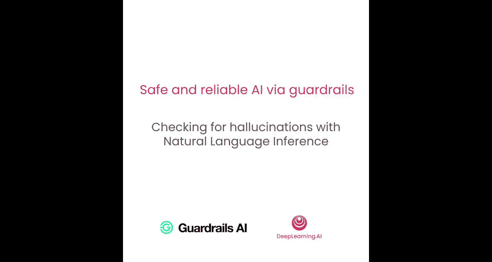
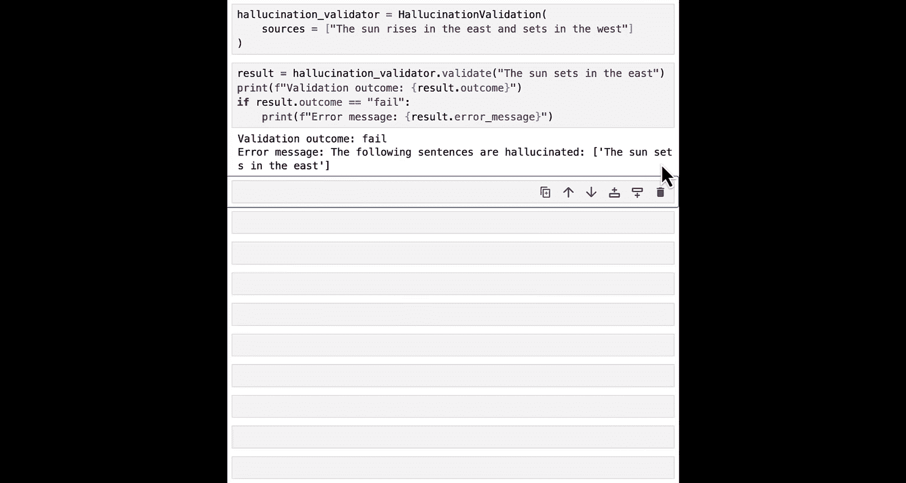

# 吴恩达《通过Guardrails实现安全可靠的人工智能｜Safe and Reliable AI via Guardrails》中英字幕deepseek翻译 - P5：5.Lesson 4 - Checking for hallucinations using NLI.zh_en - GPT中英字幕课程资源 - BV1kEUtY5ELM

。

So you just saw how you can build a guardrail to prevent a very simple problem。

 which is the mention of a forbidden word。 Now let's extend that and build a much more sophisticated guardrail that tackles one of the biggest problems of modern geneative AI systems。

 which is hallucinations in your pizza shop chatbot now。

 let's start by building the validator that actually detects these hallucinations in responses to customer questions。

 We've seen a lot of examples and news headlines of how hallucinations really harm the safety and effective views of geneative AI。

 So for example， some issues here with you the chatd GT lawyer that was very famous lawsuits from various politicians finds to large enterprises etc ce。

 And in this lesson， were going to go back to that example of our chatbot failing on hallucinations。

 So you saw this in our first lesson， but I'm just going recap your memory where we have the exact same system message Re database and un。

and we use all of this to set up our chat widget Let's look at how this chat bo does when I ask a question about you know how I reproduce a recipe and then we saw that it hallucinated a recipe that just didn't exist in our shared data right。

Okay， so now let's see how we can build a validator that helps mitigate hallucinations。

When we talk about hallucinations and mitigating hallucinations。

 we mean hallucinations specifically in the context of groundedness。

 which is when you have some sources that you as an organization are as a developer can trust are you know truthful and you can use them to truthfully respond to any questions that come in and once you have these sources how faithful is your LM within your ran chatdbo being to these sources are you talked about。

 NI models are essentially checks of how faithful some text is given some know higher level context。

 So the core idea with NI entailment is you know the premise and hypothesises。

 premise as it sounds like some context you can really trust and hypoes is some statement that might be related to the premise both of these act as inputs to the NLI model and the NLI model is basically a classifier that predicts that given the premise to be true how likely is it that the。

Ptheis is entailed。 That is the hypothesis is truthful or faithful to the premise。

 How likely is it that the hypothesis is contradictory or is not entailed from the premise and how likely is it that the hypothesis is neutral。

 So that is the core idea behind NI entailment and we are going to use this to detect if our language model is being truthful to the sources in our vector database。

 So to carry out natural language inference， you're going to import some additional machine learning libraries。

 N LTK， which includes tools for natural language processing。

The sentence transformer embedding model and the pipeline from Hu face transformers。Additionally。

 you'll import the various guardrails classes and functions that you saw in the previous lesson to allow you to build a guardrail that uses that NLI model。

 so let's set up our NLI model and you're going to be using Huging phase to do this。😊。

The NLI model you'll be using is the fine tuned NLI Providence model。

 which is uploaded to the Garrail AI Huging F organization。

And then we're going to create a hugging face pipeline out of this model。

 so all this model does is set up some muchne boilerplate to be able to use this model really easily when you run this in the notebook it will take a few seconds to download and set up the model weights so you may want to pause the video here。

😊，Now we have our local NI model set up within a pipeline。

 we can take this pipeline out for a little spin and see how it performs。

 so let's try it on a sentence that should be entailed。

 so I am going to paste in for my first example here the premise of sunrise in the east sets in the West and then a hypothesis that is entailed from this premise which is you know the sunrise in the east。

And now let's see what my NLI pipeline has to say for this。

And I'm just going to add a pretty print here， so let me try running this on my pipeline。Awesome。

 this was my premise。 My hypothesis and the result is entailment with a very high score of 0。869。

 Now let's look at a contradictory sentence。 So the only difference between these is in the hypothesises where the hypothesises now from the same premise is the sun rises in the West。

 Let's look at what our NI pipeline has to say about this and running our model in the background we get contradiction as our label once again with a very high score of 0。

864 so we get a hang of how our NI pipeline works。 and what we can do here is use this as the building block of our hallucination detection validator So what we need to do first is actually situate this Ni model within a broader system where that system make sure that our LLM output as well as the sources within our vector database are in the right format so that they can be consumed by this NLI model。

 So what I have here is a high level description of。😊。

how this is going to work I'm going to go into this in much more detail step by step but on a very high level what we're doing is like chunking and splitting up the sources of information that we get both in our LM output as well as in our vector database and then passing those pairwise chunks to our NLI model where if we get entail then the LM output isn't hallucinated and if it's contradictory then it negates whatever information is present in our sources and therefore is hallucinated。

😊，Alright so with that out of the way let's start building our hallucination validator This is a very complex validator with you know many moving pieces as we saw in the diagram so what we're going to end up doing is like build this step by step All we've done is set up the validate class same as we did for our previous example and both of these are just sts right now。

The second thing we need to do is implement sentence chunking when we get our LLM output。

 which is composed of many sentences and mine would be many paragraphs when we're validating it for groundedness we validate it on a sentence by sentence level and so what we need to do is split up our LLM output into individual component sentences as we see here so what I'm going to do is I'm just going to copy paste this here in our next cell and then add this additional function which I'm going to call sentence splitter this function basically takes in some text and uses the NLTK sentence tokenizer to return a list of strings and then my validate function is the main function where I implement the logic of my validateator So all I'm doing within my validate function is splitting the text into sentences as I see here。

And then passing。Okay， so now that I have each individual sentence available to me。

What I want to do next is see if that sentence is grounded in the sources that are relevant to that sentence and for that the first thing I want to do is find what my relevant sources are so as part of that。

I am going to add in this。Additional function to this class。

 which I am going to call find relevant sources and what this function does is it embeds both our source。

Sentences as well as are Lm generated sentences。I use the same embedding model。

 this is key that we use the exact same embedding model to embed both my document sources as well as my L and generated sentences。

 and then I iterate over each sentence。Compute the cosine similarity between my sentence embedding and all my source embeddings。

I sort my cosine similarities and then I pick my top five。And then once I have that。

 I then keep track of what are the five most relevant sources for each sentence。

Once I've implemented this function， we go back to our validate function。

 and I am going to add in a call to our find relevant sources function in our validator。

 where I pass in the sentences that we split in our last step。

 the sources that are relevant for those sentences， and then move on to the next step。

Our final step in building our validator is to figure out if the five most relevant sources for each sentence do in fact。

 entail or prove whatever is stated in the sentence。

 What we're going to end up doing here is to take our relevant sources as the premise we take each sentence as our hypothesises。

 which may be entail a contradictory from our relevant sources。

 and we use our NI model to make a determination of ground andness or not。

And since we've already set up our pipeline earlier。

 this is actually going to be a pretty straightforward function。

 which we' are going to call check entailment， so this function basically takes in one sentence。

 this is the LM output sentence and it takes a list of sources that are relevant for that sentence and this function returns a boolean where it's basically true if the NLI pipeline predicts a true label or entail label and falses if the NLI pipeline predicts either contradictory or neutral now that we have our check entailment function。

😊，Let us go back to our validate logic and validate function and。

The last thing we did here was find a set of relevant sources per sentence Now what we end up doing is iterate over each sentence that we have and see if it is entailed right so we pass in each sentence as well as a list of relevant sources into the check entailment function that we just implemented if we get a false value back。

 then we add this specific sentence to our list of hallucinated sentences。

 otherwise we add this sentence to our list of entail sentences。Before we can stop here。

We add our final logic check to our validator where if we have any hallucinated sentences。

 we return a fail result， as we'd seen in our last example。

Otherwise we return a past result the final thing we need to do before we can use this validator is to make sure that all of the sources。

 the embedding model and the entailment model that we're using is all accessible within our class so this is really really straightforward we first update the arguments that the in function can take where we make some space here for the embedding model the sources and the entailment model and then we're going to make sure that all of these three arguments that weve passed in are accessible to all functions of our class。

By making them class variables so what this looks like is making a self dot embedding model that is basically a sentence transformers initialized model using the model called all mini LmL6 there's a very small but very mighty embedding model that does really well on a bunch of legalboards sub dot sources equal sources and then self dot nI pipeline which is our initialized pipeline basically initialized from the entailment model that we passed in Okay so you built up this really great validator how can you check that it's actually working。

You can try out the validator by instantiating the hallucination validator class and passing in some source text as you see in this line of code。

😊，Then you can pass the hallucination validator， some text that you validate。

 the same as what we saw above， and then capture and print the result。😊，As you can see。

 the v either returns a failure here because the text isn't entailed。Great。

 so the validator is working now let's go on to the next lesson to see how to wrap it in a guard and then use it to test for hallucinations within the chatbot。

😊。

