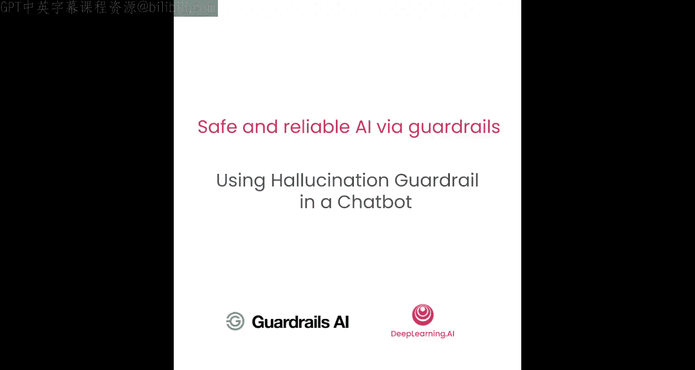
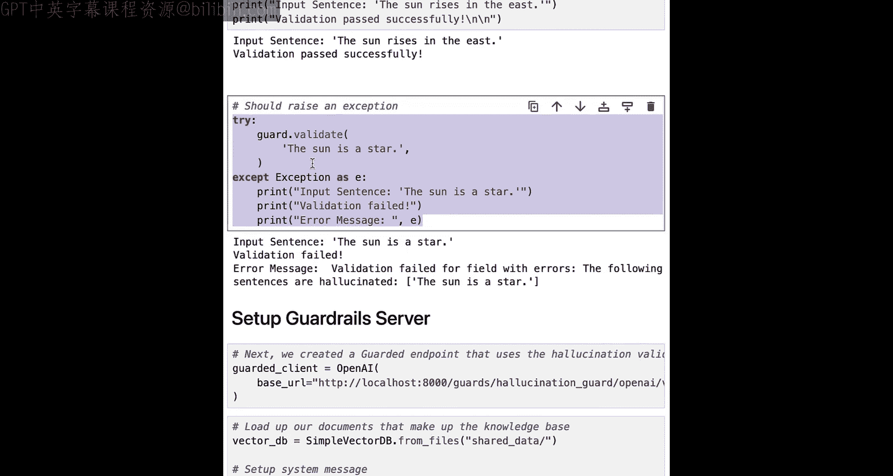

# 吴恩达《通过Guardrails实现安全可靠的人工智能｜Safe and Reliable AI via Guardrails》中英字幕deepseek翻译 - P6：6.Lesson 5 - Using hallucination guard in a chatbot.zh_en - GPT中英字幕课程资源 - BV1kEUtY5ELM

In the last lesson， you built out a validator that detects hallucinations in the output of an LLM。

 you use an NLI model to check whether the LLM output was actually grounded in your trusted documents。

In this lesson， you'll actually take that validator and build a guard around it。

 You'll then add that to the pizzaizz shop chatbot and see how it prevents hallucinations from being shown to your customers。

 Let's dive in Asome， say in the last part of this lesson。

 we took a look at how to build a validator that uses Nli added its score to make a determination of whether some Lm text is hallucinated or not。

 So all I've done in this part of the lesson up until now is they copied over some of those imports that we need for building that validator and then copy pasted that validator that you wrote in the last lesson。

😊。

What you're going to do next is use the guardrail that's we built as part of a guard。

 test it out on some of the examples that we'd seen before and actually use it to mitigate some of the hallucinations that we'd seen in our intro lesson。

 So you have seen how to use a guardrail as part of a guard and by itself as we saw in the last lesson when would you do one versus the other。

Using a guardrail directly is really useful when you're testing to see if things are working as you expect them to。

 this is precisely what you did at the end of the previous video。😊。

You can also use a guardrail directly if you want access to the output of the guardrail without lots of layers of abstraction in the metal。

 again for debugging purposes。However， if you wrap your guardrail inside a guard。

 you get several benefits。 First of all， a guard allows you to combine multiple guardrails in a single。

Execution step， typically for an application， you wouldn't just want a single guardrail。

 You will want to make sure that your chatbot doesn't hallucinate and also doesn't use any profanity。

A guard also allows a lot of benefits such as streaming support where you can allow the LLM to stream its output and then in real time validate like chunks as they're streamed out to you so that your users end up getting really fast。

 streamed results that are also protected and validated。

You can also get Open AI compatible LLM endpoints with a guard so that it's a single line of code change to go from using Open AI or an LLM directly to using a protected LLM endpoint instead。

You also get out of the box logging and error handlingling support so that every guard execution is logged and can be analyzed later to see how your application is performing overall。

With that， let's go back to our notebook and then see how you can set up and test your hallucination guard。

😊，All right， so you've already seen this to initialize a guard， we basically do guard。

 use and then copy in the class of our hallucination validation。😊。

And we're going to use the embedding model， all mini Lml6， same as our last default value。

 the entailment model we're going to use is again as our default value。

 the guardriil ZI finetuned andI Prodence model and for our first run our first test of this guard。

 we're going to try it out on some of those sources from our toy example of you know the sun rising and setting in different directions and how we've configured this validator is so that it throws an exception。

When it detects a hallucination。Alright， now that we have this initialized。

 let's try out this guard on the same toy example we've seen in the paths off where the sun rises。

 so we're going to try it out on this sentence which should not contradict the sources that we set up here in the guard。

😊，And let's take it for a spin， so we see that for this input sentence， the sun rayises in the east。

 validation passes successfully and the guard doesn't throw an error。Now。

 let's try this same guard on an example where we say the sun is a star。 So interestingly。

 this is actually not a false statement， but it's just not a statement that is supported from the sources that are given to our guard。

 right？ So this is factual but not grounded and very quickly we see here that validation fails with the error message that this sentence is hallucinated。

 because the sources that we use where sunrise in the east sets in the west and the sun is hot。

 So even though the sentence is true， it's non grounded or faithful， perfect。

So now let's use the guardrail that we just created from within the guardrail server and use it for mitigating hallucinations on our chatbo。

 just as a reminder for this lesson， we've actually already set up guardrail server for you to use the validator that you just implemented if you want to use this guard in your own server setup you'll need to add the validator you just wrote here to the server configuration file and you can look back at the earlier lesson for details on how to do that。

 Allright， so now same as before， let's swap out the earlier client that we've created for a guarded version of the client that uses the server that we just wrote So once again all we're doing is setting up the openaiI client with a different base URL that passes the LM API through this guard that we just created which currently is only running the hallucination guard。

Awesome， now that we have this setup， we can basically repeat the save instructions as before where we set up our vector database and our system message。

 you've seen this before in the past。😊，And we are going to set up a guarded version of our chatbot and then try running this chatbot on the same example as our last lesson where we pass in the same prompt we use that generated the hallucination and this time around we get this detailed error message for a validation failure because these sentences on how to make your own pizza。

 the instructions for how to set it up， etc is hallucinated。

 which is exactly what we expected by the way， for your own use cases。

 you don't need to rely on the validation failure messages here you can actually try to cache these exceptions。

 same as what we did over here。And then add more graceful error messages to control the flow of logic in your application。

So now that you've seen the pattern of setting up a guardriler validator。

 wrapping it in a guard and then serving your LM cause through that guard on the server。

 let's take a look at some of the other failure modes you saw in the first lesson。

 Join me in the next lesson to start with a look at how you can keep your chabo on topic。😊。

