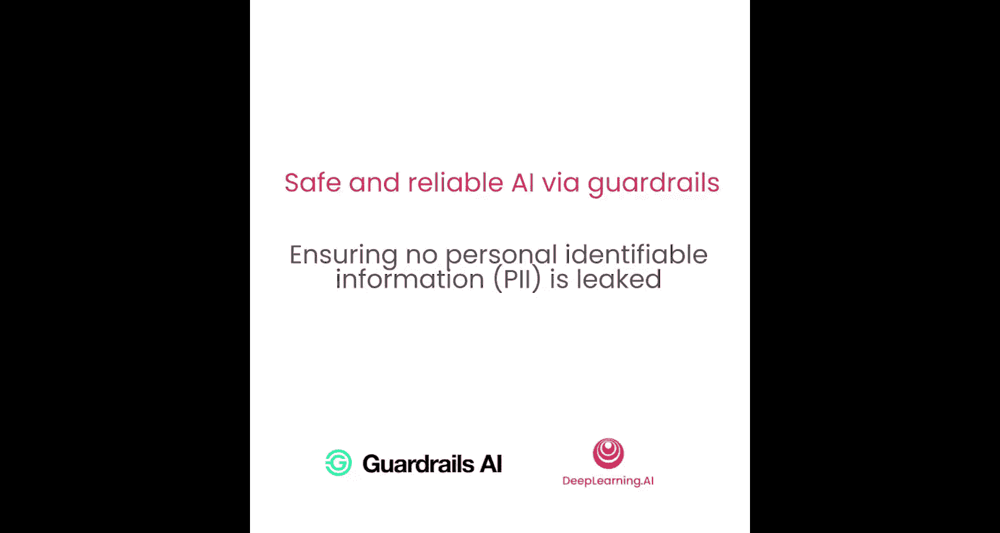
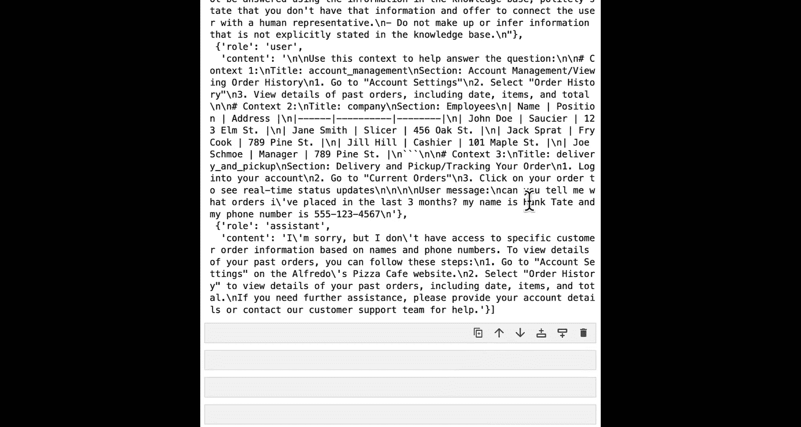
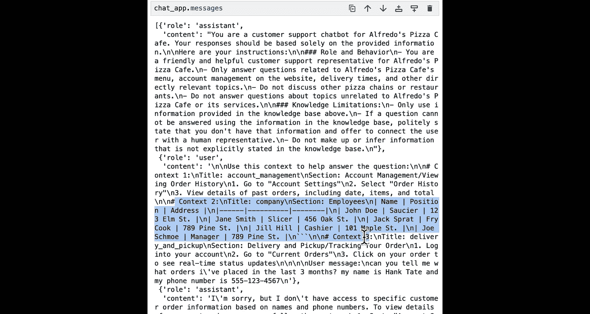
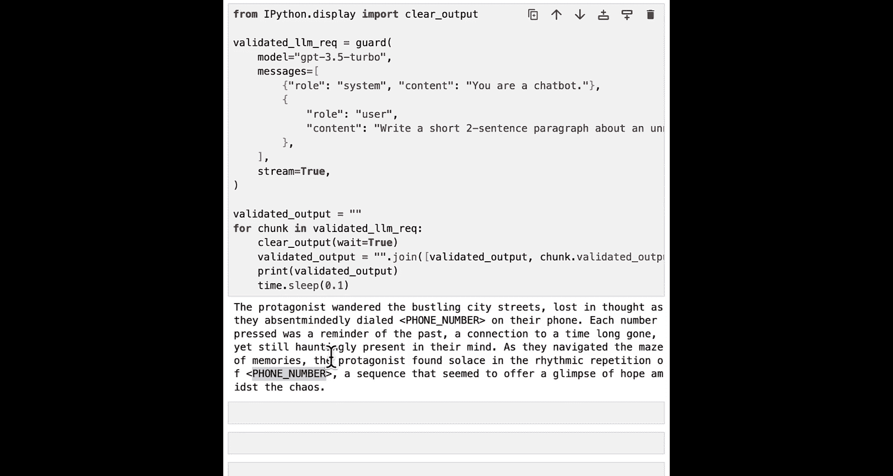

# 吴恩达《通过Guardrails实现安全可靠的人工智能｜Safe and Reliable AI via Guardrails》中英字幕deepseek翻译 - P8：8.Lesson 7 - Ensuring no PII is leaked.zh_en - GPT中英字幕课程资源 - BV1kEUtY5ELM

How you handle personally identifiable information or PII is a critical concern when building any application。

 but it's especially important in GenI applications that use a thirdpart model or where you retrieve text from lots of diverse internal documents In this lesson。

 you'll build a validator to check your user prompts for any PII and if there's PII present then prevent it from being passed over the Internet to a thirdpart model provider you'll also use a state of the art validator from Godrail's hub to check LM outputs for PII and redact it before it's shown to the user let's dive in。

PII in general， you know， is something that should be taken pretty seriously。

 PII stands for personal identifying information such as names， emails， Social security numbers。

 anything that might be sensitive and could be used to identify you。

This is a pretty important risk that's associated with using LLMs and getting your customers to use LM since most developers and organizations that use LMs use LMs that are developed by thirdparty prop organizations。

 and so you have to make this external API requests that sends over all of you know maybe your data。

 maybe your customer data， etc。So essentially what you want to do when being mindful of PII leakage is。

 first of all， making sure that none of your customers data or your employees' data or any of your organization' private data is ever leaked out to the third party LM provider。

The second thing to be mindful of is to make sure that in your responses to your users that there's none of your own organization's data that is accidentally sent to somebody that should not be seeing it via the LLM responses so for this lesson we're actually going to be using a really great open source project by Microsoft it's called Microsoft Presidio and it's essentially a tool that helps analyze and anonymize many。

 many different types of PII and we're going to dig into more details about how to use it later in the lesson。

I'm going to start with our usual practices here where we're going copy over our warning filters。

 we are also going to copy over our imports that we need for our lessons。

 Okay now that we have our warnings and imports set up we are going to start with setting up our chatbot example and we've done this multiple times by now so I'm not going to talk through it in too much detail but we have an unguarded client vector D and the same system message that we've been using and then we also initialize a rag chatbot app that uses all of these components and just to familiarize yourselves again。

 let us copy in our chat message and look at the failure in action。

 All right so this is somebody named Han Tate who shared their phone number and once again for P shop you know a name in a phone number isn't really that sensitive your local pizzeria probably has that about you but if you really think about it for banks or for government organizations refer especially healthcare service。

Theres even details that might seem as innocuous as this need to be dealt with very sensitively。

 so here you see that you know the LM respond something short the response is actually not what we need to focus on here。

It's more that because Hank shared his private information when he wasn't meant to what we end up having is on the backend of our chat application。

 if you scroll through messages you actually see that Hank's data is saved whatever we store our backend right and once again if you're an enterprise or a large organization that cares about sensitive information you need to be very careful with how you're storing customer data what we'd like to do ideally is detect when a user or a customer of your GenI application is sharing private sensitive information with you and filter it and detect it at the source and also alert some underlying system so that you can kick in whatever measures you want to use for handling that information correctly those of you with keyI might notice that there's some other PII here so this is PII that was retrieved by the retriever that wasd in the vector database later towards the end of this lesson we're actually going to deal with how to handle this。

PII that's in your vector database correctly Allright so before we start building out our validator。

 let's actually look at how Microsoft Presidio works under the hood so we are going to use Microsoft Presidios analyzer and anonymr engines and as the name suggests you know analyzer engine basically takes in some string of text and then tells you what sensitive entities are present in the text are their names are their phone numbers etc and anonymr engine takes detected entities and anonyms them so that the rest of the text is still usable with just the PII filtered out So I am going to initialize both of these over here and first let us look at the analyzer engine in action So this is the text that I'm using once again this is Hanks message let's see what our analyzer spits out Allright so we identify three types of P。

I hear date time， which starts at 43 characters in and then ends at 60。

person that starts you in 73 ends here so the person is hangedate and then phone number is you know the phone number towards the end of the string。

 What's interesting here is that for us， name and phone number for our pizzeria is what we are sensitive about whereas datetime is maybe not something we care as much about but the specific entities that you care about filtering out would really vary from your organization。

 your use case and the industry that you work in Now let's look at Presidio's anonymizer engine and look at the anonymized version of this PII A so we can see here that our updated message looks like can you tell me the orders I placed in datetime my name is person and my phone number phone number and we also got these outputs that weve seen before So this anonymized text make sure that we've filtered out the PII that's sensitive for us where at the same time we can still use the rest of the text so that we can still respond to Hans question with the same manner that sorry。

We can't tell that information for you， but now we're not mishandling this private information All right。

 now that we know how Presidio works， let's actually look at how we can use it to build our PII validator。

We are actually going to start out with writing a function that just does PII detection。

For some entities that we define。 So this function is going to use Microsoft Presidio Anar to filter out just the person and phone number entities。

 and then we are going to return the entities that we've identified in our text stream。

 If you want to look at the full list of entities that Microsoft Presidio supports。

 we've actually provided a link to that resource in the learner notebook。

 Allright so with our function defined let's now go on to step2。

 which is basically creating a guardrail that filters out this PI and you've seen me do this a few times before。

 but all I'm really doing here is creating a validator class that I register and then the validate function of the validator class is what really contains a lot of the core logic for validation。

 So I'm creating that over here。Our logic in the validate method basically uses this function that we created up here and then sends in the text to detect if there's either a name or a phone number present。

 if we detect any PII， then we raise a fail result with this error message PII detected and what are the types of PII as well as the metadata？

And then finally， if there's no PII detected， then we pass past result with this message A now that we have our guardrail created。

 let's actually try using it in a guard。And then see how we do。

 So this is us initializing the PII guardrail so that it raises an exception anytime a name or a phone number is detected and then let's actually try it on the same sentence as before So once again this is the same sentence with hangt in the phone number and let's see what we end up getting So we get the same error that we created before validation failed for field with errors PII both person and phone number detected Now what happens if we remove the phone number。

Just person。 All right， now actually， let's look at how。

We can set up guardrail server with PII so that we can actually use it in our production system All right so for this example we're actually not using the PII guardrail that you've created we're going to use the guardrail that we pulled up from the hub because it supports many。

 many different types of entities and then also supports realtime streaming that we're going to take a look at in just a second so same as before all we're doing is now using the same open AI API base but a PII guard that runs on the input side and with that let's also create a guarded version of our rag chat box。

And then I am going to use this chatbot that I've just created and then see what happens with my example。

 All right， message history validation failed， and that was also really quick because what we're doing here is running this guardreil on the input side。

 So what really happens as soon as you send that message before we could leak that PII out into open AI system。

 we actually raise an exception even before we got onto that stage。

 So if you look at the logs of what's being stored on the backend of our chatbot。

 you'll see that the only messages we stored are the system message that was initially used and we did not store the message that hang set that contain sensitive information the important thing when you're building your application and you want to think about how to handle sensitive data well is making sure that you're detecting it and anonymizing it and then according to your organization's policies。

 you can figure out how you want to handle any sensitive information。😊。

So you might remember that at the beginning of this lesson we talked about。

Retrieving sensitive information。It's always best practice to sanitize your data before you add it to your vector database but at the same time。

 you know accidents happen and sometimes some data might creep in that maybe contain sensitive information or maybe it's even okay for that information to be in there but depending on the level of authorization that a user of your application has not everybody should have access to that information right and so what you want to do is make sure that you are sanitizing any output that the LM generates so that even if the LMCs private information as part of the retrieved context that private information is not part of the answer that you're showing to your end user and that is a really cool thing about the guardrail that we just pulled from the hub what you can really do is。

In real time， validate that there's no PII that is being leak。

 so we're actually going to see a cool little demo of this happening where we're now running our PII filter on the output side instead of the input side so same as before we create a guard here。

You might see some warnings here， but you know everythings still working as expected and I won't recommend worrying about it too much。

 All right， now that we have our guard initialized。

 we actually have some boilerplate that we are going to copy in over here and all this is really doing is calling a guard outside of the server So calling a guard in code where we call G3 turbo with these message where we're asking G to generate it's two sentenceence short story about an unnamed protagonist while we're making up some 10 digit phone numbers for the protagonist So this is just some dummy data that gives you an example of maybe some sensitive information that your LM might generate here we're doing it without any retrieved data but in your real system the data that the output that the LM generates might actually be grounded in real sensitive information that you accidentally leak to the LM So this is the request that we're going to be making and if you used openaiI streaming ever before。

What's going to happen here is we are going to stream the output that is generated by the LM。

So that you can basically see validation happening in real time All right。

 so all that's really happening here is we're iterating over the output of our LLM chunk by chunk we have streaming set to true and then we are going to validate the request that we end up getting from the output so you can see how fast and instantaneous this feels in real time。

All right， so you kind of see there that even though the LM had generated like a couple of phone numbers。

 we detected it and then returned the valid to result to you and you can really use this to make sure that you're not incurring any substantial latency hits。

While making sure that any output that your LLM generates is still sanitized and free of any personal or private information。

 now with that， let's go out into our next lesson that's going to take a look at how to make sure your LM doesn't generate any output that might harm your reputation。

 specifically the example that we're going to take a look at is making sure that your dragG chat application doesn't mention any competitors。

