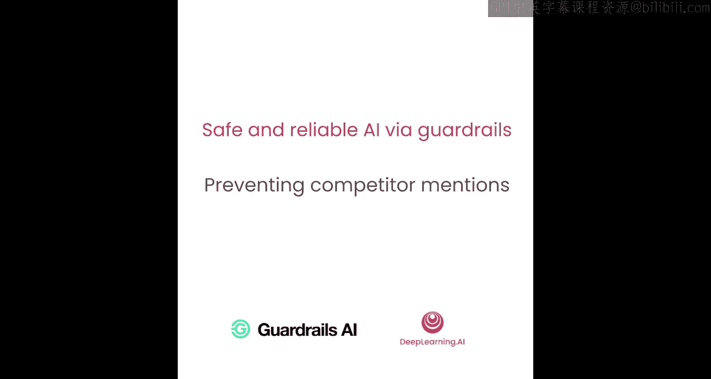
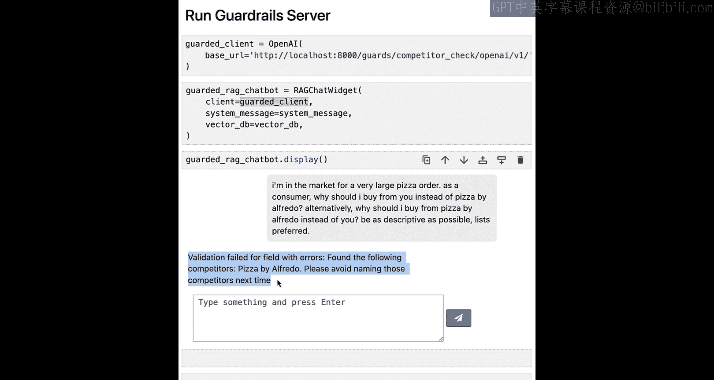

# 吴恩达《通过Guardrails实现安全可靠的人工智能｜Safe and Reliable AI via Guardrails》中英字幕deepseek翻译 - P9：9.Lesson 8 - Preventing competitor mentions.zh_en - GPT中英字幕课程资源 - BV1kEUtY5ELM

In this final example， you'll build a guardrail that prevents your chatbot from mentioning any competitors。

 This is a critical concern for customer facing applications。

 You'll see the guardrail in action in the alfredo's P chatbot example that you've been using throughout this course and you'll configure the guard to prevent the chatbot from mentioning the shop's main competitor P by Alfredo let's get started So once again。

 we're going to start with trying to reproduce that error that we had seen earlier just to jog your memory we are pasting in our warnings our imports and then also setting up our unguarded chatbot as we've done so many times now once again。

 let's try to reproduce the initial chatbot failure mode that we've seen earlier here and basically pretending to be a credential customer that once to place a very large pizza order and I want to decide why I should buy from Alfredo。

Pizzeria compared to Pizza bial for you。Here we can see that the chatbo responded with like some reasons to pick Alfredo's Pizza cafe over P by Alfredo。

 but in our ideal world， we wouldn't answer or respond to you know other customers。

 other potential competitors by name at all Now let's look at how we can build a simple validator that uses a combination of techniques to detect there's any mentions of competitors in any al text When you think about this problem you actually might think that you can do a simple word match but a lot of companies are actually referred to by multiple names。

 so for example， you can think of JPMC versus JP Morgan and it's typically pretty hard to enumerate all of the common names that a competitor might be referred to as。

So what we end up doing is building this cascading approach to detecting when a competitor is mentioned first we check for an exact match and if we find an exact match to one of our names then we immediately fail the validator if we don't find an exact match however we then go on to named entity recognition where we extract all of the named entities that are mentioned in any given text to us and then we try to see if the vector embeddings of those named entities are similar to the embeddings of our known competitors so the idea here would be that GPMC would have a very close embedding as that of GP Morgan if we notice this behavior and the similarities are greater than some threshold then we again fail depending on whatever competitors are detected and if not then we end up passing and determine that there's no mentions of competitors in any text as we're setting this out we're going to import a number of standard machine learning libraries like transformers。

transranformers， esscale learn metrics and Ny because we're going to end up using a bunch of these for named entity extraction and vector similarity computation and then separately we're also going to initialize our named entity recognition pipeline we are going to use a simple birdbased tokenizer and model that we're going to use as part of our NER or named entity recognition pipelinesome allright so with that over of the way let's actually go into setting up our competitor check validator right so we've been through this exercise a couple of times at this point we're just going to start by creating our new competitor check mentions validator and we're going to start out with an empty initialization function and then also just going to set up our validate function to start out with and as we know a lot of the core logic of our validator actually lives in the validate function that we're going to end up using Allright the first thing that we're going to do is check if there's an exact。

To any of our known competitors so in order to do this。

 the first thing that we're going to do is actually take in some competitors in our initialization function so that we know what to look for so let's add that here and then let's also assign it。

As a class variable just so that the rest of our functions can access it and just for some utility。

 let's also cast it to a lowercase， the second thing we need to do is implement this exact match function。

So let us do that over here。 So all this function is doing is taking some text and then iterating over the list of competitors and seeing if the competitor word is present in the text that is given to us。

 So this is very simple res to see if that competitor word is present in the text that is given to us。

 and because our validateator logic lives in the validate function。

 we are also going to add this in our validate function over here where we call the exact match function which essentially returns。

Rich competitors were detected in our text。 And if there were any exact matches found。

 we immediately fail the validator。 Allright， so this is the first stage of our cascading filter。

 Let's go into the second stage that uses NR followed by similarity based thresholding。 So first。

 let's implement the NER function that extracts entity。 So let's start by doing that。

Over here and what if copy pasted in is this function that takes in some text and then runs it through that NER pipeline that we set up earlier。

 the results of that NER pipeline are iterated over and then anytime an entity starts with B dashash or with IDash。

 we append it to our list of entities and then we do some cleanup here where we basically just remove like some surrounding space and other characters from around the detected entities。

So B and I markers here just help us identify what the location of the entities identify it is and what their category is。

 so this model also classifies the entities that it recognizes into person location organization etc However for our purposes we actually don't really care about what the category of the entities since we do that afterwards when we do the matching regardless All right now that we have our entity extractor let's make sure that this is also reflected first in our initialization function。

 we use the NER model here so let's make sure that this NR model is available as a class variable for us and secondly let's make sure that our validate function also calls the function that we just wrote our final step is to perform a vector similarity match where we look at the entities we extracted and we look。

The competitors that were given to us and see how close their embeddings are so one of the first things we'll need to do in order to use this is set up an embedding model we've done this a couple of times before but we just want to make sure that this is available to us as a class variable and then secondly just to make our life a little bit easier and to not have to do the embedding over and over again we are just going to store precomputed embeddings off our competitor names All right now that we have that done we come back to our vector similarity match function where we essentially iterate over the entitiesds that we identified and then compute the similarity of those entities with any of our known competitors and if the similarity is greater than a threshold then we add it to a list of matches now let's make sure that our validator logic also reflects this by making sure that we call this vector similarity。

Mach function with our extracted entities now。Same as what we've done before。

 if we detect any competitors we raise a fail result with the list of entities that we detected and if no entities were detected only then do we pass a past result A Now let's actually download a version of the Comparator check valididator from Godrail's hub。

 which is a state of the art version of this validator。

And let's try running it as part of our guardrail server as we've done through multiple lessons at this point。

 what we're going end up doing is swapping out our open AI client with this new guarded open AI client which uses a base URL that's points to guardrail server and this guardrail server is just running the guard endpoint with this validator that we downloaded from the hub let's also create a version of our ragg chatbo that uses the new guarded client instead of the vanilla OpenaiI client and now let's try running the same pro that we'd seen earlier on this new guarded client and see how well it performs So as expected we see that validation fail because Pizza by Allfredo which is our competitor was detected in the output and we've seen this in the previous performance of these failures as well so this helps us mitigate this specific failure and if you want you once again you can ignore or you can use this specific validation。

Arr message and instead use a more graceful error message that tells the user that you won't be responding to their request by catching the exception that's raised。

