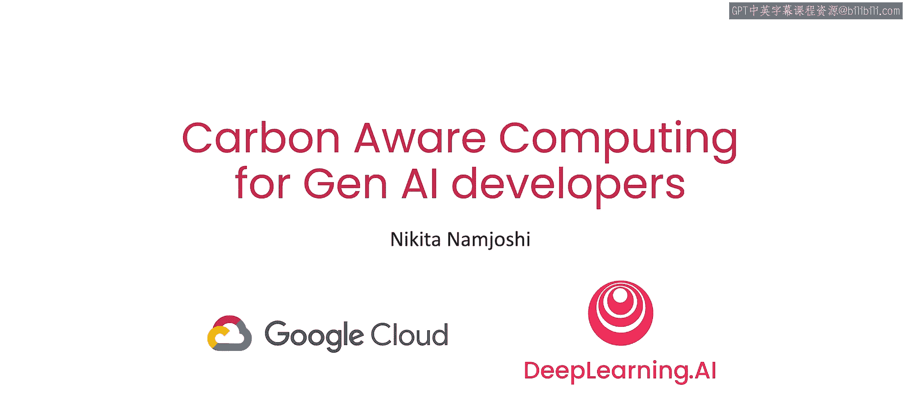
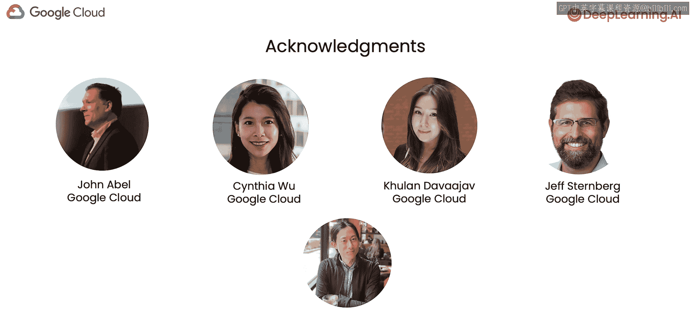

# 吴恩达《面向生成式AI开发者的碳意识计算｜Carbon Aware Computing for GenAI Developers》 - P1：1.intro.zh - GPT中英字幕课程资源 - BV16z421B75k

Welcome to Carbon awareware computing for JI developers built in partnership with Google Cloud。

 I'm delighted their instructor for this course is Nikkita Namjihi。

 who is a developer advocate at Google Cloud and also a Google Flow on the Permafrost Discovery Gateway。

 which is an initiative using AI to track Arctic Perbonrost 4。😊。

She's working on sustainability for over five years and has a lot to share about best practices for reducing CO2 emissions of AI workloads Thanks Andrew。

 I'm excited to work with you and your team on this。😊，Training， fine tutorning。

 and even serving your models， especially generative models can be compute intensive and energy intensive。

But it doesn't have to be carbon intensive if you know how to customize where and when you run your Moid jobs in the cloud。

 specifically， you can choose low CO2 energy sources to power your training jobs by running them in data centers that are power by low carbon energy sources such as wind。

 solar， hydro or nuclear。In the short course， youll learn how to query the breakdown of energy sources for different regional electricity grids across the world using the electricity Maps API。

 and also you learn how to train an ML model in the cloud at a data center that is powered by a high amount of carbon free energy。

Current estimates are that cloud computing accounts for around 2。5 to 3。

7% of all global greenhouse gas emissions。Further AI workflows are continuing to grow。

 which is a sign of how I feel this booming， but also makes it increasingly the importance that we do our part to mitigate emissions。

In this course， you learn about how carbon is quantified and reported according to the greenhouse gas protocol corporate standard and what that means for you as a developer。

 Nikquita will go through these concepts using the electricity maps API as was Google Clouds vertex AIS SDDK and carbon footprint too But the concepts you learn apply to multiple clouds or even if you're just using your local machine。

 Thanks， Andrew， I think it's a lot easier to understand our environmental impact when we do something like use a single useed plastic fork or water bottle or when we fly on a plane or maybe put gas in a car。

 but it's a little harder to grasp the impact from something like computing and machine learning where we're just writing code learning about carbon aware development has been really eye-opening for me with some simple steps that you'll learn in this course。

 you can make a significant difference on the carbon impact of your machine learning workloads。

 Also be sure to stick around for the end of the course where you will explore a dashboard that helps you。

😊。

Pick an optimal Google Cloud region based on how you weigh factors like carbon footprint。

 cost and latency。 The course will also wrap up with an overview of some exciting research in the field of sustainable cloud computing。

 Many people have worked to trade this course。 I'd like to thank from Google Cloud， John Abbel。

 Cynthia Wu Klan Davajav and Jeff Sternberg from Deep learningda AI Eddie Shu also contributed to this course。

 In the first lesson， you'll learn about energy and the electric grid as they relate to computing infrastructure and carbon emissions。

😊。

You'll also explore the carbon intensity of regions all around the world with an interactive map That sounds great。

 let's go into the next video and get started。😊。

