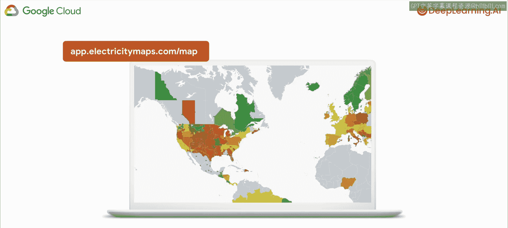
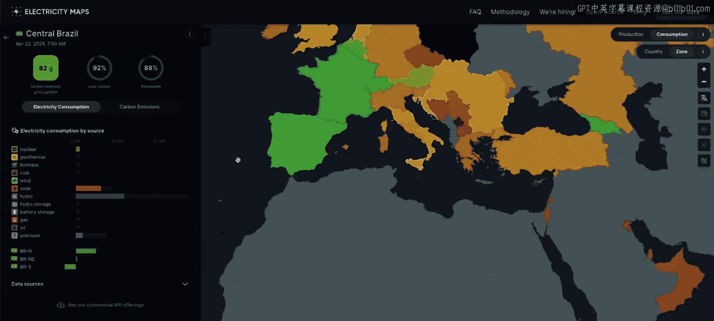
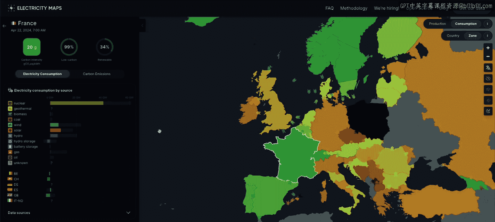
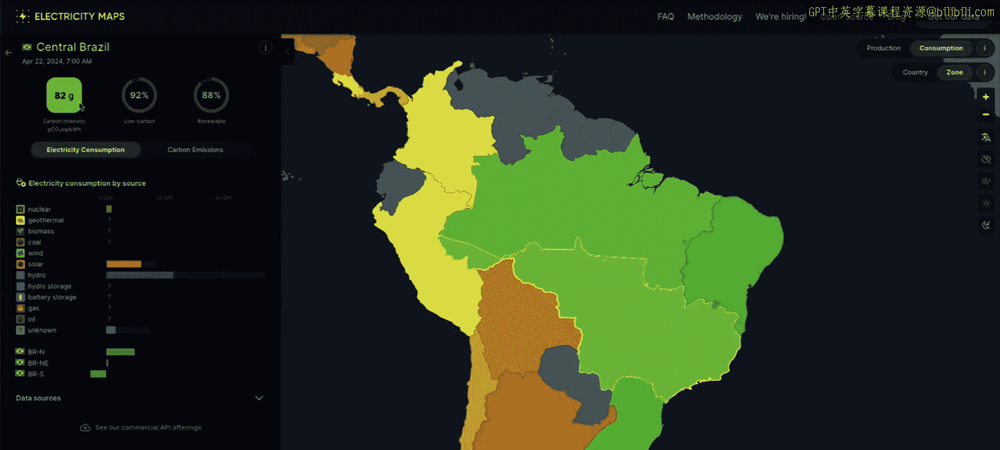
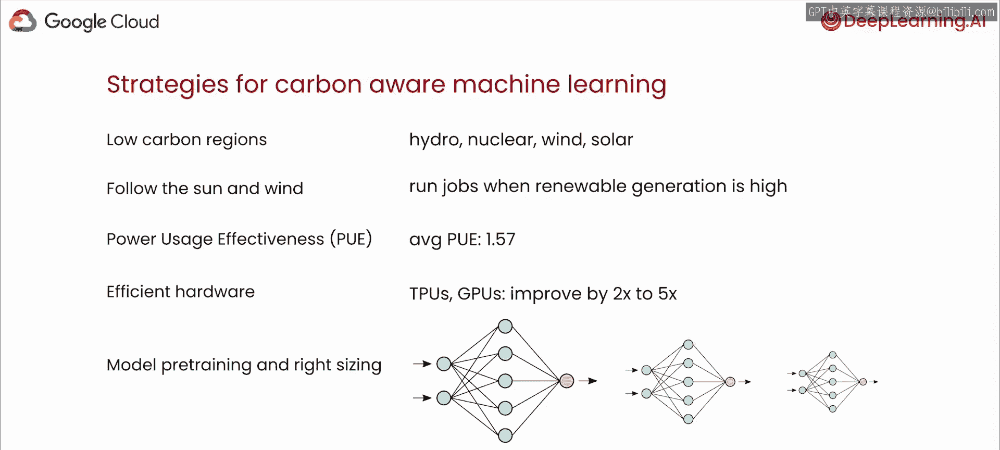

# 吴恩达《面向生成式AI开发者的碳意识计算｜Carbon Aware Computing for GenAI Developers》 - P2：2.carbon footprint of machine learning.zh - GPT中英字幕课程资源 - BV16z421B75k

To start things off， you'll learn some basics about energy and the electric grid as they relate to computing infrastructure and carbon emissions you'll see how model training and inference。

 especially when it comes to LLMs， can have a significant carbon footprint。

But you'll also get familiar with key factors and decisions that impact how large or small this carbon footprint is。

 Let's dive in。

Each step of the machine learning lifecycle has a carbon footprint Before we even get to writing code。

 there are carbon emissions associated with all of the physical hardware that we use to train。

 host and store machine learning models the CPUs GPs Ts servers and physical data centers creating all of this infrastructure requires extracting raw materials manufacturing shipping and there are environmental costs associated with each step This is often known as embodied carbon。

 which refers to all of the emissions produced in the supply chain for given item or product these emissions are usually the most difficult to estimate in the machine learning lifecycle because supply chains are pretty complicated Now what's a little easier to calculate are the emissions produced from training and serving machine learning models In other words。

 the emissions from compute Tra machine learning models are using them for inference requires energy to power and cool servers whether that's running pre-training on massive data sets to generate。

al LLM or training on custom data sets to produce fine tuneed models。

 or even at inference time when users interact with your large language model based application。

 All of this requires energy and all of this has a carbon footprint that footprint can vary pretty widely depending on a number of factors。

 For example， Stubbo at all at the University of Amherst found that training a transformer model with neural architecture search was comparable to the carbon emissions of five cars that run over their useful lifetime。

 If you aren't familiar， neural architecture search here refers to a technique for automating the design of neural networks。

But a paper from researchers at Google showed that training the same transformer model was actually closer to 0。

00004 car emissions， that's a big discrepancy， and it highlights how factors like training strategy。

 hardware and data center efficiency and location can have a massive impact on carbon emissions by being a carbon aware developer you can take steps to lower the carbon emissions from your machine learning workloads。

 and that's exactly what we'll learn about in the short course。

Note that while tracking and understanding emissions throughout the entire machine learning lifecycle is really important in this course you'll just focus on emissions generated by compute you'll learn a little bit about emissions on the serving side。

 meaning inference when your models are used in production but overall the focus will be on training because that's a little easier to calculate and there's just been more research so far compared to the carbon impact of serving models So let's zoom in and talk about why training and serving machine learning models has a carbon footprint in the first place In short。

 running any kind of compute workload machine learning or not requires energy in the form of electricity and this energy often comes from sources that release CO2 As a result。

 cloud computing actually emits more global greenhouse gas emissions in the commercial airline industry According to numbers from the shift project it's estimated that cloud computing accounts for 2。

5 to 3。7% of all global greenhouse gas emissions Note that these numbers are for cloud computing in general and not specifically machine learning workloads so here's a brief overview。

how our electric grid works energy is produced by power plants these power plants could be sourcing energy from carbon emitttting fossil fuels like coal or gas or non-carbon emitttting sources like wind or solar this energy then flows through a network of transmission lines and substations which is known as the electric grid to power our homes offices。

 restaurants， hospitals and even data centers the mix of carbon and non-carbon emitmitting sources of energy is different for each regional grid For example。

 France relies really heavily on nuclear Sweden on hydro and Texas on natural gas and even within a particular regional grid。

 the carbon intensity can change depending on the time of day because some sources like solar are only available during the daytime if you want to see what regional grid are're connected to and what kind of energy sources are powering your laptop。

 your refrigerator and the lights in your home you can check out electric maps they provide data quantifying how carbon intensive electricity is on an hourly basis across over 50 countries。

In in the next lesson， you'll use their API to get real time energy data about the grid and maybe even the grid that you're using right now。

 So let's jump over to the electricity Maps web app real quickly。

So for example， here is the energy breakdown for France at the time of recording this video you can see that nuclear actually makes up most of the energy on this regional grid and the current carbon intensity is 20 grams of CO2 equivalent per kilowatt hours that's a bit of a mouthful but it's telling you how much carbon is being emitted when generating a certain amount of usable energy now let's go explore another location so if we move down here over to Brazil you can see that Brazil has a few different regional grids there's north Brazil。

 northeast Brazil we have central Brazil if we click into one of these you can see that things look a little different where a lot of the energy is being supplied by solar and hydro and the carbon intensity here is 82 grams of CO2 equivalent per kilowatt hour。

Gms of CO2 equivalent is a measure used to compare the emissions from various greenhouse gases on the basis of their global warming potential by converting amounts of other gases like methane to the equivalent amount of carbon dioxide with the same global warming potential you'll often hear carbon used as this broad term refer to the impact of all types of emissions and activities on global warming。

 but CO2 is not the only greenhouse gas， so for example one ton of methane has the same warming effect as about 84 tons of CO2 over 20 years so we normalize one ton of methane to 84 tons of CO2 equivalent and note that kilowatt hours here is a measure of energy not of time。

Now here's the key insight。 We can figure out the carbon intensity of a particular regional grid We just saw how to do that using the electricity mapps app so if we know the amount of energy consumed by machine learning training or serving application and we know where this workload is being run then we can estimate its carbon emissions so how do we do that how do we estimate how much carbon is released from a machine learning training job well firstly get the carbon emitted per unit of energy again that's grams of CO2 equivalent per kilowatt hours and you'll often hear this referred to as carbon intensity so we get this for the electric grid that you're using to power your compute infrastructure then you'll multiply this number by an estimate of how much energy you use to train your machine learning model and then from that you can estimate how much carbon is emitted as a result of that training job so far you've learn how to find the mix of carbon and non-carbon energy sources powering the grid but what about the other piece of the puzzle how much power does it actually take to train a large language model we can measure the energy consumption in kilowatt hours。

With the following formula kilowatt hours equals hours to train times number of processors times the average power per processor where a processor may be a CPU but more likely for Ml training it's a GPU or TU Now note that if you're training in the cloud the energy used includes not just the electricity to run the compute but also the overhead to run the data centers such as cooling systems so you need to multiply by a factor called power usage effectiveness or PE to estimate the total electricity used for your training job PE is a standard way to measure data center computing efficiency It's calculated by taking the total energy used in the data center divided by the energy only used for computing So for example let's assume that your workload consumes 100 kilowatt hours and the PE of the data center where it's running is 1。

5 that means that the actual consumption from the grid is 150 kilowat hours where 50 kilowat hours goes to the overhead of running it。

Data center and 100 kilowatt hours goes to the hardware where your workload is actually running now as we just talked about to get from the kilowatt hours to an estimate of carbon emissions you multiply by the carbon intensity of the grid where your workload is running。

Now you might recall that large language models require a lot of pre-training hours and a lot of processors One way to quantify the amount of compute required is GPU years or the amount of compute that it would take a single GPU one year to complete one particular GPU that you can use as a unit of measurement is the NviDdia V100 GPU so for example。

 in 2020 GPT3 took 405 NviIDdia V100 years to train in other words。

 if you use a single NviDdia V100 GPU it would have taken 405 years to train GPT3 so it's a good thing they had more than one GPU available。

In the paper measuring the carbon intensity of AI and cloud instances。

 researchers estimated the energy consumed by different transformer models They trained a 6 billion parameter transformer model for 13% of the time it would take to train to completion and they found that that resulted in 13812。

4 kilowatt hours that's actually more energy than the average American household consumes in a year according to the US energy information administration the authors of this paper that estimated that a full training run would consume approximately 103500 kilowat hours large language models are big and theyre training on a lot of data and this means they can rack up a lot of energy use Now the good news is that you often aren't training a large language model from scratch with prompt engineering。

 you might be able to get a model to do what you need without running training or even fine tuning jobs but remember energy is still required every time use one of these models for inference to make predictions or generate text and the paper power hungryungry processing what's driving。

Cost of AI deployment， researchers estimated that the stable diffusion XL base 1。0 model generates 1。

594 grams of CO2 per 1000 inferences to put that in some context that means that every 1000 inference requests to this model is roughly the equivalent of four miles driven by an average gasoline powered car to make it easier to find more efficient models。

 the huggingface LLM perf leader board actually includes energy estimates and tokens per kilowatt hours and you'll see a pretty wide range and how much energy each of these models requires for inference。

There's also the ML Energy leaderader board which compares various open source models by average GPU energy consumed by each of these models to generate a response These leaderboards are resources you can use if you want to make energy consumption part of your large language model selection criteria。

So far you've learned about how GenAI and computing more broadly has a carbon footprint。

 you've learned where that carbon footprint comes from and how you can estimate it。

 Now you might be wondering， well why should I care what can I actually do about any of this I think that the idea that you as a developer can have an impact on these emissions might seem a little daunting at first I mean at the end of the day you're just running a job and a machine connected to some electric grid out there but there are actually strategies you can implement to be a carbon awareware developer for starters。

 one thing that really impacts the carbon emissions is the location where you train your model and the time of day that you train it As I mentioned earlier。

 different regional grids have different mixes of energy sources which also fluctuate throughout the day if you're running your workloads on the cloud this means that certain cloud regions are connected to electric grids that have a higher amount of carbon-fr energy sources operating on them as a result where you choose to train your models can have a big impact  different regional grids can have significantly different carbon emissions profiles。

Even regions that are geographically close together if you run a machine learning training job in a location that has 100% carbon-fr energy actually produces zero carbon emissions from compute in the next lessons will make this idea a little more concrete and see how to retrieve real-time information on the carbon intensity of the grid a more sophisticated strategy is not to just pick locations with low average carbon intensity but to run flexible workloads at times of the day when there's more carbon-fr energy available this technique is sometimes called followow the sun and wind and the basic idea here is to move workloads to times in places where there's a lot of renewable energy available this could mean that you delay running an MLl training job until later in the day when there's more renewable energy available like noon when the sun's capacity is at its highest but it could even mean something a little more complicated like pausing and resuming a workload to minimize total emissions throughout the course of a day or a week etc if you're training or hosting models in the cloud you can try to pick a cloud provider with a low PUE。

Again， that's the power usage effectiveness This number actually can vary pretty widely。 for example。

 the average Google data center PUE is 1。10 and can even be as low as 1。

06 in some scenarios while according to the Uptime Institutestitute's 2021 data center survey。

 the global average data center PUE is around 1。57 so that's almost 50% higher electricity and carbon emissions just around the same amount of compute Another strategy for being a carbonbonware ML engineer is to use efficient hardware the authors of the paper。

 the carbon footprint of machine learning will plateau than shrink site that using processors optimized for ML training like TPUs or some more recent GPUs like NviDdiaVi 100s or NviDdia A100s compared to general purpose processors can actually improve performance per watt by factors of 2 to5 and as we talked about earlier one benefit of GenAI is that even though the models are big and training takes a long time you usually aren't training from scratch。

You often don't need to train a model at all while the trend in GenAI has been to chase bigger and bigger models。

 more specialized and purposebut smaller models can often do the trick there are many different strategies for lowering carbon emissions across the entire life cycle of software and there's increasingly more interesting and illuminating research in this area but these are just a few important tips when it comes to machine learning so now let's get to coding and see how we can get access to real-time carbon data and train machine learning models in places that have more carbon-free energy available let's move on to the next lesson。

