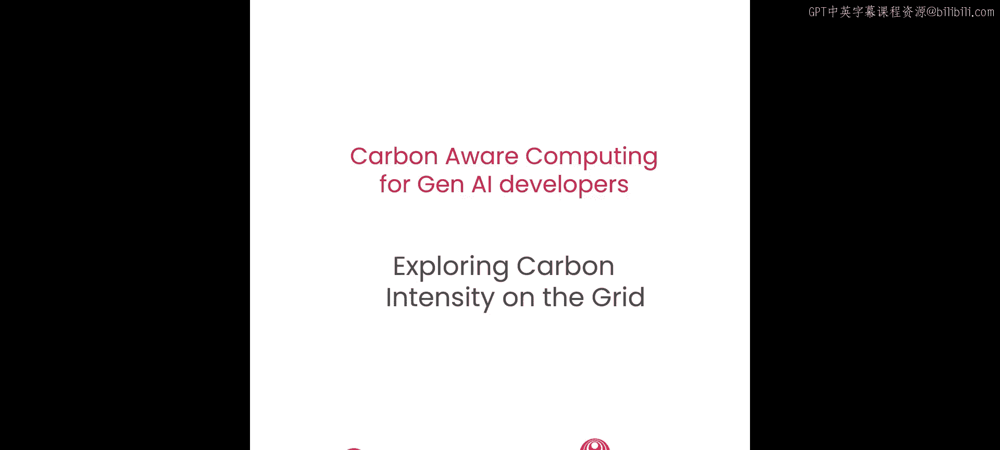
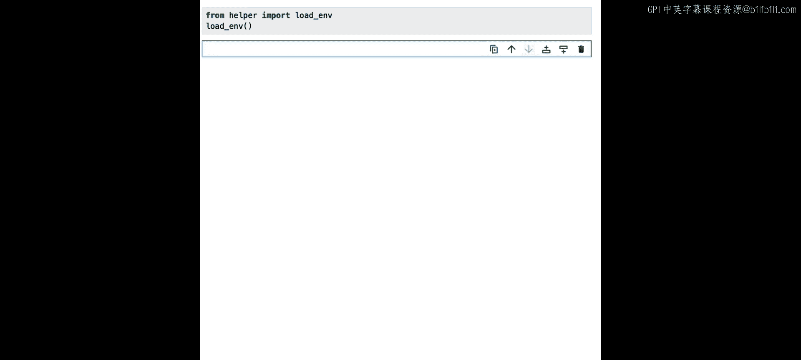
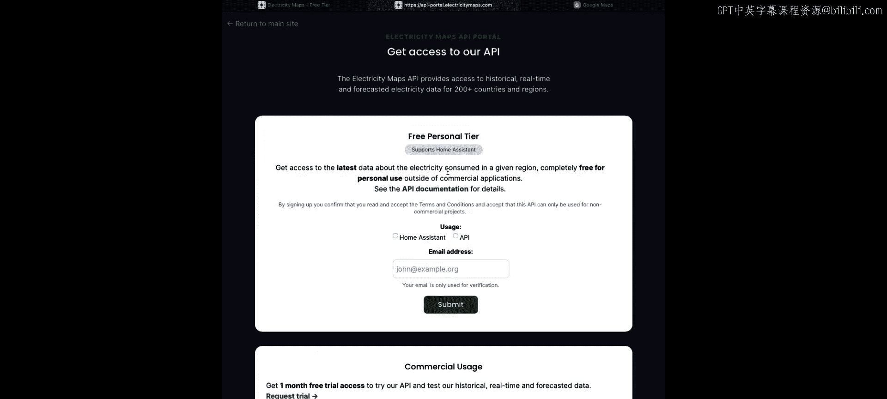
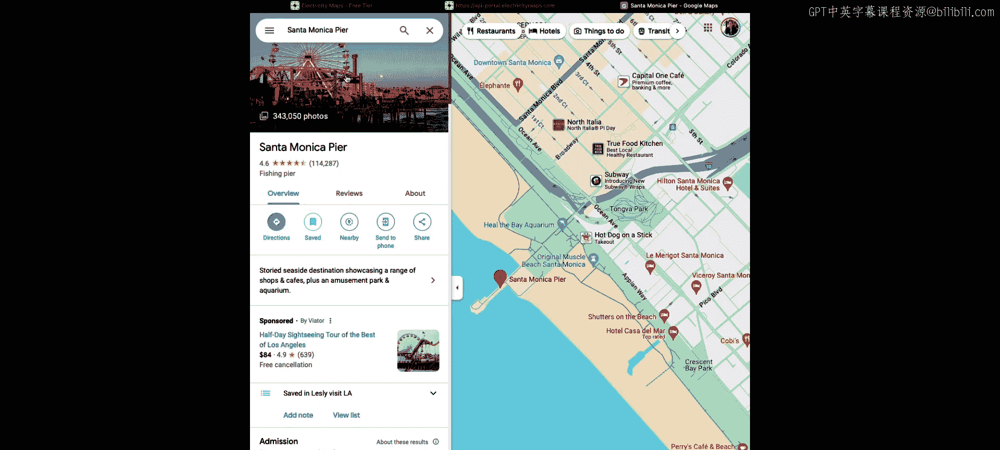
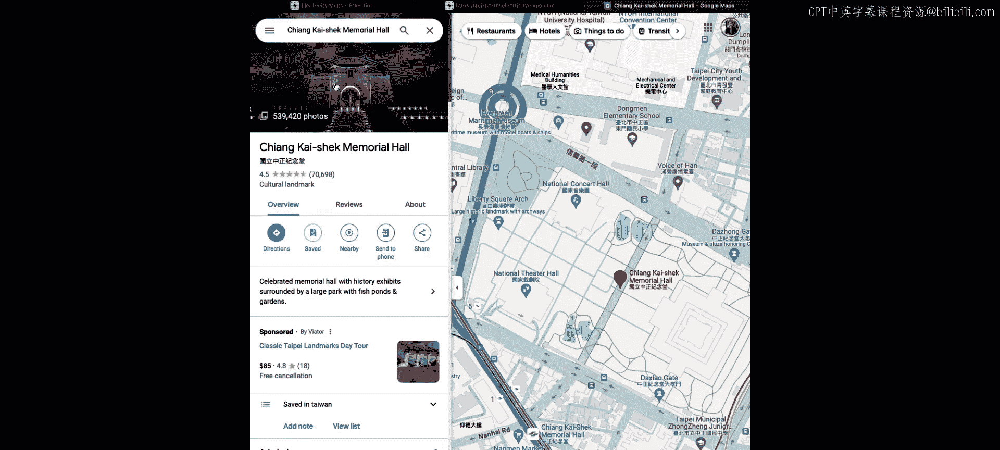
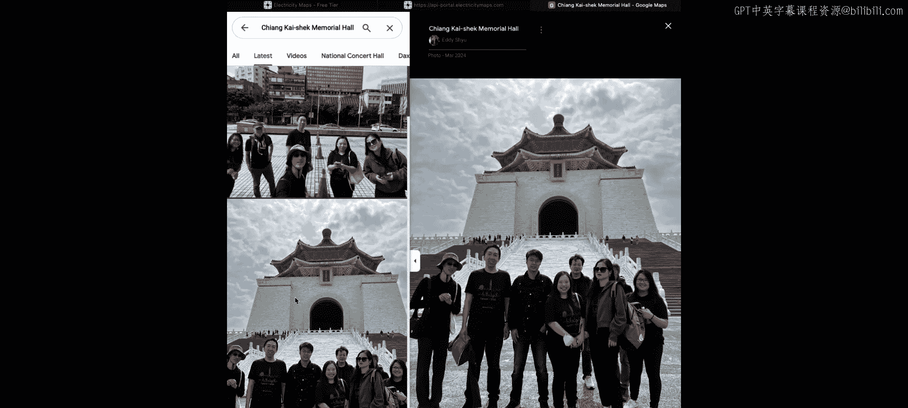
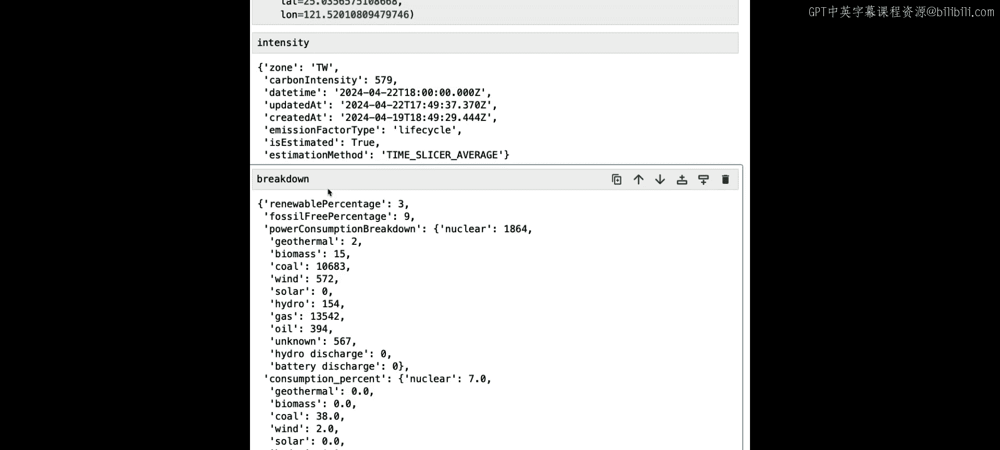

# 吴恩达《面向生成式AI开发者的碳意识计算｜Carbon Aware Computing for GenAI Developers》 - P3：3.Explore Carbon Intensity on the Grid.zh - GPT中英字幕课程资源 - BV16z421B75k

In this lesson， you'll use the electricity Maps API to explore carbon intensity on the grid。

You can use this API to get information on where electricity in a specific area comes from and how much carbon was emitted to produce it。

All right， let's get to coding。

So in order to use the electricity Maps API you will need an API key and we've set that up for you already in this environment so you can just import the load end function and execute the cell but let me quickly show you how you would get your own API key if you wanted to run this outside of this online classroom so this is the electricity Maps website and you can just click over here into get API key and you can get access to the free personal tier to explore this API on your own。

Back in the notebook， the first thing we're going to try out is the electricity mapps live carbon intensity endpoint。

 This endpoint will retrieve the last known carbon intensity in grams of CO2 equivalent per kilowatt hours。

 So in other words， it's going to tell us how much CO2 was emitted per kilowatt hours of electricity consumed in a particular area。

 And as a quick reminder when we say grams of CO2 equivalent。

 This is a measure used to compare the emissions from various greenhouse gases on the basis of their global warming potential。

 So to use this endpoint， you're going to specify the location of where you want to retrieve this information for。

 you can specify location using lalong coordinates or you can query with one of electricity mapps predefined zone identifiers。

 We're going to use the lalong coordinates。 So you can actually get lalong coordinates for any location if you open up Google mapps。

 So let me show you how to do that。 So here we are in Google Maps and I'm going to search for a location。

😊，We're going to look for the Santa Monica Pier in Los Angeles which is right over here and if you right click。

 you'll see that the coordinates pop up right here and you can click on them and it'll copy them for you so you can even do this for your own location and addition to coordinates you can even check out some of the cool latest pictures there that have been uploaded。

Al right， so now that we have these coordinates， we can hop back over to the notebook and what we're going to do is we're going to create a dictionary with these coordinates。

 so we'll say coordinates equals and then we'll make one key for la。😊。

And I'm going to paste in this number。And then we'll make another key for lo。

And we'll paste in the next part of this。And now that we have this dictionary。

 we're going to make a request to the endpoint using the Python requestquests library。

 we'll start out by defining the URL and this is just something that I got from the electricity Maps documentation。

 so I'm going to paste in what this URL is right now。

And you can see here that it's electricity maps and then this is the carbon intensity endpoint and later on in this lesson we'll use a different endpoint and you'll see that this this will change but right now we're going to use carbon intensity latest and the way you specify these coordinates。

 these La long coordinates is through query parameters。

 so we'll type question mark and then we'll type La， we'll extract out the value from our dictionary。

And then we'll do the same thing for longitude。 So we'll type another and side time type another and。

 symbol type one equals and then。Corines。And extract out that value。

 And we're doing all of this with F string formatting， as you can see over here。

 So let's go ahead and print this out。😊，To make this a little bit clear， I'm going to print out。

The endpoint。We'll add a little bit of text here just to make it a little bit easier to see。

And we'll print this URL。Let's execute this so you can see here this is the endpoint that we want to hit and it has our coordinates in here as a query parameters so now we are ready to make our get request so I'm just going to quickly import the requests library from Python as well as helper and that's because we need to make sure we pass in our API key that we defined earlier in order to make the request so we'll say request。

😊，Equals and we'll make a get request and in this get request we're going to pass that URL we just defined and then we need to pass in our API key to the headers value as o token so the way we do that it looks something like this。

We say headers equals off token and then the value there is going to be the API key。

 which will load from this function here in our helper file so we've made our request to the endpoint so let's print out the returned object We can format this nicely with JON。

So I'll import JSON and then we'll say。Chaase on that loads。And we'll print out the results here。

And this is just a way of viewing the content from this request in a nice dictionary So at the point of recording this。

 you can see that the carbon intensity on the grid in Los Angeles is 242 grams of CO2 equivalent per kilowatt hours so what that means is that if you are an LA you're emitting 242 grams of CO2 for each kilowatt hour of electricity consume Now note this is real-time data so you're probably going to see a different number than I do when you actually run this query and that's okay all this is live realtime data and the numbers are going to change throughout the day because the carbon intensity and mix of energy sources is just going to fluctuate throughout the day In addition to just saying the carbon intensity。

 what if we wanted to see what energy sources actually are contributing to these carbon emissions so this time instead of just receiving this one single number we're going to use a different endpoint and see what the different mix of energy sources is so we'll use the live power breakdown。

En point， and this retrieves the last known data about the origin of electricity in an area。

 So like before。You first need to define the URL and this URL is going to look pretty similar。

 I'll paste it in right now。 We'll use F string formatting to add in our coordinates。

 so this one is called power breakdowns we scroll up a little bit over here you can see that earlier we were using the carbon intensity endpoint and now we are carbon intensity endpoint and now we're using power breakdown So again。

 like before we need to pass in our coordinates as query parameters。

 I'm going to go ahead and paste them in this time and this is just saying get me the value for the key la in my coordinate dictionary and then get me the value for the key lawn in my coordinate dictionary and then we can go ahead and print out the URL just to take a look and it looks something like this So this is the power breakdown with our coordinates as query parameters Now that we've done that we are ready to make the request。

😊，So again， we'll say request equals。And we'll use this Python requests library to make a get request and we pass in the URL。

And then we need to pass in our header， which has our API key。

 and we can paste that in right now and we'll make our request。

 so let's go ahead and print out the content again。

So we'll call this power breakdown and we'll use JSON loads。

And we'll get the content from this request and then we can print this out。

And there's a lot of information that's come back。 this is a big dictionary with a whole bunch of information。

 so let's look at some of the most important keys here。😊。

The first key we're going to look at is called the renewable percentage。

 so let's print this out right now。And that's 67%。 So this refers to the percent of power consumption coming from renewable energy。

 So at this point in time， Los Angeles has 67% of its energy mix coming from renewable energy and that's actually pretty good。

 We can look at another key here， which is called the fossilfr percentage and if we print that out。

 we'll see that is actually also 67%。 So this refers to the power consumption coming from renewables and nuclear。

 So what this means is that there's actually no energy coming from nuclear right now。

 if there was you would see this number 67 be slightly higher because it would be whatever the renewable percentage was plus whatever was coming from something like nuclear。

 which is considered to be carbonfree but not renewable。 So again。

 these are all live numbers So you'll probably see something completely different when you're running these cells than what I'm seeing right now。

 Lastly， we can look at this power consumption breakdown。😊。

And this will show us here the breakdown of energy sources in this particular location。

 this is all in megawatts， so we can do a little bit of math and turn these numbers into percentages just to make it a little bit easier to understand so first to do this math we're going to import NI。

next thing I'm going to do is I'm going to grab one more key from this dictionary。

 which is power consumption total so if we scroll up a little bit。

 you can see power consumption total is right here。

 so let's grab that and call that total consumption so we can print that out we'll say total。😊。

Consumption and that's 1962 megawatts so that's the total consumption of electricity right now in Los Angeles so now we'll do a little bit of dictionary comprehension and what we're going to do is loop over the keys in this dictionary here and we're going to divide each one of these numbers by the total consumption and we'll multiply by 100 and that will give us a nice breakdown in percentages for each of these different energy sources so to do that the first thing I'm going to do is say for our keys here we're going to take the value and we're going to divide by total consumption and then we're going to multiply by 100 and again that's taking one of these values here divide them by the total and then multiply by 100 and we're going to round that off just to again make it a little bit easier to understand。

And we'll do this for each key and value in our power breakdown。Dictionary。

And we need to do this for the items。And then we're going to print this out and you can see here that now we have the numbers nicely reformatted for us in terms of percentages。

So actually a lot of energy right now is coming from solar on the LA grid right now。

 which is pretty cool Just a quick note， if you do see all of these numbers as being zero which can happen sometimes if you look at the results you might see everything is zero。

 that can happen if the energy provider for some reason just isn't providing data。

 this again is live data it's real-time data so sometimes the data sources。

 fail for some reason and you don't get anything back don't worry about it if you do see that on the off chance you do you can just try out another location or try this at a different time in the numbers should you should actually see numbers other than zero coming through。

So now it's your turn。 go find the coordinates for your location and query these endpoints to figure out the carbon intensity and power breakdown。

 So for example， let's try out a landmark in Taipei Taiwan。 This is the Chiang Kaaik memorial Hall。

 So let's go check that out。 we can even see some of the latest of what's going on here in case you're curious what this memorial looks like So now that we have that we can grab the coordinates and copy those to the clipboard back in the notebook。

 there are some helper functions， so you can import all these helper functions to get all of this information。

 So you don't have to run through all the cells all over again。

 So there's a helper function here called power stats。

 which is going to return the carbon intensity as well as an abridged version of all of the breakdown of carbon and non-carbon energy sources。

 if we import this helper function， we can call power stats。

 we get back the intensity and break for the coordinates here， which are the coordinates of。😊。

landmark in Taiwan。So let's run that cell。And then we can see what the intensity is。

 the intensity is 579， so it's higher right now than it was when we looked at LA。

And then we can type the breakdown。And we'll get a dictionary here which shows you the different energy sources powering the grid there。

 so we've got some coal， quite a lot of coal natural gas， we've also got a lot of solar。

 a little bit of biomass and you can check out these numbers so note that electricity maps doesn't have coverage for the whole world so if you do happen to be in a place where they don't supply any data you can try out a different location or someplace nearby or just a landmark or area that you're really curious about so with that I will see in the next lesson where we will put this information in action and actually train a machine learning model in a location that has a lot of carbon-free energy available I'll see you there。

