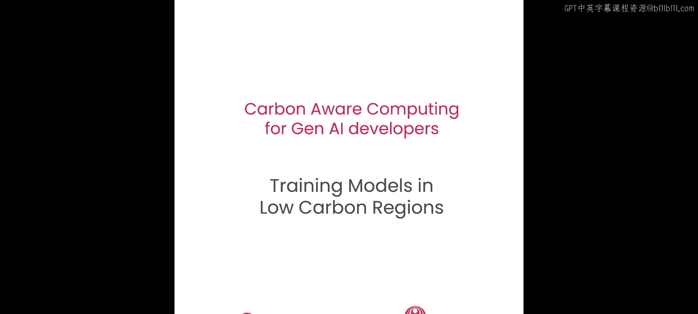
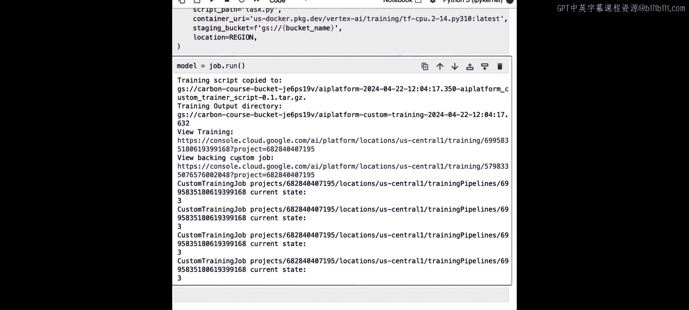
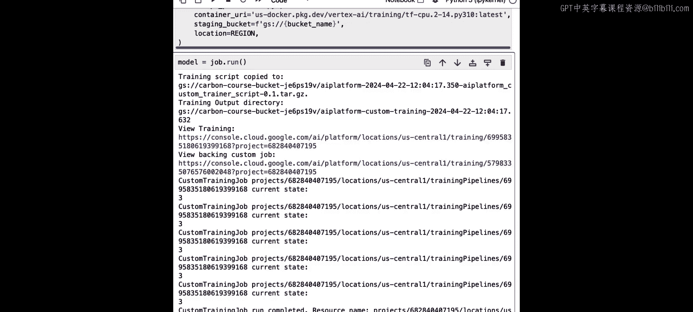
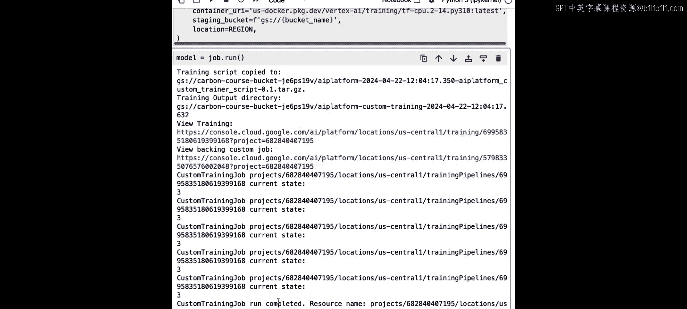
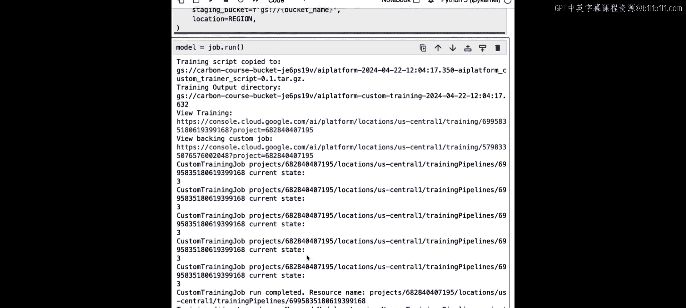
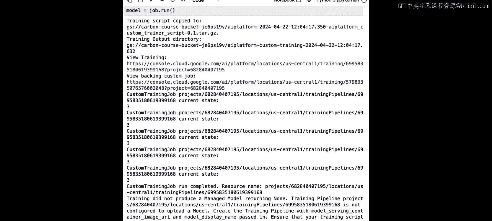
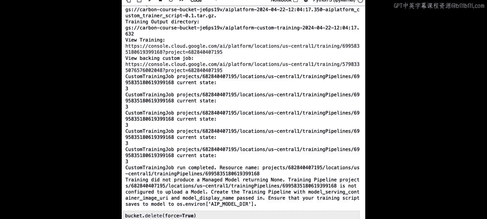

# 吴恩达《面向生成式AI开发者的碳意识计算｜Carbon Aware Computing for GenAI Developers》 - P4：4.Training Models in Low Carbon Regions.zh - GPT中英字幕课程资源 - BV16z421B75k

In this lesson， you'll try out one of the simplest and most impactful strategies for carbon aware ML development。

 training a model in a location that is powered by a high amount of carbon free energy。

This strategy doesn't take too much effort， but as you'll see it's got a pretty big payoff。

 so let's try it out。

The first thing we're going to do is train an ML model locally so in this notebook and we'll start off by importing some libraries。

 we've got NI， Psyit Learn and TensorFlow and then we will create our data set and we're going to do this using the MakeBlobs function in PsyitLn and this will make a training dataset with four different categories if you're interested in more background on these functions and the specific classification task here this is actually the same example that is taught in Andrews machine learning specialization so you can go and check that out this is in the second course advanced algorithms。

After we've created our data， we will go ahead and create the model and again the details here aren't super important for this lesson specifically。

 we just need to make a model and this one has two layers in it。And once we've done that。

 we can compile the model so this will look familiar to you if you've used Caris before if you haven't。

 don't worry about it too much Compiling is where you specify the loss function as well as the optimizer that you want to use so we can execute that cell and once we've done that we've created our training data and we've created our model and we can call model dot fit which is how we will train the model and so we'll pass in our training data that's xtrain and Ytrain and we're going to let this run for 200 epochs so this should train pretty quickly because it's a small model and not a whole lot of data we can scroll all the way down and you can see that the loss function is decreasing so looks like our model is learning something okay we're at the bottom here so the model has finished training。

Now one of the benefits of training in the cloud is that you have some flexibility when selecting where to train a model。

 so right now if you are located in someplace that is connected to a grid with really high carbon intensity you don't really have a whole lot of control over that electricity and where that comes from but you can take advantage of lower carbon grids by running compute workloads in the cloud so by using the cloud you have the ability to specify where you actually want to run this compute and you can select regions that just have more carbon-free energy available so that's exactly what we're going to do now we're going to run the same training code but we'll run it on Google Cloud and the reason we're doing that is so that we can select a data center location that has a really low average carbon intensity。

Now before we do this， we need to learn a few things about Google's machine learning platform vertex AI。

 We're gonna run all of this code on vertex and in order to do that we'll need to take three main steps we'll import and initialize the vertex AI Python SDK we'll write our training code to a file and then we'll configure and submit a training job that will run this code So let's run through each of these steps one by one and we'll start with step1 which is initializing and setting up the vertex AI Python SDK We have a helper function already written for you which will import credentials and project ID So if you are unfamiliar with Google Cloud here are a couple of basics so the first thing we do is we import AI platform and this is the machine learning platform on Google Cloud and then you'll need to call this initialized function where you pass in two things you'll pass in the project ID and the credentials The project ID is a reference to your Google Cloud project that's just where all of the services and anything you run any compute you use。

That's where all of it is contained and then these credentials here are secret credentials for authentication so again this has been set up for you already in the notebook you just need to run this authenticate function and once we've imported our credentials and project ID we can import the AI platform library and then we will call initialize and so we'll say AI platform in it。

😊，And we'll pass in the project ID。And then we'll also pass in our credentials。

And this is so that we can access the vertex AI services from this notebook。

So now that we've got the setup done， we're ready to move on to step2 So instead of running the training code directly in the notebook like you just did。

 we're going to write that code to a file and we'll run that file on vertex AI so let's first create a file we will use the notebook magic called write file and then I'm going to call this file task pi so what this means is that whatever code I put in this cell when I execute the cell a file is going to be created called taskask。

 pi where all that code will be written and I'm saying task pi here you could call a file something different on vertex AI this is just a general convention usually the main training code is called taskask pi but again it's a convention so you could call this file something else if you really wanted to but this file needs to have all of the key components of ourm training application so that means importing libraries and then it needs to have the code to create the data set and just as a reminder is。

The same code we just ran directly in the notebook。We need the code to create the model。

And then we need the code to also compile the model。

 which is where we specify our loss function and our optimizer and finally when we're done with all of that。

 we are ready to call model dotfi， which is what will actually train the model So when I execute this cell here you can see that it's created a file called taskask dot pi and if we were to take a look you can see this file is right here and we could even say cat。

😊，Tasked up Pi and you can see that this will print out exactly the code that we specified so we import our libraries。

 we create the data set， create the model and then train so U code is now in this one file so now that we've defined the training code we want to execute on vertex AI we have to create and run the training job and we'll do this using something called a custom training job in the vertex AI Python SDK so let me show you what that looks like。

😊，Al right， so we're going to create a custom training job using this AI platform library and there are a couple of important arguments we'll need。

 so the first is the display name， this is a string identifier for the job I'm calling this deep learning AI course example。

 but feel free to change the name if you like in the notebook。

The next thing we need to pass in is the path to our Pyon file。

 so this is script path and that is Task。 Pi， which is that file we just wrote and we just looked at that has all of our training code。

The next thing we need to pass in is a container UI。

 we need a Docker image to run our training job and we don't have to write a Docker file or anything。

 but vertex provides pre-built images for TensorFlow Pytorrch psyitLn and XG boost so here are just some of the images and if you click on them you can see here all the things that are included so this TensorFlow image here comes with XG boost it comes with a couple of other important libraries that you might need。

So we don't need to write our own Docker file or create a Docker image because vertex provides some out in the box images for a TensorFlow。

 XD boost， Pytorrch and psyit learn， so we're writing a TensorFlow model we can click over here to TensorFlow and you can see this is the most recent image and if you click over here on included dependencies we can see what else is included so it's not just TensorFlow we've also got XD boostost we've got a couple of other useful libraries that we might need so if you want to use this image you just copy right over here and this is what we're using in the actual notebook。

😊，The next thing we need to pass is the location and this is the data centerer location where we want this workload to run when we pick this in the notebook we are going to pick a location that has a lot of carbon-free energy available and then the last thing we'll need to pass here is a staging bucket so buckets are just places in cloud storage where you can store any kind of object and you need a staging bucket just for any intermediary artifacts that might get created during the training job so these are all the arguments that we need to pass so let's try this out in the notebook。

We're going to start by selecting the region where we want to run this training job。

 Google provides average carbon intensity values for each of its data center regions if we scroll down on this page over here。

 you can see the carbon data across different Google Cloud regions so here is the name of the region you can see where it's located and then it'll tell you the grid carbon intensity over here。

 which indicates the average emissions per unit of energy from the grid where this data center is connected so if we look at some of these regions over here。

 you can see that Europe West 9 is actually in Paris in the first lesson we took a look at France on electricity maps and we saw that there was a lot of nuclear energy here and so this is actually considered a low CO2 region some of these regions here have these low CO2 markers and they just generally indicate that these are regions that have a lot of carbon for energy available So this Paris region here is because it's in France and theres a lot of nuclear。

Energy available there We can also look at South America East one where you see Sao Paulo and we took a look at Brazil on the electricity Maps API as well and this one is also pretty low CO2 it's probably from a lot of hydro and I'm guessing some solar as well and then there's also Los Angeles which we looked at in the previous lesson when we were checking out Santa Monica which has average intensity of 202 but it's not considered a low CO2 region and I'm guessing that's because the。

😊，Energy mix fluctuates pretty widely throughout the day。

So we're going to go ahead and pick US Central One which is in Iowa and has a lot of wind energy。

 it's considered a low CO2 region， we're going to use that as the region for running our ML training job。

 so the first thing we'll do。I we'll define region。

And we'll call this US Central One so that's the Google Cloud region where we want to run our training job and the next thing we'll need to do is create a cloud storage bucket again this is a location for storing any staging artifacts that get created along the way in our training job but before we do that bucket names do need to be totally unique so we're going to create a unique ID which will append to your bucket and this is just to avoid name collisions with other learners so I'm going to import random import string and then we have this handy function over here which is going to create this unique identifier。

So if you execute this cell， you can print out UUID here。And this is my unique identifier。

 so hopefully yours looks different， the ways this function didn't work。

 but this should create a unique identifier and so we'll use this when we create our bucket name。

So in order to create the bucket， the first thing we need to do is import the。Storage Python SDK。

 so we'll say from Google。cloud import storage， and then we need to create our storage client。

And we'll do that by calling storage。 clientient and to this。

 we need to pass in the same things we passed earlier when we were initializing vertex AI。

 we need to pass in。Our project ID？And we need to pass in。Our credentials。

And then once they've done that， we can execute this cell here。

 and now we just need to come up with the name for our bucket。

So I'm going to say bucket name and we'll use F string formatting。Call it carbon course bucket。

And we'll add to the end of it here that unique identifier。

 so this unique identifier is really important if you leave it off and you just try to create a bucket called Carbon Co bucket or you can vote another bucket。

 you will probably run into a name collision and you will get an error later on。

 so make sure you include this unique identifier here。

And we can take a look now we have this bucket name here and again yours will look different because you'll have a different unique identifier there。

 but once we've done that we can use our storage client to create a bucket。😊，And when we do that。

 we will make sure we create it in a specific region。

 so we'll say location here equals region and region was US Central One which we set up here。

 which is where we want to run the training job and that's important because we need to create a bucket in the same location where we plan to run our training job so once we've done all that we are finally ready to create this custom training job so we're going to call it job and we'll say AI platform。

Custom training job and now we'll pass in all those arguments that we took a look at on the slide。

So that starts with a display name and this is a name that you can make up for yourself if you want。

 I'm calling it Deep Learning AI course example。The next thing we'll do is we'll pass in the path to our Python files so that was tasked Pi then we need to pass in the container UI and this is the Docker image that vertex provides out of the box for us so we'll just paste that in there and then we need to specify our staging bucket so this is going to be the name of our bucket that we just created here it'll look something like carbon course bucket and then your unique identifier and this GS Co slash slash here is just a way of identifying a Google Cloud storage bucket so that's what that looks like。

And then lastly， we need to specify the location and of course this is really important because this is where we are specifying to train our model in a region that has a lot of carbon free energy available。

 and that's the US Central One region。So once we've done that。

 we can execute that cell and finally we can call job。run。So let's do that。Job。

 run and when we execute this cell， what's happening right now is that behind the scenes。

 vertex is provisioning compute resources。 it's running the training code that we wrote in that Python task。

 Pfi and then once all of the training is completed it'll ensure that the compute resources get deleted when the training job is finished the logs here are going to print out a few different things you'll see this link you won't be able to click on this link since you're using an online classroom。

 but just for reference if you do this in your own projects you'll be able to see the status of this training job how long it's taking this training job will probably take about three and a half minutes to complete you can also see the Docker image that you use to train it and just track the progress right here in the cloud console。

😊，Now this job is going to take probably around fiveishch minutes is my guess。

 so it will take a little bit longer than it did to actually just execute the cell directly in the notebook and that's because provisioning the resources adds some extra overhead that overheads gonna to feel pretty dramatic here since this model is so small and it trains so quickly and the code runs pretty instantly in a notebook but that's of course not really representative of real world training scenarios and those more realistic scenarios where your training job takes a lot longer the overhead is amortized that just means the overhead per training job will be much smaller over multiple jobs Something else to keep in mind here is that you'll notice that we had to create a bucket in the same location where we actually run the training job and that's because generally you want to store data in the same location where you actually run your compute you're running a really Oheav job you wouldn't want the carbon savings running in some faraway low carbon region to be out。

By moving data across the world So machine learning training jobs are workloads that are pretty well suited to a strategy like this because they're batch jobs and they aren't supertime sensitive。

 they don't have these latency requirements like you might when you're serving an ML model where you probably want the region to be close to your user traffic so for a batch job like training you can sometimes be a little bit more flexible when choosing where to run your program and where you also want to store your data so you'll know that the training job has completed when the log stop printing out and it looks something like this and that just means that we finish training or model on vertex AI and with that you've seen one of the simplest and easiest most effective strategies for carbon- awareware computing and that's just taking whatever you plan to run and making sure you run it in someplace that has a lot of carbon-free energy available So before we wrap up this section here we need to do one more thing which is delete the bucket that we just created just to clean up all these extra resources in this online classroom environment so we'll call bucket delete。

And we're saying force equals true because the training job did write some kind of intermediary staging artifacts and files to this bucket So in this lesson we took one of the simplest but also one of the most effective measures for trying to reduce our carbon impact from our ML training jobs we took a look at the Google cloud documentation to find a region that had an average low carbon intensity and that's retrain our ML model again。

 this is a really effective strategy for lowering your carbon footprint when it comes to compute In the next lesson we're going to try something a little different and we're going to use some realtime data to inform our decision of where to train so I'll see you in that next lesson。

