# 吴恩达《面向生成式AI开发者的碳意识计算｜Carbon Aware Computing for GenAI Developers》 - P5：5.Using Real-Time Energy Data for Low-Carbon Training.zh - GPT中英字幕课程资源 - BV16z421B75k

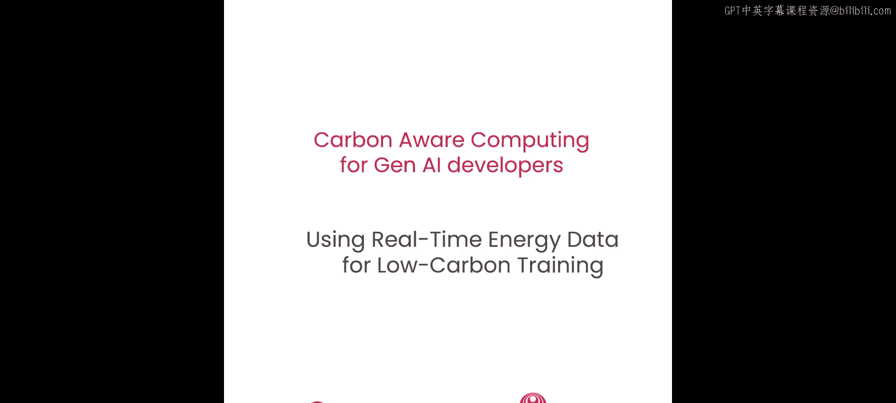

Next， you're going to build off the previous two lessons and use real time data from electricity mapps to inform your decision for which region to train an ML model in。

 Let's check it out。

So now that we've run a vertex AI training job in this low carbon region， US Central One。

 let's actually go ahead and take a look at what the real time carbon data is for that region using electricity maps。

So like we did in the previous lesson， we're going to import requests and JSON。

 which we need to make the request to the endpoint and then take a look at the content that was returned and then we will use our helper function loadend to get access to our API key so we will load in the API key and let's go ahead and call that API key right here so we have this easily accessible for when we want to hit the endpoint just by the way this is if you were to print out API key。

 what you would see it wouldn't be a real API key that you could use。

 it's been hidden for the purposes of the online classroom so if you try and print that out you wouldn't actually be able to use it just a quick note。

So like before we're going to need some coordinates to pass into the electricity Maps API endpoint Now of course I don't actually know exactly where this Iowa data center is located。

 but I can come up with some rough coordinates as an estimate。

 so let me show you how you might do this。Back on the page we looked at earlier with the carbon data across Google Cloud regionion。

 you can see that each Google Cloud region has a location。

 so some of these are a little bit more specific than others。

 some are actual specific city names Iowa is a state in the United States if we go into Google Maps and type in Iowa。

And find a location there maybe like one of the biggest cities and this should be good enough for us to estimate the electricity mix of the grid that this data center is connected to so here we have some coordinates in Iowa and the next thing we'll do here is define our URL and this looks similar to the previous lesson we have the carbon intensity endpoint and we pass in our La lawnwn coordinates here from our coordinates dictionary。

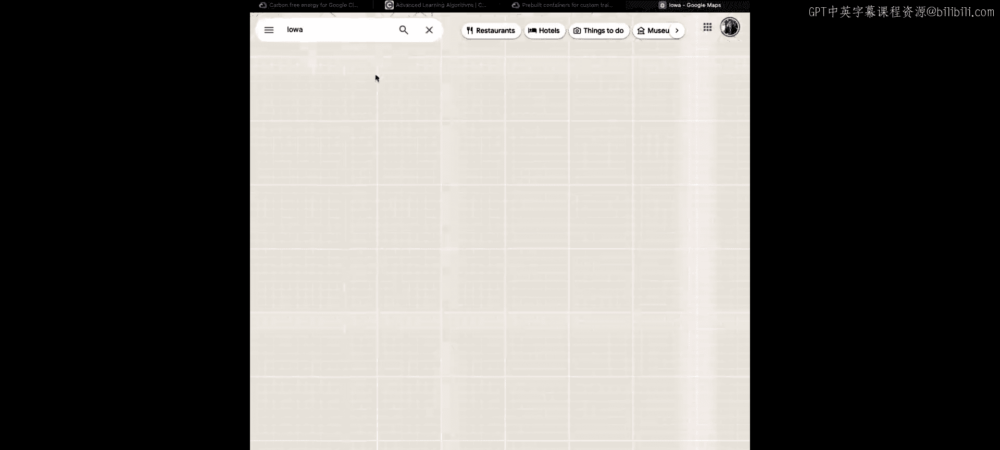

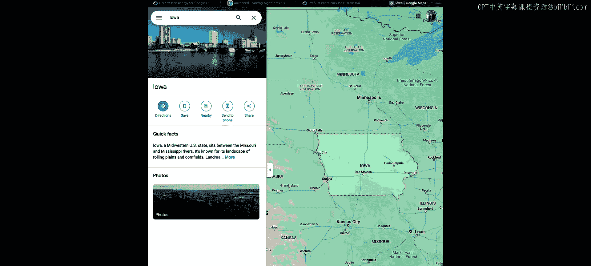

Let's run this cell and now that we have our URL， we are ready to make a request。

 so we'll say request equals。😊，Request。get and we'll pass in the URL we'll also need to pass in the API key。

And we can now take a look at the content that was returned， so we'll use JSON loads to do that。

And we'll extract the content。From the request， and when we print this out。

 we can see the zone and the carbon intensity， which is 431。

So on this documentation page it says it says over here that the grid carbon intensity on average for US Central1 is 445。

 so right now what I'm seeing is 431 so it's a little bit lower than the average again this is all live data so you'll probably see a different number here。

So now let's try something a little different。 We've had a chance to take a look at some of these different regions in Google Cloud and see which ones have average low carbonbon intensity。

 but what if you wanted to use real-time data to select a region to train in or what if you only wanted to run a training job when there's a region available with carbon intensity below a certain threshold or what if you are using a cloud provider or location that just doesn't provide indicators for lowcarbon regions like you can get in these Google Cloud Docs in all these scenarios where we need some more customization we can think about ways to creatively use the electricity mapps API to help us make an informed decision so I'm going to start up by making a dictionary with some of the Google Cloud regions supported by vertex AI and their coordinates and again these aren't coordinates of the actual data center location itself I don't know where those are located but they're just coordinates roughly in the same area and on the same grid so we'll create this dictionary here and basically think of this as a list of options。

Now want to find the region that has not just low average carbon intensity。

 but has the lowest carbon intensity right now。 The first thing we'll do is we're going to write a function。

 We'll call it carbon intensity。 And what this function does is that given a Google Cloud region like Europe West 6 or Australia's Southeast1。

 it makes a get request to the electricity maps endpoint and returns the carbon intensity。

 So here's the function。 But don't worry， we're going to run through it line by line。

 So let's try out each line of this function with a specific region。 Let's select the region。Asia。

 Northeast3 to do this。So this function here takes in vertex regions which is this big dictionary that we just made。

 it takes in the API key so we can make a request to the endpoint and then it takes in region which is this string identifier here for a particular Google Cloud region So let's take a look at this function line by line First we create something called region object。

That's retrieving the dictionary for Asia Northeast3 from our big region list。

 so if we scroll back up a year， we can see Asia Northeast3 over here is in Seoul and we can see the Lalong coordinates right here。

So that just extracts that dictionary from that big list。

The next line in this function creates the URL and substitutes in the La lawnwn coordinates like we've done before。

And then after that， it makes the get request。Passing in the URL， as well as the API key。

 The next line in the function loads that response， and we can take a look here。 Let's print it out。

So we can see right now here is the zone， this is in Korea and we have a carbon intensity of416。

 and of course it's going to look different for you since you're running this with live data。

The last part of this function is just to extract the carbon intensity value right here from this dictionary and return it as an integer so that's 416 if you look at the function again you'll notice that there's a little bit of extra code in this function over here and this is just some error handling in case you pass in some coordinates that that electricity maps doesn't support or if data is down for some reason we just have a little error handling in this function。

😊，So that is the function， carbon intensity again， for a particular region。

 it will return the current carbon intensity for that grid。

 So now we're going to write one more function and this function is called cleanest and this function calls the previous function that we just wrote for each region in our list and then returns the region with the lowest carbon intensity value。

 Here's the entire function， but again well run through this line by line。

 So this function cleanest takes in two things。 it takes in this the big list of all of our different vertex regions。

 which we can take a look at again right over here。 that's this big list here of dictionaries。

 and then it also takes in our API key。 So let's run through this line by line as well The first line in this function creates an empty list called carbon intensity for regions and then we're going to loop over each region in our regions list and append to our empty list。

 the region name as well as the information return from the carbon intensity。😊。

Fun so we'll say for region in vertex regions and then we will append to this empty list。

 well it's empty right now， but it won't be empty as we start looping over and appending the region as well as a new key to our dictionary。

Called carbonbon intensity。And don't worry this will make a little more sense when we print this out and see the results。

And the value here is going to be calling that first carbon intensity function that we wrote。

 which returns the carbon intensity for a particular region。

 and so if you recall we had to pass in three things to this function we had to pass in。

The vertex regionsions， which is our big list of dictionaries， we had to pass on our API key。

And we had to pass in the string identifier for the region we care about。

 like US Central One or Asia in Northeast3。So let's print out the result here so we can run through this one more time to be extra clear about what happened。

 so we're going to print out this carbon intensity for regions list again。

 this started off as an empty list。Then what we did is we looped over each element in our big list of dictionaries and we called the carbon intensity function that we wrote earlier to retrieve real-time carbon intensity data about each of those regions and we created a dictionary and appended that to our carbon intensity list so what you'll see here is that this list here has a bunch of dictionaries in it each dictionary represents a different Google Cloud region so here's North America Northeast one and we have the name of that region as well as the coordinates and then we just have one additional key here which is the real-time carbon intensity So one way to think about what we just did is imagine that we took every single one of these dictionaries here and we just added one extra key to each of these dictionaries and that was the real-time carbon intensity about that particular region。

And if you're wondering what these double asterisks are。

 each double asterisk here unpacks each dictionary。

 meaning that they take out all the key value pairs of a dictionary。

 and then add the key value pairs into a new dictionary。

So the syntax here where you have two dictionaries unpacked using the double asterisks。

 both of which are contained inside curly braces， is basically saying。

 take all the key value pairs of each of these dictionaries and then merge them into a new dictionary。

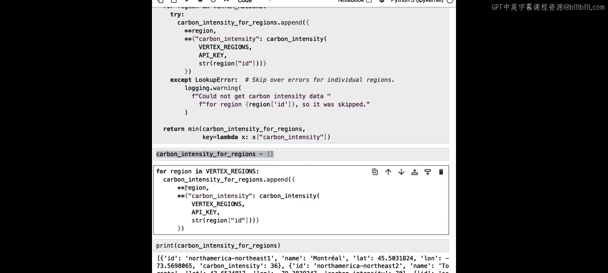

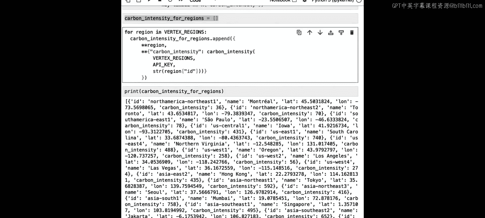

Okay， once we've created this big list here called carbonbon intensity for regionsions。

 we just need to identify which of these carbon intensity values is the smallest and then that is the region that we care about so we can do that by calling min。

On this carbon intensity for regions list。And then we'll say for our keys， we're going to use。

A lambda here。And we'll be looking at the carbon intensity。Value， so that is。

 we want to know for these for all these dictionaries here。

 which one has the smallest carbon intensity。And when we do that。

 what I get back right now is the North America Northeast One region which is in Montreal and I'm seeing that this is a carbon intensity of 36 so you might see something different。

 it's possible that right now for you in real time。

 there's a different region that has a lower carbon intensity。

 but at least for me right now when I'm running this code I'm seeing North America Northeast one。

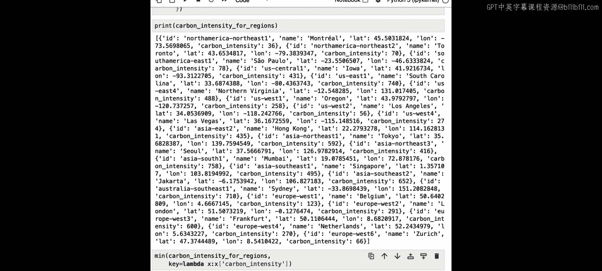

If we go back up to the whole function， we run through every line in it now。

 you will notice that the looping over the dictionary here happens in a try accept block and that's just again to have some extra air handling here in case the API doesn't return a carbon intensity for a specific location。

 but otherwise we've now run through every line of this function at cleanest。

And we could call this function instead of calling it line by line， let's actually try calling it。

So we'll say cleanest region equals and then we'll call the function cleanest。

And we'll pass in two things we need to pass in our big list。And our API key。

And then we can print out the result。And it should be the same as what we saw in the previous cell here。

 which was North America， Northeast one。Yep， and we got the same thing。

 so this is the region with the lowest carbon intensity right now。

We can actually compare the carbon intensity of this new region to the carbon intensity of the region we trained in earlier。

 So let's say the old carbon intensity equals and we can scroll back up since。

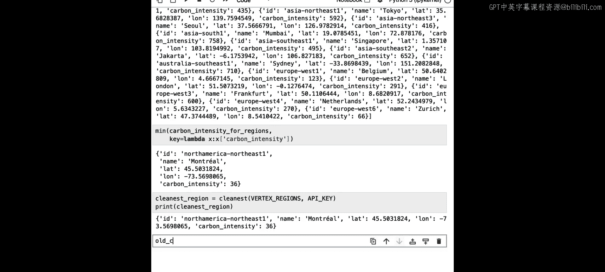

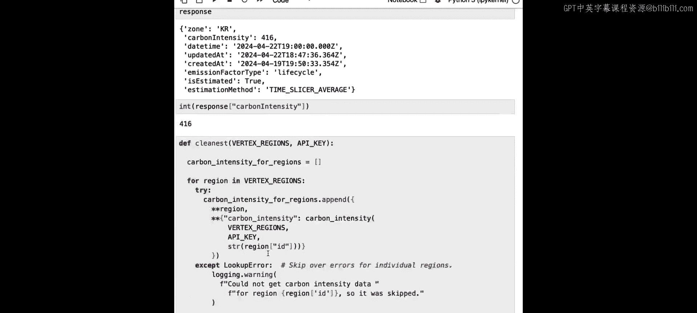

I don't remember 416， so that was the region we originally trained in was 416。

 that was again in Iowa and then in this new region we have a carbon intensity of 36。

That's about 11 times as much carbon in the original location as in this new location。

 which is a pretty big difference， so now that we have identified a region that has the lowest carbon intensity right now。

 we can kick off the same exact training job but in this new region。

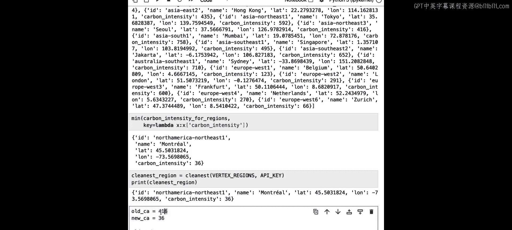

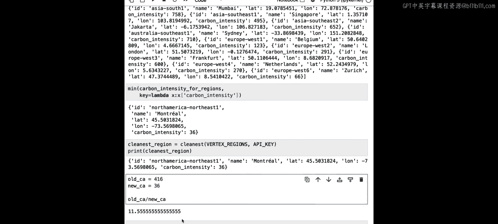

So I will go ahead and define region again and instead of calling it US Central1。

 I'm going to call it North America Northeast1 Now this again might look different for you it's going to be whatever was returned from this function cleanerest so you'll pull the I from that or you can choose to train in a North America Northeast one it's a pretty good bet because this Montreal region tends to have pretty low carbon intensity but you might have something even more clean with using the real-time data when you run this code So in order to train in this new region。

 we will need to create a new bucket again， your staging bucket needs to be in the same region where you run your training job so we're going to run through the same steps before we will create a new unique identifier I'm just going to say that this bucket is called cleaner bucket because it's for our cleaner region。

😊，And we can print this out。And so this has my unique identifier at the end， again。

 the unique identifier is important because if you don't have it。

 you'll probably run into a name collision and get an error when you try to create your bucket。

But then after that， we can go ahead and create a bucket passing in the name。

And then passing in the region so now we've created a new bucket and we can run a custom training job again we'll say a platformform。

custrainingjo and we need to pass in all the same things we passed in earlier so that is a display name I'm going to call this one deep learning A eye course example cleaner because this job is going to be a little bit cleaner it's going to produce a little bit less carbon pollution then we'll pass the path to our Python file that again is the task dot pi file that we wrote earlier we'll pass in the container where this code is going to run。

And then we'll pass in our bucket and that's the staging bucket that we just created。

 here's our bucket name and then finally of course， the most important part。😊，And that is our region。

 And that is going to be for me in North America， Northeast one。

 but it could be something different for you。 So now we are ready to。😊，Call jobb。

 run and run this training job This should look pretty similar to what happened earlier where it will kick off a training job and you'll see these logs being printed out here and again you'll see a link here that you won't be able to click on in this online classroom but you could click on it if you were running all this in your own Google Cloud project so just to quickly summarize what we've done we ran this Python code task pi first locally in our notebook where we had no control over what electricity grid we were connected to and how much carbon was being produced as a result then we tried running on the cloud using Google Clouds indicators of regions that have low average carbon intensity and then finally we use some real-time data to pick a region that had the lowest carbon intensity right now and that's where we chose to run our training job。

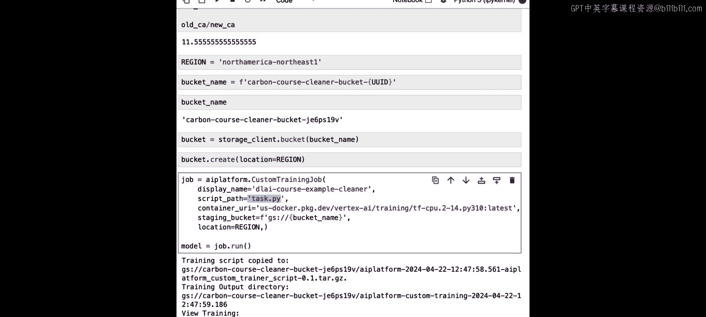

All right， and the training job has completed and note that you will see something that says training did not produce a manage model returning none don't worry about that it's not an error message。

 just something getting printed out in the logs here as long as you see custom training job run completed。

 things are good to go so lastly， like before we do need to delete our bucket and again let's just to make sure we keep this online classroom nice and clean and don't keep any extra resources around that we don't need。

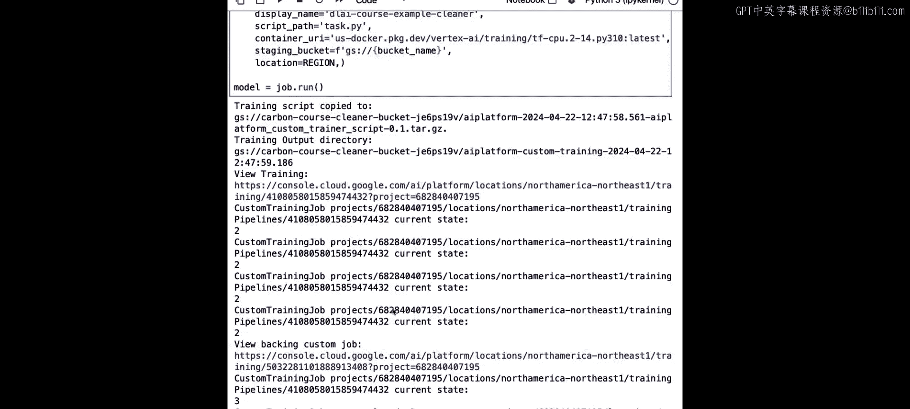

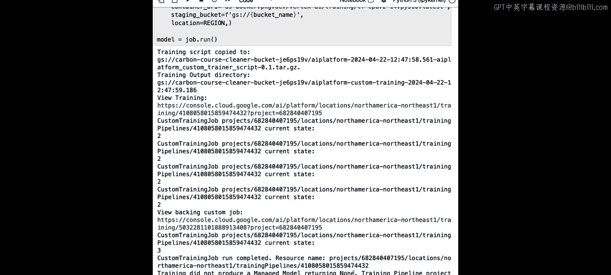

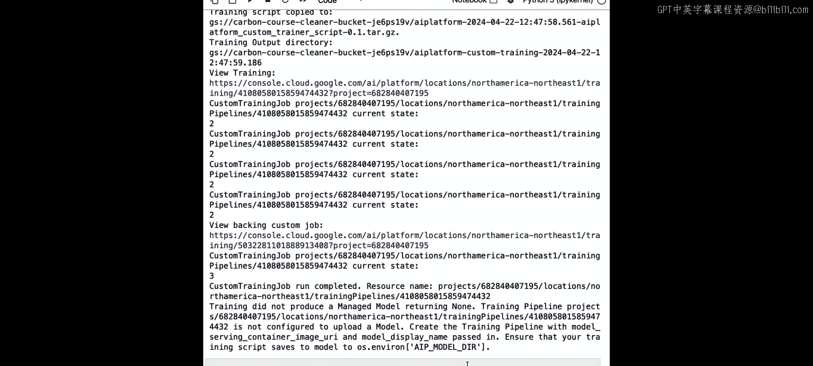

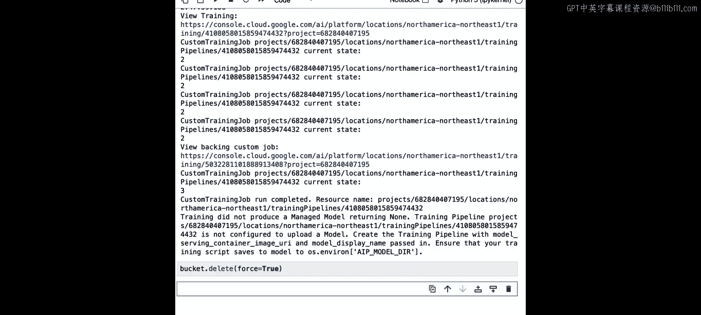

If you do want to learn about how to create your own Google Cloud project。

 if you've never done it before， there's an optional lab at the end of this course that will show you how to do that so you could run all of this code in that project and then you'd be able to go and check out the cloud console without getting an error message。

😊。

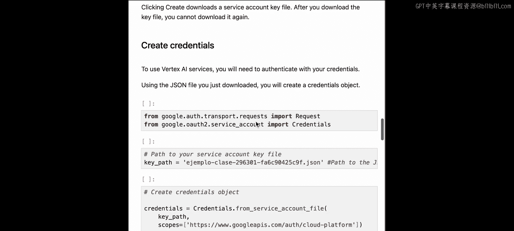

Now to wrap up this lesson， I think it's super cool that we're able to use this real-time data to inform us where we can run a training job。

 but one nuance I want to mention that is just worth keeping in mind for the future is that the carbon intensity is always changing so starting at a time with low carbon intensity like we did here can result in emissions reductions for short jobs like the short training job we ran here but for longer jobs say over a day the savings are likely to not be as big because these long jobs are naturally going to average out across the day or multiple days if you wanted to see how the carbon intensity for a region was changing throughout the course of a training job there is a electricity maps API endpoint that lets you do that it's called recent carbon intensity。

So let's try that out， this URL is going to look similar to the one we've been using in that you see here at carbon intensity。

 but previously it was carbon intensity/lash latest now we have carbon intensity/lash history。😊。

And then we'll pass in our La long coordinates here as query parameters。

 so this is going to be for the cleanest region that we just trained in right now this endpoint retrieves historical data and intervals of 60 minutes so let's call this endpoint we will make a request get request we'll pass in this new URL which is the carbon intensity history endpoint and then we need to pass in our API key as the header。

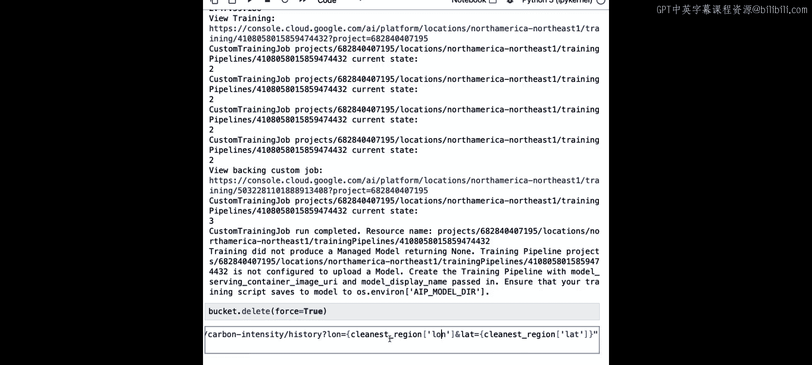

And once we've done that， we can print out the response。We'll load it with JO。

And we'll get the content。And we'll print it out so if we scroll all the way up to the top here of this big dictionary。

 you can see that this is the carbon intensity for this Montreal location where I just ran my training job and we can see for each hour how the carbon intensity changed so it was 37 for that it was 383832 this region seems like it's actually pretty stable at least for right now different regions will look pretty different some regions have a pretty stable number others are going to fluctuate really widely depending on the time of day The reason that data like this is useful is that if you were to run a really long training job and you wanted to try and get an estimate for how the carbon was changing during the course of that training job you could look back and see how this intensity changed for each hour that you were actually training for So that's a wrap on this lesson you saw how to use some real-time data to make a decision about when and where to train your ML model and in the next lesson we will。

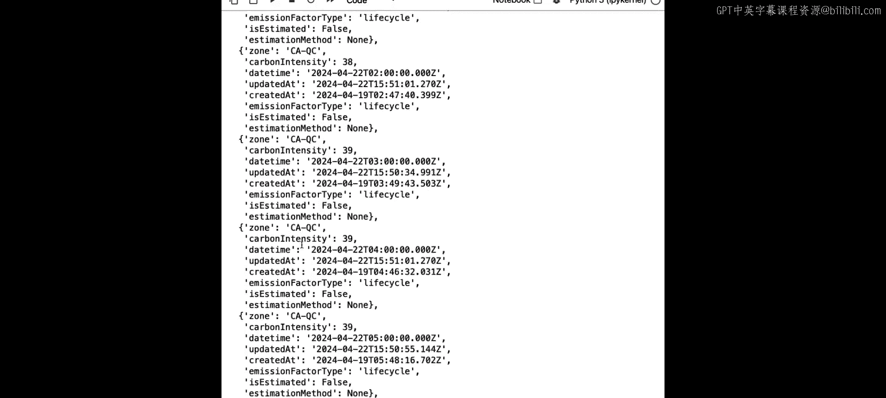

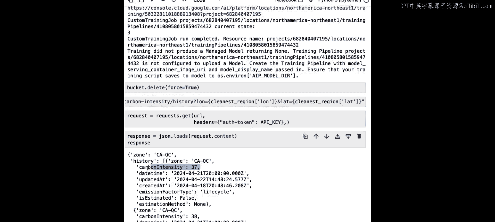

Get a more holistic look at how to estimate our carbon emissions across all of our cloud usage and I'll see you there。

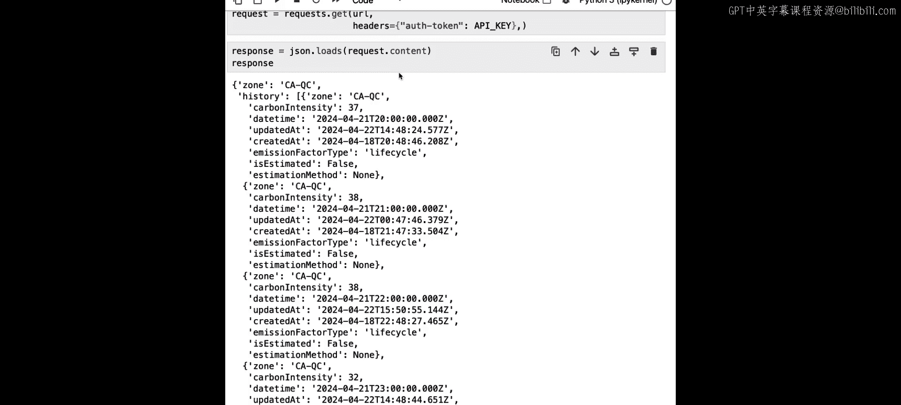