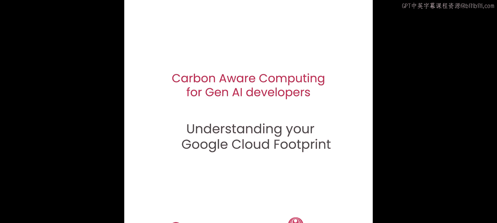
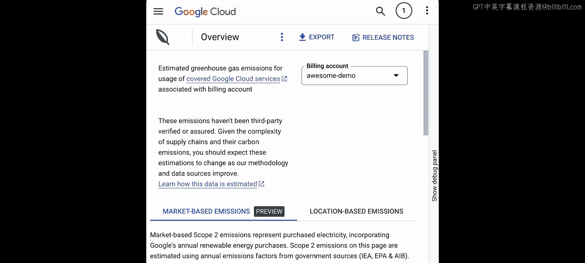
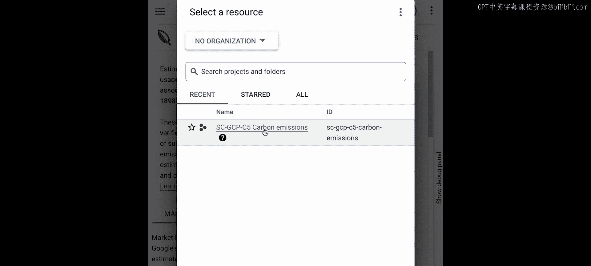
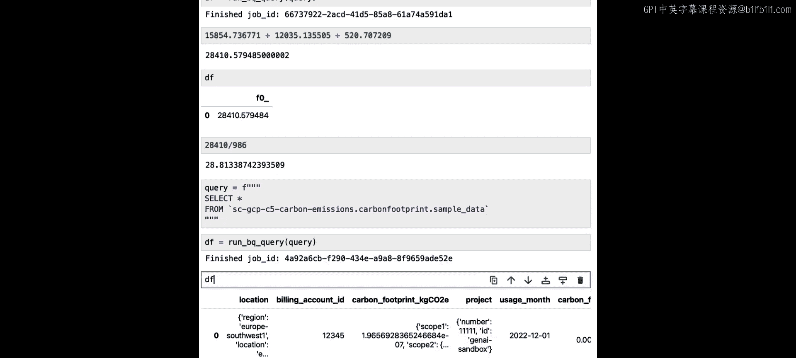

# 吴恩达《面向生成式AI开发者的碳意识计算｜Carbon Aware Computing for GenAI Developers》 - P6：6.Understanding your Google Cloud Footprint.zh - GPT中英字幕课程资源 - BV16z421B75k

In this lesson you'll learn how to use the Google Cloud Carbon footprint tool This tool provides a more comprehensive measure of your carbon footprint by automatically estimating greenhouse gas emissions from all of your usage of Google Cloud。

 so let's dive into the code。

We're going to be using Google Cloud， so like before you'll need to import the authenticate function so you can get access to the credentials and the project ID。

Every Google Cloud project has a carbon footprint overview page in the cloud console which shows you a monthly carbon footprint estimate associated with a particular billing account across project region and product If you have a personal Google Cloud project that you've been using。

 you can type carbon footprint into the search bar and you'll see something like this If you want to do some more in depthepth analysis。

 the Car footprint data can be exported to BigQury。

 which is Google Cloud's data warehouse tool Once it's in BigQu。

 you can use SQL to analyze the data or exported to JSON or CSV。

In this lesson we're going to explore carbon footprint data in this notebook using Python and SQL Now before we can actually get to coding。

 you'll need to understand just a little bit more about how carbon is usually measured and quantified the greenhouse gas Pro corporate standard defines three categories called Spe 1。

 Spe2 and Spe 3。These categories help organizations measure their carbon impact and what exactly contributes to each category is going to differ across organizations depending on the type of business that they run and the type of activities that they carry out Scope2 is what we've talked about so far in this course It captures all of the indirect emissions from the purchase of electricity。

 heating and cooling。When we talk about carbon and computing。

 Spe2 is the most relevant because it includes the emissions related to electricity usage in Google Cloud data centers as a result of being connected to the grid。

 however， purchased electricity is not the only way we produce emissions。There's also scopecope 1。

 which includes the direct emissions from sources controlled by an organization like a gas range in a kitchen。

 or maybe fuel that's used to run shuttles if you were to operate a fleet of shuttles。

In the context of a Google Cloud data center， Spe1 could include something like an onsite backup generator。

 then there's scopepe 3， which captures all of the indirect emissions from your assets not controlled by your organization。

 This includes categories like items bought from suppliers or waste disposal and any kind of business travel So in the case of Google Cloud。

 this could include the emissions associated with producing the GPUus in the data centers。

 Now carbon impact encompasses more than just the scope to electricity generation emissions that we've focused on so far in this course。

 and by including scopes 1 and3 into our estimates， we get a more holistic view into our impact。

 When we talk about this carbon footprint tool specifically and the data that we're going to look at in this lesson。

 what you're seeing is Google's scope 12 and three emissions from data center operations。

 and as a developer your usage of Google Cloud would actually fall under your scopepe 3 emissions。

 Now that was a lot of new jargon。 So let's make all of this more concrete。

Looking at the data and seeing these numbers in action。

The first thing we need to do is import the BigQu library and we'll also import pandas。

 so we'll do from Google。cloud， import BigQury。And then we can import pandas。

For your own projects outside of this course， you're going to need to set up an export of the carbon footprint data to BigQuery。

 I've already done this for this course， so you won't need to set that up。

 but let me quickly show you how you would do this in the cloud console if you want to try this out for your own projects and get a sense of your own carbon data for any work you might have been doing in Google Cloud。

So in the cloud console， you would type in Carbon footprint。And then from here。

 you would click this export button and you'll select a project you want to export the data to。

 and then you can click configurefi exportport。

Once you've done that there are a few different customizations you can set。

 you can just leave everything as the default， the only thing you need to set is the name of a data set in BigQury where you want all of the data to get transferred to so I'm going to select the data set called Carbon footprint which is a dataset set I made and then you can click save and once you've done that this little set up and export of the data and you'll be able to access it。

But back to the notebook using the BigQu Python client we're going to write a function that executes a BigQu query。

 this function will take as input a SQL query as a string and will execute it in BigQu and the results will be returned as a panda's data frame let's define this function we're going to call it run BQ query and it takes in SQL and this will be string and will use this function in just a minute。

So the first thing we need to do is create our Big query client。

 so this is kind of similar to the previous lesson where we created the cloud storage client except this time instead of storage。

cl we'll call this bigque。 client and we need to pass in our credentials and our project so we'll pass in project and we'll pass in the credentials once that's done we need to actually run the query so to do that we're going to set up something called a job config which is where you can pass any specific configurations but we don't actually have any that we need here。

And then we will actually query the Big query client and to that will' pass in the SQL。

And then this drop config。And then I'm also going to go ahead and grab the job ID just so we can print that out because that's nice to see。

And the very last thing we'll do here is wait for the job to finish and we will extract everything into a pandas data frame using this two pandas and then we'll just print out a little nice message here saying that the job finished and we'll print the job ID and then we'll also return the data frame。

 so let's run this function to make it a little bit more concrete。So now that we have our function。

 let's try some queries and we can investigate the data and we're going to use SQL to do this。

 but don't worry， if you're not a SQL expert， I'm not either。

 we're just going to walk through a few basic SQL commands that you can use to get a lot of information out of this data。

So the first thing we're going to do is take a look at a subset of the data we're just going to pull the first five rows of the data set and that's so we get a feel for what's actually going on in this data and what all the scopepe 2。

 scopepe 3， scopepe 3 business actually means so let's start defining our query。😊。

We're going to write this in SQL， but we'll format this as a string。

So we'll say select star and so if you aren't familiar with SQL that's going to pull all the columns and then we need to pass in the name of the BigQu table where we have our data so I've gone ahead and put all of the carbonbon footprint data in a BigQu data set called Carbon footprint and a table called sample data and this is the name of the project that it's located in。

 so this is where all of the carbon footprint data is currently located and I set this up beforehand。

And then I'm going to say limit five so that we only get the first five rows and we don't get a whole bunch of data。

Because we just want to look at it and just kind of get a look and feel for the data。

 So once we defined our query， we can call this run Big query query function up here and get the data back。

 So let's go ahead and do that。 Let's call this return data frame sample data frame。😊。

And we'll say sample data frame equals run BQ query， and then we'll pass in our query right here。

So let's execute that。And when it's done， we'll see this little note here saying the job was finished and here is the job ID。

So let's now print out。This data frame。Each row here in this table represents the emissions for a particular Google Cloud service in a specific project over the time frame of one month。

 This is actually all real data from three of my projects in Google Cloud so in this you're going to see different Google Cloud services that I used at different times for all of the demos and machine learning content and courses that I create So let's what you're seeing here If we scroll through these columns here you'll notice that there's not one single column unfortunately called emissions if only we're so easy but that's because there are a few different ways to calculate and report this number So let's zoom in on this column here called carbon footprint Kg CO2 E and in fact we're going to go ahead and print out the value for this first row here。

 so we'll extract this value for the first row You'll see that this carbon footprint Kg CO2 e field has three nested columns Spe1。

Scope 2 and scopecope 3 which are the scopes that we talked about earlier so what are these numbers telling us well this is carbon footprint data I compiled from some of my Google Cloud projects and this row specifically if we print out the value for the service column here is from something called cloud run which is a particular Google Cloud project so these scopepe 12 and scopepe 3 numbers here are telling us the emissions that were produced from my cloud run usage that particular month。

So if we look at scopepe 2 here， you can see that 4。

966 times 10 to the power of negative 05 are the emissions produced by Scope 2 and this is estimated by taking the greenhouse gas emissions produced from electricity provided by the local grid where this compute workload was executed here is the value for scopepe 1 and then this value for scopepe 3 and in the carbon footprint tool。

 these two numbers are calculated by taking the total Google Cloud scopepe 1 and Spe 3 emissions and then apportioning them based on your specific Google Cloud usage。

So to tile this together， when we look at my usage of cloud run。

 it's not just the scope 2 emissions right here， which were the emissions produced from the electricity generated that matter。

 but this carbon footprintprint tool also gives us an estimate for the additional emissions that were created as a result of operating and running the data center where I actually ran this workload Now just a quick note you might have noticed that scopecope 2 here has this extra key called locationbased this refers to the actual amount of CO2 equivalent being emitted from electricity consumed in the usage of a particular Google Cloud service The reason that this is called out as a specific key is that in the future there's going to be a market-based value here as well which takes into account Google Cloud renewable energy purchases for the workload。

 but that number doesn't exist in the data right now so you don't need to worry about it you can ignore it but in case you're wondering why does scopepe 2 have a specific key here and you don't see that for scopepe 1 and scopepe。

That's why， but the number is still the same and the number here is what you care about Now。

 in addition to this carbon footprint K G CO2 E column。

 you'll see if we scroll over that there is also。Carbon footprint total KG CO2E。

So let's print this out。If you want to know the total emissions for all three scopes and not just for scopepe2 electricity usage。

 this is the field to look at and we can actually test this out and make sure the math is correct because if we add up scopepe 12 and scopepe 3 from here。

 we should get this total location number right here， so let's go ahead and do that。

Let's add up the value of scope 1。Plus the value for scope2。And the value for scope 3。

And if we do that。There we go， the number is the same so really even though in this course so far we really just talked about scope 2 emissions。

 if we wanted to get a full picture of our impact， adding in scopepe 1 and scopepe 3 and looking at this total number here would give us a better estimate of our carbon emissions。

So now that we've taken a quick look at the data， what types of interesting queries can we run Well if we want to know the total emissions from electricity generation for one particular service。

 let's say BigQu， here's what you could run。We'll define a query and we'll say select。

And then we'll do a sum。And we're going to add up。All of the scope too。Values。In our data。

And we'll say from and we'll specify our same Big query table where I've stored all the data。

And then we'll add this little where clause here at the end。

 so we only want to add up scopepe2 values for rows that are related to BigQu So we look back up here。

 we only want to grab the emissions from rows here that are for the BigQu service and not for other products that I may have used on Google Cloud so now that we've defined our query。

 we can pass that into our run Big query query function。

And we'll see a little note when the job is completed。

And let's take a look so here are the emissions so just to recap in my three Google Cloud projects here that we're looking at data from 0。

199 is how many kilograms of CO2 E were produced from all my usage of BigQu which is pretty low but Bigque is not a product that I used too much so let's try a different query now what if you wanted to see the breakdown of carbon emissions across all three scopes。

 not just scope 2 for a particular project across month region and service here's a more complicated query that you might run。

 So this time we're going to type select。And select is just defining the columns from our data that we want to actually pull。

 so I want to pull usage month。Wwhich is the month that this data is from， the service description。

 which tells us what Google Cloudd project that row refers to。

 and then also the location which tells us which data center that workload was run in。

And then we'll also grab the total KG CO2 E field。This is going to be all of the carbon that was produced from all three scopes。

And then again， we'll say from and this will be from our same table here。

 the sample data table here where I put all the carbon footprint data。

And now we need to define aware cause to specify。The project number we care about。

 so this data has three different projects in it and we're going to look at project number。11111。

 so obviously my project number wasn't actually 11111。

 but I just changed a couple things to anonymize the data but I made up a new billing account number and some projects numbers and stuff so。

That's what that number there is， and then we want to also order this data。

And we'll order it by two fields， the usage month， and then the service description。

 then we need to close out our string。So let's run our same big query query function and we pass in this new query and then we can print out the results once that completes。

 So again， this new table here is basically a filtered version of what we were looking at earlier。

 but it's just for one particular project so each row here tells me in this specific project 11111 It tells me that I was using cloud build in。

😊，20210601 and here are the resulting carbon emissions that were produced。

 and it also tells me the region that I actually ran that workload in。

Let's take a look at one more query if you wanted to know the total amount of emissions across all three scopes for a specific project。

 here's what you would run First we'll define the query。And we'll format this as an F string。

 and then we'll do our select。😊，And we're going to do a sum over the carbon footprint total Kg CO2 E。

Location based。Values。And let's call that。Carbon emissions so that comes back as a nice name instead of so we can actually give that new column a name and then we also want to select the project。

Number column。Then we will define our from statement。

And specify our carbon footprint table that we've been getting all this data from。And then lastly。

 we'll group this。By our project number。Then we can execute this query using our run Big query query function。

And we will print out the results， so now you can see for the three projects in this data。

 you can see the total amount of carbon emissions， so just to give you a little bit of context。

 according to figures from the German nonprofitfi organization At flying from London to New York and back it generates about 986 kilograms of CO2 per passenger so this one project here is just a little bit less than two flights from London to New York and back and that's all just from training machine learning models and building demos which is what I do in these projects。

And if we were actually into just sum these three numbers using this query here。

We can see the total amount of emissions from all of my Google cloud activity in these projects Let me just test my SQL skills here because let's make sure this is actually accurate so here we'll take this first number add this one let's hope these numbers actually add up。

😊，Okay， they do all right， so I was right in defining my queries so if we take this number right here and we divide it by 986。

 which was the amount of kilograms of CO2 per passenger flying from London to New York and back again。

 we get 28， almost 29， so that's close to 29 flights to and from New York that I produced just from training MLL models and building demos and all of those other things that I do in these Google Cloudd projects。

And this number I thought was pretty surprising to me。

 I think personally it's easy to see the way we have an impact on the environment when we use single- useed plastic or we put gasoline in our car or something that's a little bit more tangible but executing cells in a notebook running code it kind of feels pretty abstract sometimes and so it's difficult to actually tie what we do when we're writing code to the actual impact we can have on the environment and so being able to see my carbon footprint data like this and see the numbers so clearly for me was really eyeopening。

So now it's your turn to experiment with the data and see if there are other interesting queries you would like to run and if you're like me and you're not super familiar with SQL。

 this data is actually small enough that you can actually load it into a panndas data frame in this notebook and so you could use pandas instead if you wanted to analyze the data that way。

 so let me quickly show you how to do that。We'll define a query and this query is just going to take all of the data。

From our table and so we'll just pull everything and if we pass this query into our handy helper function here。

 what we'll get back is a data frame that has all of the Big query data but now in pandas so you can analyze it directly using Python。

So that's all for this lesson where we saw how we could get a complete picture of the carbon emissions produced from all of our activities using Google Cloud。

 and the next lesson we'll talk about some next steps and further reading and also some concrete steps that you can take in Google Cloud to lower your carbon footprint。

 and I'll see you there。

