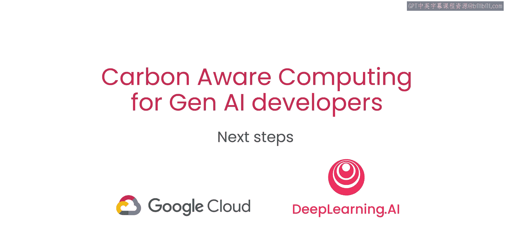
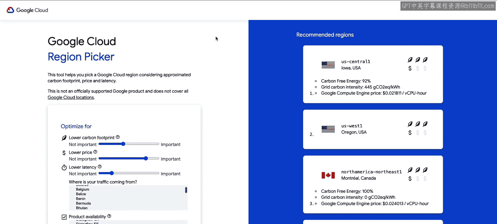
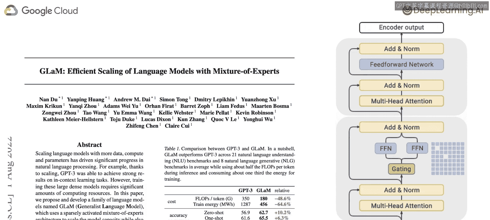
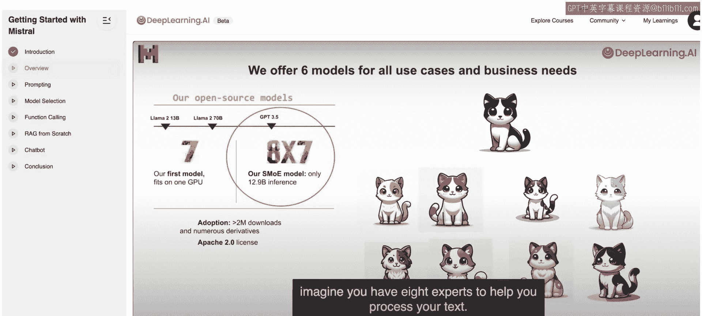
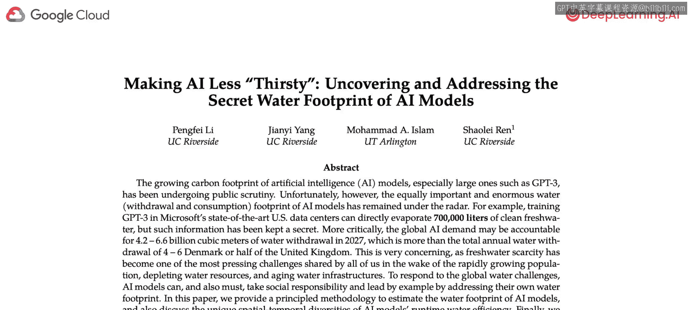

# 吴恩达《面向生成式AI开发者的碳意识计算｜Carbon Aware Computing for GenAI Developers》 - P7：7.next steps.zh - GPT中英字幕课程资源 - BV16z421B75k

Before we conclude this course， I wanted to share some interesting papers and projects with you to hopefully inspire you on your carbon aware journey。

 let's dive in。

The first is the Google Cloud region Picker tool In this course。

 we talked about how to select a region based just on carbon， but of course。

 selecting a region for a real project usually depends on many other factors like latency price and data location to help you with region selection you can use this region Picker tool by specifying for different factors like carbon footprint and lower price and latency how important or not important they are So let's say that carbon is of little bit less than medium importance。

 but we really care about price and we don't care so much about latency if it's applicable you can also specify where your traffic is coming from and then the products that you're interested in running So let's scroll down here and select for T AI Once youve specified all these different parameters you'll get a recommendation for regions that are good based on your specific preferences so it actually looks like I'm getting。

mended at US Central One in Iowa， what you might recall is the region we used in lesson three to train the machine learning model。

 and then later on I also trained in Montreal， Canada because that one had more renewable energy available at that point in time。

So definitely check out the regionion Picker if you plan to use Google Cloud and you can use this tool as a way to guide you to pick the best region that still optimizes for carbon efficiency while also keeping in mind other factors that might matter to you。

Now for some interesting research papers， if you want to learn a little bit more about this field。

 and the first is a family of language models called GAM or generalist language model。

 the authors of this paper show that the largest GAM model which is 1。2 trillion parameters。

 consumes only one thirdd of the energy used to train GPT3 and requires half of the computation flops for inference。

 all while achieving comparable performance across 29 NLP tasks。

I think it's super cool the way the researchers were able to achieve this efficiency they used something called Sprsely activated mixture of experts architecture and it was something I wasn't familiar with until looking at this paper and would definitely recommend checking out if you want to learn more about how that works and how they were able to get these efficiency gains when it comes to energy use and in addition to looking at this paper if you want to learn a little bit more about mixture of experts。

 there is another short course from mystral AI that covers a little bit about mixture of experts so definitely check that out if you want a little bit of an introduction before diving straight into this technical paper and while we talked mostly about the footprint from training models in this course。

 there's recently been more research on energy consumption at inference time so I would recommend checking out the paper power hungryungry processing what's driving the cost at AI deployment the authors here point out that while inference on a single example requires much less computation than that required to train the same model。

 inference happens a lot more frequently。

even model training specifically the researchers here compare the amount of energy use per inference for a few different blooms models with the total amount of energy use for both training and fine tuning them they use this number to estimate how many inferences would be needed to be carried out with a given model in order for the cost of inference to reach the cost of training and they estimate that for chat GT even just assuming a single query per user the energy costs of deploying this model would surpass its training costs after just a few weeks or months of deployment This paper studies 88 models across 10 tasks and 30 data sets and applications in natural language computer vision and they analyze the impact of the endtask modality。

 model size architecture and learning paradigm all on energy efficiency one thing you also learn in this paper is that。

 for instance， prompting a large language model to perform a sumization task is much more energy and carbon intensive than asking it to perform classification and as you might imagine image generation is。

Much more energy intensive than image classification or text generation。Lastly。

 thinking beyond carbon， there's also a water footprint associated with GenAI。

 remember that data centers running GPUus and TUus can get really hot and cooling systems may evaporate a significant amount of water in order to keep these processors running recently there's been some work to try and understand and quantify water usage So if you want to learn more about this I would check out the paper making AI less thirsty there's definitely less research here than there is in quantifying the carbon footprint from compute but just like how in the past few years that's become a topic we understand a lot better I think understanding the water footprint and learning more about how we might make certain optimizations is something that well see a lot more of in the research space water usage is a topic that's been getting more attention in the research community recently and just like how a few years ago。

 we didn't really understand or think about the carbon footprint of compute that much but that's changed a lot in the last few years and there's been a lot more research there I think water is a new area that we're going。

SeeA lot more research and understanding on what this impact really is and how we can make changes to utilize less water and have a lower footprint so definitely check out this paper if you want to get an understanding of how this new field is starting to develop and with that those are just a few papers and projects that I found really interesting I hope this course is a starting point for you in your carbon aware journey I think it's really exciting that you can make a difference as a developer and engineer and I hope from now on you'll start to consider carbon when you're developing software applications I mean we're already used to thinking about things like performance。

 security cost so really carbon is just one more thing to add to that list。

