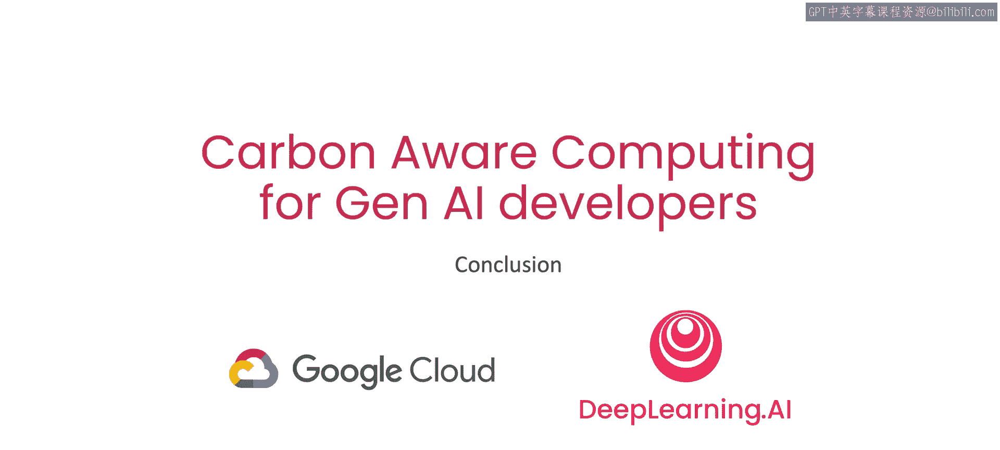

# 吴恩达《面向生成式AI开发者的碳意识计算｜Carbon Aware Computing for GenAI Developers》 - P8：8.conclusion.zh - GPT中英字幕课程资源 - BV16z421B75k

。

In this course， you learn about energy and the electric grid as they relate to computing infrastructure and carbon emissions。

You learn how model training and inference， especially when it comes to LLM can have a significant carbon footprint。

But you also got familiar with key factors and decisions that impact how large or small this footprint is。

 And you've got to try out one strategy for carbon aware MLl development。

 training models and locations that are powered by a high amount of carbon free energy。

I think it's really exciting that you can make a positive difference on the environment as a developer and that by making changes in how you code and design MLL applications。

 you can tangibly impact your environmental footprint。One example。

 if you're looking for a place to start contributing now。

 the electricity Maps app is actually open source， and there's even a process for adding a new regional grid if you noticed that your location was missing。

 I hope this is just the beginning of your carbon aware journey。

 There's so much more to explore in the space and increasingly illuminating research。

 and I can't wait to see what carbon aware applications you build next。😊。

