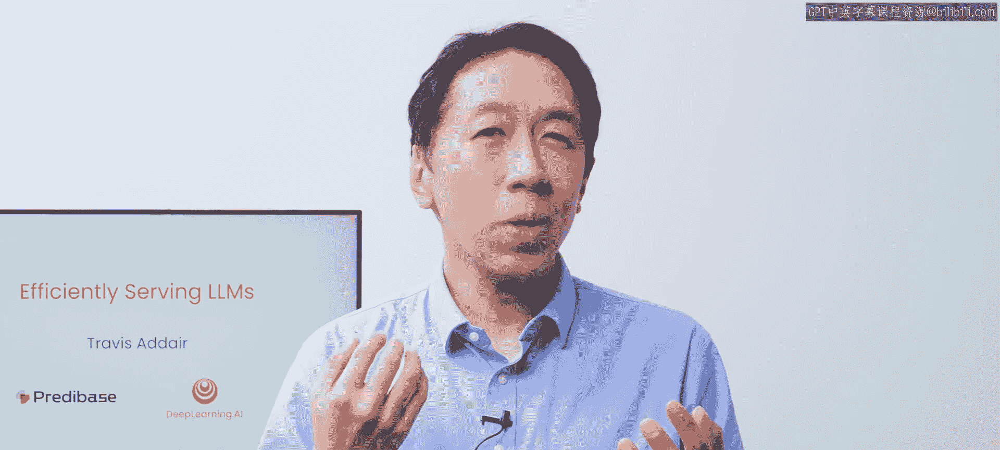
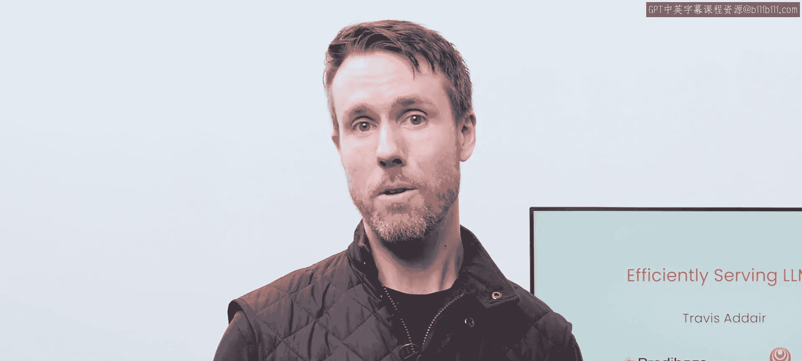
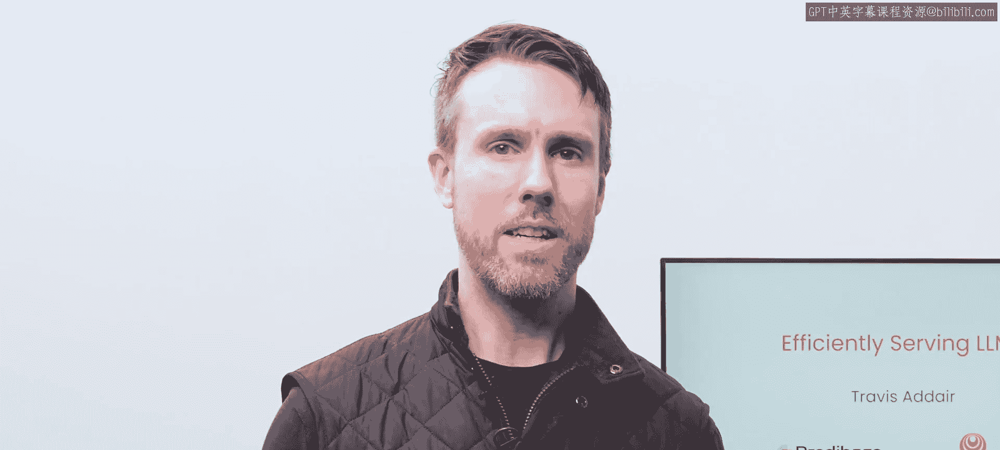
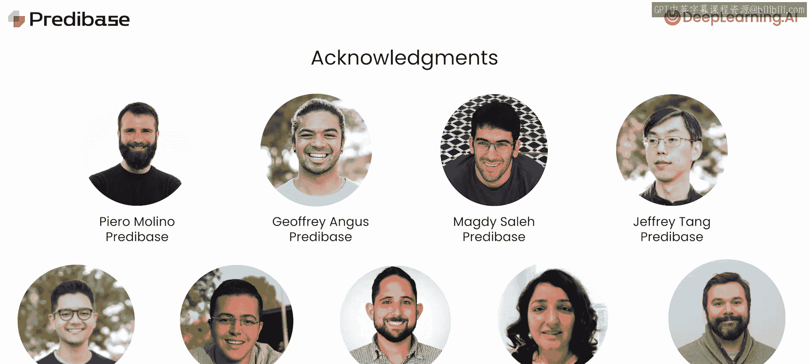

# 吴恩达《高效服务大型语言模型｜Efficiently Serving LLMs》中英字幕 - P1：1.introduction.zh - GPT中英字幕课程资源 - BV1bt421578n

Welcome to E serving La language models， built in partnership with Predbase。

 I'm joined by Travis there， cofounder and CT of Predbase and the instructor for the course。Thanks。

 Andrew， I'm really excited to be here with you and teach this course In this course you learned the deep technical details about how to serve large language models。

 specifically you learn about the key technical ideas like how to cache parts of the computation inside。

 transform a network inference to make this process efficient when you're building applications that use OM this deeper understanding will help you to figure out implications like time to first token and throughput of your OM application as well perhaps help you select a vendor for serving your custom OM。

A lot of LM development has started with teams using Cloud hosted APIs。

 which is a good way to get started quickly， but as Team mature。

 I'm running into a lot more developers that want to use open source LMs。

 including fine tuning LMs to their own data。

But when use an open source or a fine two model， you need to find a way to get it hosted or served In dis course you learn the details of how LMs are served efficiently。

 including the techniques allow you to handle many requests from multiple uses。

 this deep understanding will help you to make the right decision about how to get yourLM served。

 That's right， Andrew， I've worked with developers who got started with an open source LM on Hugingface and wrapped it behind a simple web server like Flask。

 only to find out the performance was nowhere near what they were getting from the commercial LM APIpis。

 even though they were using a powerful GPU to serve it。😊。

The result was a system slowly handling one request at a time。

 and most of their users were just waiting to receive a response。 Fortunately。

 thanks to the company's light Prease， it is now easier than ever to get yourL efficiently served to many customers at once。

 This is possible because if techniques like vectorization。

 which allows models to process multiple sets of user inputs in a single operation or even multiple fine tune models at once。

 and also techniques like Kv caching， which speed up inference by storing some results of the transformer network's attention calculation in memory after each token is generated so that these calculations don't have to be redone every subsequent step as you generate the latest tokens。

😊。

By implementing several of these techniques at once， you can improve both the latency。

 which is the time it takes for a user to receive their response to the prompt。

 as well as the throughput， which is a rate at which the server processes request。

 the best hosting services have already put these techniques into place and their excellent options for making any custom application you build behave well in deployment。

 In this course， you'll start by taking a detailed look at how autoaggressive large language models generate text one token at a time。

 You'll implement the Kv caching technique Andrew just mentioned and see how it leads to big reductions in latency per subsequent token。

Next， you'll learn how to batch prompts into single tensors so that an LM can process multiple inputs at the same time you'll then extend this idea to a technique called continuous badging。

 which allows you to dynamically update the batchge as new requests come in and old requests complete。

 This makes it possible for LM hosting services like Crbase to serve many customers with good latency and throughput at the same time。

After that， you'll implement a quantization function that reduces the memory footprint of its model by transforming its weights to a lower precision representation。

In the last two lessons， you'll learn how parameter efficient fine tuning techniques like Lauraura or low rank adaptation make it possible to dynamically load end specialized fine tuned adapters to your LLM at runtime。

 then will combine multiple lauras with continuous batching to serve hundreds of fine tune models simultaneously while maintaining high throughput and low latency。

At Prebase we use these techniques to make it cost effective and scalable to serve many fine tune models for our customers so as you can tell。

 this course presents a really detailed set of technical topics。

I think it's important that developers have this foundational knowledge so that you can make informed decisions as you design and build your applications。

Exactly， with the knowledge from this course in hand。

 you'll better understand the trade offs that you have to make as you think about the performance of your application。

 and you'll be better positioned to evaluate what a potential vendor is offering you and whether their promises are realistic。

This will help you make the best decisions for your project and for your company。

 Many people helped in the production of this course from Prebase。

 I'd like to thank Pierero Molinino， Jeffrey Angus， Mar Di Sala Jeffrey Tang。

 Noah Yohida while a bit and Michael Oteger and from deep learning AI Dialla Eadin and Tommy Nelson also contributed to this course。

 I hope you enjoy this course on efficiently serving as。

 and that the knowledge you gain will efficiently serve your development needs to Let's go on to the next video to get started。

😊。

