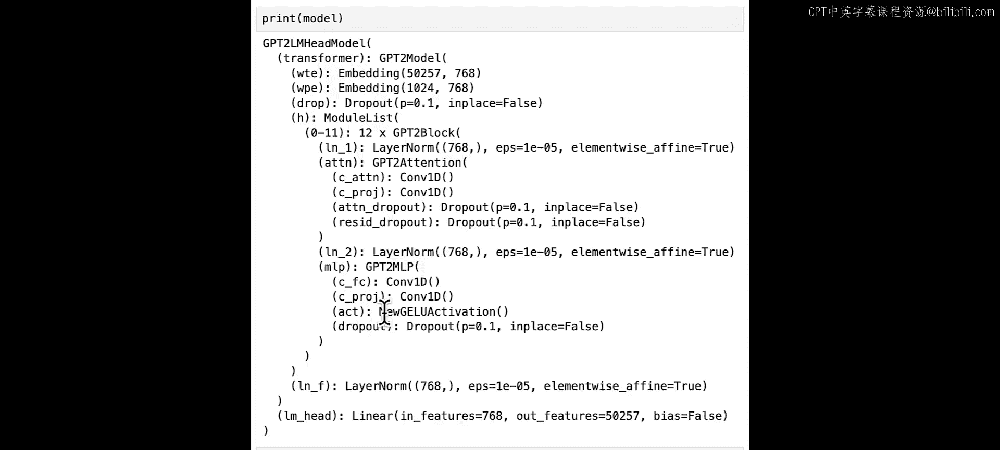
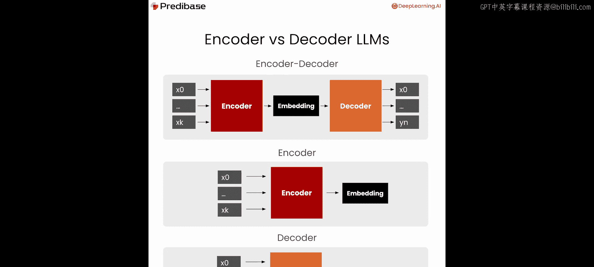
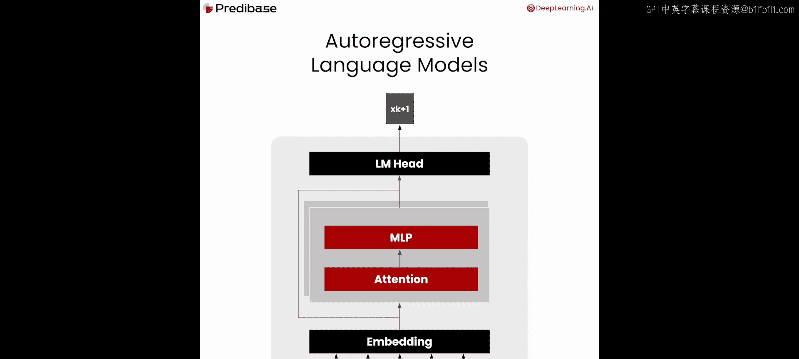
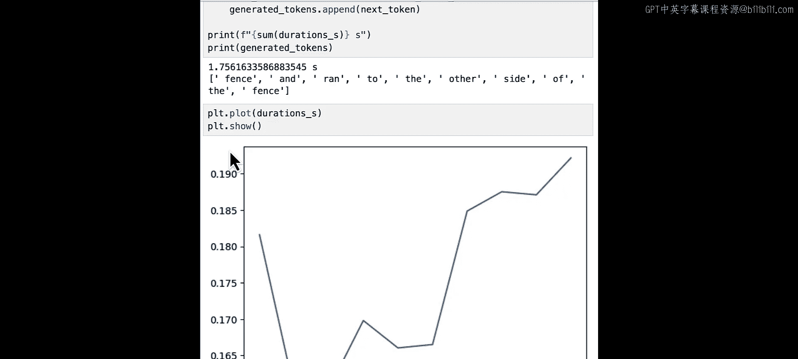
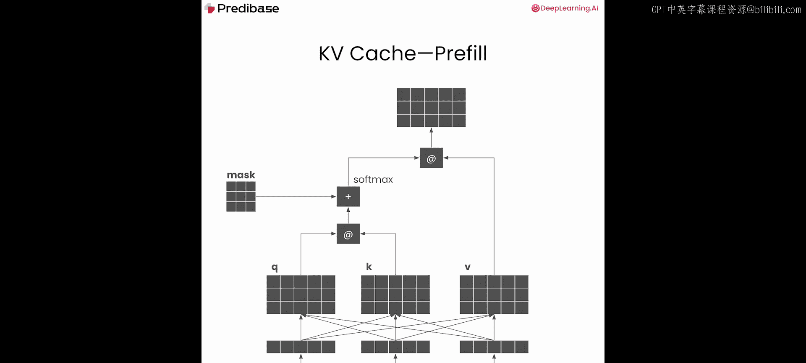
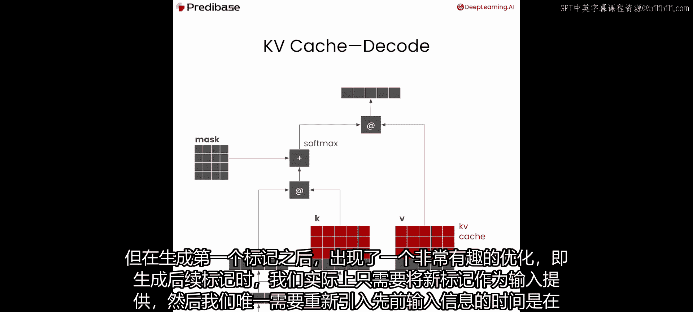
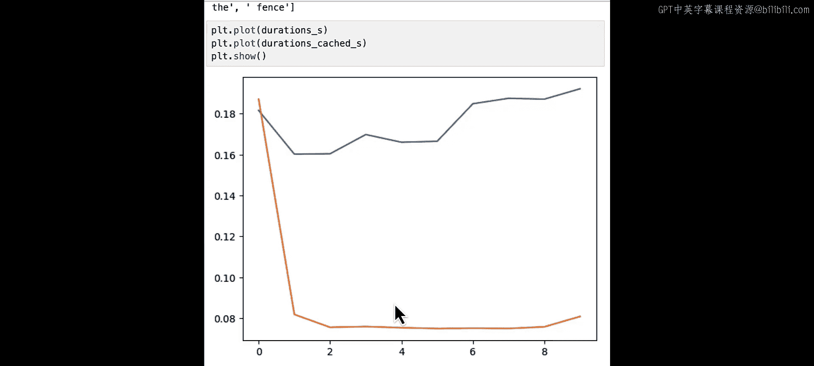

# 吴恩达《高效服务大型语言模型｜Efficiently Serving LLMs》中英字幕 - P2：2.L_1-Text_Generation.zh - GPT中英字幕课程资源 - BV1bt421578n

In this lesson， we'll introduce the process of text generation using autoaggressive language models。

 You'll learn how to iteratively generate text one token at a time from model outputs。

 and you'll see how this process can be divided into two phases。 Prefill and tocode。

 and optimize it using KV caching to speed up the attention computation。 Let's get started。

 So let's start by loading an LM from hugging face to serve as our example LM that we'll be working on for inference。

 So first thing we do is just import our dependencies， Pytorch transformformers。

 will be the framework that we'll be working with for this。😊。

And then we will go ahead and。Load in the GT2 model from Huface along with its tokenizer。

 both of which are hosted on their reos， Another reason why we chose GT2 here。

 even though there are many more newer and better models available today is actually still really useful and practical model for a lot of tasks that are very heavily sensitive to latency because it's such a small model。

 it's quite fast in practice to run when optimized on a GPU and as such for simple text completion tasks like when you're typing an email you want to see what are some recommended next tokens that you might want to type for autocomplete models like GPT2 actually end up being very practical in production where you need latency that's on the order of tens of milliseconds per token and hundreds of milliseconds total right and you can't afford to wait multipleconds to get the output。

I'll just take a moment to load in and then we can go ahead and inspect。The structure of the model。

Now it's important to note that for these transformerbased models like GT2 that we broadly call LLMs。

 there are different types in the early days we had the encoder decoder model was one of the first architectures that came out broadly you can think of encoders as being the way that we take tokens and then map them to an embedding space so models like Bt our encoderbased models that are useful for generating embeddings for classification tasks and things like that as well as similarity search。

 but GPT2 is what we call a decoder only model and so it doesn't have an encoder and so instead what we do is we just take the input and then pass it through an embedding and then apply a series of these blocks that consists of attention and a multilayer perceptron repeatedly over the tokens the embedded tokens to then generate set of outputs and so this decoder only structure what essentially does in practice is generates。

Token at a time for us and this ends up being what we call an autoaggressive language model。

 which then is the foundation for what we call the modern large language model most large language models today follow this same general structure Okay so now that we instantiate our model let's go ahead and explore how we actually get it to generate text So let's start with a basic prompt here。

 the quick brown thoughts jumped over the and past this input through the tokenizer and we're going to return these values in the PT format which stands for pitorch so this is different from nuy or tensorflow or other types of output formats that you might be using but since we're using ptorch today that's the format we're going to return So you'll see that what we get out is a couple of tensors In this case we have the input Is which are the mapping from particular chunks of the text into these tokens from the token。

And then this other tensor here that we call an attention mask， which is just all ones。

 but you'll notice that there's a one for every token in our input IDs。

 and we'll come back to this concept of the attention mask when we get to batching。

 but for now this will just be thought of as a tensor that goes along with the input IDs for the purpose of determining what tokens within the particular input should be attended to which other tokens。

Now that we've generated our inputs to the model from the tokenizer。

 we can go ahead and try passing them into the model itself and seeing what comes out。

 So first thing we're going to do is say with torch do nograd which tells pitorch that we don't want to generate gradients。

 which is just extra memory that we don't need during inference。

 we're going to pass in our inputs as individual keyword arguments to model generate the outputs。

 And then the outputs is going to be an object that has a set of properties。

 and the one that we're particularly interested is the one called the logs。 So if we run this。

 you see that the logits is itself a tensor that has a three dimensionmenional shape。One。

 which is the batch size， which right now is just one we're only passing one input。

7 is the sequence length that we passed in。 that was a number of tokens that we had in our original input and then 50257。

 that's essentially the vocabulary size， which is how many possible tokens we might generate in the output。

 So from there what we want to do is figure out which of those 50。

000 tokens we actually want to use as the next token of this model it is going to predict。

So to do that we're going to take this Loitts tensor。

 we're going to take only the first row because we only have one batch element anyway。

 and then we're going to specifically take the last element in the sequence dimension corresponding to the next tokens and this is because during model inference the model will actually generate Loitts for every token in the input but we actually don't need that that's useful during training but not during inference so we're just going to take the very last token here and then every single one of the elements from the vocab dimension and then compute the arcm so essentially which index in that tensor has the maximal value and in this case that happens to be the token with ID 13990 So now let's go ahead and use our tokenizer to decode this token back to a normal string and see what we get and you'll see that。

It's returned the token fence， so if you remember original input the quick brown f jumped over the fence。

 you can see that that is in fact something that would be grammatically correct and would make logical sense in the context of the input that was given to it quickly let's go ahead and explore a few other possibilities though so in addition to just looking at the AGmax。

We could instead look at the top K， so what are the 10 most likely next tokens that could be produced and see what we get。

And you can see that other possibilities that the model could choose would be fence edge。

 railing wall， etc。 And if you were to use a different decoding strategy， say， for example。

 multinomial sampling instead of greed decoding you could end up in situations we select one of these other tokens and normally with large language models the amount of creativity that's going to choose some of these less likely tokens is controlled by a parameter called the temperature which we won't get into today。

 but that's one of the different decoding strategies that are out there to help create more diverse outputs for the model we sometimes think of these LMs as being just systems that regurgitate all the information in the world。

 And so you would think that if it was thinking like a human here that it would go with the cliche。

 the quick brown thought jumped over the lazy dog but here you it's actually just purely thinking in terms of probability distributions like what is the most likely token here。

 it's not thinking about。Cultural context around the sentence right so that's definitely a difference between how humans tend to think and Elens Al right so now we generate our next token。

 which is fence and where we go from here So for these autoaggressive large language models。

 the very straightforward way to do it is to just take the token that we generated from the previous section which was next token ID。

And just concatenate it to the original input。 So we now get a tensor that is the input plus the new token packed together into a single new tensor。

 And then for the same thing for the attention mask as before we said that this is just all onces for now。

 So we're just going to append a token with the value one to the attention mask。 All right。

 so now we've generate our next input， let's go ahead and see what that looks like。

 So you can see that we have the same input tokens that we have before。

With the token we generated 13，9，9，0 appended to the end。 And this is a tensor with shape 1 by 8。

 And then similarly for the attention mask， it's all ones。 But now， instead of shape 1 by 7。

 it's  one by 8 as well。 So now， let's take a moment to think about the overall performance of this operation and how quickly we can generate these tokens。

 So let's start by。Defining a function that took everything we just did in the previous cells called generate token。

 And its job is to take a single input dictionary and generate the next token。

So now that we have our generate token helper function。

 we're going to try generating some tokens and seeing how long it takes。

 So the first thing we're going to do is we're going to define a list called generate tokens。

 This will keep track of the actual tokens as strings themselves so we can see what the final output looks like。

We're going to go ahead and define a variable next inputs。

 which will update in each loop step to contain the next input we want to feed to the model to generate token。

 and we're going to have an additional list here called durations in seconds that keeps track of how long each iteration took in seconds。

 So we're going to run this for 10 steps。 So we're going to generate 10 tokens。 First。

 we record the time just before we generate the token。 Then we actually generate the next token Id。

And then we append to our durations list the time that that operation took in seconds。Next。

 we go ahead and define what our next input should be using the same process as we showed before。

 where we concatenate the input IDs from the previous step with the next token ID that we just generated and then for the attention mask。

We compute the attention master in the previous step and appendda one to it。

And then go ahead and decode the token ID that we just generated and added it to our list。

And then repeat， and then the very end。We'll measure how long this operation took in seconds。

 which was about 1。75 seconds and then see what the final set of output tokens was。

 which was the quick brown Fo jumped over the fence and ran to the other side of the fence。 So again。

 we can see that this is all grammatically correct and is something that you could imagine someone writing if they were asked to complete the sentence that was given to the model originally。

 All right， so weve just generated 10 tokens and we measured how long it took to generate each of these tokens。

 But I think one thing that would be very interesting to dig into is how the time it took to generate each token changed as we generate more tokens。

 So let's just go ahead and quickly plot what that duration curve looked like。

 And one thing that you might intu it from the previous section is that we were， in fact。

 increasing the size of the input after every step。

Because we were concatenating more and more tokens to it and then recomciing the output each time so you might expect that over time there would be some trend towards the time to generate each token going up and you'll notice that even a 10 tokens we do see some of that it's obviously quite noisy the first token tends to be a little bit slower maybe due to lack of cache warm up in some things and some lower level parts of the code but then afterwards it starts to tick up slowly over time until we get to nearly 200 milliseconds here to generate single token and so you can see that this is a large part of where the cost of LN inference comes from when you just kind of do this in a very straightforward way so a lot of our time here will actually be spent on thinking about ways that we can optimize this and speed things up for any transformer the biggest computational ballck is unquestionably the attention computation and there are different variations of this this is the multiheaded attention。

And what you can see is that we have the input sequence， the quick brown dot dot dot。

 so whatever the initial set of input that we feed to the model is。

And then we construct these different matrices， the query matrix called Q。

 the key matrix called K and the value matrix called V from each of the inputs。

 And then we compute the overall attention computation where we do some matrix multiplication we apply the mask。

 we apply a softmax operation and generate the output。

 So for the purposes of this particular lesson is not too important how all this works under the hood。

 But the important thing to realize here is that the size of these matrices here are ultimately proportional to the size of the input sequence。

 In this case， the quick brown dot dot dot。 So we're just considering the first three tokens。

 So we're seeing that these matrices have three rows。

 then we get output that also has three rows correspond to three tokens。

 but after we generate the first token， a really interesting optimization that emerges is that it turns out that we' generating the subsequent token all。

We really need to do is provide the new token as input。

 and then the only time that we need to reintroduce information from the previous input is during this attention computation specifically for these matrices K and V where we need the values for that matrix that were computed for the previous tokens to now compute the value that will help us generate the next token。

 and so what you see is that effectively these values from the previous tokens for K and V can be cached so we don't have to recompute them between invocations of this computation and then just do a very lightweight concatenation operation where we take the cached values append the new K and V values for the new token do the attention computation。

 recast those values and then generate the next token。

And this effectively allows us to skip having to do all that redundant computation over and over again for all the past tokens in the input sequence。

 And so this brings us to the overall idea that we call the Kv cache。

 which is one of the most fundamental optimizations and LM inference and leads to what we call a separation between two different phases of token generation。

 The first is。What we call the prefill phase， which is what happens when you generate the first token using all the inputs。

 and then what we call the decode phase， which is where we generate the subsequent tokens using the cached K and V values。

 so previously we defined a function called generate token。

 which only accepted two inputs which were the input Is and the attention mask。

 but now we're going to generate or define a new function here called generate token with past。

 which does the same thing， but also uses as well as returns this other property of the output called the pass key values。

 And so if you remember from the slide， the past key values are the K and V values that were computed and then stored off for that particular input to the model so that we don't have to recompute them again。

So everything else should look very similar to what we did before。

 but now we're just returning the past key values All right so let's go ahead and run that。

 Now let's go ahead and repeat the process that we did before of generating 10 tokens and measuring how long it took to do so。

 but this time we're going to actually use the past key values。

 So as before the first two lines here will be the same but now we're going to define a new list called durations cached so that we can measure this separately from our original durations。

Again， we're going to generate 10 tokens。 We're going to measure the time it takes to generate the token。

 but we're going to call this generate token with past function now。

 which is the new one we just introduced， which now returns the pass key values record the time it took And then the real meat of the changes here come and how we compute the next input。

 So before you remember that we were concatenating the next token I to the original input。

 This time we're just sending the next token I by itself as the next set of input I。

 So we're completely discarding the previous input Is。 However， the attention mask。

 we're going to keep the same。 We're going to take the attention mask from the previous step here。

 and we're going to concatenate a one to it。 So that part because that's what ends up getting used and that attention computation that we showed that parts going to stay the same。

 and then the past key values is just going to be the past key values that we computed in the previous step。

 And then all the decoding and rest of it should。The same so let's go ahead and see how long that takes to run and this time around。

 you can see that our all in duration was 087 seconds。

 which is if you recall a nice significant drop from what it was before。

 but let's go ahead and now plot。What that looks like compared to the durations that we observed without caching。

And you'll see that now the blue line here was the time it took to generate the tokens without caching and the orange line here is the time it took to generate the tokens with caching and as you might expect before we have the KB cache generated generating that first tokens going to take about the same in this case about 180 milliseconds but after that。

 because now we're only passing one token at a time instead of the full input the time per token drops dramatically during the decoding step。

 which is what this big hockey stickt drop looks like and that's where the bulk of those time savings are coming from。

 And so this alone has already know essentially have our total time to generate the tokens and then as we would generate more tokens we'd be getting even more benefits because each marginal token with this approach is much much faster than it would be without it and this is really the first major milestone in optimizing texture。

Generation with LLMs that is at the core of what these inference systems are really doing kind of going beyond this。

 there are a lot of sophisticated techniques that we don't have time to talk about today。

 like paged attention being one that's really popular that really try to optimize the utilization of the Kbc both in memory and compute and what's happening at the couda layer So there's lots more optimizations that we can layer beyond this that systems like Lx implement。

 but for the purposes of what we want to talk about today。

 this is where you get the majority of the benefits is just from this simple optimization that covers it for what we want to say about text generation with LLMs to start off。

 And so now we're going to go one level further and begin talking about batching in the next lesson and batching will be a technique that we can use specifically to improve the throughput which is important when we want to build a serving system capable of handling multiple concurrent requests at a time instead of a single request like we were working with here。

 and so that'll be。

The fameme we'll explore next。