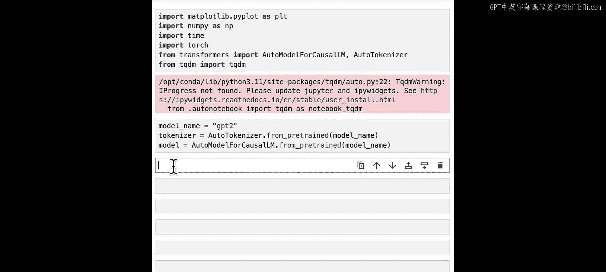
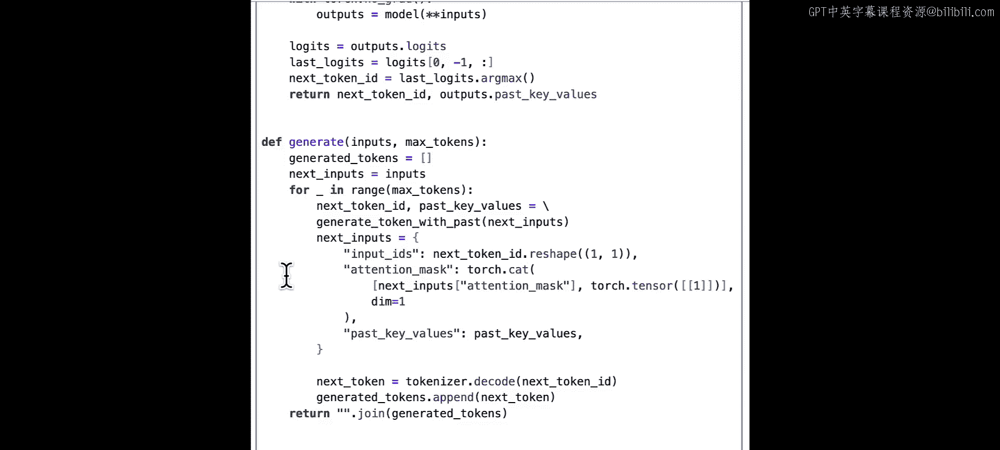
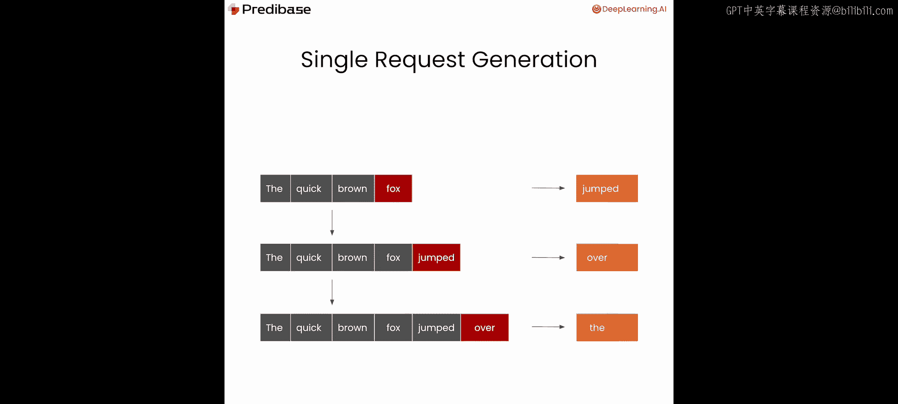
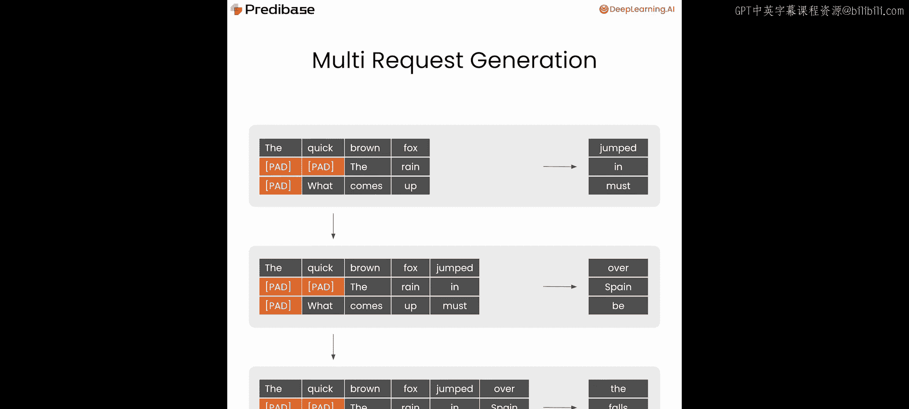
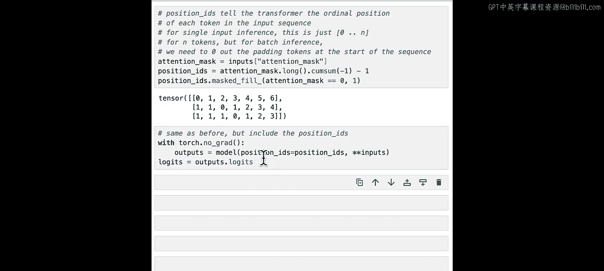
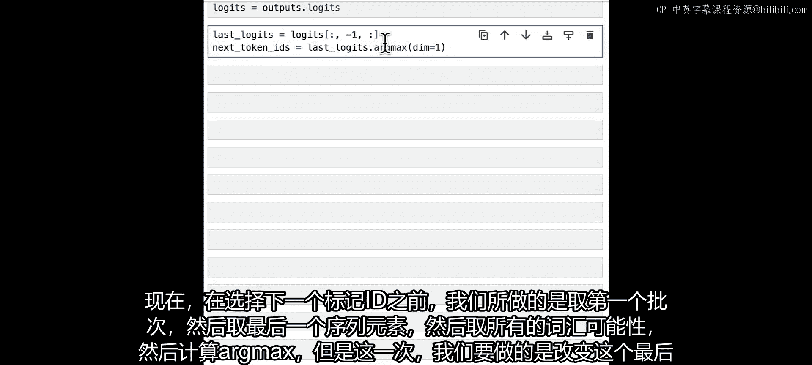
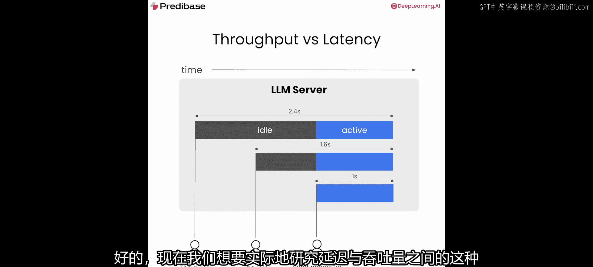
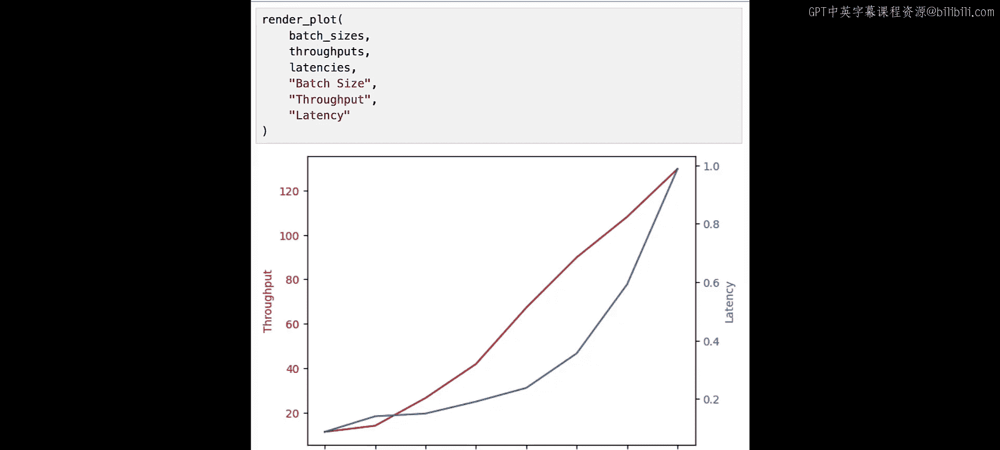

# 吴恩达《高效服务大型语言模型｜Efficiently Serving LLMs》中英字幕 - P3：3.L_2-Batching.zh - GPT中英字幕课程资源 - BV1bt421578n

In the previous lesson， you learned how to efficiently generate text for a single request at a time。

In this lesson， we'll expand on this idea to batch together multiple requests at once and see how this creates a tradeoff between handling more requests at once called throughput and quickly responding to any one request called latency。

 All right， let's dive into the code。 We're first going to start with our same set of dependencies as before。

 our familiar G2 model， as well as the same generation utility function that we created in the first lesson。

 But this time we're going to be extending this in the parts that follow to support not just a single input but multiple inputs and see how we can optimize the performance of that。

 In the previous lesson， we talked about how to generate the next token。

 one token at a time for a single input。 So in this example， the quick brown f。

 we generate jumped that then becomes the input to the next step。

where we now have the quick brown Fo jumped over， etc and we repeat this process until we decide we want to stop but in the multire or batched context we now need to introduce padding tokens for the purpose of making each of our inputs consistent and dimensions so that we have a regularly shaped tensor that in this case looks something like a normal 2D matrix and so for introducing these new sequences。

 the rain， what comes up we have these padding tokens on the left whose purpose is to ensure that overall the shape of the matrix is consistent so let's go ahead and start with what we had from lesson1 and just quickly sandy check that we can generate the same output that we expect so our input is still the quick brown Fo jumped over the and our output is fence and ran to the other side of the fence。

So great。 we've got everything that we expect。 Now let's get into how we can extend this to multiple inputs。

 The first thing we need to do is make a few small modifications to our model in our tokenizer to introduce a padding token。

 and then additionally we need to define where this padding is going to be placed if it's going to be to the left of the input sequence so that we'll have leading padding tokens or to the right。

 which means that we'll have trailing padding tokens。

And this is something that depends a little bit on the model and depends a little bit on whether you're doing training or inference。

But for inference， you typically would want to do padding to the left because we'll be appending tokens on the right hand side of our input。

 So naturally， we'll want to pad out the left so that we don't end up with sequences like the quick brown fox pad。

 pad pad jumped over the lazy dog。 right， So now we're going to do。

Is instead of defining our prompt as a single string， we're going to create a list of three prompts。

 and like before our goal is going to be to generate the tokens。

 the subsequent tokens that naturally follow from each of these three sequences。

So as before we're going to pass these inputs into our tokenizer。

 luckily the hugging face tokenizer class knows how to handle a list of prompts in addition to a single prompt。

And we're going to return the format in the pytorch format as before。

 But we're also going to add this new parameter padding equals true。

 which will use that padding token that we added to our tokenizer from earlier to pad out our prompt so that they are in a single tensor that all have a regular shape。

 Now， let's go ahead and look at what came out of our tokenizer this time。

So you can see that now we have a tensor for our input IDs that shape three， which is the batch size。

And 7， which is the maximum sequence length among all of the inputs that we provided。

 And you'll notice that for the sequences that are shorter， which were the second two sequences。

 they begin with this token 5，02，5，6， which is the padding token that we introduced from before。

 So they're all pated out to be of length 7 with this leading padding at the beginning。

 In the previous lesson， we talked a little bit about the attention mask。

 but we didn't go into a lot of detail about it。 But this time the attention mask is actually more than just a single vector of ones。

 This time， you'll notice that the attention mask also include zeros。

 and specifically the zeros correspond to the same padding tokens that we introduced。

 and what this is effectively going to do is tell the model that it should not attend。

 or in other words， it shouldn't really factor in the padding tokens when thinking about how this token relates to。

😊，This other token， instead it should basically ignore the padding token so that they don't affect the overall output that we want to generate。

So now let's return to the problem of generating the next token。

 given these three input sequences that we've batched together into a single input ID tensor One new thing that we want to introduce here when we're dealing with batched input is the notion of position IDs。

And these position Is is something specific in this case to the hugging face transformer implementation。

 but essentially just tells the model the ornal position of each token the input sequence。

 And so this is just a list0 to n for end tokens， but for batch inference。

 we do need to pad this out to zero out the padding tokens at the start of the sequence so that they don't contribute to that incrementing sequence so we'll just go ahead and do that as a first step。

And you can see that here we have some additional ones in here for the padding tokens。

 but then the sequence starts in earnest after we get past the padding tokens Next we're going to pass this into the model using the same with Torch do nograd as before。

 but now we're also going to include these position IDs。

 and then the output will once again be the Loits。

Now before to select the next token ID， what we did was we took the first batch and we took the last sequence element and then all the vocab possibilities。

 and then we compute the AGmax。But this time around， what we're going to do instead。

Is change this last Los computation to instead select over all of the batches。

 And then instead of taking the global arc max， we're going to want to return。

A vector of next token Is， one for each batch。 and to do that。

 we're going to take the argm over this dimension。 So we're essentially going to retain that batch dimension。

 If we were to try changing this dim to a different value instead of one。

 what we'd be doing is essentially saying the next token for the sequence dimension or something to that effect which would not be what we want。

 So this makes sure that we're not crossing the streams and accidentally computing the argm across different batches。

 So there's one next token ID corresponding to every batch element。 and let's go ahead and run that。

 And if we print out these next token Is， you can see that as expected， we have three of them。

 for the first sequence， this token for the second sequence and then the third token for the third sequence in the input and then finally。

 we can go ahead and convert these token Is into strings and。

What we get？And so we get fence on and B， and if you remember the original sequences were the quick brown fo jumped over the fence。

The rain in Spain falls on。 and what comes up must。B。

 so while those don't correspond again to our expected cliches， they are， in fact。

 all grammatically correct and all reasonable things that you would expect would naturally be completions of those original sentences。

Okay so now we're going to try putting this all together and generating not just one token。

 but in tokens in a loop， as we did before， using a helper function， generate tokens from past。

 but this time it's going to be generate batch tokens with past。

This was actually the implementation that we used in lesson one where we again were just using a single element in our batch and we were taking a global Arcmax。

So this time around， let's go ahead and change this so that we're dealing with all of the elements in the batchge and not just the first one and instead of a single next token ID。

 we're going to compute the next token IDs。Over dimension1 and then return the next token IDs along with our pass key values as before。

Okay， so now that we have our function for generating the next token from a particular batch。

 let's go ahead and build up the function that will generate all the tokens for some limit。

 which we'll define as max tokens， so this will be 10， for example， tokens that we want to generate。

For every single row in our batch。 So the first thing that we're going to do is to find this list here。

 generated tokens， which will initially be just three empty lists for our batch of three prompts。

Next we're going to go ahead and take the attention mask。

 we're going to use it to generate the position IDs。

Excluding the zero out elements of the attention mass that correspond to the padding tokens。

 And then we're going to just extend our batch to include those position Is。

 along with all of the other keyword arguments that we wanted to pass to the model originally。Now。

 as before， we're going to iterate over the number of tokens that we want to generate。

And the first step in our process will be to just generate the next set of token IDs one for every element of the batch for our current batch。

 And now let's go ahead and do the fun part， which is building up our next batch of inputs given the previous inputs and the new set of tokens that we just generated As before we're going to take the input Is that we generated from the last batch and use those as the input Is for the next batch So here we're using the Kb cached version of this process where we're discarding the inputs from the original batch at the very beginning during what we call the prefill step for the position Is we want to do something somewhat similar where we take the last element of the position Is and increment it by one which you see here。

 and then we're effectively going to go ahead and discard all the previous elements。

From the sequence。 So we're just going to take the last element， but retain the full batch dimension。

 So what this will give us at the end of the day is a tensor that is of shape batch size by one。

 And so this will just tell us like what is the position I of this set of next tokens that we're providing。

 unsqueezed here is just a pytorch helper function that's going to help us get the shape to be the exact shape that we want for the attention mask。

 we're going to do exactly what we did before， we're going to take the previous attention mask and expand it by one。

 But one additional caveat here that's slightly different is that instead of just appending a one to the attention mask。

 we actually need to append a vector of ones with shape equal to the batch dimension shape。

 And then finally， our pass key values are just the pass key values that we generated from the last token。

 So that part doesn't change。 Now， let's go ahead and take our vector of next token Is that we generated。

😊，This particular iteration and convert that into a list of strings， one for each batchge。

And then for every element in the batch we're going to go ahead and append the new token that we just generated to that list。

 Finally， we're going to go ahead and join all the tokens together into a single string instead of just a list and return that as the final output of our helper function At this point we have a helper function called generate batch that takes a dictionary of inputs that come out of the tokenizer and a max number of new tokens that we want to generate and so we can just call it like any other function and see what happens at the end。

 So now let's try printing out what the generated batch function actually generated。

 and for this we're going to do something a little bit fun。

 which is we're going to actually render the generated tokens with the color red so that we can visually distinguish them from the original inputs。

And you can see that for each of our three sequences。

 we generated something that looks very comprehensible。 So at this point。

 we can feel pretty confident that the model is。😊，Effectively。

 batching correctly and in particular because our first sequence is exactly the same output that we generated when we were doing this for a single batch。

 we know that by introducing this batching， we still get the same outputs at the end of the day。

 so there's no cross contamination in the process that is introduced by adding these additional sequences into the batch one of the stated goals for batching is to increase the system's throughput the number of tokens we can generate over some period of time in cases where more than one request is coming in at once。

So in this section of the lesson， we're going to explore the effect of batching on latency or how long it takes to generate each token。

 as well as overall throughput， and we'll observe that there is a fundamental tradeoff exit between throughput and latency to illustrate this。

 let's start with an example where where only dealing with a latency optimize system where each time we get a request。

 We're going to greedily process it with no batching。 we denote in a different color。

 the section of the timeline where this particular input is being processed from the time when it's idle。

 And so the quick brown f comes in， we process it immediately。 The next request comes in。

 it needs to idle for some amount of time while the original input is still being processed and then again。

 it greedily picks up immediately and same for the third request。

And this is designed to optimize our system for latency where we're trying to minimize the wait time for any individual request and so here we're seeing that our latency is 1。

2 seconds per request on average， but our throughput here is just one request per second overall because we're not doing any batching and so every sequence ultimately has to just wait its turn。

 but in a world with batching， we can think about ways that we can trade off between latency and throughput to prioritize in this case throughput over latency One thing we could do is actually choose to wait to process requests until a certain number of requests have come in or a certain time limit is reached in that case we're actually hurting our latency a bit because the user whose request came in originally has to wait a bit。

But the overall number of requests we're processing over particular interval time is actually increasing。

 In this case， we're now able to process 1。2 requests per second。

 whereas before we were only able to get one request per second。

 So this is a good example where trying to prioritize batching can help us get better throughput but trade off the latency that we can deliver to the user。

 Okay， so now we want to actually empirically study this effect of latency versus throughput and try to understand what the effect of waiting for varying batch sizes has on the total throughput。

 how many tokens we're able to generate per second。

 and the average latency or how many seconds it takes on average to generate each token。 So first。

 we're going to， for our experiments set up， define some constants in this case we're just going to have a constant for the number of tokens that we want to generate。

 which will be 10。 And then we're going to define some data structures to measure off。

servSo durations， which is how long each sample took to process。

Tputs or what the throughput was of each experimental sample and latencies。

 which is what was the average latency for each of our samples Now let's go ahead and set up our experimental samples that we want to test。

 which will be the varying batch sizes we want to explore and in this case we're going to try different powers of two basically varying from 1 to 128。

And see what effect that has on both throughput and latency。 So to run our experiments。

 we're just going to start by iterating over each of the batch sizes in our list and for some simple debugging as we go through this。

 we're going to print out the batch size at each step。 Okay so next。

 we're going to generate the tokens for each batch and record the duration。 So first step here。

 what's the current time。 Second step， we're going to form a batch from a set of prompts of size batch size。

 So we're going to say for I in range batch size。 we're going to grab one of the prompts from our original list of three prompts。

 and we're just going to take them in sequence。 So the modular operation here。

 making sure that we can grab a prompt for any given eye value here。

 And this is just to make sure that we have some variety in the prompts that we're sending to the batch instead of saying the same one over and over again。

 And then we're going to send them through the tokenizer as we did before with padding。😊。

And in Pytorrch format。Generate the batch so we're going to generate the final output as a string and then finally record the duration of that whole process took in seconds。

Next， we're going to go ahead and record the observations of what the throughput and average latency was for this particular batch size。

 So first we want to calculate how many tokens we generate in total。

 which is the batch size times the max tokens。And then throughput can be calculated from that by taking the number of tokens and dividing it by the duration in seconds。

And then average latency here can be derived by taking the duration seconds。

And dividing by the max tokens。 So the only difference here really。

 is that the in tokens value here does not factor into the average latency computation。 And finally。

 we go ahead and append those values to our list so that we can use them down below for visualization。

 So let's go ahead and run this and see what we get。 And if you're just eyeballing this。

 you can see that as we increase the batch size， you latency started off low and starts to tick up over time as the batch size increases and throughput starts to tick up as well。

 And so you might recall that we want higher throughput， higher throughput is good。

 we want lower latency。 So we are， in fact， observing that trade off that we expected where getting better and better throughput is starting to degrade our latency over time。

 All right， Now， let's define a function that will plot this relationship for。

And we're going to pass a few things to our render plot function， the batch sizes。

 which will be the X axis， the throughputs and the latencies。

 which will be our two overlapping y axes， and then we're just going to pass in a few labels for these different axes。

Ser。And let's run it。And what you can see here from the plot is that throughput here in red starts off pretty low and then does start to linearly increase as we continue to provide larger and larger batch sizes and latency also starts to tick up albeit a bit slower in relation to the throughput until we start to reach a point to where latency is getting so high and throughput isn't able to keep pace anymore that you could reasonably say there's not really any benefit to continuing to use larger batch sizes because the latency trade off is so severe。

 But for almost anything in this range here， you could say there's a very reasonable trade off that you're exploring here where you know the throughput is increasing。

 the latency is still low， albeit increasing and it's really down to your personal use case and judgment about what the right batch sizes for what you're trying to optimize for。

 So that's batching in a nutshell。Is the idea that you want to get better throughput and are willing to sacrifice some amount of potential latency in order to do so to improve the overall quality of service for multiple users of your system or multiple requests coming into your system at once join me in the next lesson to learn about continuous batching。

 which is an optim for batching that attempts to solve this problem of latency。

 increasing while throughput also increases that tries to retain the benefits of having high throughput while minimizing the latency for generating the next token。

