# 吴恩达《高效服务大型语言模型｜Efficiently Serving LLMs》中英字幕 - P4：4.L_3-Continuous_Batching.zh - GPT中英字幕课程资源 - BV1bt421578n

In the last lesson， you saw how batching can improve throughput at the cost of latency。

In this lesson， you'll implement a technique called continuous batching that exploits the iterative per token text generation process to get the best of both worlds。

 high throughput and low latency inference。 All right， let's go。 So to start。

 let's revisit the synchronous batching case that we had before。

 where we have multiple different requests coming in at different times。

 and then we want to batch them together into a single batch that can be processed together in order to improve throughput。

 And as we saw when we do this， our throughput increases by latency takes a big hit。

 So one thing that we can observe。 however， is that in the synchronous batching case。

 even though we put all these requests together in a single batch and process them all the way through to the end。

 In truth， every one of these tokens that we generate can be thought of as a separate independent operation that can be decomposed and separated out from the other steps。

😊。

And this is because as you recall， these autoaggressive language models actually generate one token at a time。

 So this brings us to this idea of continuous batching。

 where what if we actually did greedily process these requests as they come in token by token。

 But when we see a new request after we complete a particular token。

 we decide whether we want to go ahead and incorporate that request into our existing batch。

 so they can continue to generate tokens together and get those throughput advantages。

 and then taking this a step further， if your requests are completing at different points in time because either they started earlier or the number of tokens that you want to generate as lower first certain request or they encounter a stop token。

 then you can effectively remove one of these sequences from the batch and swap it in for another request that's waiting its turn。

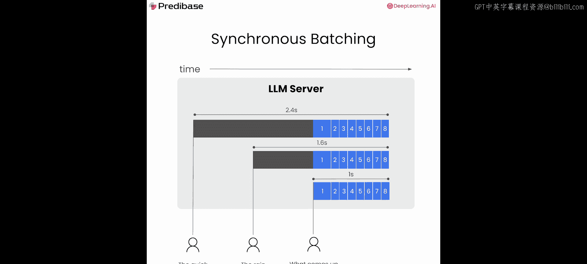

So this idea of constantly moving elements in and out of the batch。

 even though some elements might stick around for some amount of time。

 is at the heart of what we call continuous batching and one additional thing to call out here is that again。

 this notion of prefill versus decode does come into play here so you'll notice in the diagram。

 for example， that the first token is estimated to take a bit longer than the subsequent tokens and so typically in a continuous batching system。

 what we'll do is we'll handle these prefill and decode steps as separate batches conceptually so if we get multiple request at the same time that need to do prefill we'll do them together。

 but then otherwise we'll try to keep all the decode requests together in a single batch so that we can limit the amount of excess padding that we have to do and overall improve the throughput and latency of the system and so in this hypothetical example we can see that we get somewhat the best of both worlds。

 our latency。Is very low。 In fact， it's even lower than the case we processed one request at a time。

 And our throughput is， in this case， just as good as what we had in the synchronous batching case。

 But if we were to extend this out further to。Cases where we have requests that are generating different numbers of tokens。

 we might even see the throughput improve through continuous batching。 Now。

 let's jump in and show you how you can implement this continuous batching process yourself from first principles。

As before， we're going to start with importing our basic dependencies like Pytororch and transformers。

And also， as before， we're going to be using the G2 model from hearinging phase transformers for doing most of our evaluation。

 And because even in the continuous batching case， we are batching。

 we're going to go ahead and introduce the padding tokens。 and similarly。

 we're going to use our same set of。Prompts from the previous lesson for our experiments we're going to reuse two helper functions。

 generate batch tokens with past and generate batch so that we can use them to compare against our new continuous batching implementation。

 First， we're going to seed our random number generator so that this process becomes deterministic to remove any effects of randomness Next。

 we're going to define a few constants in this case the Q size So how many requests are we're going to put into our Q and our batch size which is how many of these requests we want to ideally put together into a single batch at a time。

 Next， let's define our request queue， which is a data structure that contains a list of tuples where the tus consists of two parts。

 The first is the string request that the user wants to submit as the prompt to the model and in this case。

We're just going to use the first prompt of our list of prompts from above。 So in this case。

 the quick brown f jumped over the。 And the number of tokens that we want to generate is going to be 100。

 If I mo the batch size equals 0。 So if it's the first element of the batch， Otherwise 10。

 And so what you'll see。Is that this particular combination should result into the worstcase performance that we would imagine where you have one element that wants to generate a lot of tokens and then the other elements in the batch just want to generate a few tokens and we should see that through synchronous batching。

 this means that all this request that just want to generate a few tokens have to wait a very long time to be able to be fully processed。

 Next， let's take our request queue and form it into batches of batch size length So this just basically creates a new list from the request queue slicing it into sublist of batch size and length or less than that if if due to rounding let's go ahead and look at the first eight or batch size elements of this request queue just to get a sense for what this is going to look like Here you can see that every single input string or prompt that we're feeding to the model is the same but the number of tokens that we want to generate is different。

And for a single batch in this case， we want to generate 100 tokens for the first element of the batch and then 10 tokens for every subsequent element Next let's convert our request queue into batches that can be processed independently where every one of the batches is going to be itself a list of batch size or fewer elements so that we can very easily feed those one at a time to the model and here you can see that we have four batches which makes sense because our Q size of 32 divided by batch size8 is4 and if we just take a look at the first batch in our list you can see that looks very similar to what we printed out earlier。

 it is itself a list consisting of eight of these tuples where the first sequence in the batch needs to generate 100 tokens。

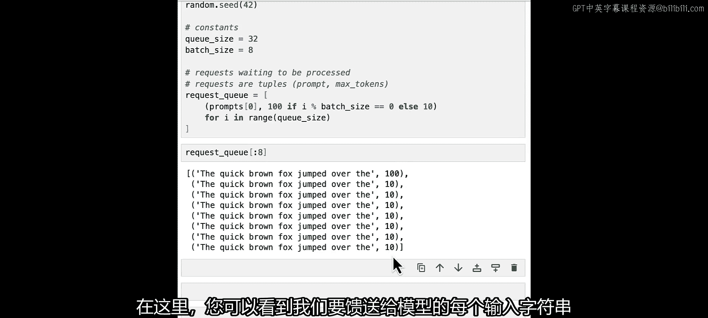

Okay， now we can go ahead and write the core logic of our experiment that will generate the tokens for all batches and record the duration。

 So in this case， we're going to start by recording the time at the very beginning。

 because we want to measure the total time that this process takes to run and we're going to use T QDM to render a nice progress bar for us。

 and then within each one of these iterations for every batch in our batches。

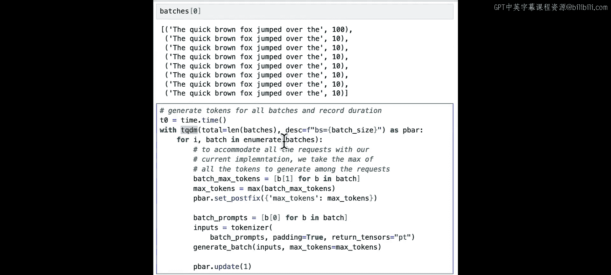

We're going to do a couple of things。 the first is we're going to get the number of tokens that we want to generate for each element in the batch。

 which is going to compute the max over that to get the max number of tokens。

And then we're going to set that as in the progress bar so that the user can see it。

 this max tokens will also come up again when we go to generate the actual data for this batch。

 and then we're also going to get the string inputs or the prompts that we want to feed to the batch so we're just going to create a new list consisting only of the prompts。

We're going to tokenize those prompts with padding， as we did before。

 and then we're going to call our existing generate batch function from the previous lesson。

And set the max tokens that we want to generate to the max tokens in the batch。And again。

 this is because in the synchronous batching world。

 even though some of these requests only want to generate 10 tokens， we're going to have to generate。

 however many tokens， the largest element of the batch wantss to generate。

 because we're doing it synchronously， we're not doing it in a continuous way。

And then we update the progress bar at the end of the iteration。Finally。

 we go ahead and record the total duration that this process took and we can run it。

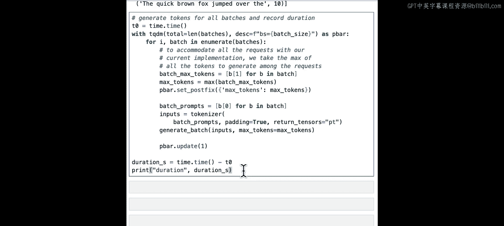

So note that this process will take a little bit of time to run because we are using a CPU for a pretty large model and generating 100 tokens is a decent bit more than we were generating before。

 but you can see that it took about in this case， 17 seconds to generate our first batch of data。

 and so we should expect that it will take about the same to generate every subsequent batch。

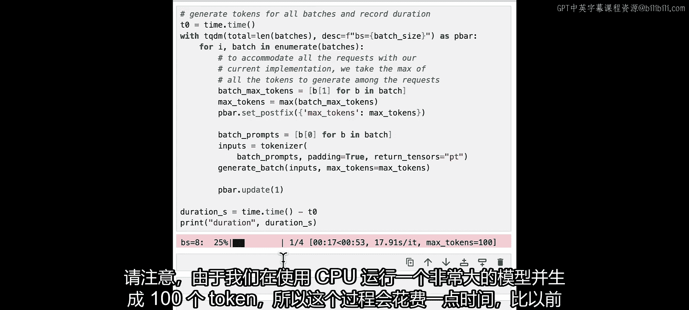

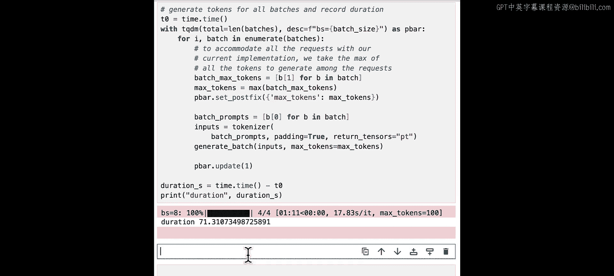

All right， and as we can see， that took about 71 seconds to complete in total so。

Definitely took a bit of time for only 32 elements。 And again。

 that's because even though there's only four of the elements in the batch that need to generate 100 tokens。

 because theres one of those in every batch end up being the bottleneck for everything。

 So now we're going to implement our continuous batching algorithm and see if that can help improve the performance for this example。

 So the first part of the continuous batching algorithm is the same as what we did before for the synchronous batching case where we define our random seed。

 our Q size。And we create a request Q。 Again， it's going to be the same request queue that we created before。

 We're going to have a progress bar that shows us how many of the elements in the request queue we've processed so far。

 Now， let's get into the unique part for continuous batchching。 So the first thing we're going to do。

Is seed the initial cached batch， so it's the initial batch after we run the first the prefill step。

And to do that we're going to use a helper function called ait batch。

 which basically takes some elements from our request queue and converts them into a dictionary form。

 which is the batch format that we're going to use for generating the next token。

 and then we're going to pass that to our generate next token helper function that will generate the cache batch that we can use for subsequent decode steps。

 and then we're going to remove the elements from the request queue that we just processed and placed into this cache batch object。

 Now we're going to introduce a while loop that will continue while at least one of two things is true。

 Either there are more requests sitting in the queue that need to be processed。

Or the number of elements in our cache batch is non0。

 which means that there are still elements that are waiting to finish processing。

 We're going to compute a。Measurement here called the batch capacity。

 which is basically the headroom that we have to add more elements into our currently existing batch。

 So naturally， if that batch capacity is greater than 0 and there are still items waiting in the queue。

 Then we can go ahead and add them to the batch in order to add them to the batch。

 we first need to run a prefi step。And again， we're going to do this because we don't want to have to introduce a whole bunch of padding to the elements that are in the cache batch that are in the code phase。

 so we're going to run a separate prefi step where we first initialize the batch inputs。

 generate the next token for this new set of elements。

 and then we're going to remove those elements from the queue so that we no longer have to work with them on subsequent steps。

Next， we're going to go ahead and merge this batch that we just generated called new batch with the batch that we previously had cached in our continuous batching process。

 So the merging process is fairly straightforward。 You can imagine that， essentially， we have。

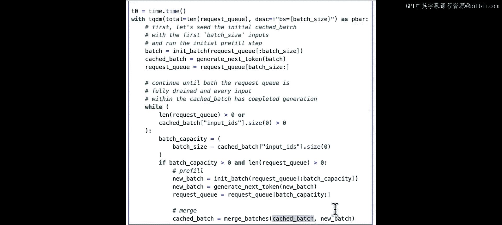

The original batch here。 So this batch， which corresponds to the quick brown fox。

 and then a new batch here that we want to append in that consists of the rain and what comes up。

 And when we cancatenate them， we essentially want a new tensor that consists of the elements of both with some additional padding introduced where necessary to ensure that the shapes line up。

 So our merge batch function is just going to do two things。

 it's going to add the padding tokens where necessary to get the shapes to a align and then it's going to concatenate things。

 Once we've gone ahead and filled up our batch to its full capacity or however large we can get it。

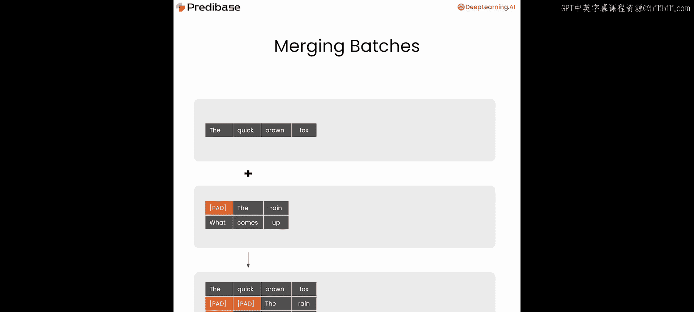

We go ahead and run the next decocode step。 So this is just a normal generate next token step。

 which results in a new cached batch for generating the next set of tokens。 Finally。

 after the decode step， we take a quick look at the current state of the batch and see if there are any elements in the batch that are ready to be removed。

 So the filter batch step will essentially do two things similar to the merge batch step。

 it will first remove the elements from the batch that have reached the terminal state either again。

 because of an end token， or because the maximum number of tokens has already been generated。

 And then it will do the reverse of the merge step where it will remove excess padding tokens from the beginning。

 because that contributes to computational overhead and memory overhead。

 So when we call the filter batch function， we get two things that come out a。😊。

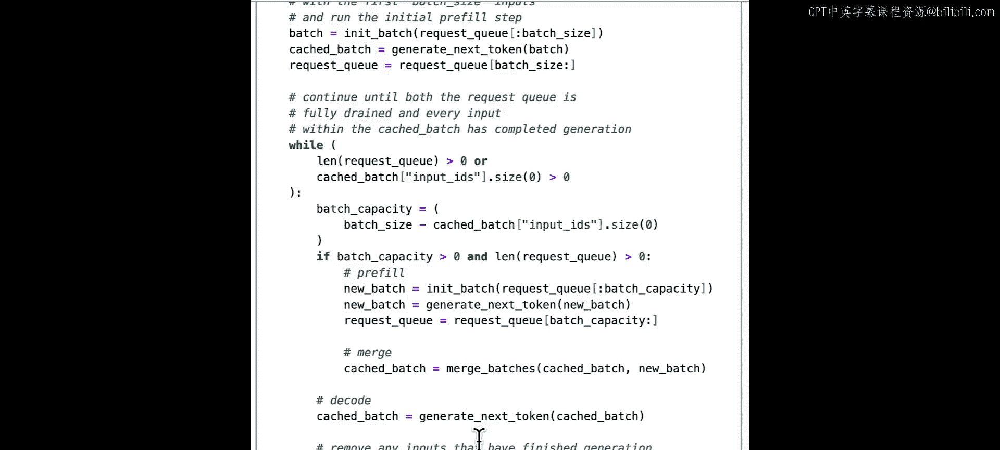

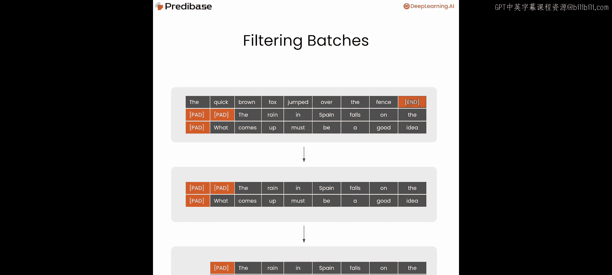

Smaller cached batch， potentially with just the things that still need to be generated left。

And then a list of the indices in the batch that were removed at this step。

 And then we're going to just update our progress bar to the number of elements that were removed。

 which corresponds to how many elements have completed processing fully。

In this continuous batchching algorithm we showed you a few utility functions that made this process a lot simpler。

 There was a knit batch function。 We had the Gene next token function。

 the merge batches function and the filter batch function So these helper functions we implemented all from scratch in a utility do pi file that's included So if you want to learn more about the details which are more pitorrch specific。

 I invite you to take a look at that file， which will include comments on what's happening at each step。

 Finally， let's go ahead and run our continuous batchching process using the same set of inputs that we used for the synchronous batchching process before and see if there's any improvement to the runtime。

Great， so that completed in about 21 seconds。 And as you may recall。

 the previous implementation took around 71 seconds。

 So it was quite a significant reduction in overall end to end runtime。

 And you might have also noticed that it took a little bit longer to get those last few elements at the end。

 And so you can imagine that that corresponded to those longer sequences where we wanted to generate 100 tokens。

 So we were able to add those to the batch at the very beginning。

 And then continue to add and remove those smaller sequences of 10 tokens throughout the process。

 and then those stragglers， those 100 token sequences complete at the end without causing a bottleneck in the whole process。

 And that's fundamentally what continuous batching is able to do for us。

 And this ultimately is one of the key drivers， not just of good throughput and latency for element。

 but also for that token streaming ability that you see commonly from。😊。

E and inference systems where you start to get the tokens one at a time。

 because we're able to process them just in time and grab tokens one at a time from the system。

 we're able to very rapidly get those results back to the user without having to wait for these big batching steps。

And in the subsequent lessons， we'll go beyond batching and start to talk about other ways that we can improve the efficiency of our system。

 including quantization， which helps us reduce the memory pressure need to run larger models。

 as well as techniques that we can use to efficiently serve fine tune models such as low rank adaptation。

 so please join me for those in the coming lessons。

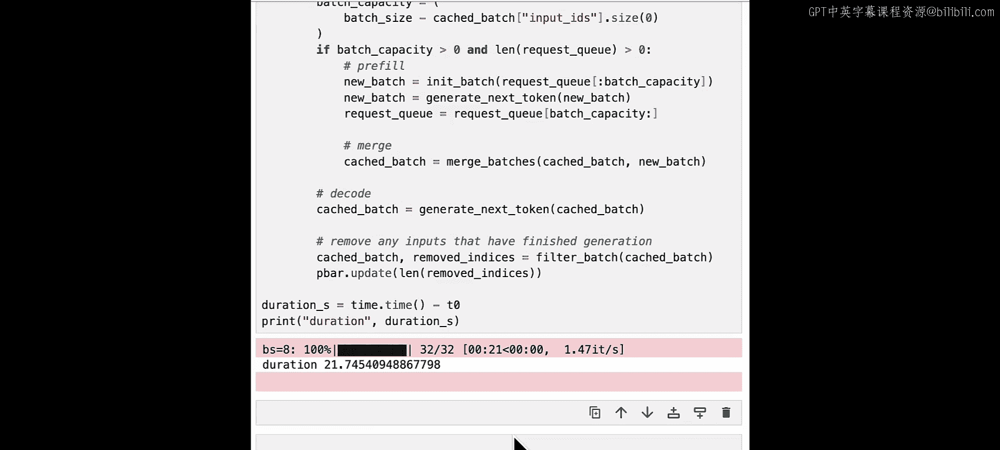