# 吴恩达《高效服务大型语言模型｜Efficiently Serving LLMs》中英字幕 - P5：5.L_4-Quantization.zh - GPT中英字幕课程资源 - BV1bt421578n

LN model weights require a lot of memory， but with quantization。

 we can compress very large models down to run on commodity hardware。

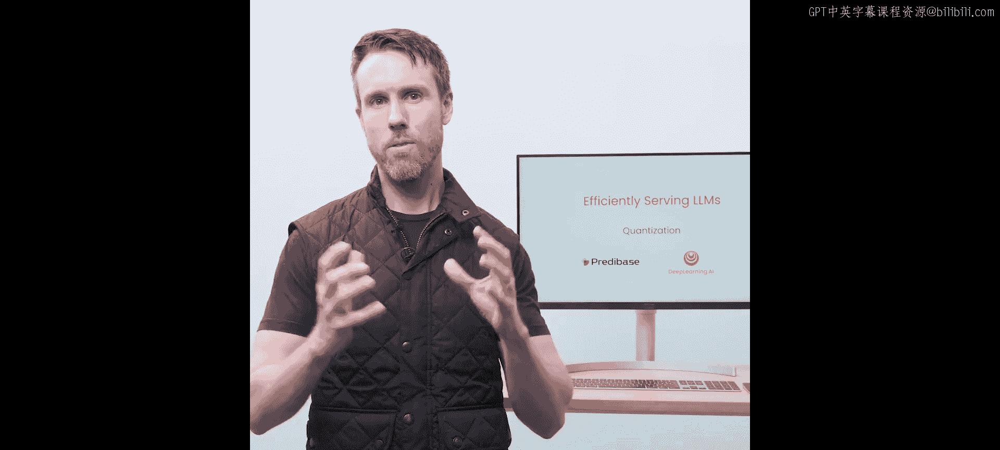

In this lesson， you'll learn how quantization works and implement an algorithm to quantize an element down to 8 bits per parameter and de quantantize just in time during inference。

 Let's take a look。

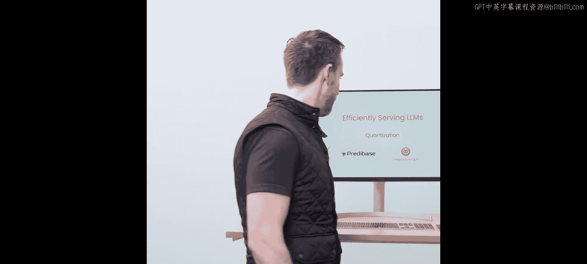

Let's go ahead and start by importing our。Normal set of dependencies this time we're also going to import our generate function from previous lessons。

 Once again we're going to start by using the GT2 model as our model of choice for experimentation we're going to do some small modifications to make it support。

Btching。One additional thing we're going to do up front is modify the D type property of the GPT2 model。

 this is just a small thing we're going to do to trick pytorch if you want into thinking that the model's data type is 32 bit float even when we do the quantization。

 which will be necessary to avoid some nasty errors down the road。

And the first thing we're going to take a look at now is what we call the memory footprint of the model。

 this is a helper function provided by the Hardney F Transformers Library。

AndYou can see that the memory footprint is about 510 megabytes。

 so that right off the bat is the main challenge that we have with storing these large models is that they require lots and lots of memory per parameter to represent So in order to motivate this idea of quantization and where all this extra memory overhead is coming from let's first take a moment to talk about floating point representations So the standard representation format that's used for representing real valued numbers we're going to use pi as an example is FP32 so that's 32 bits per number and this is a very standard format that you see used across lots of computing applications for representing numbers but it also has quite a big footprint compared to some other formats out there particularly for deep learning models like large language models where you might have hundreds of millions or even。

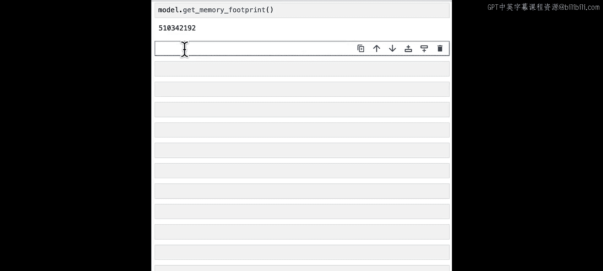

Billions of these floating point values that you need to represent。

 So where is all that overhead coming from So in FP32。

 there are three constituent components that make up the floating point value。

 The first is just a single bit which is the sign so positive or negative The next component is what we call the exponent which is8 bits and FP32。

 and that generally corresponds to the magnitude or the range of values that you can represent。

 and then finally you have what's called the manta or sometimes the significant which you can think of as being like the decimal component or the fractional component of the value and that broadly represents how precise of the number you can represent with that format。

 So FP32 has quite a large mansa at 23 bits。 So that's where most of that data is coming from is representing all that precision。

 one interesting thing about deep learning applications though。

 is that depending on what you're doing。The model， whether you're training it or you're doing inference。

 etc you might not necessarily need all that precision Oftentimes what you really just need to know is the approximate magnitude of the value and so we can think about ways that we can represent roughly the same amount of information with fewer bits and so the first step down from FP32 would be thinking about how much information can we capture with half the number of bits so 16 instead of 32 and that leads us to two data types that are popular in the industry one is FP16 which is the standard 16 bit floating point representation which has five bits in the exponent and 10 in the Mantsa and a more recent format called B floatloat or brain floatloat which came from。

 I believe the Google Bra folks is where the name comes from and that has8 bits in the exponents so same dynamic range as FP32 but a much smaller。

Manta， so only seven bits instead of 23 for FP32 or 10 for FP16 and what that means is that our precision。

 our ability to accurately capture the desired decimal part of the number is greatly reduced as you can see comparing the representation of pi there。

 3。141 is closer to the true value than 3。1406 but BF16 ends up being very practical for representing numbers in deep neural networks both at training time as well as at serving time in a lot of cases。

 because it has that larger range of magnitude values it can represent and so is often a popular choice for these sorts of applications if the hardware supports it。

 and then finally if we want to go even further， more recent formats which the latest generations of NviIDdia GPUs like the Hopper architecture supports is FP8。

 a floating point that's represented with8 bits。In this case。

 five in the exponent and only two in the mantesa so if your hardware does support it。

 it's definitely worth exploring some of these data types to save on memory overhead while still getting good performance from your hardware distinct from the idea though of using increasingly small floating point representations is the idea of quantization So with quantization we're less interested in representing the exact same information but just with fewer bits and more interested in thinking about how we can actually compress that data down into a compress form with some metadata that can then be reconstructed just in time during the forward pass so that we can save on memory overhead and pay a small amount of cost on compute but get dramatic benefits in terms of compression so oftentimes these quantization formats can get down to8 bits in the simplest form but sometimes four。

32 and even1 bits in some cases can be used。So the ability to pack increasing large models onto smaller hardware can be quite profound Let's talk about one such quantization technique here。

 which is zero point quantization so let's imagine that we have a tensor corresponding to five floating point numbers and the first thing we're going to do is we're going to compute some metadata about the tensor that we want to compress so in this case we're going to compute the min and the max value and then we're going to compress that down into a range between0 and 255 using only unsigned integer values and then store that off for use later in our application Now let's write a function that will help us do this quantization step in code First thing we're going to do is calculate the min and max values of the tensor and then we want to calculate two sets of metadata values the scale and the zero point the scale is the value that we'll use to quantize the value。

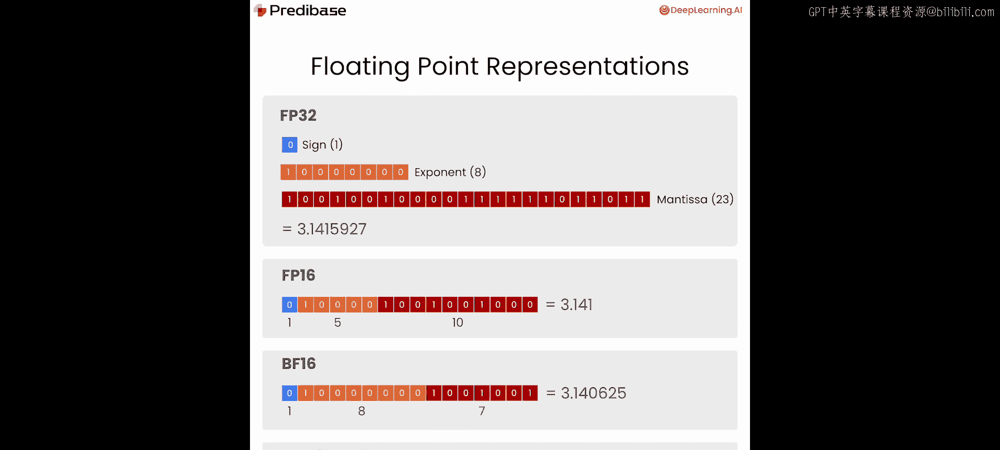

Down to the range between 0 and 255 and the zero point is what we' subtract off from our original value during quantization add back during dequitization So at this point we can go ahead and apply this scale function to our tensor of input so first thing we do take every value the tensor subtract off this zero point which in our case is just the min value and then divide by this scale and this will ensure that every single value in t quantant is going to be within the range of0 to 255 last thing we want to do is a simple clamp operation just to handle any rounding errors so we'll go ahead and clamp off any remainders on the decimals to make sure that we're just dealing with values within this range and then importantly we also need to keep track of these values in the states so that we can use them to reverse the quantization during the dequantitization step later on one important call out here is。

That unlike in using smaller and smaller floating point representations。

 we can't just use the quantized tensors directly in computation。

 that's because these integral values alone are not sufficient to actually represent the information we also need this metadata to reconstruct them so that we have the true values that we're trying to represent here。

 Last let's go ahead and cast our tensor， which is now full of just these values0 to 255 to the unsigned in a format so that we can officially reduce that memory footprint of the tensor down by a factor of4 and then return both the quantized tensor and its state to the call let's run a quick test to see what effect this quantization function has on a random tensor from our model。

 So we're going to grab a single tensor from the first attention block layer and we're going to print out two things it shape and。

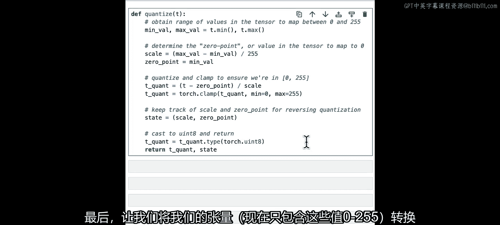

A small sample of its values and you can see that these values generally fall somewhere between negative1 and 1 in most cases。

 they're floating points and they have a decent amount of precision maybe about four decimal points that we're showing here Now let's call our quantization function using this tensor t and we'll print out a sample of the values from the quantai state along with the men and the max values from TQ which should correspond to 0 and 255 if everything worked。

As we expected and sure enough， when we look at the values， they're all unsigned integers。

 they're all in that range 0255， and the min value is strictly 0。

 and the max value is strictly 255 so we can feel pretty confident that our quantization function did what we expected。

Next， let's write a function to now reverse the quantization step， which should be a lot simpler。

 We're going to write a function called de quantantize。 and it's going to take two parameters。

 The first is。The quantized tensor T， and the second is the state that we stored off consisting of the scale factor and the zero point。

 so let's go ahead and。Pull those two values out of the tuple。

And then we're going to return a pretty simple calculation here。 So now we have it back。

In that full FP 32 format， but it's still at this point， just values between 0 and 255。

 so let's multiply it by that scale factor。 so now it's within the range that we expand and then let's offset it by the zero point。

 So now the min value will be the min value from our original tensor and just return this back to the color。

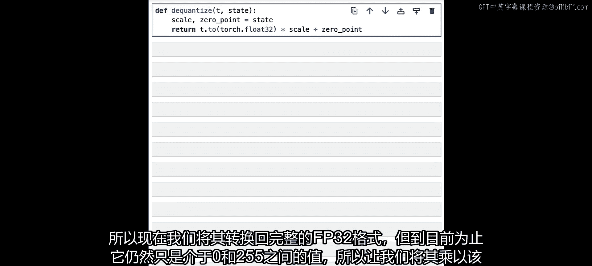

Now， we can try。Calling this function， So T reverse here。Dequantize。TQ with the state。

And then we'll print out the value of。This reversed or de quantantized tensor and see that it's back in that expected range of negative1 to1 with values that look probably similar to what we had before quantization but let's actually take a closer look and see just how close these values are to the original values so during the process of dequitization。

 we took our tensor of floating point values， we converted it to a tensor of integers between 0 and 2 of5 and then in dequitization we converted it back to tensors in the range of the original set of tensors。

 but because this is a lossy compression， we should expect to see some amount of error between our original tensor and our dequantized tensor Now a couple of those values specifically the men in the max should not be any different but other values will and that amount of error will generally vary depending on how reasonably that number。

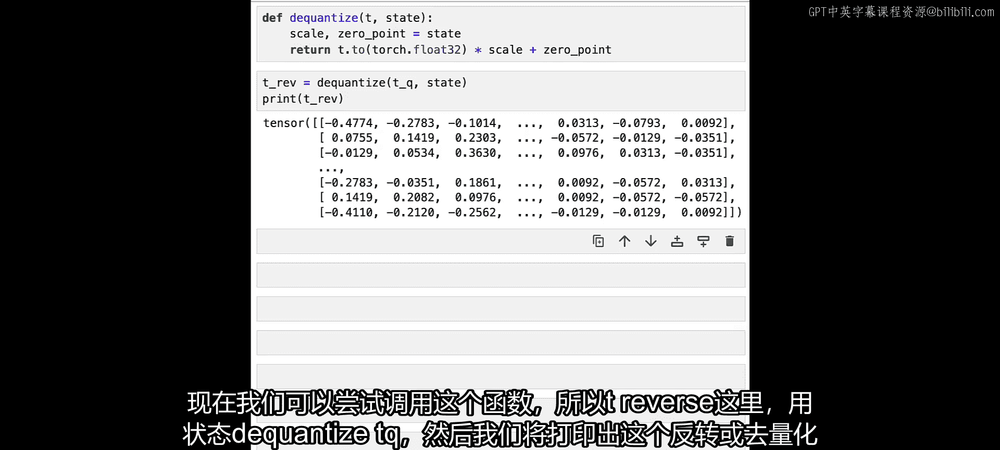

coul be projected onto the simple space of 0255 unsigned integers。

 so now let's go ahead and measure out what we call the absolute error between these tensors。

 the original tensor and the deco quantantized tensor and just get a sense for this particular tensor how far off our decoquitization was from the baseline。

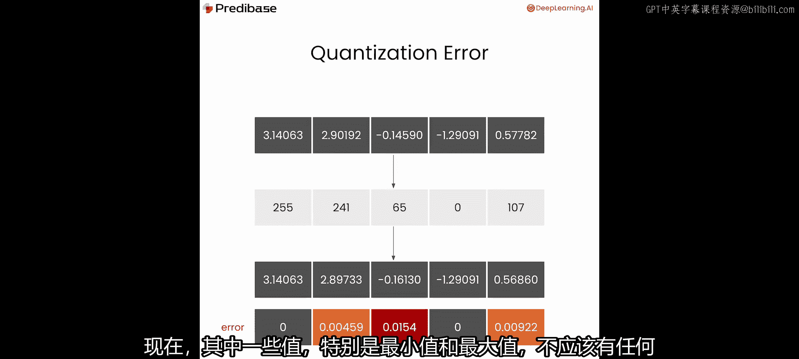

And as you can see， the error is generally pretty low in absolute terms。 In some cases。

 we have about two decimal places of error， some cases close to one， but in general。

 it's not egregious， but it's definitely going to have in effect on the performance of the model。

 And so in the next section we'll see just what kind of effect this has on overall model output quality。

 Allright， now let's try applying this quantization technique to the entire model。 Before that。

 we're first going to take a look at what the model outputs for a particular request so that we can compare it。

With the response that we get back after we've gone ahead and done the quantization。

 So here we're going to use our helper function that came from the previous lessons。

 we're going to pass in the model and its unquantized form， the tokenizer。

 And then we're going to form a batch from our input， the quick brown Fo jumped over the。

 And we're going to generate 10 tokens。 And let's see where we get back when we do so。

 As before we got the quick brown Fo jumped over the fence and ran to the other side of the fence。

 So let's keep this in the back of our minds as we go through the quantization process and see what effect that has on the model output。

First， we're going to write a function that quantizes the entire model instead of just a single parameter。

 First thing we're going to do is create a dictionary of states that are going to be used to store the scaling and zero point metadata that's needed to reconstruct the full precision model parameters during the decoquantitization step。

 we're going to iterate over every named parameter in the model so that we can use that name as a key in our state dictionary。

 We're going to make sure that every parameter has requires grad set false as the N8 quantized data type is not differentiable。

 therefore， we' raise an error if we try to store off the data while the parameter requires gradients。

 We quantize the data and then store off that data in the parameter along with recording the state and the state dictionary。

At the key that maps to the parameter with this name。

 so we do all that and then we return two things， we return the model in its quantized form along with the dictionary of states。

 Now let's go ahead and run the quantization。As before we can look at the memory footprint of this model to see if our quantization worked as expected。

 and great， as we can see， it's now 137 mebytes instead of the over 500 plus mebytes that was before。

 So we did， in fact， get that about 4 x reduction in the total footprint that we were hoping for One thing you might have noticed。

 though， is that we are also now generating some new state or some new overhead in the form of the state dictionary。

 So one question you might have is how much overhead does that state dictionary contribute。

 So let's use this new function size and bytes to sum over every value in the states dictionary where every one of these values is。

 as you recall， a tuple that consists of the first element being the scale factor。

 the second element being the zero point and we're going to use that size and bytes function to compute how many bytes each of those tensors takes up and add them both together。

😊。

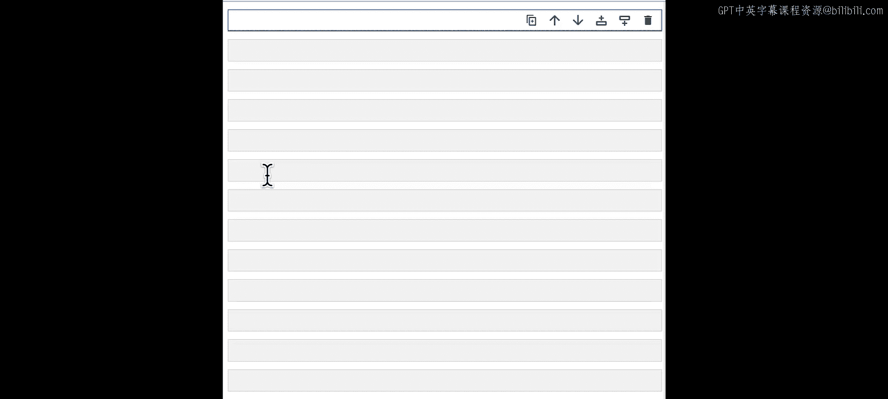

To calculate the size per state variable and you can see that in total。

 we are only creating an additional kilobyte or so of overhead by introducing this state dictionary so for a model that has over 100 million parameters we have a kilobyte of overhead from state which is not too bad and so we shouldn't worry about the effect of introducing this dictionary in production settings。

 you'll likely want to dequantize each layer just in time as you need it during computation to avoid having to dequantize the entire model at once and thus undo all of the effects of quantization in terms of reducing the memory overhead but that requires quite a bit more work so instead we'll write an additional helper function here called dequantized model that takes in the quantize model along with that state dictionary and then essentially undoes the process of quantization by again iterating over the name。

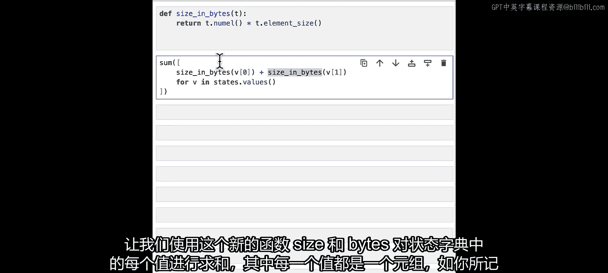

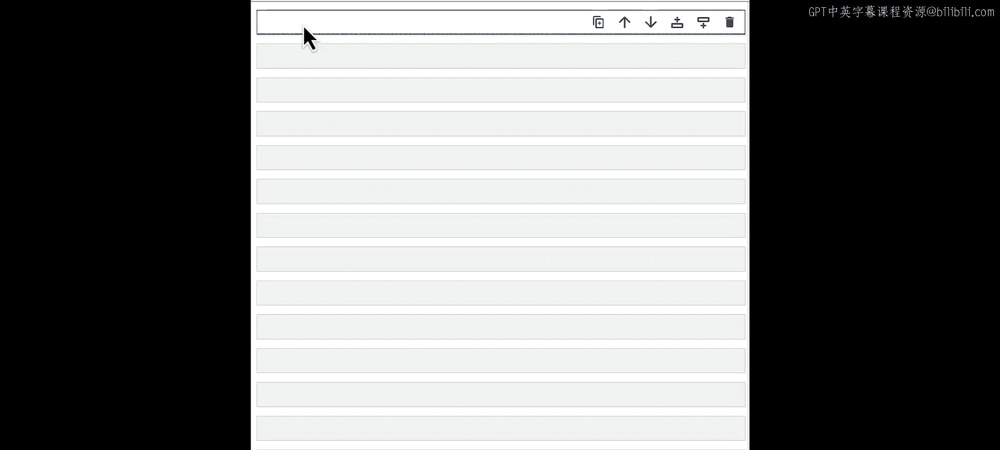

Prameters。Pulling out the state from the state dictionary running the deco quantitization step using the quantized data and its state and then repopulating the parameter data with the new deco quantantized state Now let's go ahead and run the decoquitization function as before we can compute the memory footprint for this new deco quantantized model and see that we're back to about 510 megabytes of overhead so our deco quantitization did what we expected and now the model is again an FP32 format。

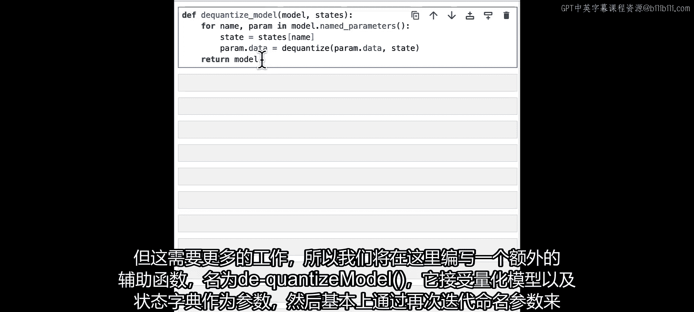

Now， let's go ahead and take the function that we called earlier to generate the response。 before。

 remember we got the quick brown fo shoved over the fence and ran to the other side of the fence。

 Let's now copy that down here。 we're going to run it again。

 But this time we're going to use the de quantant model。

 Instead of the original model and see what the output looks like。

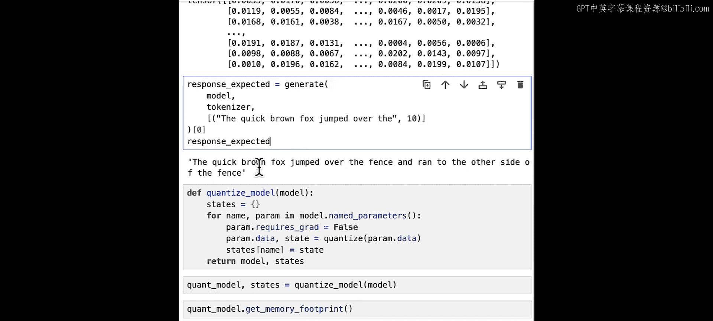

So the quick brown fo jumped over the fence。 The fo jumped over the fence。

 So the first couple of characters there are the same It still said fence。 But after that。

 it started to diverge that the output was still sensible if a little bit repetitive。

 But it was still grammatically correct and still something that you could say the model is not completely degenerate to the point of being incomprehensible。

 which can certainly happen if the deep quantization is lossy enough。 So overall。

 you can see that quantizing and dequizing does have an effect in overall model output and model quality and different quantization techniques therefore exists to try to have an effect of getting the most quantization while degrading the model performance。

 the least noticeably。 one thing in particular that you could do as an exercise is try creating increasingly granular quantizations of the tensors。

 So instead of competing metadata for say。The entire tensor。

 you could compute separate metadata state for every column or every row of the tensor and see if that helps to improve performance。

 So just a few things to explore as you go deeper into this topic of quantization。

 In the next lesson， we'll talk about the idea of serving fine tune models。

 and particularly parameter efficient， fine tuning and inference。😊。

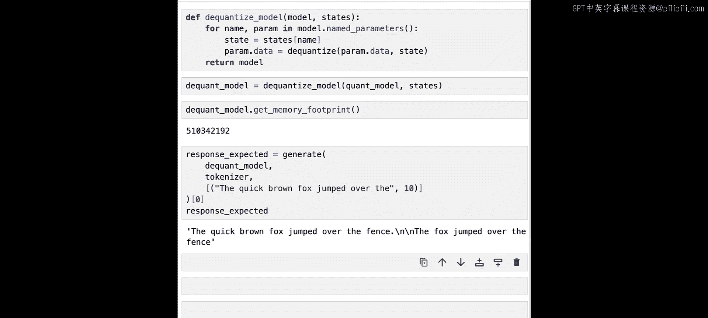