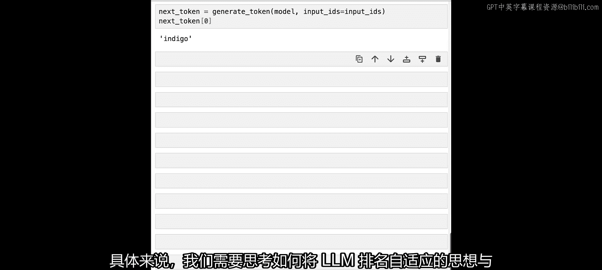

# 吴恩达《高效服务大型语言模型｜Efficiently Serving LLMs》中英字幕 - P6：6.L_5-Low-Rank_Adaptation.zh - GPT中英字幕课程资源 - BV1bt421578n

Geting the most out of LLMs means customizing them to your data and tasks。

 low rank adaptation or Laurara is a parameter efficient fine tuning technique that allows you to customize LLMs without changing the existing model parameters。

In this lesson， we'll implement Laura from scratch and show you how adding just a handful of parameters can have a big effect on model output。

 let's do it。

Let's start by talking about the basic concept of fine tuning。 So in fine tuning。

 our goal is to adjust the weights of the model to better suit our specific task or our specific data set in normal fine tuning。

 what we call full fine tuning。 Every parameter in the model which corresponds to a weight is going to be updated during the backward pass of the fine tuning process。

 And what this means in practice is that when we save out our fine tune model。

 we're actually saving out entire copy of all of the model parameters， and therefore。

 when we want to go and deploy these fine tune models。

 we have to stand up an entirely new deployment for each fine tune model。 However。

 there is another way that we can customize models to our specific task。

 Lowrink adaptation takes a certain set of parameters in the model somewhere between the layers surrounding the attention computation or。

Some cases， even all the layers in the model， and it introduces a new set of parameters alongside it so that when the input goes through the layer。

 in addition to。Processing the input of the original weights。

 it also processes the input of this new set of weights。

 which consists of two new tensors that we denote A and B that have what we call a low rank shape。

 So the input dimension of a corresponds to the input dimension of W。

 the output dimension of B corresponds to the output dimension of W。

 But the inner dimensions for A and B， so that when they multiply together。

 they have the same input an output shape as W。 that input dimension is actually going to be much smaller。

 And this will mean that the effective size of these parameters is a very small fraction sometimes around 1% or so of the parameters of the original tensor W。

And that means that in practice， if all we are doing is updating these new low rank matrices that we introduced。

 then what we've effectively done is found a way to fine tune this model and adjust it to our particular task while only modifying a small fraction about 1% or so of the parameters。

 And from a serving perspective， this is very advantageous because it means that the cost of loading in these fine tune models into memory is very low。

 And we could potentially do it on the fly dynamically at runtime and even swap these Laura adapters in and out of memory。

 depending on the request coming in from the user。 And so that's the idea we're going to explore both in this lesson and the lesson that follows to begin。

 let's import our normal set of。Depenencies， pytorch， et cetera。 This time around。

 we're not going to be using hug face transformers。 Instead。

 we're going to be using a toy model so that we can really get deep into the weeds of how this technique works and really understand what's happening layer by layer。

 Let's start by setting a manual seed so that everything that we do below will be deterministic。

 And now let's create a test model that we'll use to explore this idea of lower rank adaptation。

 So in this example， we're implementing a very small toy language model that just consists of three layers。

 The first is what we call an embedding layer that maps the input token Is into a hidden space。

A linear layer， which projects that embedding into another embedding。

 and then a L M head layer that falls at the end that then produces the final logits that we can use to determine what the next token should be。

 So we're not doing any attention。 Very， very simple architecture。

 but the input and output contract should be consistent with what you would expect from a normaldal L M。

 like our original G2。Now， let's initialize an instance of this model。 And in this case。

 we're going to set the hidden size， which is the only parameter that we pass this model to be something reasonably large in this case。

1024。 We'll do that so that we can illustrate just how much of an effect Laura has at reducing the overhead of fine tuning this model。

 Let's create some dummy inputs for our model。 In this case。

 we're just going to pass in some random token Is between0 and 7。

 We're going to use a toy vocabulary as well， This isn't going to correspond to any particular language or anything like that。

 just some token Is that we can use for illustrative purposes。 specifically。

 what we can do is imagine a simple mapping between these token Is。To some words in this case。

 colors in the English language。 So， for instance， what we see here is that token 0 will map to the color red。

 token 1 will map to the color orange 2 to yellow， etc cetera。 And in total。

 we have 10 of these colors in our vocabulary。 So our total vocabulary size will be 10。 mean。

 the largest value that we should expect to see is 9。 Let's bring back our familiar。

 generate function。 In this case， it's going to be generate function that works on a batch。

 So we'll go ahead and process that over all of the rows of the input as opposed to just the0。

 As before we're going to say torch do nograds so that we don't introduce any gradients。

 We're going to pass our inputs into the model。 We're going to extract the last logits。

 And we're going to take the a max to greedily。Crab the most likely next token。

And then we're just going to pass that token ID into our detokenizer using a simple index lookup into the list。

 and that'll tell us what string that particular output corresponds to in the vocabulary。

 Now we're ready to actually generate a token。 So let's go ahead and call this function with our model And with the input Is that we generated。

 which was just a sequence0 to 7。And see what token comes out of the model。 magenta。 Okay。

 so this is not anything particularly intelligent going on here。

 These weights were initialized randomly， as you may recall。

 but you'll notice that it does produce magenta and it's also deterministic in the sense that if we call this more than once。

 it's going to continue to produce the same output。 So good。

 everything is working as expected so far。 Now， let's come back to the idea of low rank adaptation。

 So our goal in this next section will be to introduce some low rank parameters to the linear layer of our toy model。

 and see if by doing so， we can affect a change in the output of the model so that it predicts a different token。

 and then you can imagine that if we were to fine tune this model further。

 we could steer the model to produce exactly the type of token that we want it to through a normal supervised fine tune process。

 But that part will save for another time。 Buts start by generating an input tensor。😊。

That would normally go to the linear layer of our toy model。

 So here the tensor is going to be three dimensional。

 which will correspond to the batch size in the first dimension。

 the sequence length and the second dimension and the hidden size。

 which you may recall we set to 1024 in the third dimension。 Now。

 let's explore the lower computation。 recall that in the lower computation that we talked about before。

 there are two tensorors A and B。So let's go ahead。And define these Now。

 we're going to use random end to create a randomly initialized tensor。

 But remember that we set a random seat above。 So hopefully this should produce the same outputs every time we run it from the top2 here is the what we call the the hyperparameter R。

 which corresponds to the rank。 So in this case， we're using a rank2 decomposition of this matrix W that we're trying to create a mirror of here with laura。

 So let's go ahead and initialize these tensors。 Now。

 let's go ahead and define W as the model's linear weight that we created above。 So。

We're going to go ahead and select the attribute of the model corresponding to the linear layer。

 pull out the weight， and that's correspond to W， and as expected， W is 1024 by 1024， which again。

 if we multiply out la A and Laura B， which we can just do here for illustrateusstrative purposes。

We can compare and see that much like WW2。It also has shape 1024 by 1024。

 So the math work is expected， and then you can imagine that when we process outputs of both W and the lower weights。

 we should be able to just sum them together and everything should add together nicely let's now compare the sizes of our original weight tens or W with the size of these two lower parameters。

 So if our original assumption was correct that the low rank parameters A and B are very small compared to the original weight parameter W than we should expect that when we compute the number of elements in a plus B that should be much。

 much smaller than the number of elements and ws。 let's go ahead and test that out and sure enough。

 it is in fact very small， it's less than a single percentage of the number of parameters in W you can imagine that if we were to increase the R rank value to something much larger than two like maybe a or 16 or 32。

That this value should go up in the number the percentage of parameters should be closer to W。

And similarly， as we increase the hidden size， this value should actually go down。

 So there's a bit of tension between those two。 Finally。

 let's go ahead and run the Laura computation in its entirety。

 just to make sure that everything works roughly as we expect。 So to start。

 we're going to go ahead and run the base output of the linear layer using our input X that we defined above。

 Next， we're going to compute the output of the Laura layers given our input X。

 So we're going to do a matrix multiplication of a of x with Laura a。

 and then we're going to take that whole result。And we're going to do a matrix multiplication against B。

 As we established before， these two output should have the same shape。 And so therefore。

 we can just element wise add them together。And as a sanity check will print out the final shape to make sure that's true。

 And if everything works is expected， there should be no errors or exceptions or shape mismatches。

 anything like that。 And great， as expected， the final output retains that shape batch size sequentially 1024 that we are hoping for。

 Next， let's generalize this whole process into an abstraction that we can use to modify our original model while keeping the contract of its input and outputs the same。

So let's define a new class called Laura layer。 It's going to be a torch module。

 and it's going to take a base layer， so an original linear layer from our model and a rank R。

And it's going to use those inputs to both store off the base layer as well as create the Laura A and the Laura B parameters。

 So the inputs of the Laura A parameter and the output dimension of the lower B parameter。

 need to be consistent with the base layer。 But that our value is， again。

 something that we have control over。 So that's why it's a parameter to the input。

 Then when we run the forward function on this layer， we compute the base layer output。

 we compute the Laura output， And then we sum them together as we showed above。 Finally。

 let's construct an instance of the Laura layer from the model's linear layer and give it rank2 as before。

 And then let's go ahead and check the output of this linear layer and make sure that， again。

 there are no error isn't the shape again has that one by 8 by 1024 shape that we're expecting。

 And it does。 Now that we've swapped out the linear layer of our model with the new Laura layer。

 Let's go ahead and just briefly take a。Look at what the structure of R model looks like now。

 So whereas before we had a linear layer that corresponded to an actual capital L linear layer from pytorch。

 Now we have this Laura layer that shares the same interface。

 So from the forward functions perspective， everything will work the same that consists of that same original linear layer as now an attribute of this Laura layer。

 So now let's go ahead and try passing our same original input into this model。So before， remember。

 we had our model， we asked to togenerate a token given a set of。Arbitrary input Is。

 it generated the string magenta。 And now we expect that with about91s probability。

 it should generate something different。 Now that we've adjusted the weights。

 if everything goes according to plan。 and it works the way we expect。 And sure enough。

 it generated indigo instead of magenta， which indicates that introducing these new lower parameters did have an effect on the overall output of the model。

 And so again， we can imagine that you might want to go one step beyond this and actually fine tune these lower parameters to better steer the model in the direction that you want。

 Or you can also start to think about how to scale up this process to apply it to more layers into generalize this process of injecting these new layers into the model。

 Next， we're going to dive into the idea of multilo inference。

 where we want to support not just one lower model。At a time。

 but support many lower models at a time。This is something that commonly arises in production settings where users are going to train lots of models and then serve them concurrently。

 and specifically， we'll need to think about how we can combine this idea of low rank adaptation with the idea of continuous batching that we explored before in order to get a system that is very flexible and able to serve as lots of different fine two models simultaneously while retaining those throughput and latency benefits that we saw from continuous batching。

 So that will be coming up in the next and final lesson。

