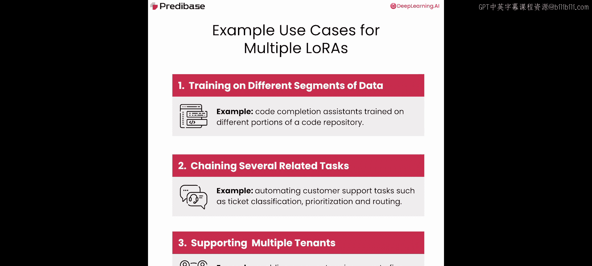
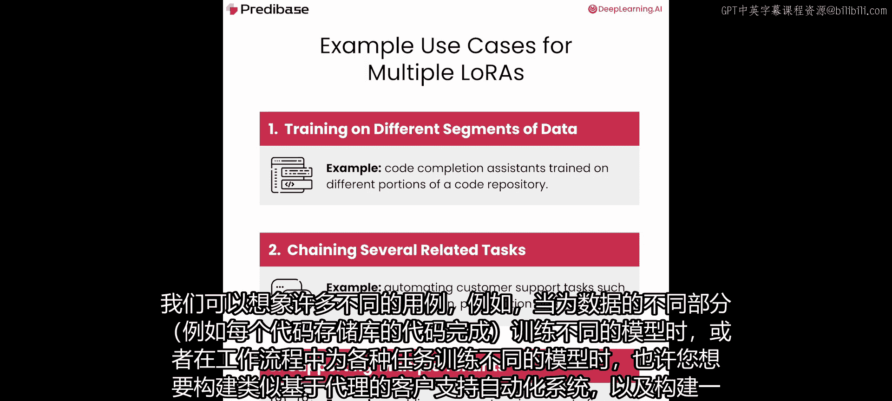
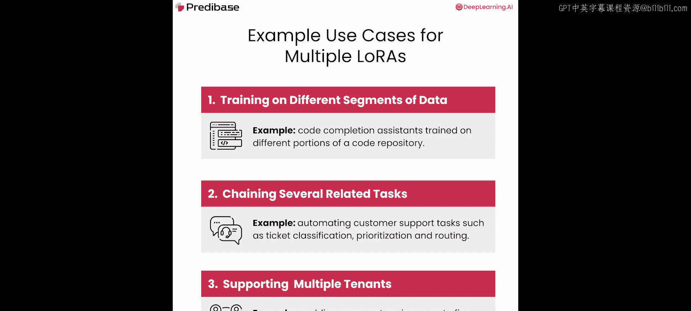
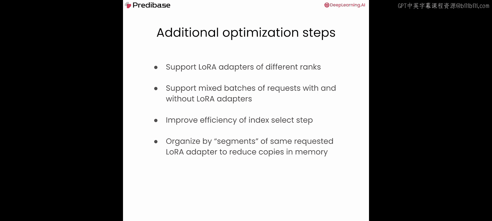
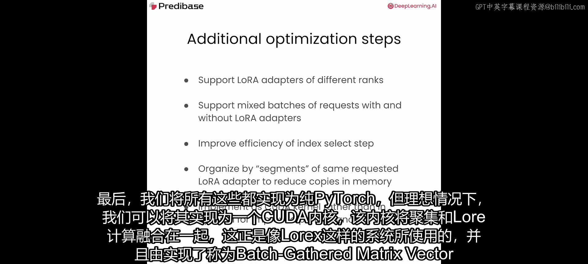
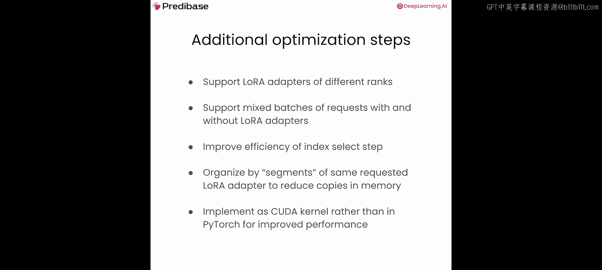

# 吴恩达《高效服务大型语言模型｜Efficiently Serving LLMs》中英字幕 - P7：7.L_6-Multi-LoRA.zh - GPT中英字幕课程资源 - BV1bt421578n

In this lesson， we'll combine Laura with continuous batching to create an end to end serving system that skills to many fine tune models and use a request at once。

 Let's dive in One of the benefits we identified when using Laura in the last section。

 is that it has a very small footprint in memory。 And this presents a really exciting opportunity。

 What if we could load many of these small fine tune Laura is at the same time。

 using the same base model backbone。 There are a number of different use cases we can imagine where something this would be useful。

 for example， when training different models for different segments of your data like code completion per code repo or something like that。

 training different models for various tasks in the workflow where you maybe want to build like an agentbased customer support automation system。

 as well as building a serverless platform to support many different tests with their own fine tune models。

 which is exactly why we invest in this idea at probase for our customers。 Now。

 in each of these cases， the end result is having many fine。😊。

modelsels that share the same base pretrained model backbone and need to be served concurrently。

 If we were to do this naively， we would end up with a separate dedicated deployment per fine tune model。

 which would be very expensive or a very slow system that processes a single adapter at a time and has to constantly swap them in and out of memory。

 But in this section of the lesson。 we'll see how we can efficiently serve dozens of these fine tune models together in a single deployment without sacrificing a latency or throughput。

 to illustrate this。 let's set up a very simple experiment that attempt to serve many fineted lais simultaneously。

 and we'll use a couple different techniques for processing these multiple los in parallel。 First。

 we'll go ahead and import our normal dependencies as before。 Again。

 we're going to be using a toy ptorch model。 So we're not going to be using any libraries like huggingface transformers at this point。

 Next， let's go ahead and start defining our interface that we're going to use for our testness。

 So we're going to define this abstract base。

So this interface called abstract multilora model。 First， our class needs an initializer。

 So we're going to go ahead and define the layers of our model。

 You may notice that this looks very similar to the layers that we had in our toy model from the previous lesson we have an embedding layer。

 a linear layer and an LM head at the end。 you'll notice that we're using 10 here as the hidden size instead of 1024 and this is just a particular attribute of working on the CPU instead of a GPU where if we were to use a much higher hidden size。

 we would be bottleneck by just computing a forward pass on the basic linear layer as opposed to on the multilora part So by using a very small linear layer we can really hone in on the benefits of the multilora inference。

 Next， let's define a helper function that will implement the multilora API contract So here the contract that we want to adhere to is that the output for I which is a particular element。

Of our batch should be equal to the input at that batch times whatever Lauraura weights A and B we want to use for that particular element of the batch。

 So you can imagine that a user is sending requests and they say I want to use this particular fine tune model or I'm going to use that particular fine tune model。

 And so for every one of these requests which correspond to I here。

 we want to use potentially a different laura。 And so that's in its simplest form， the goal here。

 and there is a very straightforward way to implement this。 in fact， which willll show below。

 but as we'll see there are also ways that we can make this much more efficient and that's going to be the purpose of this lesson is exploring that optimization。

 Now it's important to note here that there are some expectations on how these different tensors will be shaped。

So our X， or input is the same input that we had before。 It has shape batch size， sequence length。

 and then in features in a dimension of the input or the hidden dimension input。

 And then our laura's tensors are actually going to be input size by the rank and the rank by the output size。

 but there's an an additional dimension here， which is the number of total lauras that we're storing in memory。

 And so the purpose here is to say that you know we could treat this as a list of tensors that all have shape in by rank and rank by out。

But for the purposes of getting nice batching and vectorization in some cases。

 we might want to keep them in continuous memory like this in a single tensor。

 and then we're going to have a lookup tensor here called Lauraura indices that it's essentially just a vector of shape batch size which will be the mapping from a particular batch element to the index into these lauras that we want to use。

 So this is where we'll get this Laurara index from。 Finally， let's implement the forward function。

 So the forward function is going to be very similar to the forward function from our toy model in the last lesson But instead of calling self dot linear。

 we're going to call this self dot linear laura helper function。

 and our forward function is not just going to take the input Is。

 but it's also going to take the set of las that we're using and the Lauraura indices that we want to use for this batch。

 Our first attempt at this is going to be using a very simple loops。😊。

Let's define this subclass now called loop multilora model。

 it's inheriting from our abstract multiloer model。

 so we're just going to reuse the same constructor slash initializer， the same forward function。

 but this linear Laurara function which was defined as not implemented above。

 we're going to now implement it。And specifically， we're going to have it first compute the。

Output of the base linear layer， which is standard part of the Laura computation。

 Then we're going to iterate over these Laura indices。And pull out the batch index。

 which corresponds to the batch size dimension。 So this is the Lauraura index for this particular batch。

 So you can think of this a bit like a flattened out dictionary。

 Then we're going to actually pull out the Laura weight from our Laura's look up insert at that particular Laura index。

 the Lauraura B at that particular Laura index。 And then what this will be in effect as a slice that contains shape in features by rank。

 and then rank by alt featuresatures。 Finally， we can apply the computation that we were looking for above where we say the output at this particular batch element equals the input for this batch element。

😊，Mattrix multiplied by the Lauraura for that batch element。 matrix multiplied by the lo B。

 the lore A times the lowerre B。 And then after we do that for every element of the batch。

 we just return the final output Y。To actually go ahead and use this model。

 we just need to make a few small modifications to our original generation process。So first。

 we're going to use the same toy de tokenizer that we used in the previous lesson。

 and we're going to use the same set of inputs as well as before we're going to set a random seed here。

Which will ensure that this process runs deterministically every time we go through this。

 And now let's go ahead and use the same generation function that we used before。

Important thing to note here is that we don't have to make any changes to the generation function we use in the last lesson because we're passing in this opaque set of keyword arguments。

 and so we're just going to transparently pass that down to the model so the actual arguments。

 even though we're going to pass new arguments to the model this time。

 we don't have to make any changes to this function。

Let's go ahead and initialize our model implementation。

Now let's go ahead and implement the outer loop for our multi laura inference process。

 So first we're going to find a few constants。The first constant here is the batch size。

 which we're just going to set to one initially， the number of lares that we're going to store in memory will be 64。

 The hidden dimension will be 10， as we discussed before， and the rank will be 2。

Now let's go ahead and randomly initialize some Lauraura weights。

 so we're just going to create a tensor as shaped num lauras by H by R and nu lauras by R by H。

 and that'll give us what we want。Now let's go ahead and generate output for 10 steps。First。

 we want to define our mapping tensor that maps from the current batch element。To a particular laura。

 So what this ran in here is going to do is it's going to create a bunch of random numbers between 0 and nu lauras。

 So between 0 and 64 exclusive， and there's going to be batch size many of them。 Next。

 we're going to go ahead and call our generate token function。 And again。

 because this function accepts arbitrary keyword arguments。 we can just pass these as we like。

 So the model， that one， we definitely always need， because we need to call the model。

 But then the input Is are the same input Is that we had from the。

The las here are the lauras that we just randomly initialized。

And then the indices are the indices that we just randomly initialized。

 And now our goal here is going to be to see if by using a random set of Lauraura indices every time。

 If that actually has an effect on the output。 So in other words。

 does changing the lauras between different iterations change the output。 If so。

 then we can feel pretty confident we're using different las。 the process is more or less working。

 if the output is the same each iteration since we're not changing the input then probably we've done something wrong。

 And now let's run this and see what we get。 ideally。

 we should see a different token for most of the batches。 All right， So as expected。

 we saw indigo initially Char trues， orange， orange， red marigold。

 So we do see that we are swapping the las effectively every time。

 Now it's time to actually benchmark our multiloris system。 So our goal here will be to measure。😊。

The average latency to generate a single token as the batch size increases when each element within the batch could have a different Laura adapter chosen randomly。

We observed from lessons 2 and 3 that batching together multiple requests is one of the key techniques for improving throughput of an L M inference system。

 So our goal for this multiloer inference system will be to retain the strong batching effect that we saw from continuous batching。

 even what it confronted with dozens of louras at once in a single batch。

Let's start by defining a few more constants for our benchmarking。

 so we're going to use a fixed sequence length of size 8。

We're going to use a fixed vocab size of size 10。 We're going to run 500 samples just to make sure that we're getting a robust benchmark。

And we're going to use a max batch size of 64。 Now let's define our benchmark function。

 So the purpose of this function will be to run the full benchmark suite across all of our samples。

And return a set of observations at the end that we can use for measuring and visualizing to determine if things are working as expected。

 So let's go ahead and define find the average latencies list that we're going to use to record our observations。

 Next， we're going to iterate from one to our max batch size plus one and we're doing this because we don't want a batch size of0。

 So what we're really saying is from one to whatever our max batch size is。

 we're going to go ahead and use that as a sample。 Now within each batch size。

 we're going to observe a set of different latencies。And our goal will be to average them at the end。

 But for now， we need to make sure we collect them all。

 And then 500 times we're going to repeat the following process。 First， we're going to generate。

A random set of input IDs。And a random set of Laura indices。In both cases。

The input Is need to have batch size by sequence length and then batch size。

 so batch size is going to be a variable here that affects both。

 Next we're going to generate a single token and measure the end to end latency that comes out of that process So we're going to record the time just before we're going to generate the token passing in all the tensors that we talked about previously。

 and then we're going to record。The duration and seconds for that。 Finally。

 we're going to compute the average latency across all the samples。

 Append that to our final observations。 And just for some debugging。

 we're going to print out at the end of each batch size what the average latency was for that batch size。

 And then we're just going to simply return。😊，The average latencies at the very end。

Now let's kick off the benchmarking process。We can see that as the batch size is increasing。

This average latency value is also increasing。 So that's telling us that the scaling effects here are not ideal。

 that somehow， even though。We're using。All the best techniques for continuous batching， et cetera。

 and theory。That we would be ultimately bottleneck by this process as we increase the batch size。

 So that's the first kind of red flag that we would want to look out for。

 But let's actually see what this trend looks like in practice。 Unfortunately。

 we observed a linear increase in latency as we increase the batch size。 And by extension。

 the number of lores in the batch。This means trying to host multiple lauras at once is essentially removing the benefits of batching。

 and we might as well just process each input one at a time。

Can we do better recall that in our implementation。

 we loop over every element of the batch and apply the laura one at a time。Naturally。

 this breaks one of the main drivers of batch throughput。

 which is vectorization or being able to process multiple inputs in a single operation。

 If we were to vectorize the lower computation， we could do away with the need to iterate over each element of the batch and apply lores one by one。

😊，In the next experiment， we'll vectorize the lower computation by doing two things。One。

 we're going to gather all the lower weight for each patch into a single tensor using a helper function from Ptorrch index select。

And then we're going to apply lower computation once for the entire input tensor together as opposed to doing it one lower at a time。

So let's now define a new class that also inherits from abstract multiloer model called gathered multiloer model。

 like the looped multiloer model， it inherits the initializer in the forward function from its parent class。

But it has a new implementation of the linear Laurara function that does two things different。 One。

 it calls index select to pull out the appropriate Lauraura A and B from the Laura's set。

Given the lower indices。Then once we have the appropriate Laura A and B tensors。

 we can just do a single vectorized matrix multiplication step where we compute X multiply by a。

 multiply by B， and then finally return the output Y。

 Let's reinitialize our model now using this new class。

And now let's run the same benchmarking step as before。

 but this time using this new implementation of the model。Already。

 you should be noticing that things are moving quite a bit faster than they did before。

 And even though we are seeing an increase in latency。

 it's not nearly as severe as it was previously， but。That's just our kind of eyeballing effect。

 looking at the output。 Let's actually visualize this to be sure This time。

 we're going to plot both the implementation of the looped model with the gathered model together on the same plot so we can see them side by side。

And sure enough， there was a pretty significant difference in the scaling characteristics of the loop implementation versus the gathered implementation。

 So while the loop implementation had a very strictly linear effect on increasing latency。

 the gathered implementation while it still LED to some increase in latency over time。

 starting to look a little bit more subline， maybe even logarithmic in some ways。

When compared against its other variant。 And so what we can infer from this is that by using vectorization。

 even when applied to a CPU such as this， as opposed to a GPU implementation that we're seeing already strong benefits of vectorization for multiloer inference。

So where do we go from here， Is this as good as we can do， Well， not completely。

 So there are other ways that we could go further。 For example。

 this particular implementation only supports a single rank in the batch。

 whereas in practice your users might have。Different lauras with different ranks that they want to use together。

We did implement any support for having batch elements that require no lower adapter。

 which is something that we also imagine could happen pretty commonly。

There's also the need to create new tensors through this index select operation before every lower computation。

 which is not free。And also， we're operating at the batch element level。

 rather than operating at what we might call the segment level。 So by this。

 I mean that in a lot of cases， particularly during the prefi step。

Rather than having every single batchsh element use a different la。

 you might have huge chunks of batch elements using the same lure。

 And so you'd ideally want to be able to exploit that fact to further reduce the amount of memory copies in the amount of the need to remove vectorization from the process。

 And then finally， we implemented this all imp pure pitorrch。 But ideally。

 we could implement this as a kup kernel that fuses the gather and lara computation together。

 which is exactly what is used in systems like lax and was implemented by frameworks such as punica that implemented kernels called the batch gathered matrix vector multiplication kernel or BgMV。

 as well as the segmented， gathered matrix vector multiplication kernel called SGMV。

 So these are both optimizations that you've can find in frameworks like laorx that go beyond what we can do in ptorrch alone。

