# 吴恩达《高效服务大型语言模型｜Efficiently Serving LLMs》中英字幕 - P8：8.predibase_lorax.zh - GPT中英字幕课程资源 - BV1bt421578n

Welcome everyone to lesson7， the optionalional lesson on LX。

 the Open source LM inference Ser in the first six lessons of this course。

 we covered the foundational elements of a modern LM inference stack。

 including the prefill versus Decode， AK the KV Caching technique。

 continuous batching quantization and finally multiLura or finet model inference。

And I think the important thing to point out is that there's a lot of fundamental concepts that are important to understand。

 but modern LM inference servers often come bundleumbled with a lot of these techniques out of box and so now what we're going to do is show you how you can get started with such a system that puts all these things together for you in a very practical way So the first thing that we're going to do is as before we're going to import some basic dependencies this time we'll be using a few utilities like Async IO to be able to run different requests in the background as well as pantic which is a framework that lets us put together schemas for our data that we want to send and receive from the server once we have our third-part dependencies imported。

 we're going to go ahead and import the client and the Async client from the Lax package so LaX。

 as I said is the open source LM inference server that I and my coworkerworks at Pretabase maintain。

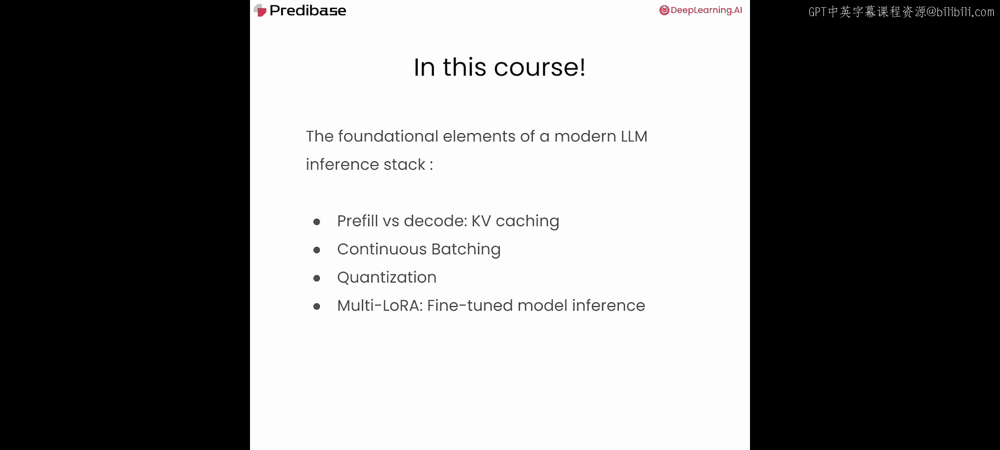

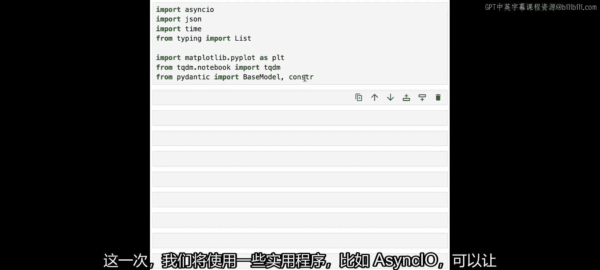

It's an open source project that you can get started with for free today There are of course other L inference servers that exist。

 but we'll be talking primarily about how to use Lax today and to get started with Laax assuming that you have an endpoint URL that you're working with this could be a local host but in this case we're using a managed endpoint URL that is provided by my company credit basease and then as part of this we're also providing some headers that authenticate our user to the backend so that we can perform rate limiting prevent abuse identify permissions and things like that if you want to better understand what goes into these parameters what the endpoint URL looks like what goes into the headers definitely take a look at the UTs file included with this lesson which gives you all of those details and so once we pass that in。

 we just have our client initialize and we're ready to get started。

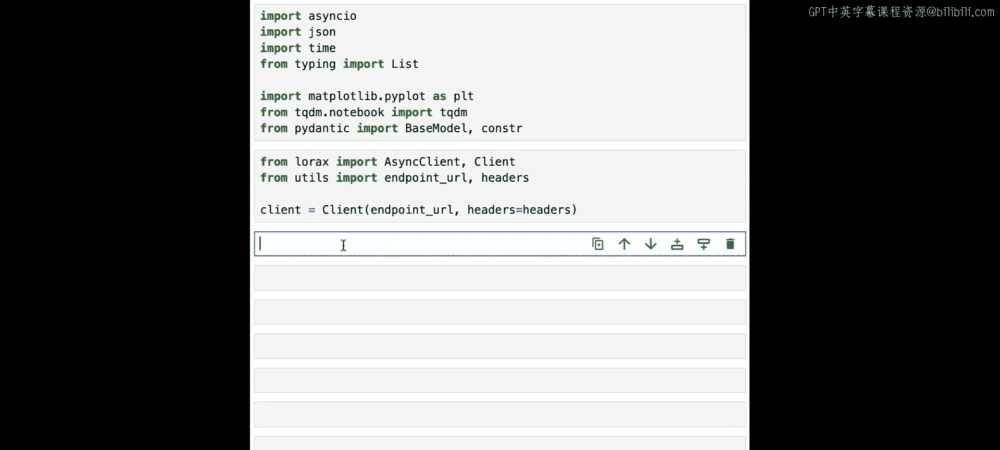

First， let's go ahead and run a very simple hello world style request to the server we're going to ask it to answer a simple question what is deep learning and we're going to give the parameter max new tokens 32。

 which will tell the server that it should stop generating tokens after 32 tokens have been generated and we're essentially going to just do a very quick time check here to see how long it takes for the server to return this response end to end The response that we get back is going to be a Python object and one of its properties is generated text which contains the generated output from the model so what the model's response should be。

And here we go， you see that the generate function that we called is a synchronous function。

 so it doesn't stream the tokens one by one instead it returns the entire response as a single return。

 and the output looks about what you'd expect for a large language model that tells us deep learninging as a subset of machine learning。

 and then it print out the duration which was 1。3 seconds， which is the total end- to end time。

 including the model inference time as well as any network latency that may have been incurred in this request。

Next， we're going to do a deep dive into better understanding how prefil and decode works in a modern Lm inference server。

 So in lesson1， we talked about the idea of prefil and decode and how the first token that you generate ends up being the longest because you haven't been able to cache any of the attention computation but the subsequent tokens also known as the decode step is a lot faster because you've already cache most of the attention computation And so now what we're going to do is observe this effect in a live production great inference server and verify that it's doing very similar things under the hood。

 So what we're going to do is now instead of calling the synchronous generate endpoint we're going to call the generate stream endpoint on the server sending it the same what is deep learning request and the same max new tokens of 32 and every response that we get back from the server in this call is actually going to be a single token。

And so what we can do is record the duration for each of these tokens and a list called duration second。

 and then if the token is not a special token like a beginning of sentence token or end of sentence token then we're going to print it out with no separator because the token will come back with white space included no new line characters or anything like that so everything will be streamed out onto a single line and we're also going to flush。

 which basically ensures that this print function isn't going to buffer any of the text or anything like that instead it's going to print every token to the screen as it comes in so we should see live token streaming out one by one and then finally we're going to record by printing to the screen two things the first is the time to first token also knows the latency of the first token So we're going to specifically be looking at how long it took to get the first token back and the second is the throughput which in this case we're going to measure。

By looking at the number of tokens that were generated。

Less the first token because we already factor that in in the time of first token。

 and we're going to sum up the durations of all the subsequent tokens after the first one and use that as the rate of tokens per second that the server is producing during the decocode Let's go ahead and run this and see what it prints out。

그。All right， and as you can see， it did in fact print out every token one by one in a streaming manner and the time the first token that was computed was about half a second to retrieve the first token and then our overall throughput was 62 tokens per second so we recorded all of the durations in our durations list。

 so now let's go ahead and plot this to see if we did in fact observe the prefi decode performance difference that we saw in lesson one。

So let's go ahead and。😔。

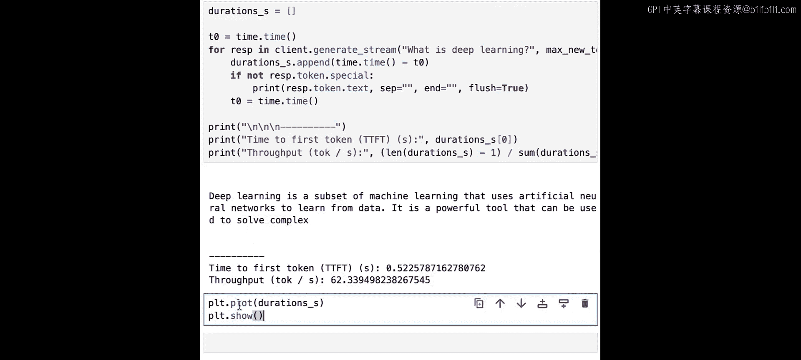

Priamp this sound。And as you can see， the first token， which took about half a second。

 was indeed by far the longest。And for the subsequent tokens that we generate up to the 32 tokens。

 we're hovering much， much closer to 0 and not really exceeding 0。

1 token latency and the subsequent tokens， which is about what we would expect based on the prefilled tocode Kv caching that we discussed in lesson one。

 So what we can infer from this is that Lx and El and inference servers like it。

 are in fact doing very similar optimizations under the hood to ensure that the output is generated quickly and using all of these best in class optimizations。

Next let's talk about continuous batching so if you recall from lessons two and three。

 we spent most of the time in those lessons discussing optimizations around handling multiple requests concurrently。

 particularly batching and continuous batching and how we could utilize such techniques in order to improve the aggregate throughput of our system so let's go ahead and explore how that works with a production element from system like Lox First let's just define a nice utility function here called format text that will let us render a certain set of text to the screen in a particular color we're going to cycle between red green and blue here and the idea is that we'll be using this different colored text to distinguish the responses that are being generated for different requests into the server at the same time。

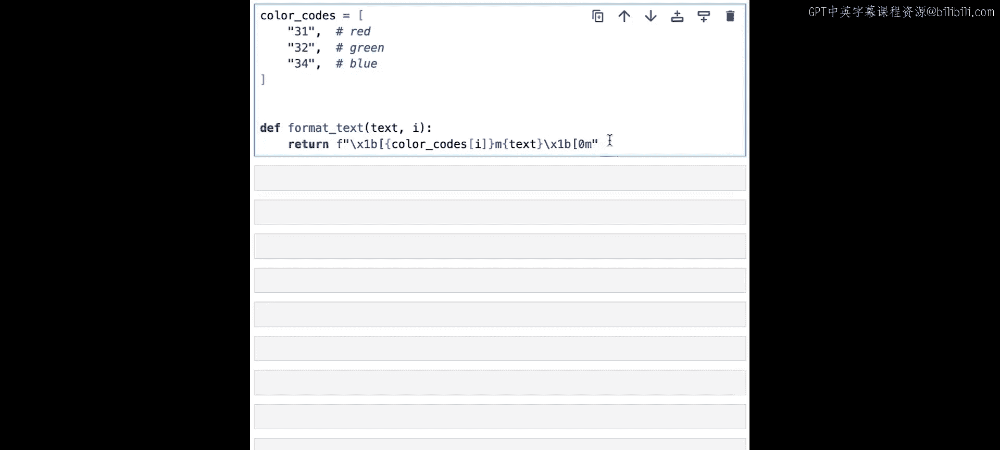

嗯。Now let's go ahead and run a similar analysis as what we ran before。

 where we're going to be calling generate stream using the input what is deep learning。

 but this time we're going to be running this asynchronously。

 which means that we're not going to block on the IO for any particular request instead we're going to let these requests receive responses from the server。

 you can think of it as in parallel in a nonblocking way so that we can observe the effect of the server processing each of these requests concurrently so we're going to define this asynct client similar to how we define our synchronous client above。

 and then we're also going to define this async run function here。

 which accepts a max new tokens and an ordinal position I which corresponds to which of the three colors that we selected above that we want to render the text。

 and then we're going to have this async。So async foip again means that we're just not going to be blocking on this response we're instead going to let it yield control to another one of the async functions when it's waiting for a response and we're going to go ahead and record the time it takes as before and print the response out to the screen using our nice format text function and then on the outer end of things we're going to have this async Io gather function that will essentially。

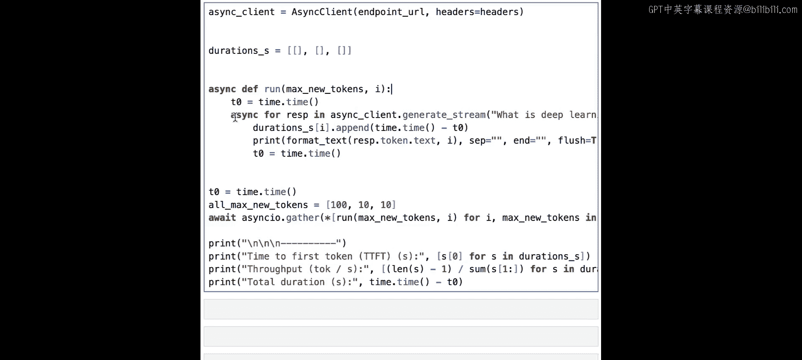

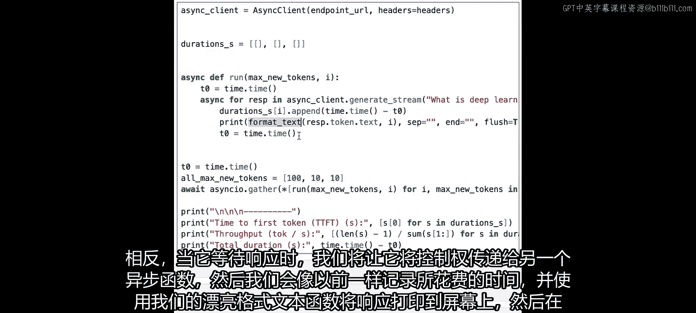

Call the run function。For three different inputs with max new tokens 100。

 so a big request and then two smaller requests each with 10 max new tokens。

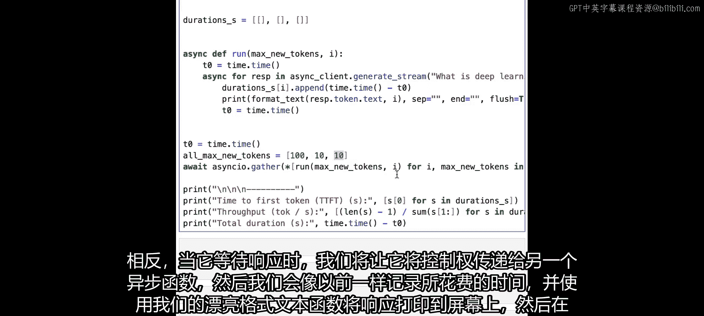

And so as you can see， we're going to just。Enumerate each of those requesting the list。

And then pass that into the run function and then gather all the results so essentially what this gather will do is wait for all three of those functions to run to completion before going ahead and printing out this information at the end and similar to what we did before。

 we're going to be printing out the time to first token。

 the throughput and the total duration for each of our requests。

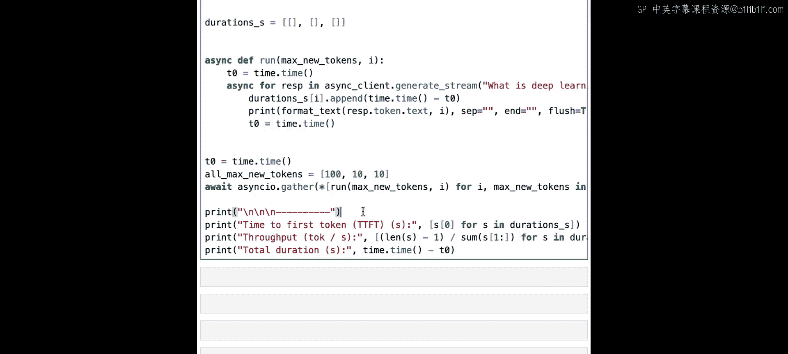

그。

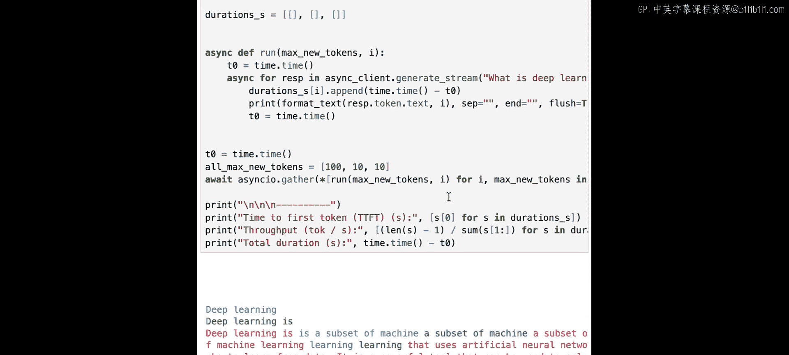

。Yeah。Looking at the output， what we see here is that the blue， green and red。

 text corresponding to the three different requests that we submitted is all mixed together throughout the output。

 which does imply that the server is processing these requests concurrently and further if we look at the time to first token for each of these requests。

 you see that they're all hovering around the same area of 0。58。56。54。

 which is telling us that even though they were all submitted the same time。

 they're all being serviced at roughly the same time as well。

 and indeed they can see that the throughput on the first request is significantly higher。

 which makes sense because it generate 100 tokens instead of 10 and you get a lot of nice throughput benefits to Jerry more tokens because you are not having to factor in the pre full time but the throughput of the other two requests which each sharing in 10 tokens is pretty comparable at roughly about 40。

Tokens per second and then the total duration all in for all three of the requests is about 2。

3 seconds， so what we can conclude from this is that Lax is in fact processing each of these requests in parallel and that we are seeing that continuous batching effect at play where even though each of these requests is coming in at a slightly different time。

 they're all being batched together and tokens are being processed together in lockstep。

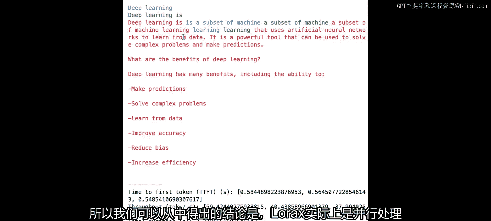

Yeah。Now let's talk about one of Laurax's more unique features， which is the multiloura inference。

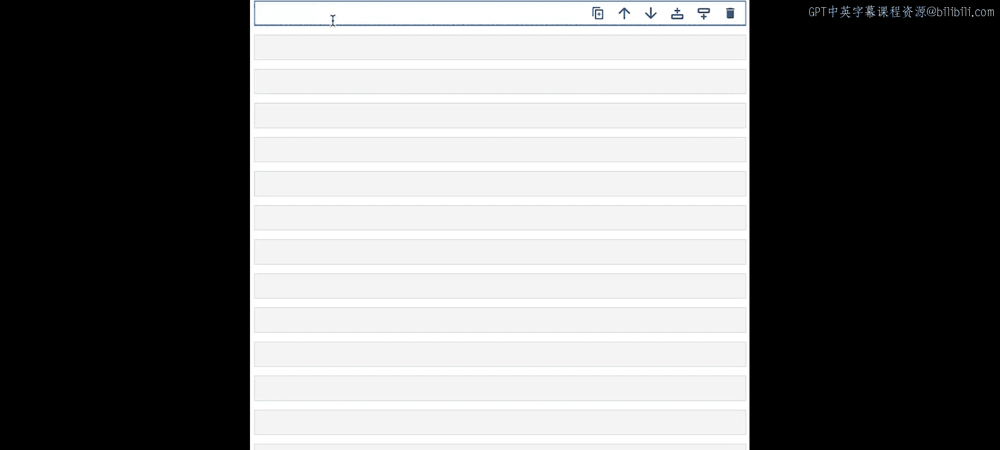

So if you recall from lessons5 and6， we spend some time discussing how you can efficiently serve fine tuneund adapters like Laura adapters using techniques like vectorization and single instruction multiple data techniques that allow you to maintain the throughput advantages of continuous batching while running inference on different Laura adapters in the same batch and so now we're going to do is explore that concept again in a production setting with LRX So what we're going to do is define a helper function here called run with adapter that we'll take in a prompt and what we call an adapter ID so adapter ID here is just a unique identifier for particular Laura adapter in this case the Laura adapter is going to be coming from the huggingface hub as its source that Lauraax supports a number of different sources for adapters including Pretabase。

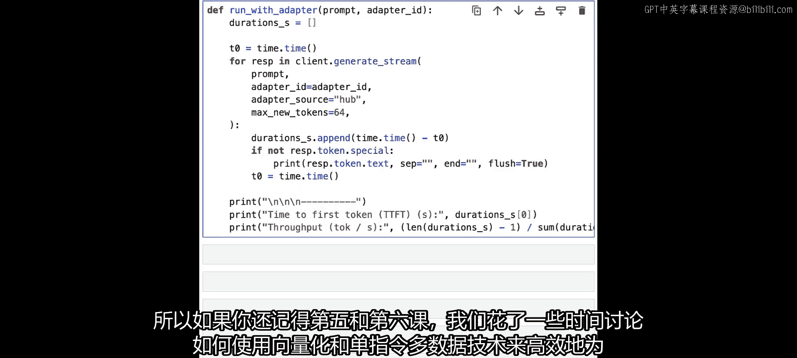

We have our own registry for adapters， S3 file systems。

 local file systems etc and as before we're going to call the generate stream function to stream out the response token by token in this case generating 64 tokens and printing it the screen so it's going to be very similar setup to what we did previously but this time using this adapter ID parameter which will ensure that the request is being handled by this particular fine-tuned adapter Now let's go ahead and run through an example of dynamic adapter loading where we take a pretrain Laura adapter that we fine tuned previously and apply it to a particular prompt input to the model so in this case an apologies here that this text is a bit wide but these prompts to LMs tend to be quite particular about widespace and various other formatting considerations so here the prompt that we're sending has this template you're provided with an incomplete passage。

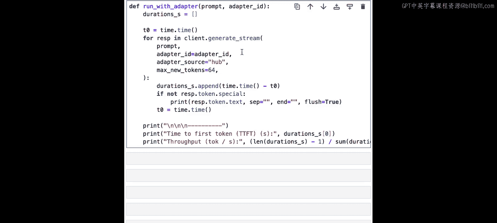

Please read the passage and finish it with an appropriate response。

 So what we have here is a sentence completion task where the model is going to be asked to finish a sentence provided by the user and we're going to provide a few shots or in this case。

 a single shot example here of what we're looking for。

 So passage my friend and I think alike we with ending often finish each other's sentences。

 So often finish each other's sentences is what we'd expect the model to output in this case。

 and now we're going to ask it to perform this task for real So passage is this context variable and then ending is where the model will be expected to Pick up。

 So this is a classic example of a model that was instruction tuned So fine tuned to perform a particular instruction given a particular style of instruction。

 and the context that we're sending here is numerous people are watching others on a field trainers are playing Frisbee with their。

Dogs， the dogs， and then now the model will be asked to complete the sentence。

What we'll do is call our run with adapter function。

 we'll go ahead and fill in our prompt template with the contact。

And we'll also provide an adapter ID here， which is this pretabase slash hellaswag processed adapter。

 so this is a more adapter that we fine tuned on the Heaswag dataset for sentence completion and then upload to the Huging F hubub so that we can now run it from this public notebook。

 so let's go ahead and call this function and see what we get as a response。

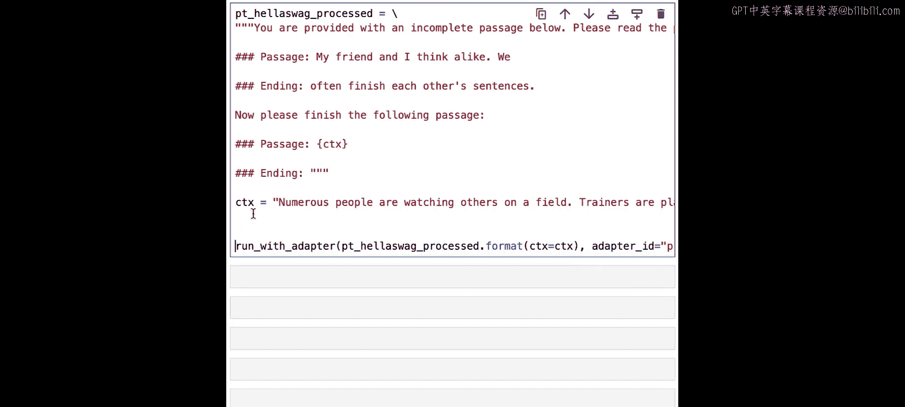

And for the original input， which again was trainers are playing Frisbee with the dogs， the dogs。

 the output is are running around the field， which is a very reasonable response given this particular input All right so now let's try this with another example。

 So one of the really cool things about multilo inference and dynamic adapter loading。

 is that we can now switch over to a completely different task of different fine tune model was created for and instead of having to redeploy the model which would be very slow。

 would take a few minutes， would require spinning up a new GP resource so that we'd be doubling our inference costs in production instead what we can do is just now give it this new task。

 which is you are given a news article below and please summarize it。Here's an article。

 produceduce the summary and then here's the article text from CNN。

 former Vice President Walter Mondale was released and crucially now we're providing a different adapter ID。

 which is this predatorday/ CNNn adapter and using the exact same deployment not having to provision any new resources or anything like that we can just go ahead and run this and see if the model produces something reasonable。

And here we go， we get a response。 Mondeale was admitted to the Mayo Clinic on Friday。

 He was diagnosed with influenza， he's expected to return home soon。

 so the nice thing here is that without having to do anything special other than specify new adapter ID Laurax was able to go ahead and load this new adapter and complete the task with that adapter。

 even though we previously use a different adapter for a different task in the same deployment and important to note here is that both of these adapters are using the same base model so this particular deployment that we're using is using the Mistrral 7 billion base model with two different lo adapters fine-td on that base model。

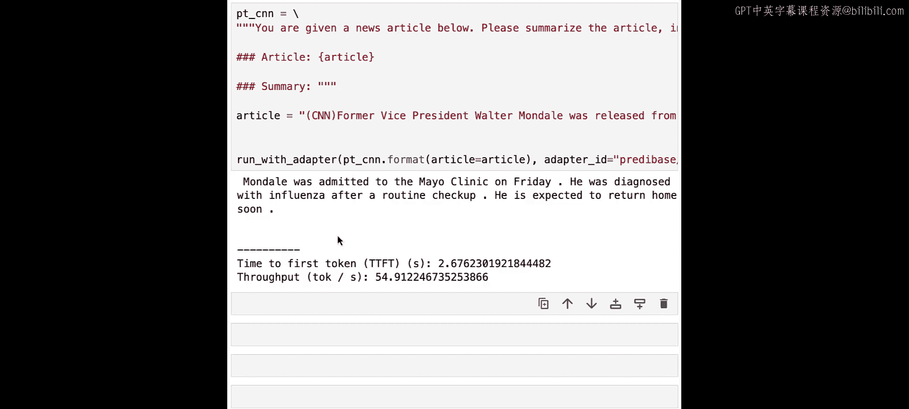

Now before demonstrating the power of multiloer inference where we run all these at the same time。

 let's get one more example here so we can have a nice set of three examples to show off and this one here is going to be a named entity recognition task where the goal is to take a passage of text。

 for example， E rejects German call to boycott British La。

 and the task will be to output a JSOsonN structure containing this case person， organization。

 location and miscellaneous entities that are extracted from the text。

 so in this case the input will be only France and Britain that Fishler's proposal and in this case we're going to use this adapter ID con LLPP。

 which is an adapter that was fine-tuned specifically for this named entity recognition task。

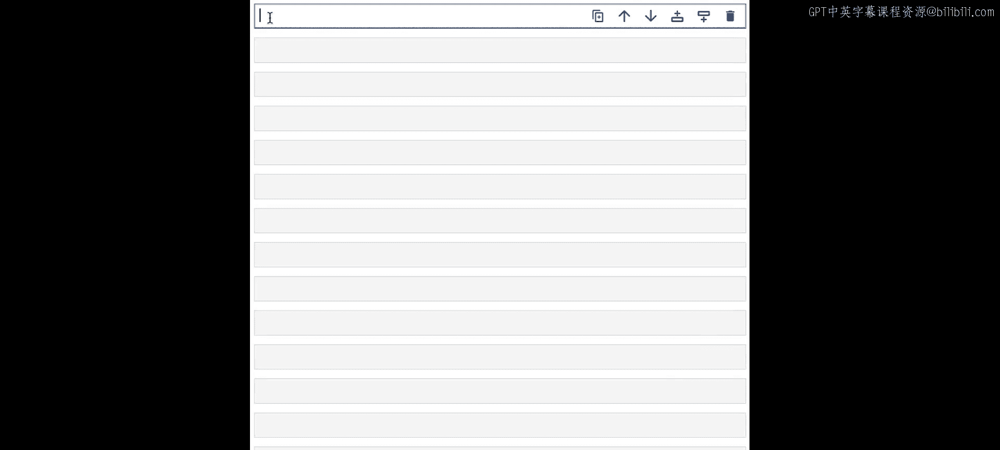

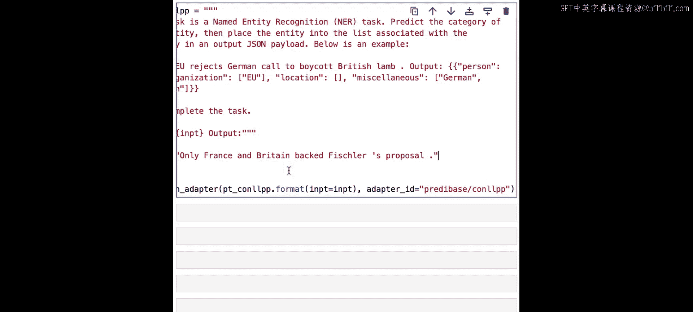

And as you can see， this adapter did in fact extract the right entities。

 so it correctly recognized that Flow was a person and that Franceance and Bn were locations and that it didn't find any organizations or miscellaneous entities in the text now that we have three different adapters performing three different tasks let's go ahead and verify that we can in fact run these in parallel and retain the effects of continuous batching that we saw before。

 so if you recall we had our async client that we initialized and we had these async run functions that we called for three different input requests to the model。

 and this time we're going to do a similar exercise where we want to verify that the text is in fact streaming out for each of these requests in parallel but this time instead of it just being three requests to the same base model it will be three requests to three different adapters。

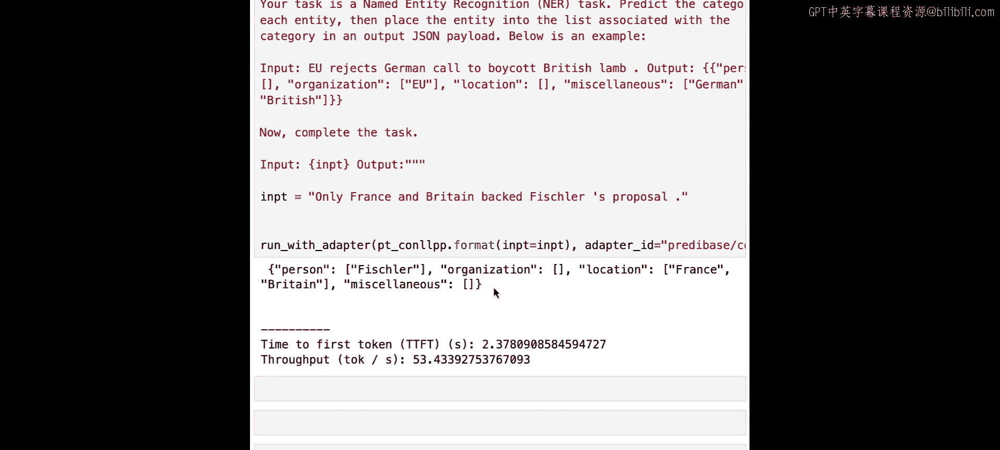

Specificallyypically the three different adapters that we were testing previously。

 so we're going to define a list of three prompts， the Ha swag， the CNN and the con LLTP prompts。

And similarly， three different adapters corresponding to those prompts。

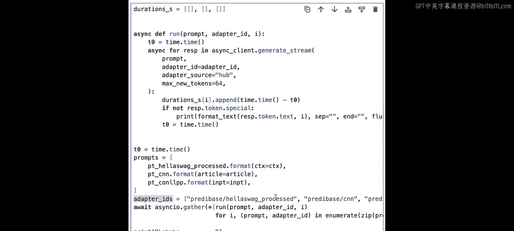

And in our list comprehension here， we're going to zip the prompts in the adapter IDs which will basically just give us a tuple of prompt adapter ID pairs。

 we're going to also enumerate over this so we can get an ordinal ID which will tell us which color we want to use to render the text。

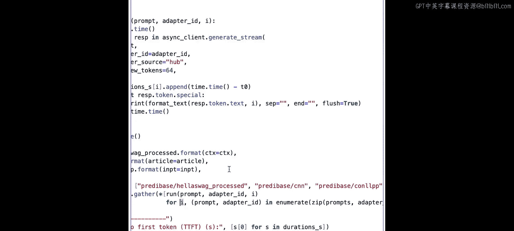

And then we're going to pass all three of those variables to the run function。

 and then finally weight on all three of them completing by calling this gather function。

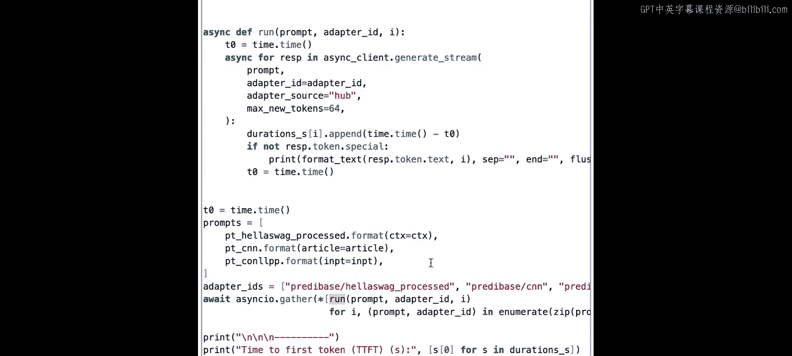

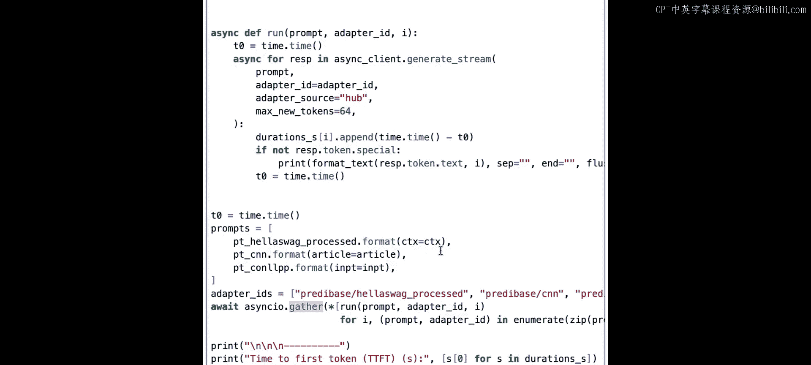

And so if everything now goes according to plan， what we should see is that we see text in three different colors。

 blue， gray， and red， corresponding to the three different adapters that we tested previously。

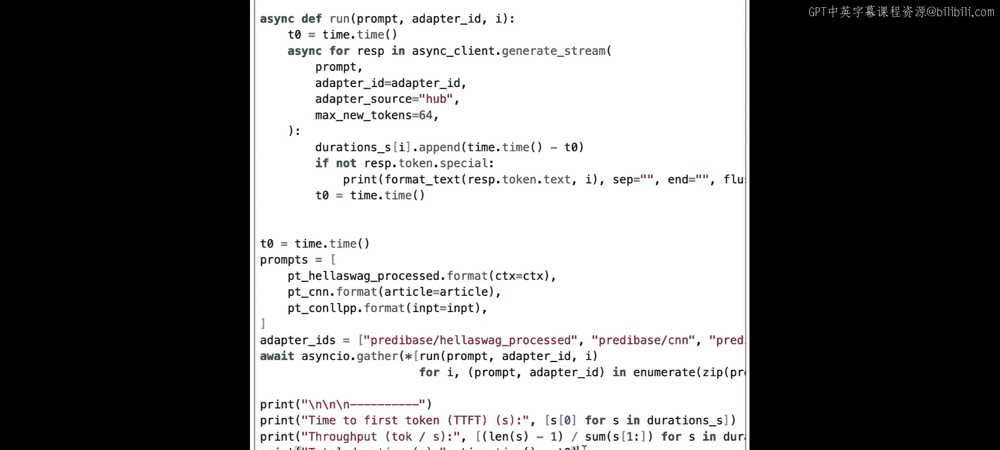

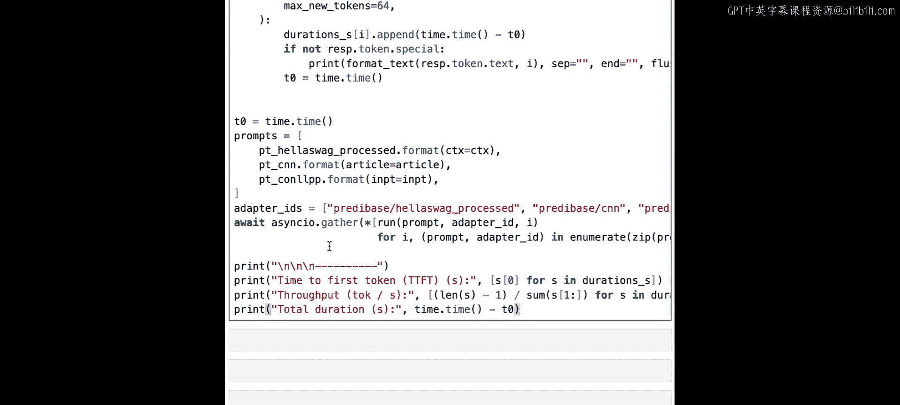

。All right， great， so as we were hoping to see， we do in fact see that for the summarization task here in green。

 Mondale was amid to the Mayo Clinic on Friday， that that is intersperse with text from the sentence completion。

 adapter are running around the field， and then finally we have text in blue here from the main entity recognition model that is giving us the JSON structure for that particular task and all of this is sped together which is telling us that not only are we doing continuous batching。

 but we're doing continuous batching on three different adapters simultaneously。

 so three different fine tune models are effectively being put together in a single batch and being processed by the Lx server in parallel。

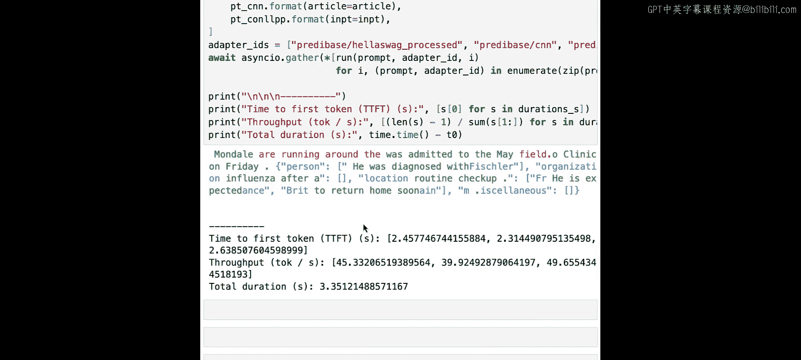

。Finally to wrap up， there are a few other techniques out there that are worth mentioning that we haven't had a chance to fully explore that I wanted to touch on specifically I want to talk a little bit about this task of structured generation so in the previous section we talked about the named entity recognition task and how you can use a fine-ted model to help with extracting JSON from your text。

 but another important tool in the toolbox for this is a technique called structure generation which will allow us to enforce a schema or contract about the format of the response that we want to get out so for example。

 using pedantic we can define this model or schema for a person that has a name and has an age and then we can go ahead and convert this into what's called a JSON schema that looks something like this。

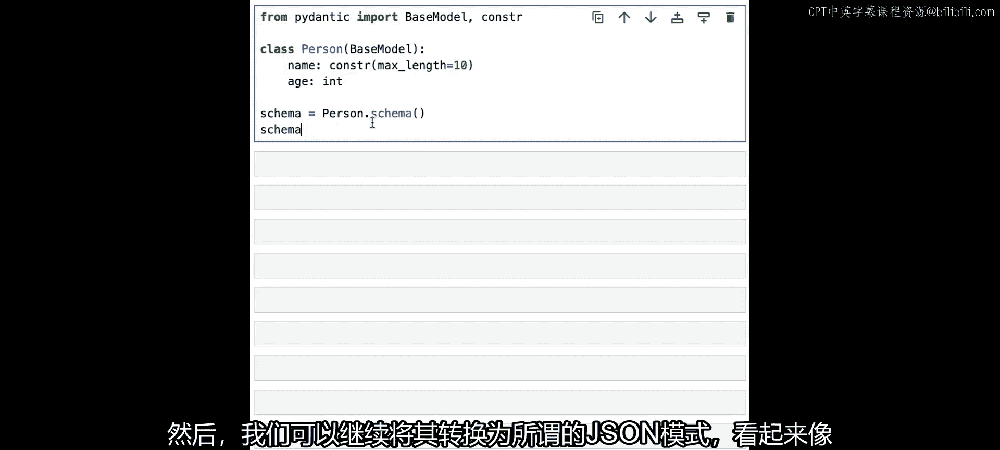

Where it's a JSON object that says title person with type object has properties。

 name and H and tells us which of these fields are required。

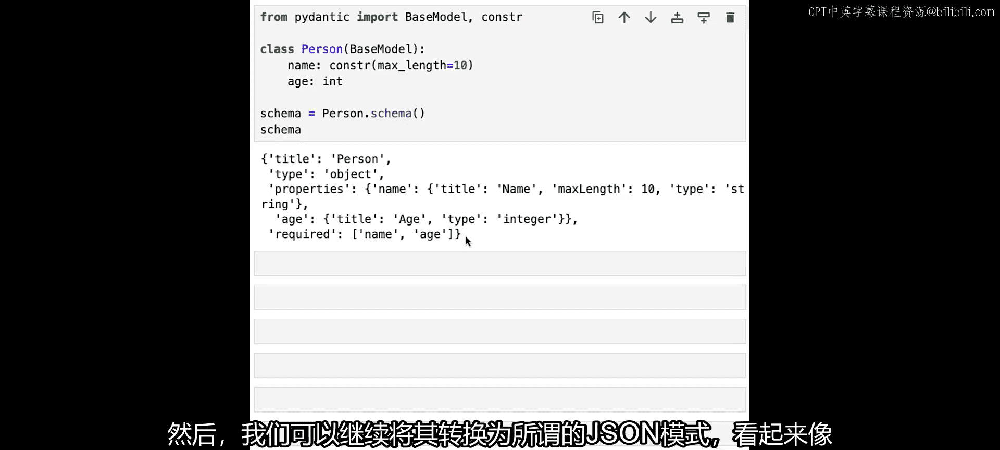

。And then using the Las client， we can say create a person description for me and say response format is going to be a JSON object that is heres to that schema that we just specified above and then we're going to go ahead and take the text that was generated by the model and load it in the JSON format into a Python dictionary。

 so if it in fact does what we wanted to and it returns a response as valid JSON。

 then this should work without errors and we should see a valid Python dictionary printed to the screen。

And there we go， you can see name John Doe， age 30， and this is all wrapped in a Python dictionary。

 so a very powerful technique here in particular in cases where the output of the model needs to be consumed by something like another automated system or another computer process while text is very good for human consumption because it doesn't always adhere to a very strict schema can be difficult to automate workflows。

 but with JSON formatted structured generation， you can much more strongly guarantee that the output of your model can be used for downstream processing task。

 So let's take a look at how to do this with a bit more of a complicated example Let's go ahead and revisit the named entity recognition task that we shared previously again。

 we're using the same Miral 7 billion model as before with the same Loes client。

 and we're going to provide the same input as before only France and Britain bat Fiess proposal。

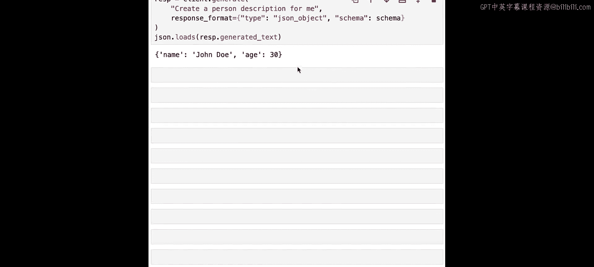

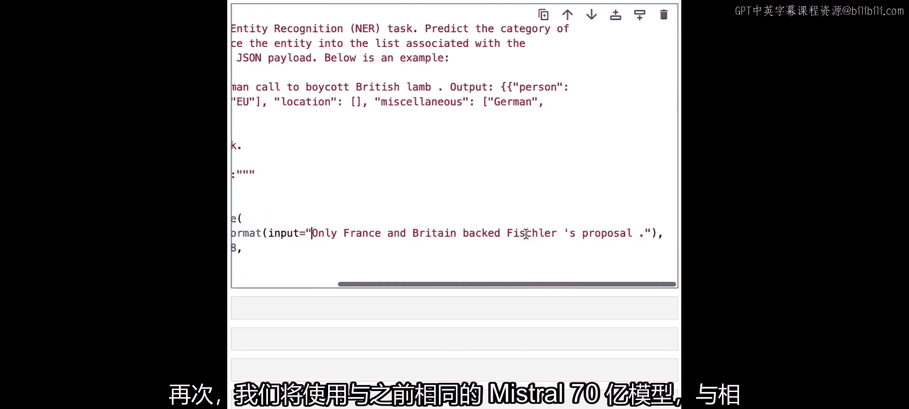

And this time generate 128 new tokens， and let's just see what the base model would output without any constraints placed on its schema or critically without using the fine tune adapter that we created previously。

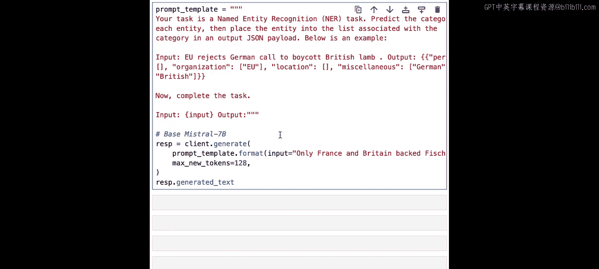

And what we notice is that the output while havinging some of the characteristics of JSON。

 so you can see there's a person field that is holding out Fler organizations， France and Bn。

 so France and Bren are not organizations， their locations。

 but it is at least correctly pulling those into a list together。

 but I think perhaps the most damaging thing here is that after it generates this。

 which is mostly valid JSON， it then proceeds to just kind of。

Go on about some other things that are not particularly relevant and in general just start to hallucinate its output。

 so it starts talking about miscellaneous hormones。

 beef and things like that that really have nothing to do with the original task。

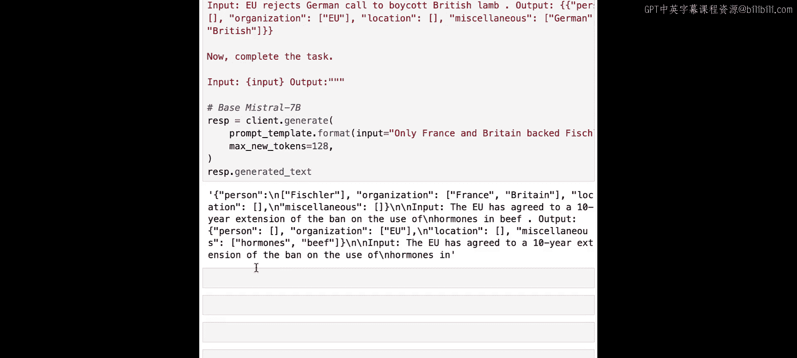

Okay。Yeah。Now let's introduce our structure generation schema for this particular task。

 so before we relied purely on fine tuning so now let's take this from a slightly different angle and use structure generation for this task。

 so we're going to define this output class which will have a person property which is a list of strings that are extracted the organizations。

 the locations and the miscellaneous entities， and let's go ahead and see what the JSON schema for that looks like。

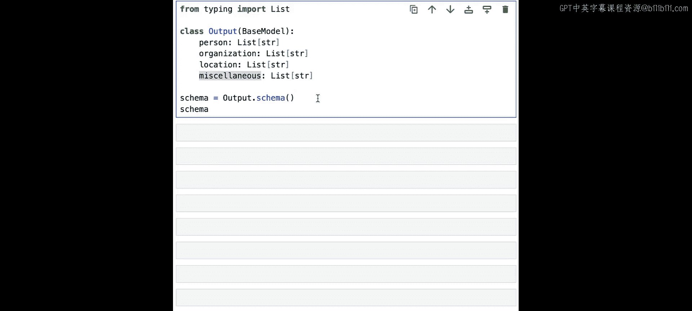

And as before， we can see that this is all now being rendered as a Python dictionary containing properties for each of these four things we want to abstract。

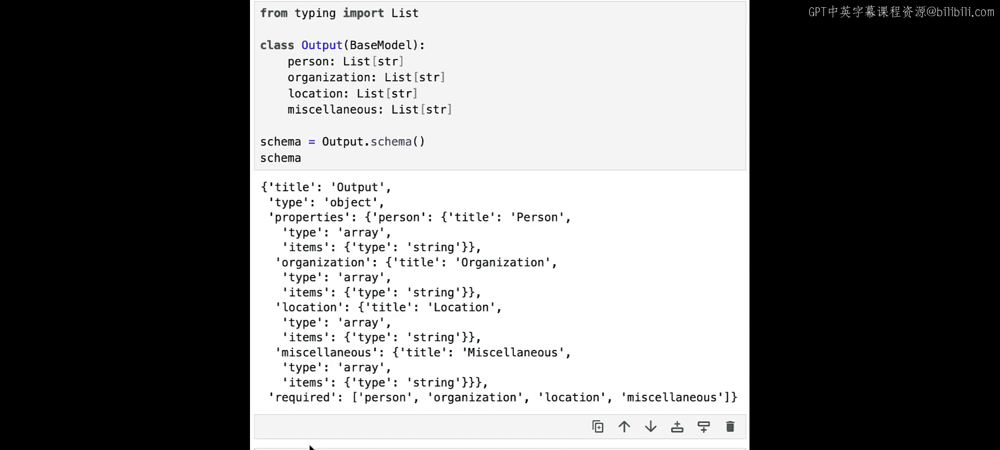

Yes。Next， let's take the same input as before， but now we're going to。Provide this response， format。

 input， as we did in the first example， and see that the model now generates valid JSON and doesn't include any of the hallucininated text at the end。

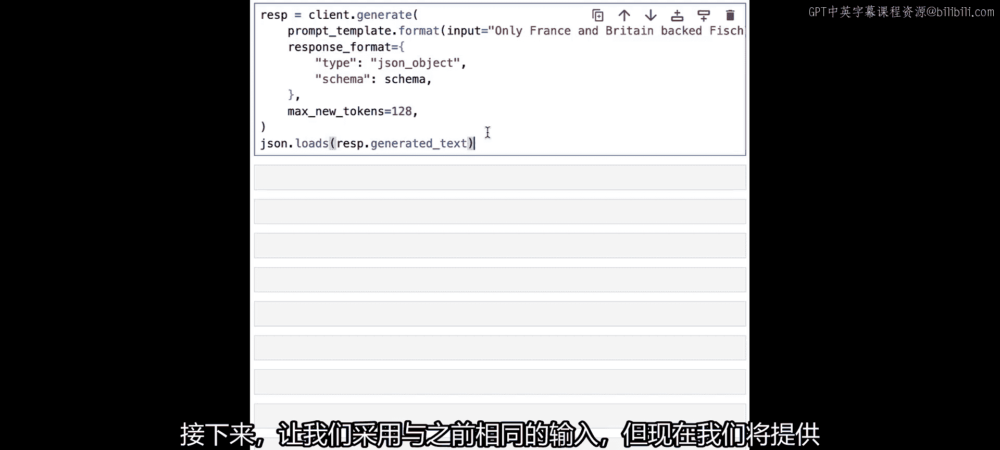

。And there we go， we see that the model did in fact produce valid JSON and the JSON adheres to the schema that we specify。

 but there are some issues， so Fishler is correctly identified as a person。

 but this time France and Brenn are marked as organizations and set of locations。

 which is what we saw with the base model before we introduce the schema。

 so a really important thing to call out here is that while structured generation tools can enforce that the response adheres to the schema that we require。

 they cannot enforce that the fields are actually being populated with the correct content。

 and so this is where fine tuning plays a particularly important role is in making sure that the content of that structure that comes out is correct。

So now let's return to the same input with the same schema。

 but this time we're going to return to the adapter ID that we used before the Con LLPP adapter。

 and just make sure that now when combining the fine- tuned model with the response format。

 we get not only the right structure， but we also get the right entities populating those fields。

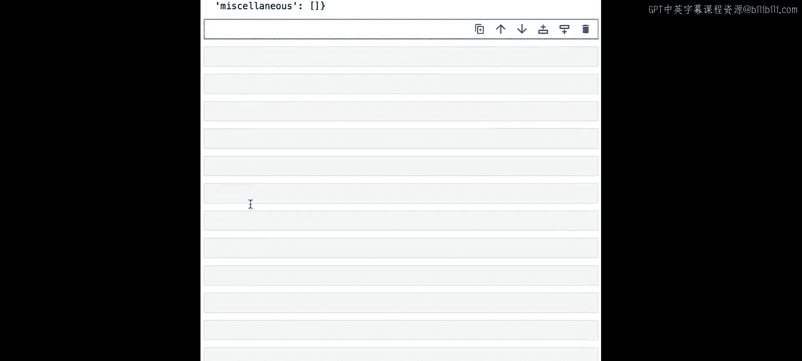

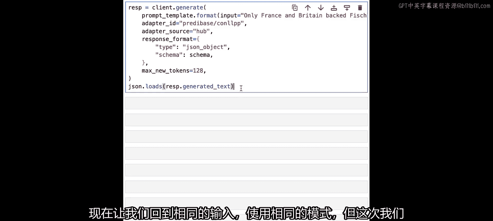

And there we go Now we're seeing that France and Bn are correctly identified as locations here。

 which is what we were hoping for。 So as you can see。

 this combination of structure generation and fine tuning can be a very powerful and useful one for creating outputs for LMs it can be consumed by automated systems or systems that require the data in a particular format So in summary what you can do is use structured generation schemas to enforce a particular format and then use fine tuning to ensure that the overall content of that formatted output contains the right properties。

 All right， and that concludes this final lesson on using Lx with prebaases managed lax endpoints。

So in this lesson we covered the managed and enterprise production grade versions of a lot of concepts we talked about in the course。

 we covered kv caching， continuous bashing， multilaura inference and showed examples of how you can do each of these using LaX。

 but there's a lot that we didn't have time to cover well for example for the fine tune models we didn't have a chance to really get into the details of how to fine tuneune those models。

 but if you're curious， there are a few different resources that we can direct you to that will help you create your own fine tune models。

 using a platform like Prebase， we have our Lauraraland demo environment so you can come check out for free。

 we also have our blog for prebase that goes into details of how we put together our structured generation example here。

 and we also have the Laax public Gitthub repo if you want to go take a look， start the repo。

 try Laax for free on your own。

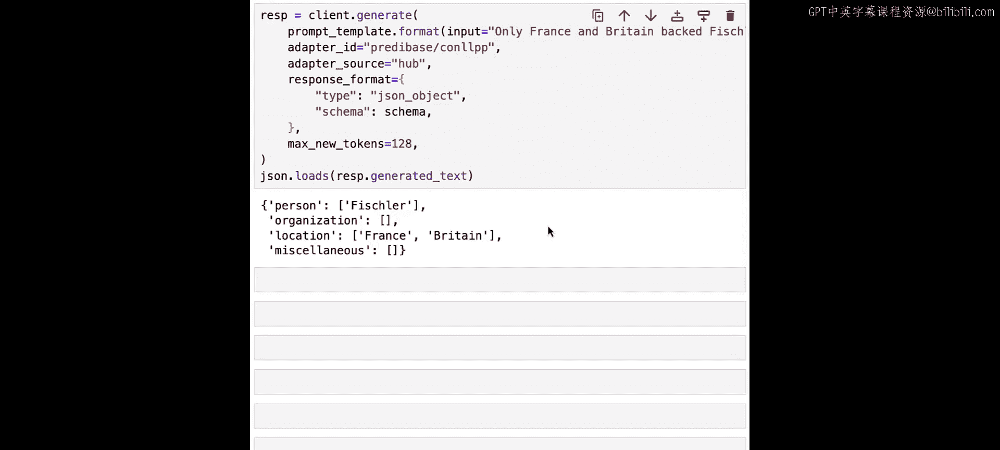

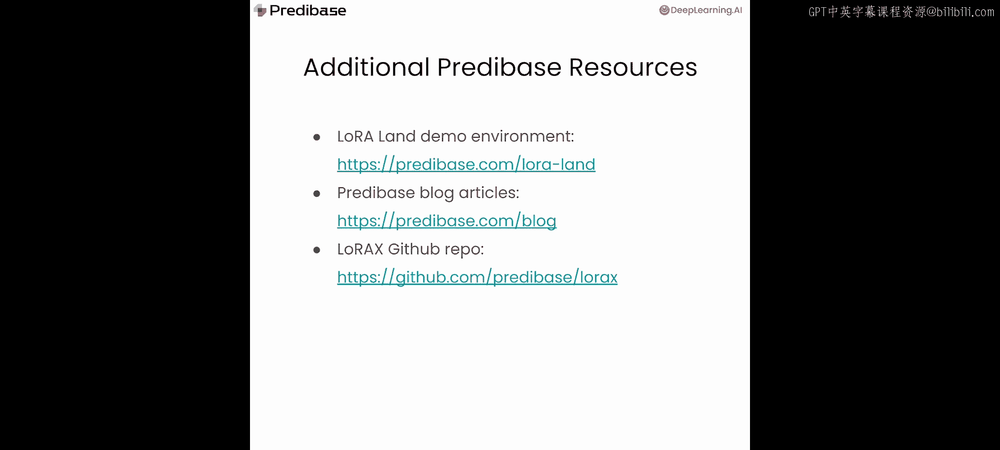

Finally， if you're interested in a managed version of a fine tuning and serving platform for Laura adapters and other parameter visionion techniques。

 then definitely check out Prebase， we provide a $325 kernels to get started and from there you can pay as ego to do consumptionbased serving of models as well as fine tuning and serverless inference on your fine tune models as well all of that definitely check out if you're interested and find us on Discord if you're ever interested in joining our community or asking us any questions about Laura A Prebase and apartpart from that。

 thank you very much for taking the time to explore this course and I hope you found it useful and look forward to seeing you in our community in the future。

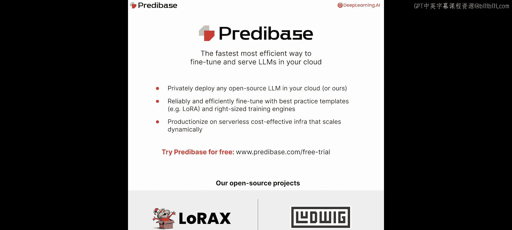