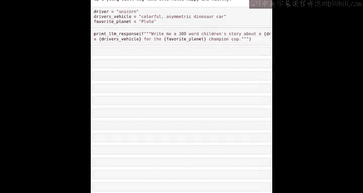

# 吴恩达亲授《给初学者的AI Python编程课（4课全）｜AI Python for Beginners》中英字幕（deepseek-R1 - P10：10.building LLM prompts with variables.zh_en - GPT中英字幕课程资源 - BV1qw4m1k7Lq

Now that you see how you can combine variables and F strings to customize and quickly update strings。

 let's explore how you can extend this pattern to create prompts that lets you interact with AI models from inside a Python program I'm going to start by running this command from helper functions import print El response。

😊。

Don't worry too much about the exact details of this line of code， but as a reminder。

 when you run the cold cells， please run them in order from the first to the last or from top to bottom。

What you've done is just load a function that allows you to interact directly with a large languagegg model via Python code。

 so to use it you can type print OM response， then open parentheses， quotation mark。

 what is the capital phrase？Quotation mark and close parentheses。

 And this actually calls Chad GT and it got back the answer the capital of France is Paris。

The string inside the parentheses here is the prompt。

 the same kind of text that you type directly into the web interface of a chatbot like chat GT。

So you can now use all the Python coding you've learned so far to build up complex prompts that can include variables and then past them to a large language model using this code。

Now， here's something fun we could do。 If they were a dog， he would be dog age years and so on。

 Or if we were to say dog age equals 21 over 7。 So that would be。😊，3 and run this。Then。

Print our response， gives。Okay， this would be an adult do， you know， like a 21 year old human。Cur is。

 playful and so on， and so by using variables to construct F strings that you then pass to a chatbot。

 you can get back really interesting and thoughtful responses Now let's look at a few more examples of using variables and we'll look at some bugs and how to fix them。

So let's write a children's story where the driver's unicorn drive's vehicle is a colorful asymmetric dieo car and the planet is Pluto。

 and then let's print our response， regular a children's story about the driver racing on the vehicle for the favorite planet。

So there are a few things wrong with this code I encourage you to pause a video and see if you can spot what's wrong with this let me run this code myself there are actually quite a few errors driver's vehicle has an a prophy S in a variables name and theres also a space if you want to space uses it and underscore like that and that would fix it。

I also need to。Replace this down here。If I run this again。

 then it looks like we left off the close scrolls for Pluto and there's a space here。

which mixes an invalid variable name so if I do that this should run and then haven't fixed this yet let's see what happens so this doesn't work because I've not this space in my cur braces。

 if I do that， then this lets me use the La language model to write that 300 words children's story。

Cool。Not too shabby。Sparco and jewelry in a。Ray San Pluto。

I'd encourage you to plug in a different driver， plug in a different vehicle and run us yourself and get your own children's story So that takes us almost to the end of this lesson please take a look at the exercises at the end of the juveter notebook to practice your code writing and debugging skills and same as before in case we get stuck remember you can use the chatbot to help you get through those exercises Now in this lesson we saw a few functions print printno response in earlier video we saw also type in the next video we'll take a deeper dive into functions what they are how to use them I'll see you in the next video。

