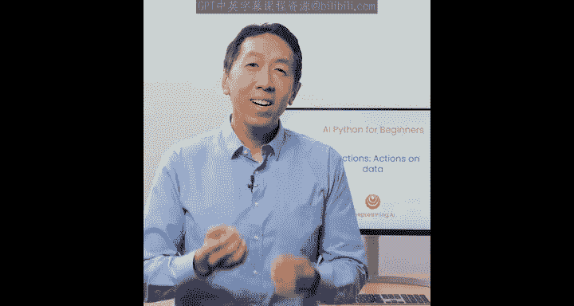
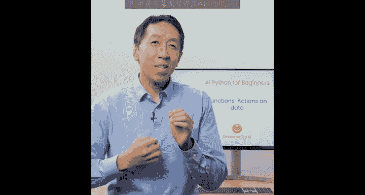
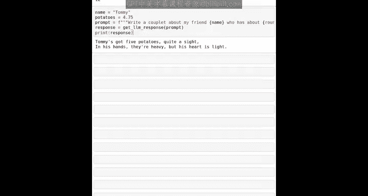
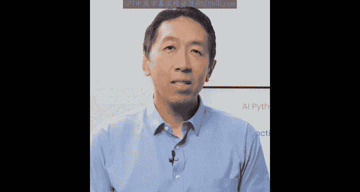

# 吴恩达亲授《给初学者的AI Python编程课（4课全）｜AI Python for Beginners》中英字幕（deepseek-R1 - P11：11.functions.zh_en - GPT中英字幕课程资源 - BV1qw4m1k7Lq

Welcome to the final lesson of this short course where we'll talk about functions。

Functions are like mini computer programs that can include inside of a larger computer program when you want to do a specific task。

Functions let you take action on data or action in the world。 Let's dive in to see what this means。

 In the last lesson we had a command letters from helper functions impose themselves。

 Let me just run that now。 and okay， don't worry too much for now about what exactly this is doing remember。

 please run every code cell in order。 you've already encountered and use a few different Python functions in the lessons of this course。

 The first was the print function。 which you can use to display text like this funny figure to the screen。

😊。

And in the previous video， you saw a more complex function， print OEMM response。

So this function takes us input a string。In this case。

 you're prompt what is the capital of France and sends it off to a large language model over the internet and then displays the AI's response to the screen。

You've actually seen one more function already， the type function。

 which can tell you the data type such as strength， float or it of a value or variable。

So you see in print。Print own response as was type。

 And these are all functions that give use in a course。In this lesson。

 I'd like to dive more deeply into exactly how functions work。

There's a function in Python called the La function， which stands for length。

And if you were to type L， then give it a string，Hello world。

This will take as input to string hollow world and compute its length。

 specifically the number of individual characters including punctuation and spaces there in the string。

And then when I print out the result， this prints 12， here's another example of a Python function。

 which is round， so this takes a number， say 42。17。

 and it rounds it to the nearest integer so we to take this and print the result of rounding 42。17。

 I get 42。One of the things that functions are often useful is to perform a computational data and then to return some value。

 For example， the lens function takes this input to data and it counts the number of characters and returns the answer or around 42。

17 It computes what's 42。17 round it and then returns 42。

 Sometimes functions are used to take an action， for example， to display a piece of information。

 So print Holello world takes a string Holello world and it displays it。

 Let's take a deeper look at what exactly happens when you call the length function on Holello worldL is the name of the function。

And when you call a function， you use parentheses to give it data and in this case。

 the string hollow world is the data you're giving to the then function。

 the common lingo for the data you provided function is called the argument if you're curious about why it's called an argument go ahead and ask a chatbot and when a function returns the number like 12。

 we say that the function returns this result。We also saw the print function which displays what you provide print is the name of the function。

 we have the parentheses as usual and within the parentheses are the argument of the data that is the string hollow world。

That is given to the print function。 So far in the examples we're using。

 we are getting a result from a function and then printing it out。😊。

But you don't have to just print out the result of a function right away。

 I can define the variable string length equals L Holello world。 and then we can print string length。

 and this will print out 12。So in the code that I ran just now you saw this command string length。

 that was the name of a new variable we're creating。

 so a new box to hold data where the assignment operator and then then Hulow world returns the number 12 and so this is saying take the variable string length and set it equal to 12 well put the number 12 inside the box labeled string length。

So after you put 12 inside this box， if you then subsequently print string length。

 it will print out the number 12， here's a more sophisticated example。

I'm going to set name to we called the Tommymy。😮，Potatoes equals 4。75。

And I'm going to write a prompt。Which is an F string。To be。

 write a couplet about my friend of this name who is about that's round potatoes to nearest whole number potatoes and then response equals get and response to the prompt。

And in print the response So get El response here is a new function that we haven't used for。

 but what this does is exactly the same as print element response。

 except that instead of printing out the response， it calls chat GPT in this case。

 gets a response and it returns it as a value， which we then store in this variable response。😊。

What this will do is create the prompt rather couplet about by friend Tommy。

 who has about five potatoes and then asks the OEM to write a couplet timessscale5 potatoess quite a his hands as hardest light。

 not too shabby。 I hope this gives you a sense of how you can use variables to sequence more complex computations together。

 And in fact， for developers writing software using generative AI。

 This type of programming pattern is something you actually see very often。

 where you have some variables， construct a prompt。

 call large language model get respond and do something else on top of that response。😊。

And so that's it， congratulations and great work on getting to the end of this short course。

You've learned the fundamentals of Python， including data types and how to do math and variables and how to use functions and how to interact with a large languagegg model using Python code。

After this video， please do try the extra practice exercises at the bottom of the Jupiter notebook because it's really by practicing that you learn and get comfortable with Python。

Remember， but also， at any time you can consult the chat bot for help or advice if you get stuck is a really useful companion to work through problems with。

And when you're done with that， I hope you join me in the NI course to learn even more powerful Python features。

 you learn how to make a computer do the same thing over and over and over。

And youll learn how to go the computer to take different actions depending on the data it sees。😊。

And as you keep learning， I think you enjoy being to do more and more amazing things over time with Python and with AI。

Congrats again on finishing this course and look forward to seeing you in the next one。😊。

