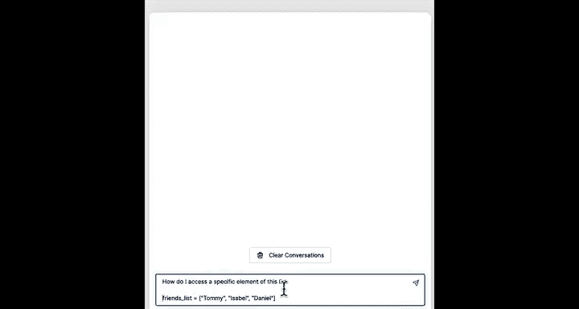
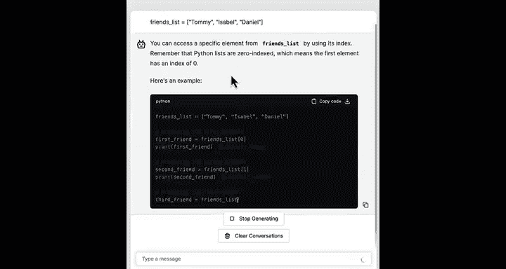
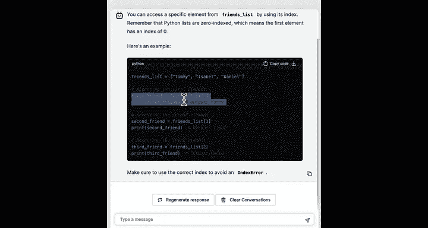
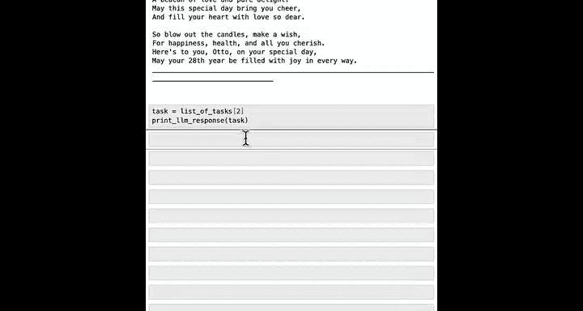
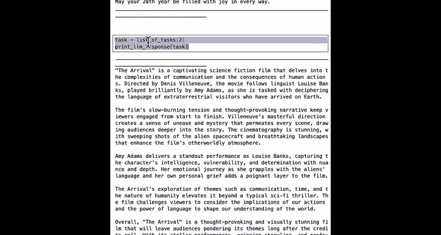

# 吴恩达亲授《给初学者的AI Python编程课（4课全）｜AI Python for Beginners》中英字幕（deepseek-R1 - P13：2.Lesson 1 - Completing a task list with AI.zh_en - GPT中英字幕课程资源 - BV1qw4m1k7Lq

In this course， you learn how to automate tasks with code that is have python to repetitive things as well as sometimes make decisions for you。

In the previous course， the data you worked with was always a single item such as a single name or an age or some other single piece of data。

But Python has the ability using something called a list to store multiple pieces of data together。

 does make it easier to tell Python to carry out repetitive tasks for you。

Let's take a look at how they use lists in Python。Let's start by importing some functions that we'll use in this notebook。

 I'm going to hit shift enter and load those two functions。And now。

 let's say I want to write a poem for three of my friends。

 Here's how we could use a large language model to do it。 I'm going to set the variable name to be。

The name of my first of the three friends， which is Tommy and now here's a prompt using an F string which you learned about in the previous course。

 which says write a fullline birthday poem for my friends， then'll insert the name here。

 point should is five by the first letter to my friend's name and let's run that。

And so this outfit was terrific Tommymy for of chair。 that's pretty cool。 I like that。

And I want to write these poems for three of my friends。

 so if I want to now go on to my second friend， I would set the variable name to now be Isabel and then we run this。

And now here's a poem for Isabel， if in a joint law， and so on， wow， another nice poem。

And then finally for the third friend Daniel。We now get dashing Daniel， Dan true， and so on。

As a reminder， if you run these cells yourself， remember to run them in the same order as I was as well。

 because running the cells in a different order may result in an unexpected error。

But you saw that this process of writing three poems was a little bit repetitive， I had to go here。

 set the name three times the different values and then run the prompt and trend El response three times it turns out using list in Python lets you store the name of all three friends at the same time and then eventually will give you a more efficient way to generate these three poems let's take a look。

Here's how we can create our first list and we'll say friends list。 This is another variable。

 but this variable will take the value of a list， and this is how it works。

 I'm going to open square bracketers that tells Python I want to create a list。😊。

And then the first item of the list。Is Tommy？Which， as you saw from the previous course is a string。

And then calmer， and then a second item， Isabel。Commer and then the third item， Daniel。

And then lastly， close square bracketers here in order to tell Python that this is the end of the list。

And if I were to run this， I've now created a new variable called Friendless that stores three pieces of data。

 Tommy Isabel and Daniel， all at the same time。If you now tell Python to print。

Friends list and run that in our prints back out this list。 Let's take a look at how this works。

 We wrote this piece of code that said friends list equals Tommy Isabel Daniel。

 and you can think of this as creating a set of little trail is or set of little cardss shown here each of which can hold a single piece of data So this co little here holds the piece of data Tommy。

 the next one， Isabel and this last one， Daniel and friendss is like a little tractor that puts together and allows you to assemble these three little cardss together each of which has one of these three net friends names Now each of these little cardss also has a number associated with it that's what these numbers0。

1 and two are。 and whereas people often start counting from one。

 So we say Tommy's the first name Isab aboutel the second and Daniel the third。

Computers and the Python programming language in particular like to start counting from zero rather than counting from1。

 so that's why this first CA is actually number was zero because it start counting from zero。

 not from one， and then the next one is CAt number one， and then the one off that is CAt number two。

These numbers will be important later when you want to refer to specific items。

 sometimes you say specific elements in this list of three items and you see later in this course that you will be able to add。

 delete， retrieve or edit different elements or different items in this list。

Let's go over the exact code needed to create a list there is the list of a name which is friends list。

 then the equal sign to say I're going to set friends list to be equal to this list on the right。

The square bracketers indicates the start and end of the list。

And then in the middle are the elements or the items of the list separated by comm。

So if you remember the type function， we ask， what is the type？Of the friendsless。Rere이션。

You find that it is a list and you remember the land function。

 which tells you the length of a string， It turns out you can also ask what's the length of a list And if you run this。

 you get three because there are three names in this list Now we created a list that source a name is all three friends simultaneously I can create a prompt like this。

Rather set a full life birthday points for our friends and then friendsless in here。

And let's print up this prompt right to the full library ofphone for my friends， Tommy Isbe Daniel。

 and it is storing the list here in the prompt is square brackets。

 which maybe isn't the best written prompt， but is okay。

 the last language model is pretty smart and I think I'll figure it out。

And never I then run print response。DLM generates three poems。

 so this worked the last language model was smart enough to understand this prompt and write three poems let's take a look at how to access one specific item or one specific element of the friends list if my friends list has Tommy Isabel and Daniel how to access one of the names。

Well， rather than me giving the answer， why don't we ask our AI chatbot。 So now' the chatbot。

 how to access a specific element of this list。

And it tells me that。

You can access the first friend as Friendless square bracketers zero and this Elpost Tommy or friendsless and in Square bracketers1 gives us Isabel and friendsless Square bracketers2。

 this gives me Daniel， so I'm going to copy this from the chatbot。

And remember this。Hash sign or pound sign is just a comment。

 so Python doesn't run anything to the rights of this hash sign。And if I run this code。

 it prints out Tommy。I just want to call out that here we're using square brackets。

 not parentheses and if you were to run this with normal parentheses。

 it wouldn't work and in fact it would generated error seeing errors is a normal part of coding so feel free to pause this video and try this with parentheses rather than with square brackets and you see that won't work。

To print out the name of thens friend， we can also do this print。Friends list and is square brackets。

 friend number one， close square brackets， close parentheses。

 and now let's run that and this prints out Isabel。And lastly， let me try one more thing。

 if I tell to print friends list and then friend number3。

What do you think will happen if also the print friends number three is says？

Gives an error because in my list， there is no friend number three， they're only friends number 0。

1 and2 and this error message says list index out of range because this number three in this example。

 we sometimes call it the list index and three is too large which is why it gives an error don't worry too much about what the error message here is saying I find Python error message is sometimes a little bit cryptic if you want to explained in a more easy to understand way。

 feel free to copy pastes error message into the chat bo and ask it to explain it to you and in contrast if we want to print out Daniel's name I should print it as friend number two。

Now， Python also gives you some nice tools to modify the elements in a list。 you can add， remove。

 edit items， and so on。So here's the friends list。 And you want to add an element。

 You could do this friends list。And then dot。😮，And then append。Although。

Let me shift enter the round that and if I now print。Friends list again。

 we now have Tommy Isabel Daniel and then we just append it to the end of the list although so I encourage you to pause the video and go take this list of four friends and append another name to it to add a fifth friend to this list Now in addition to adding elements or adding items to a list。

 you can also delete elements So let's say you're using a list to track friends you need to send birthday cards to and Tommy's had this birthday you've sent a card so you can now remove him from the list then you could do this。

Friendless， start to remove。Tommy and to be clear， I still like Tommy。

 we're still friends just removing it because I've already sent him his birthday college and if you do this。

And print the new friendsends list， you end up with just Isabel， Daniel and Holdo。

 and please try for yourself， modify the code to remove one of these other names from the list and print it out to see if it gave you the right answer。

Now， so far we've been using lists to store strings or to store people's names。

 It turns out lists can store other types of data as well。 So， for example。

 if you want to store the ages of your friends， you can have a list of here three numbers。

 three integers， if you print。The list of ages， you end up with that。Later in this course。

 we'll use Python to help us prioritize tasks to do。

 so here's a longer piece of code that says list of tasks。And as usual。

 I have an open square bracket， and then here's to task composed brief emails of my boss。

 explaining I'll be late for tomorrow's meeting。😊，Read the birthday point for Oto read through as Review of the movie。

 The Ar and this creates a list of three strings where each of these strings is one of these tasks and in Python you can spread out the list over multiple lines of codes since this makes it a little bit easier to type and read than if all of this was in a single line and in fact。

 each of these list of tasks is something that you could ask a large language model to do so one thing we could do is set tasks to be list of tasks zero so now tasks compose a brief emails where basics may ob beulate。

And so I'm going to do that。😊，위에서 이。If I now wanted to do the next task for me。

 I can have it do this task equals list of task one。

Let's have it do that Here's my birthday poem for Alto。And then， lastly。Let's have it， do。

Just three for me。

Which generates this review of the movie， the arrival。

And so by writing these three slipnipers of codes where we set tasks equals list of tasks and then square bracketers 01。

2 in turn and in printinging the L response to these tasks。

 we worked through the different elements in this to do list。

 but this was still a little bit repetitive we had to type and run this code three times to process each of the elements of the list separately In fact if you had a todo list with 10 items or 20 items typing and running this code 20 times manually would be a little bit annoying and repetitive。

In the next video， you learn about a much better way to do this， a full loop。

 which is a way to tell Python to do a task for you over and over。

 Let's go to the next video to see this in action。

