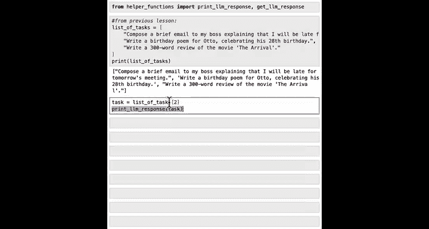
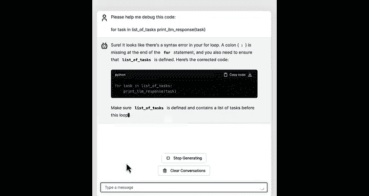
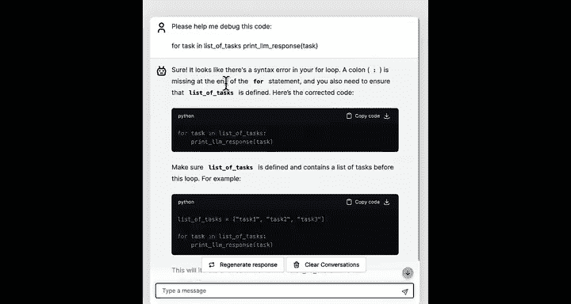
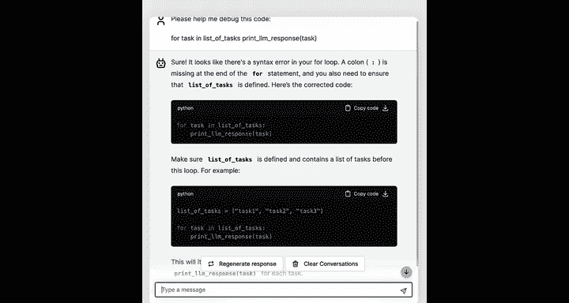
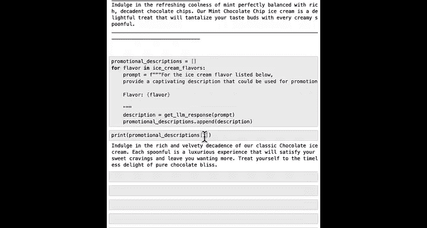

# 吴恩达亲授《给初学者的AI Python编程课（4课全）｜AI Python for Beginners》中英字幕（deepseek-R1 - P14：3.Lesson 2 - Repeating tasks with for loops.zh_en - GPT中英字幕课程资源 - BV1qw4m1k7Lq

In this lesson， you learn about a very important concept in programming， the for loop。

This is a special code pattern or a special command that's found in many programming languages。

 and it lets you tell the computer to repeatedly perform actions in all of the items in a list in an automated way without rewriting code over and over。

😊。

So if you have a list with many data items， a follow loop lets you tell the computer to do the same thing to item 1 or item 0 with0。

 then item1， item2 and so on to all the items in the list， let's take a look。

Let's start by loading some hopeer functions like we did before from the previous lesson。

 we saw this example of a list of tasks and I we run this。This shows this list printed out down here。

And we saw how you can set task equals this a task0。

 then run this and then maybe changes a one and werun this and it changes the two and we run this and this way of getting the LM to run through all three tasks it felt very manual in that we needed to type and run code like this three times Let's take a look at how you could use a four loop to automate this process。

A for loop lets you repeat a set of commands for each element in a list this is what the code to use a for loop looks like so in plain English this is saying for each task in a list of task lets pier response to that task。

And this piece of code， which is called a for loop。

 is equivalent to writing all of these different lines of code， print L response listit task 0。

 printL Re task 1 and so on for as many elements or items as there are in the list of tasks。

Let's go through the details of exactly what every single part of this code is doing for here mixes a four command or a full statement task is the name you define for the variable that would take on the value of list of tasks 0 list of tasks one list of tasks 2 and so on So task will in turn take on the value of the different elements of the list of tasks in is another special Python keyword and there's the list that we had with the elements we want to go through and we use a colon to tell Python where is the start to the command we wanted to run on every item in the list and that's the command that it will repeat on each element of the list Now one of the special parts of this code is there are four spaces over here incoding we call this an indentation and that just means print。

responsesponse is indented or shifted for spaces to the right By convention。

 Python programmers use four spaces， and so I would recommend you stick to that convention。

Let's take a look at this code in action。 We've already set this a task to be equal to this up here。

 And so I'm going to say for task in。List of tos， colon。

And then because I wrote a colon when I hit En， Python already knew I wanted to in them these four spaces。

 So it brought my cursor there， and then they we just say print。

Taskk so what this will do is it'll say for each tasks in this list of three tasks print out that task and if I run it。

 Sha enter， what you're seeing is that the task is being replaced each time by one of the items in the list of tasks。

Now there's two four tasks in。This hell。Ts可。And now that's s。Oh and response。Tusask。

And let's run that。And this takes a little bit of time。 There's the first task。

There's the second toss， the birthday message， and there's a third toss。The review。

Just to show you some common errors with four loops， if I didn't have four spaces here。

 if it were to not indent this and I were to run it， this would have an error。

But if you were to quit。A few spaces there force faces a convention then this would work and another common mistake in using forum is to forget the colon here s around this this also generates an error and if you see an error well this actually says syntax error expected colon but you were to see an error like this and not be quite sure exactly what to do。

Well， if you ask your AI chatbot companion to， please help me deb this code。

And then let me pick there。Then is actuallyhi？

Pretty good， it says。Look's at there's a syntax error， a colon is missing。

 and then it actually fixes up the code for you， it reminds you of the missing colon。

Sometimes all of us would just miss a colon in our code or miss a single character in our code。

 and many programmers have spent many hours staring in the code to try to figure out what is that one little bug。

 that one little error in their code but since AI chatbots became widely available。

 our ability to copy paste our code into chatbot to have it help us figure out what might be wrong。

 has helped many programmers find bugs and fix them much more efficiently。

Here's another example where we're going to use a large language model to automate a writing task。

 specifically creating ice cream flavor descriptions。All right， here are some ice cream flavors。

 and if you want to have descriptions of each of these ice cream flavors。

 maybe because you're writing marketing， copy or marketing text for a website。

This is what you can do。You can say for flavor in ice。Cream flavors。And then。

I'm going to set the prompts to be for the ice cream flavor listed below provide a captivating description that you've use。

For promotional purposes。 And then here's the flavor。 And lastly， I'm going to tell it to。

Prince response。For that prompt。So let's run this。His description of vanilla ice cream。

His chocolate ice cream which is actually my favorite。

Strawberry ice cream and that's mined chocolate chip ice cream。One thing I would point out is that。

This entire block of code is indented。Meaning that all of this code is shifted by four spaces to the right and Python looks at what code is indented to figure out what is the code you wanted to run four times once for each of these ice cream flavors So in contrast。

 if you were to run this dismalt work because this will cause Python to run prompt equals the prompts with vanilla then chocolate and so on。

 or do that four times without ever calling print arm response and only after running this highlighted code four times try to print El response so this code will work feel free to try it and see what happens is only by indenting all of this code that it then runs all of this code four times which is what you want and feel free to modify this code and play of it to see if you can understand what it's doing I want to point out that as you run through this block of code。

 this chunk of code this block of code four times every time you run it。です。

Flavor takes on a different value， is vanilla， than chocolate the strawberry。

 and main chocolate chip。And every time you run to this code。

 this prompt variable is set to a different value。And Sir runss print out response on a different prompt。

 If you want one thing you could do is。Print out the prompt here so you can see the prompt before I pass on to the large language model。

 I'm not going to run this， but feel free to pause a video and make this change and run this code if you're interested。

Now， let's look at one last example before we wrap up this video。

 which is we had a list of four ice cream flavors。What if you want to take the descriptions that the large language model is generating and save the descriptions to their own list。

 let me show you how you could do that。😊，I'm going to create a new list。谋事哦。Descriptions。

Equals and then I'm going to create an empty list。 So open square bracket。

 And then without putting anything in the list， I'm going to close the square bracket right away。

 So in our little tractor pulling a few cards along。

 this is like a tractor that's all by itself with no cards that is pulling behind it。

 and this is an empty list。😊，Then here's the code we're going to use we're going to say full flavor in ice cream flavors and as usual remember the colon。

 and then all this code is indented， so you're going to run all of this code multiple times。😊。

We've set a prompt to be。This for ice cream flavor listed， rather a capsulating description。

 then we're going to set the description variable to be getel response to the prompt。

 so our description is one of those delicious descriptions of these ice cream flavors。

And then we're going to take promotional descriptions， which starts off as an MT list。

And append to it， the description that we just had in the examples we've seen so far。

 we largely initialized the list with all of the items you needed to have。

 be it theres a friend's names or the list of tile or the ice cream flavors。

 but it's actually a pretty common coding pattern in Python to start off with an empty list and then repeatedly add or append items to the end of that list and then build up that list。

Let's run this code。 It actually take a few seconds to run because it's now calling the large language model four times to generate these descriptions。

 And now if we were to print，Promotional。Descriptions。

Then this is a list of all the four descriptions， it's a little bit hard to read in this format。

 but if I want to print out， say the description of the chocolate ice cream， my favorite。😊。

Then you can print out as promotional descriptions square bracket one because it is the second ice cream flavor on our list so as you can see the combination of full loops and lists is quite powerful and lets you do a lot in Python in these examples we've been using pretty shortness with maybe three or four items but imagine being able to loop through hundreds or thousands of items in the list then you can get your computer to do repets for you hundreds or thousands of times Now one limitation of this is it can be tricky to access items if you don't know where they are I happen to remember that chocolate ice cream was item once I could type one here but if you had dozens of ice cream flavors and don't remember what exactly was the number of the flavor you like then it could be harder to figure out how to access that one description that you want in。

The next lesson you learn about a new data type that has some similarities to this。

 but where finding and working with a specific data item can be much easier。

This data is called a dictionary and in Python lists and dictionaries are the two most important ways to store collections of multiple data items。

 So let's go into the next video to learn about dictionaries。

