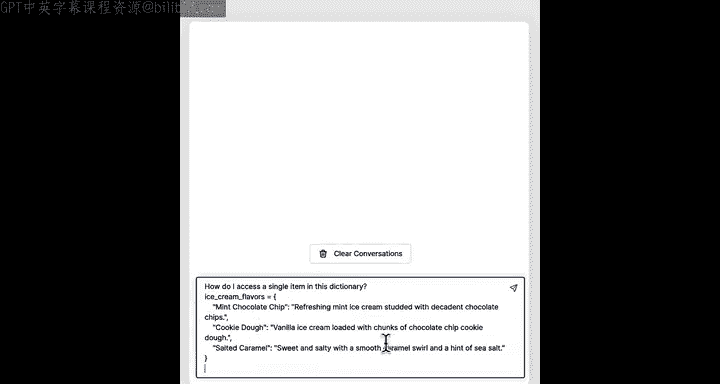
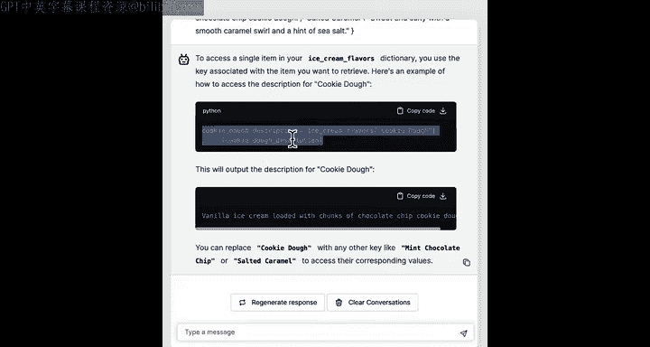
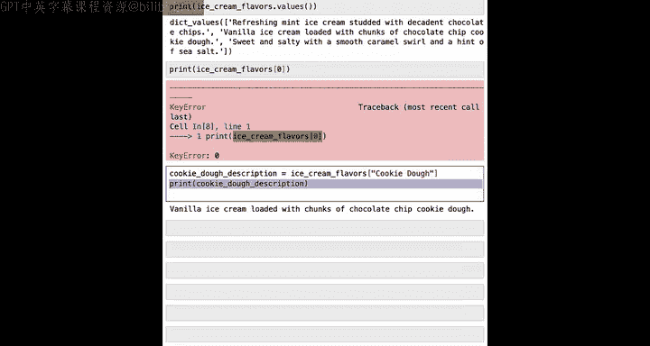
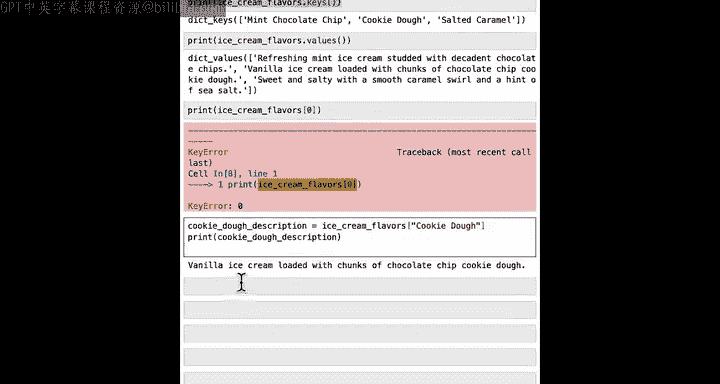
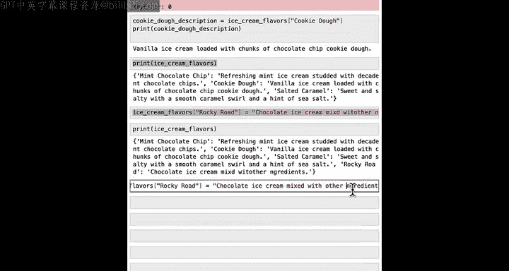
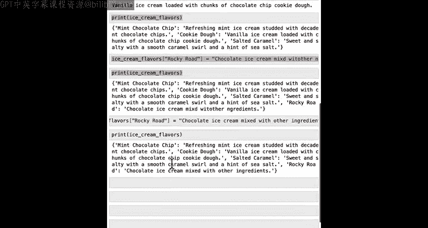
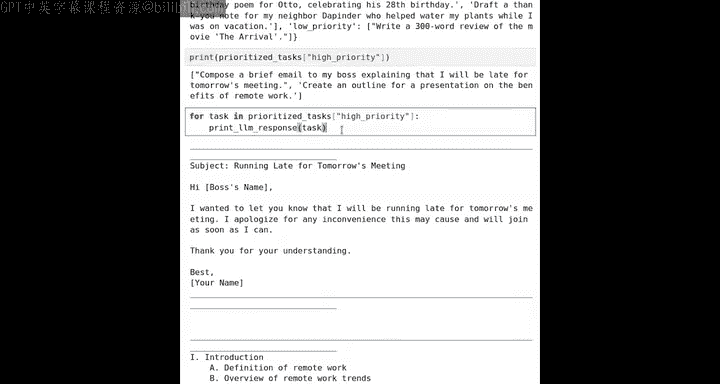

# 吴恩达亲授《给初学者的AI Python编程课（4课全）｜AI Python for Beginners》中英字幕（deepseek-R1 - P15：4.Lesson 3 - Prioritizing tasks with dictionaries and AI.zh_en - GPT中英字幕课程资源 - BV1qw4m1k7Lq

Long list can be a good way to store a lot of data and a long list and you want to use a for loop to do something with every single element of that list。

 then that's fine， but if there's one specific element or one specific item and that list that you want to find。

 but you don't know the number or the index of that item。

 then it can be hard to access to the poor that one item。

There's another kind of way to organize collections of data in Python called a dictionary that makes it much easier to pull up one specific item from your collection of data We'll learn about that in this lesson and we'll also see a fun example of using a dictionary to prioritize things on you to do this as maybe be high versus mediumn versus low priority let's dive in and see how dictionaries work。

Let's start of loading some paperpa functions as usual。

 and then I'm going to use the example of ice cream flavors and their descriptions。

 So here's a longer list of ice cream flavors together with descriptions。

 vanilla's classic and creamy with a rich smooth flavor and so on the problem with using a list like this is if you want to look up the description of a specific ice cream flavor。

 say mango ice cream and you don't remember what's the number of index associated of this。

 it's pretty hard to pull up this description of mango ice cream。😊。

So dictionaries in Python are inspired by real world dictionaries that people use to look at the meanings of words。

 so in a paper dictionary， maybe I'll have a word like Anvooc and then a definition of that word。

 and then another word like say apple and then a description or definition of what is an apple。

In Python。There is a similar mapping from words to definitions。

 except that we call them keys and values。 So， for example。

 you might have a key which captures the concept of mint， chocolate chip， ice cream， and that maps。

To a description of that flavor and a different key cookie dough may then mapped in this case to the description of the cookie dough Here's the Python snippet of code you will use to define a dictionary where here we setting ice cream flavors to be a dictionary where mint chocolate chip maps in this description cookie dough maps this description Let's walk through all the components of this code in detail。

What I've highlighted in blue here are the keys of the dictionary and highlighted in orange here are the values and in a dictionary。

 different keys， the ice cream flavors map to different values in this case。

 the descriptions notice that keys and values are separated by colons and here ice cream flavors is the name of this dictionary that we're defining equal is the usual assignment operator。

AndTo define the dictionary， you use curly braces to open and close or the start and end the definition of the content of the dictionary。

 and we also have commas separating out the different key value pairs inctionary。

 which is why there's a comma there。So let's define the diction me， I'm going to say ice cream。

Favors equals， because I'm defining a dictionary， I'm going to use a open curly brace。

And for this example， let's just use three flavors， min chocolate chip， colon。

 then the description of mint chocolate chip， then cookie dough colon description of that and finally salted caramel。

 and then to close out the dictionary and we'll do close curly bras and then hit Che enter and now I've defined ice cream flavors as my dictionary with three keys like these and values。

😊，Like this text here on the right and the different lines are as before separated by commas。

So the point out again some key differences between dictionaries and lists First as you've seen instead of using a square bracket we use curly braces and then second there are two items。

 two strings per line instead of a single string per line and these two strings are the key this first string and in the value which is the second string and is separated by a colon because dictionaries have keys and values we sometimes say that the dictionary in Python stores a set of key value pairs where each of these lines has a key value pair。

If you want to look at the keys， I can print ice cream。Favourors， dot keys。Like so。

 And this prints out the three names as expected。 And if you want to print out the values。

 then we can run this and this prints out the dictionaries values。

 Now dictionaries might look a bit like this， but they behave differently。

 If you were to try to access the first item in this dictionary via say print ice。Cream flavors，0。

 This won work because there is no such thing as the zero of element。

 So let me hit Shi enterer and just generates an error message。

 So how that I access a single item in this dictionary。Let's try asking a chatbos。

I'm going to ask how to access sync items a discretionctionary。😊，And let's see what it says。

And here it says cookiee dough description equals ice cream flavors， square bracket and a co dough。

 and print cookie dough description。Let's give it a try。 I'm going to copy this code。

And go back to my Jupiter notebook and paste that in and let's run that and there you go it printed out the description for an ice cream load of chunk of chocolate chip coqui dough so the code to access a specific item of the dictionary is to have the name the dictionary ice cream flavors and then these are square brackets。

 I know this could be a little bit confusing when defining the dictionary。

 you use curly braces not square brackets but after you've created the dictionary if you're accessing a specific item in the dictionary。

 you use square brackets and then in here is one of the keys and what the dictionary will do is look up if there's a key that says coquio and if so it then returns or passes back the description that is the value associated with this key and it slows that in a variable coqui dough description and so when it printed it out regardless the description of coquio flavored ice cream。

Let's look at how we can add an item to a dictionary。

 let's add to this dictionary a description of Rocky R's flavor chocolate。

 so here's my dictionary print ice cream flavors and there's my chocolate chip cookie dough salt of caramel and if I want to add a description of rocky Road。

 I would say ice cream flavors， square bracket， not curly braces， Rocky Road。

Equals， and then， you know， here's a description。 And if I now。Print out again。

 ice cream flavors is now expanded my dictionary to also have rock hero as a new key that maps to the subscription chocolate ice cream mixed with other ingredients。

 but wait， we have a few spelling errors here。And it turns out the same pattern can be used to update the value of a certain item in your dictionary as well。

 where if I rerun this code chocolate ice cream mixed with other ingredients， let' run that。

 and if I print ice cream flavors， then now I get an updated description that has the errorss fixed。

Now it turns out that dictionaries can hold all sorts of data In the example we use we had ice cream flavors mapped a description of the ice cream flavor but dictionaries can also map to numbers instead of two strings So for example。

 if I want to create a dictionary of facts about Isabel that hoasia 28 a favorite color is red then I can construct the dictionary like this and remember as a curly brace to build the dictionary and here the key age maps to or colon map the number 28 and favorite color maps to another string and if I print Isabel facts and then with this dictionary where one of the values there a number is an integer and one of the values is a string So dictionaries can map the keys to different types of data in this case。

 strings or numbers Now if Isabel has three cats and was installed in。am of all of her cats。 Well。

 one thing I might do is trade a list。 and so here's a list I've created a list with square bracket and in Charlieby Smoky tabbitter is the name of her three cats。

 but how do I store the names of these cats。 Well， one thing I could do is trade an extra key。

 Isabel Fax square bracket cat names equals this list of three cats。😊，And so in this example。

 I'm taking the Isabel Fs dictionary， creating a new key cat names。

 and instead of cat names mapping to a single string like red or single number like 28。

 this key cat names now maps to a value where the value is itself a list of all three cats names。

So let me do that and let's now print as a bill。F， and you see that this is a dictionary where age Ma28 favorite color mass are red and cat names maps to a list。

And here's another example， I can set Isabel's favorite snacks to pineapple cake and candy。

 and if I then print Isabel。Facts after that， then it has famous snacks as pineapple cake and candy。

Before we wrap up this video， I'd like to just go through one fun example of using a dictionary to help you keep track of and complete high priority tasks。

You previously saw an example of using a lists to keep track of a set of tasks。

 and that was one fine way to do this， but let's level up our personal organization game and let's take these tasks and store it in three lists that organize our tasks by priority。

And so high priority task is a variable that has stored a list of these two items。

 medium priority task is a variable that has stored a list of these two items and similarly for low priority task there's a list with just a single item。

Now let's create a dictionary to put these three lists inside the dictionary。

 so I'm going to say prioritized tasks equals cur braces。

 and then I'm going to create a key high priority。Collin， high parity。Toss， calmer。

And so what we just did is create a key that's to string high priority and the value that this key maps to is high priority task。

 which is this variable that we just defined up here。And similarly。I'm going to create two new keys。

 medium priority is a key that maps to this list of medium priority tasks that we define up here and same for the key low priority。

Close on the breezes and。Let me now print out prioritize tasks and now you see this is a dictionary where high priority is a string that maps to this list of two items。

 mediumn priority is a string that as a key maps the value of this list of two items and similarly for low priority。

Now， let's say you want to use a large language model to do the high priority tasks。Well。

 I can look up the high priority task by looking up。Prioritize tasks high priority， like so。

 And I could actually。Priinnt is out。And so this prints out the two tasks。

 compose a brief email and created an outline for a presentation。

So prioritize task with the key high priority is a list of two items。

 And you remember what we had seen in the previous lesson with a volume。

 let's see and figure out what this might do。 I'm gonna say for a task in。And then。

Proortize has high priority。Remember， we need a colon here and then indent four spaces and then let's print along response task。

Let's run this shift enter。And so this composes a brief email。And then。

Therere's an outline for a presentation on remote work。

And if you want feel free to edit this code to have it then do your medium priority tasks or your low priority tasks for you as well So youve learned a lot about dictionaries and list in the next lesson we'll go further with dictionaries and use the key value pairs specifically the values of the dictionaries to create customized prompts for large language model and we'll go through a fun example where we'll use a large language model to write custom food recipes for us let's go take a look at that in the next video。

