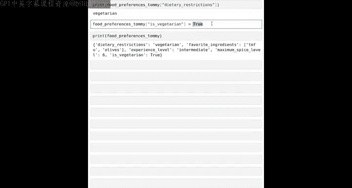

# 吴恩达亲授《给初学者的AI Python编程课（4课全）｜AI Python for Beginners》中英字幕（deepseek-R1 - P16：5.Lesson 4 - Customizing recipes with lists, dictionaries and AI.zh_en - GPT中英字幕课程资源 - BV1qw4m1k7Lq

As you've seen， dictionaries and lists are both useful ways to organize data In this lesson I'd like to go through with you a fun example about storing your friend's food preferences in a list or a dictionary or a combination of both and then using that as data to customize a prompt to an AI to suggest recipes for your friend。

This gives us a more sophisticated way to store data and use that data to customize a prompt that's fed to a large language model to then generate some pretty interesting and hopefully delicious outputs let's take a look。

So。I'm going to define the dictionary to store the food preferences of Tommy。

 remember we're using curly braces here because thiss is dictionary。

 then the key dietary restrictions maps to the string vegetarian。

Favorite ingredients maps to a list of two favorite ingredients， tofu and olives。

This is his experience level as a chef。Maxine spice level  six on scale of 10。

 so let me run this first cell and the second cell and you notice that the dictionary has four keys as well as four values and the first values of a string second value is a list of strings。

 the third values of a string and the four value is just a number just as we saw in the previous lesson if you want。

 you can print out the keys of the dictionary and you can also print out the values of the dictionary like so。

Now if we want to recommend a recipe for Tommy to try out I could use a prompt like this so this says please suggest recipe de for the fine ingredients and then this is an F string so cur braces as usual for an F string and in food preference Tommy which is the dictionary weef up on top square bracket to look up the value associated with the key favorite ingredients so this should plug in tofu and all is recipe should here the find dietary restrictions to look up Tommymy dietary restrictions difficulty a recipe should be this should be pull up the value intermediate as its experience level and then the maximum spice level on a scale of 10 is6 and to provide a two sentence description。

So let me run that and if you want， you can actually take a look at what this prompt looks like。

And here's the prompt。And you see that all the values in the curly braces in my F string have been filled in by pulling the right pieces of data from the food Prefaces Tommy Dictionary。

And if we now print response。We then end up with this。 Try make it。

 Mediterranean tofu and olive stirry， salted， cube tofu with bell peppers。 You know， I know。

 sounds pretty good And this is vegetarian。 And you notice that this recipe included both tofu and olive。

 So we've got in both of his favorite ingredients。😊。

Feel free to pause the video and plug in your own favorite ingredients and your own dietary restrictions of any and so on and see if this gives a result to your liking。

Now， let me just run through one more example of customizing this a little bit further。

You notice that all the data we have so far relate to Tommy's food preferences。

 so it made sense to create a variable in this case a dictionary to store his preferences。

But if he tells us that in his kitchen， he's running low on spices。

 except for these four cumin tumerary oragono paprika。

 then we can write this prompt and let's run this to set the available spices variable and lets now run this to generate the new prompt and in my F string here。

Available spices gets inserted over here， which is why the problem now looks like this。

 spices is cumin tumeric oro paprika。And if I set recipe equals Gi a response and let's print a recipe songs。

Then。This generate a Mediterranean tofuin olive stir fry that uses Cuban organo and paprika and doesn't use any other spices than the ones that he says he has in his kitchen right now。

 so that's pretty good。 In this example I use mainly short recipes where we also sit to provide a two sentence description so you don't have too much to read。

 I encourage you to change the prompt to have it give you step by step cooking instructions。

 And also maybe try adding a key value pair to the dictionary that indicates your favorite cuisine to see if it can suggest a recipe in your favorite cuisine。

 And the nice thing about writing code like this is if say Tommy were to run out of another spice。

 say he used up all of his oro， then you could delete organo， rerun this。

 regenerate the prompt and then with this code， have it generate。

The new recipe with a different set of available spices So I encourage you to try out different variations with providing different types of data in the available spices or the food preferences Tommy me or you can change it to your name。

 food preferences your name and see what interesting recipes you can get。😊。

So you've learned a lot about lists and dictionaries and how you can use them to customize prompts as a preview of what you see in next lesson。

 you saw earlier that we have set food preferences Tommymy dietary restrictions to be the vegetarian。

 it turns out that there's another way to store this data。

 which is the word to say food preferences Tommymy is Tommymy vegetarian or not true or false and I can store a value with the is vegetarian key to be associated with the value true。

 and if I do this then food preferences Tommymy now becomes a dictionary with five keys where a key is vegetarian。

 that's associated with the value true。And for someone else that's not vegetarian。

 we could replace true with false and a computer will know how to handle that as well。

 and it turns out that there are some advantages to storing some values explicitly as true falses such as if you want to make sure you really really keep track of whether or not someone is vegetarian to make available the right food options available to them。

 but to learn about all this and how to compare data。

 which will set us up to let AI help us make decisions， let's go on to the next video。

