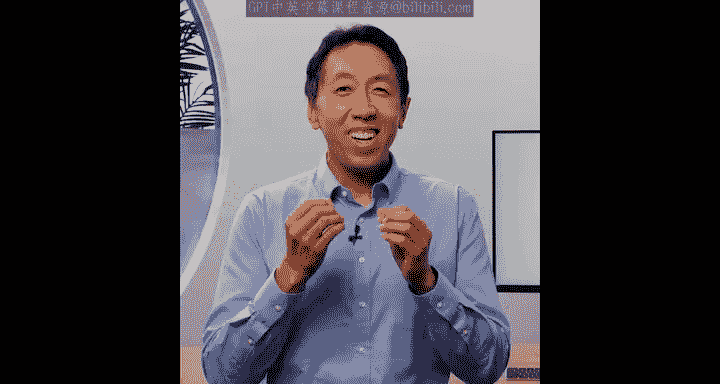
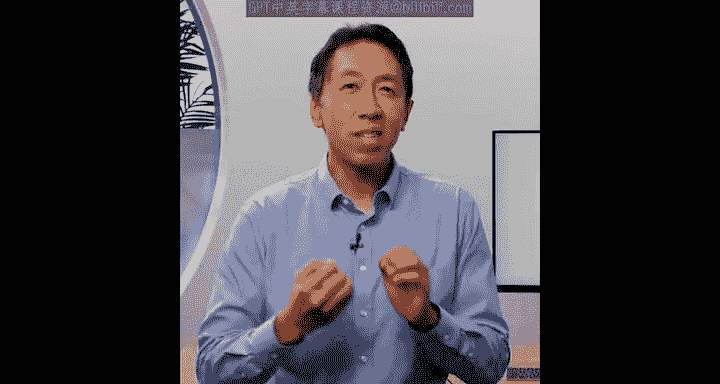
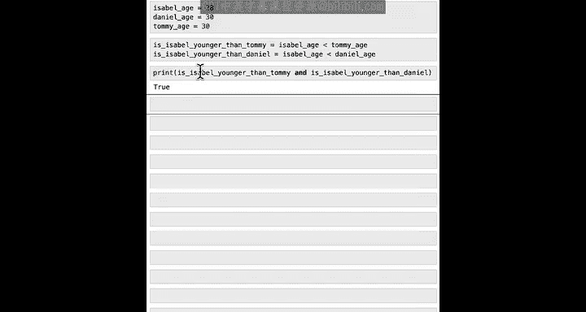

# 吴恩达亲授《给初学者的AI Python编程课（4课全）｜AI Python for Beginners》中英字幕（deepseek-R1 - P17：6.Lesson 5 - Comparing data in Python.zh_en - GPT中英字幕课程资源 - BV1qw4m1k7Lq

At the end of the last lesson， you saw me allude to a true value variable when we said。

 Tommy isvetarian is true。

In this video we'll take a look at these true false value variables。

 which we call in computerized Boolean variables and see how you can use these variables in Python to compare data with each other。

 ask questions like which number is bigger and then also to use these comparisons to answer questions about data let's take a look。

😊。

In the last video you saw me use a dictionary like this one to store Tommy's food preferences。

 I want to use a Boolean variable to store whether or not he is vegetarian。

 so I'm really going to comment out this line and let's run these three cells like so。

 And if I now print，Foods preferences， Tommy。We end up with this showing that is vegetarian is true and we don't need to slow。

The vegetarianism of Tommy under this dietary research was key any， true。

 as was false of special values in Python。If I were to type print true。And print false。

 you might think that these would generate an error because I didn't put true and false in quotation mounts。

 but if you run this this goes Ash valid， what's going on here？If you were to check the type of true。

The type of true is boo， which stands for Boolean。 anywhere you to look at the type of false。

 that too is boo or Boolean。 So you've seen integers and floats and strings and list and dictionaries。

 and this here is a new data type called a Boolean variable or boo for short。

 Just as integers allow only certain values like negative 1，0，1，2，3， but not 1。5。

 Boolean allows only certain values and those values are either true or false。

 If you're curious why this is called a Boolean。 Let's ask our chatbot companion。

Why is it true of false that I would call a Boolean？Turns out this is named after George W。

 a mathematician who had developed Boolean algebra。

 and it turns out Boolean algebra is important for computer logic and designing digital circuits and we'll see later that Boolean values are often using computer programming to hope for computer decide do we take this action or not。

 Yes or no， youll see more on the use of Boolean values in decision making late in the course。

So the recap， Booleions or a data type can take on only two values， true or false。

 like the outcome from a coinintass which can be only his or tails。

 and you can think of Booleions as giving answers to yes or no or to true or false questions So for example。

 if you ask is Tommy my friend， you might set this to true if indeed is is and you say yes。

 he's a good friend of mine。And Python will often make comparisons between different pieces of data and when you compare two values。

 the result from comparing two values is a Boolean here are some Python operators for making comparisons so is one thing greater than another thing is something less than another thing。

And in code this is how you write greater than or equal。

 you write the greater than sign than the equal sign。

 this is less than or equal and something we'll see later as well as use two equal signs to check if two values are equal。

 So for example， if you want to check if Isabel's age is greater than or equal to Tommymy's age。

 you would write h issabel greater than equal to age Tommy and this expression here will return a value that's either true or false that is a Boolean value depending on whether or not。

 H issabel is greater than or equal to H Tommy Let's take a look at some examples encode code。

I'm going to assign is Tommy， my friend equals true and notice that is capital T。

And is Isabel older than me equals false。E my prince is tell me to my friend， I get true。

And if I print， yes， is it about older than me？I get back the value I has thought in dispooing variable。

This is about older than me， and if I were to ask what's the type of this。

 you figured out this isn a bull。Now， let's say Isabel。

 Daniel and Tommy are playing a game and they decide that whoever as youngest gets the go for us in the game。

 here are some things you could do in Python to compare these different numbers。

I can check if Isabel's age is greater than Daniel's age。And this expression returns a bo。

 So let me print。Isabel age greater than Daniel age， and because Isabel is 20th and Daniel 30。

 this should print out false， and yes indeed。That is false。

However I were to print Isel age less than Daniel's age， then it is indeed true that Isve age。

 which is 28， is less than Daniel's age， which is thoroughly， so I run this of the print out true。

Here's another nifty thing you could do。 You can set a new variable I Isabel older than Daniel to be equal to the results of Isabel age greater than Daniel age。

 So what this does is it will carry out this comparison。

 See if Isabel's age is greater than Daniel's age， which is not。

 So this expression that I've just highlighted， should give us the Boolean value false。

 and this line of code will therefore set is Isabel older than than Daniel to be equal to false。 so。

Le。Run this and hopefully this prints how false， Yes， it does。

I use greater than and less than up there。 you can also use the less than or equal to operator。

 So is isization less than equal to Daniel's age。Yes， it is because 28 is less than equal to 30。

Is Tommy's age less than Daniel's age， no it's not because they're both。30， so this should be false。

But the way to answer is Tommy's age less than or equal to Daniel's age that because Daniel and Tommy are both 30。

 this should return。True。If you feel the pulse of videoo and we do these with greater then and greater than or equal to and see why results you get in addition to testing for less than or less than or equal to or greater than or greater than equal to we can also test for equality So what do we want to check if two things are equal it turns out in Python。

 the way to do that is to use the double equal sign。

You've seen we use a single equal sign to assign a value to a variable。

 a double equal sign is a different operator than a single equal sign。

 and it tests if two things are equal， so for example， it can do print。

Tommy age equals Daniel age and because Tommy and Daniel are both 30， this should return。True。

Whereas if I were to see if Isabel and Daniel the same age。

 this should print false and please be careful about single equal sign and double equal sign。

 one common bug and Python is to write a single equal sign like this when you meant to use a double equal sign and this will actually take the value of Daniel's age and overwrite Tommymy age with a value there and just go to some pretty unexpected effect so please be sure to use a double equal sign if you're actually trying to test if two things are equal to each other。

And by the way， you can use double equals as well to test for equality of strings。So。

Is vegetarians equals a vegan， maybe this is not a good way to test if these two concepts are the same。

 but what Python is doing is looking at this string。

 vegetarian and checking if that string is equal to the string on the right and in this case and is not Where is it going to run this is vegan equal to vegan then this would be true and you can imagine that testing of two strings are equal or not equal to each other is an important part of how computers check if a password you just enter is equal to the correct password because that involves testing of two strings are equal to each other by the way。

 if you ever build a high security password checker。

 there are some other steps that are recommended to make it more secure but testing whether two strings are equal really is one of the steps using password checkers today。

Now， let's say I'm hanging out with two people。 Tommy and Isabel， and I have saved two variables。

 This Tommy， my friend。 is true。 I is well， my friend is also true。

 And we want a compute us both Tommy and Isabel。 my friend。 How can you do that。

 It turns out Python has a logical operator called the and operator。 Second can ask is Tommy。

 My friend。 and。😊，Is。Isabel。Myi friend。And printed。This turns out to be true。If for some reason。

 Isabel didn't want to be my friend anymore and that were false。

 then this would become false because it's no longer true that both Tommy and Isabel I my friends。

 Wait， I don't like that Let we change the stack。All right， much better。

So these are the most frequently used logical operatorss in Python and it true if both of the inputs are true and always true if at least one is true。

 and this is an example of the and statement that you saw in a code just now。

Just to illustrate some other examples is Tommy， my friends or Isabel， my friend。

 this is true and again。E though doesn't like me anymore then whether both all my friends is false but whether at least one of them is still my friend that still remains true。

 I know I just went through a lot of brilliant logic here if any of this doesn't fully make sense I encourage you to post the video。

 try randomly code yourself with different true false values and see what you get and also feel free to ask the AI chatbot companions explain these results to you if part of it still doesn't make sense。

Just a wrap up this example， if Isabel， Daniel and Tommy are playing a game and these are the ages we had defined previously。

 then we can set Boolean values to be is Isabel younger than Tommy is Iel younger than Daniel and then to see if Isabel is the youngest so she gets to go first we can say is Isabel younger than Tommy and I isabel younger than Daniel because if this is true that she is the younger and the three and yes indeed she is so she gets to go first us in this game Now we've learned about Boolean values。

 you've be able to in the next video use Boolean values to help AI make decisions where it'll be able to compute whether something is true or false and then depending on that value decide what action to tape let's take a look at how to do that in the next video。

