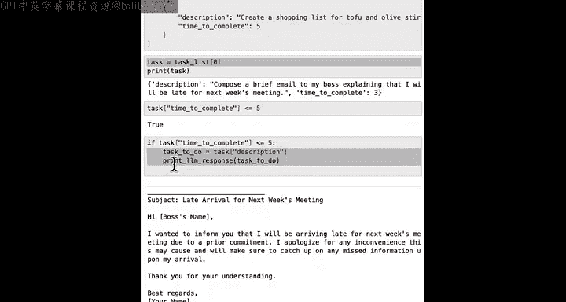
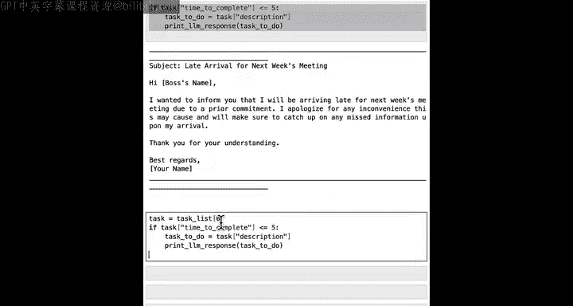
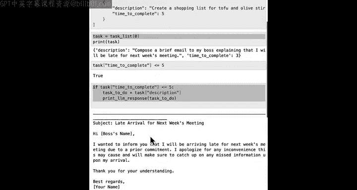
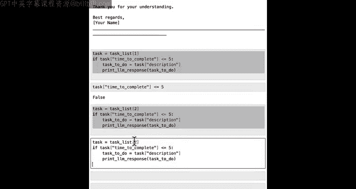
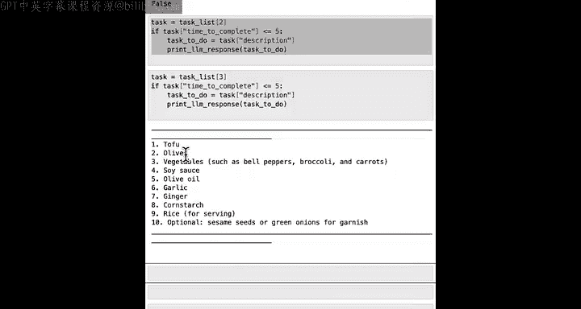
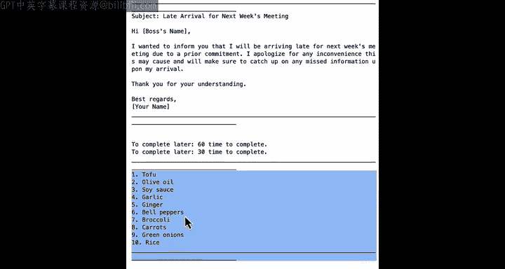
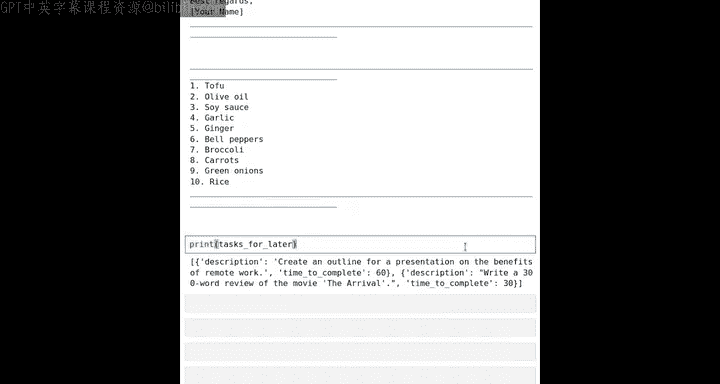

# 吴恩达亲授《给初学者的AI Python编程课（4课全）｜AI Python for Beginners》中英字幕（deepseek-R1 - P18：7.Lesson 6 - Helping AI make decisions.zh_en - GPT中英字幕课程资源 - BV1qw4m1k7Lq

In this lesson， you take the Boolean variables that you learned about in the loss video and combine that with a new type of programming pattern called a conditional to help a computer make decisions This will let us write some really cool programs where the outcome depends on the data so depending on the data it might do A or might do B one of the examples you'll see in this video we'll be using this to help prioritize what things to do first on your to do list Let's take a look。

Let's go through an example with a more sophisticated to do list or tos list I'm going to define a tosses with here for tos First tosses compose a brief emails by boss and so on。

 and that would take me about three minutes to compose it using an AI large lunch model and then takes a few minutes to send it off and then screen an outline for a presentation on remote work and beyond the outlines have cleaned it up。

 edited， send it some people So let's say that takes me 60 minutes， ran a 3 in word。

 review the movie， the 30 minutes， and lastly create the shopping list for a meal with a tofu and olive Sur fry with my friends Tommy Isabel and Daniel and that shopping list will take me five minutes to put together。

 So structuring the tois will let us do most sophisticated things with it。

 Let's say it is nearly lunchtime and you're about to head out the door to lunch but you have just a little bit of time。

To do any quick task。 Here's how you can use a new type of programming pattern called a conditional to go through your task and decide whether or not to do each one。

 So first， let me set task equal task list0 and。Let's print out like that is。

So maybe not surprisingly， that is that first task up here on your task list。

And if you're on your way out the door to lunch， one thing you might want to do is check of a task can be done in less than five minutes and so let's see this task。

As a time to complete。Does's less than or equal to five minutes because if it's a quick task。

 maybe we just get it done quickly before we head out to line。

 this turns out to be true so let me just go ahead and show you the code to make a program do a task only if it takes five minutes。

Or less， it's good to look like this。I'm going to say if the task is the time to complete this lesson into the5。

 so one Ive highlighted here will be a boolean value。

 that'll be either true or false and then a colon and one thing you see in Python is whenever there's a colon almost always the next line is indented so indented four spaces here。

 but this says if the task takes less than or equal to fiveness to complete。

 then let's set task to do to be a description of the task and then let's get the LM to process that task to do as a prompt and print the response So in this case when task is task is0。

Because the time to complete is less than equal to5。 that's true。 if I run this。

 it will take the task to do and imprint DL response like so。

Let's go on and repeat this with the next item since I have item zero。

 let's look at item1 on the list。

Item 1 takes 60 minutes as during an online representation， so if I were to run this。

What do you think were happen， I when I read it， nothing happened。

 which is exactly what we wanted because tasks time to complete lesson equal 5。Ass equal to false。

 And so it decided not to run this code。 It did not print El response because this says if it takes less than five minutes。

 then do this。 But because it's not true that it takes less than five minutes。

 it did not do the task。 And if you want to go through your entire task list。

 than the next item was write a review of the movie， which takes 30 minutes and you run this。

 It does nothing again， which is exactly what we wanted。And， finally。

Let me do this one last time， the final task was to create that tofu and olive Sur fry shopping list。

 which takes exactly five minutes。 so if I run this。It calls the lush language model， and it does。

Do this final task。 Let's take a look at what just happened。

 And if statement in Python is a control statement。

 then you define different ways for the program to behave depending on the Boolean condition dennas。

For the if statement that we used， what we said was check if the task we completed in less or equals to5 minutes if true。

 then do the task print theL response to that task otherwise in this example we don't do anything and we'll see later how the write code to tell it to take some other action if this Boolean value turns out to be false we'll come back to that in a little bit。

Let's walk through the key components of this piece of code， there's the if statement。

 and then there is a Boolean condition which has got to take on either a true or a false value and then colon an indent and after that is the code to execute if the Boolean condition is true and this code is indented。

So what you just saw me do was walk through the four tasks one at a time and write a little simpler of code like this。

 where for each of the tasks task 0， then task1， then task 2， then task 3。

 it will check out the time to complete this lesson equal to to five minutes and then if so。

 it will set the task to do to be the script and print the own response to that task to do。

This is a pattern that we saw where we went through for loops and we saw that instead of having to manually write this code four times in this case。

 there's a more efficient way to do this using a single full loop to tell the computer to just do this step to every one of the four items on the task list。

 Let me just show you what the code to do that looks like。 Im gonna say four task in task risk。

And now notice this is indented and we're going to repeat the same code that we had before。

If the task time to complete is less than the five and if I hit enter again。

 notice something that funny has happened instead of being indented for characters。

 my curses indented eight characters now。And then I'm going to have the rest of this code over here。

 so notice that what we did was take this code that we wanted to run four times and we indented all of this code and another four spaces to the right resulting in this block of code that's inside the full loop and what this folder loop will do is for task 0 task 1 task 2 task 3。

 remember we start counting from0 it would run this s of code will repeatedly check if the task can be done less go to five minutes and if so。

 then it will print on response of that task to do which is a description of the task let's go ahead and run this and see what result we get。

So decide to do the first task and the final task and ignores task two and3。

 which is exactly what we wanted。If you want to tell your code to do one thing if the Boolean condition is true and do a different thing if the Boolean condition is false。

 here's how you can modify the code。You could say if task time to the pleaseness for five minutes。

 then do the task。And then else and colon again and you see there's a lot in Python whenever there's a colon。

 usually the next line is indented， so if this is true， do it otherwise or or else。

 if it's anything but true of as false print one will do this task later。

 let me modify this code to demonstrate the elses。Condition。So here's what we had just now。

 and I'm going to write else and remember the colon。To complete later， time to complete。

Some other the task。So if I run this now。It does the first task。

Lets me know there's a task I'll do later that takes 60 minutes and other tasks that take 30 minutes and then it does the fourth task and I know that this doesn't print out the tasks complete later in the clearest way。

 but if you want feel free to pause this video and modify this if you want maybe over here you could tell it task。

姐姐。Equals the description。And have it print out the description of the tasks that you are saving to complete later。

 so feel free to pause the video and try to modify the code to make this print out the more detailed guide for on what exactly we're saving to do later。

😊，Now what we've done so far is for the task we're prioritizing for someone other day。

 we're just printing on a message saying well we'll do this later。

 it turns out that there's a nifty way to use something that you can learned about early in discourse to save those future tasks in a better organized way。

 here's what we can do。You might remember the coding pattern of where we start off with an empty list。

 so I'm going to start off with no task on my to do list for later and now here's a piece of code that will go through my tasks list and if it takes less than five minutes。

 we'll just do it now。Otherwise， if we're not doing it before lunch。

 then we append it to task for later， so let's run this and see what we get。

So we will do the first taskss。We will do that final task and now if we print task for later。

 we end up with that task to create an outline that was going to take us 60 minutes and is's that review of the movie arrival that takes 30 minutes that will save for some other day。

So you're nearly all the way to the end of to section the materials on all the way to taskss with Python Before we wrap up there's just one more quick video Im going to go over to talk a little bit about working with files Let's go on to the next video。

