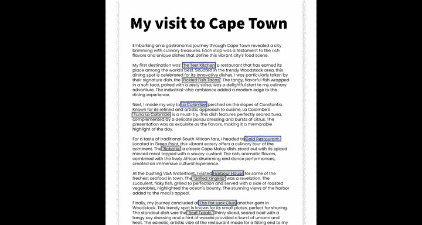
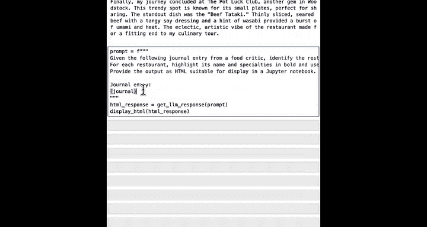
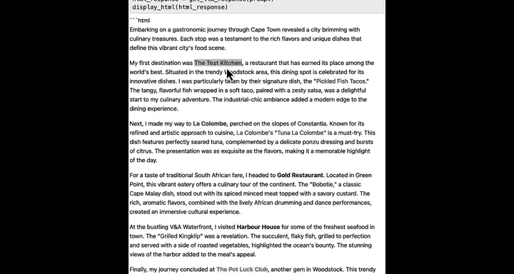
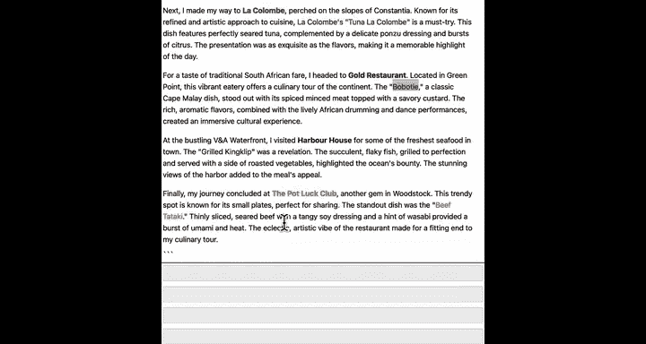
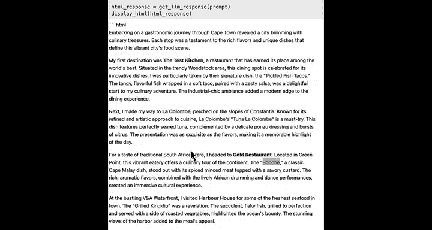

# 吴恩达亲授《给初学者的AI Python编程课（4课全）｜AI Python for Beginners》中英字幕（deepseek-R1 - P19：8.Lesson 7 - Next course preview working with files.zh_en - GPT中英字幕课程资源 - BV1qw4m1k7Lq

You now have a lot of tools for working with data， variables， lists， for loops， dictionaries。

 and conditional statements。

I know it went through a lot of the materials quite quickly and if you don't remember everything that's okay you can revisit materials or even better ask your AI chatbot companion to remind you of any concepts that you want to refresher on professionalf programmers don't remember everything either and also often ask chatbots for help。

And the next goal， you build on everything you've already seen and learn how to get Python and AI to work on your own data。

I don't know if you think you have data， but let me say you definitely do。

Let me show you an example。You probably own data stored in your own files like your own documents or to do lists or emails or spreadsheets and so on for the example we'll get to in a minute。

 let's say you are food critic and keep a journal of travels to different cities and your journal includes descriptions of restaurants and the specialty dishes。

Say you want to analyze your journal entries and highlight the restaurants and the names of the dishes。

😊，In this video， you see briefly how to load your own journal text into Python and use AI to highlight these restaurants and dishes and your data。

For the purposes of this video， don't worry about the specifics of how the code you see in this video works。

 you learn about all the details in the NIC course。

Here I'm going to load some helper functions。And then here are some Python codes that read a text file stored on my hard disk that contains a text journal。

 so let me load it and print it out。 And here's my journal embarking a gasinary journal through Cape Town Reviewer City and so on。

And then I'm going to write a prompt that says， given the following journal entry for a food critic。

 identify the restaurants and the specialties for each restaurant。

 highlight its name and specialties in bold and use different commentss for each。

 provide the output as HTML So here's the prompt we're going to insert the journal using an app string。

😊，Get our response and we'll get the Hml formatted response。 Web pages are formatted with Hl。

 and we're going to get the AI to return an Hl response。 and then lastly， we can display the Hl。

 And if I run this。

Which takes a few seconds to run， you end up with。D result where？

It has highlighted the names of restaurants， the test kitchen， la coom in boat。

 and the different dishes in corresponding colors。

I don't know if you have food credit or not， but I hope this gives you an illustration of how if you have text files stored on your heart disk。

 you can with a few lines code， get AI to help you mark up your own text and the next course。

 why I' going to use this to try to plan out a great vacation that involves visiting lots of restaurants and eating lots of delicious food。

😊。

Congratulations on making it through this course you've learned really important concepts and programming patterns that professional developers use every day in their work you've learned about lists and dictionaries that can be used to slow collections of data items。

You've learned about the full loop， which lets you automate repetitive tasks by telling Python to do the same thing to all the items in a list。

 you learn about Boolean variables which should only be either true or false and how they use them in if statements to help a computer program make a decision depending on the data it sees you covered a lot and I hope that you see that you now have the programming tools to maybe start building some things using AI and there's still more to learn I look forward to seeing you in the next course where you get Python and AI to work with your own data。

