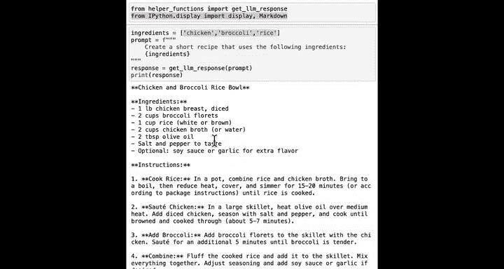
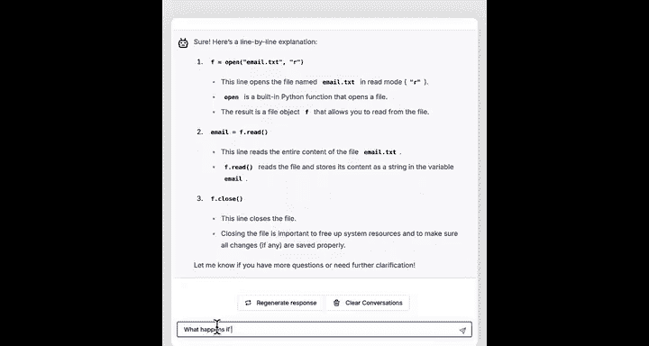
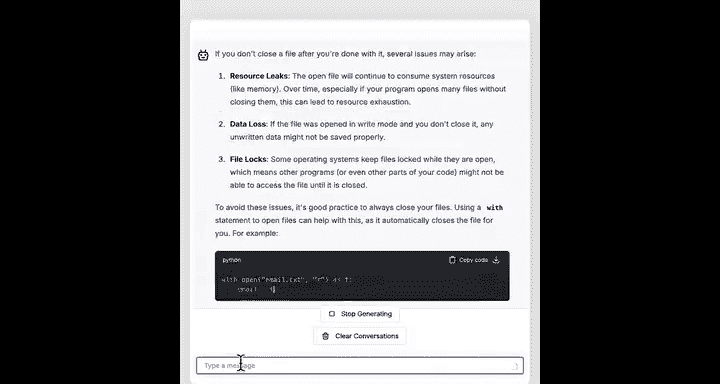
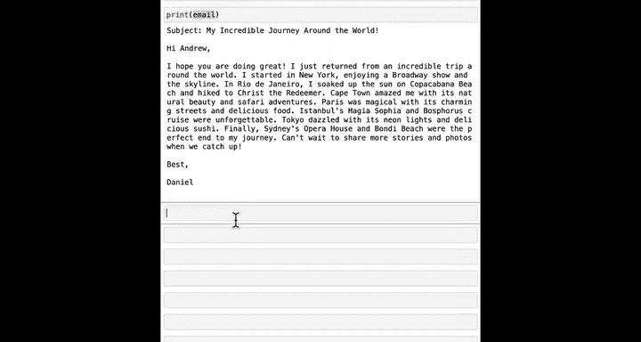
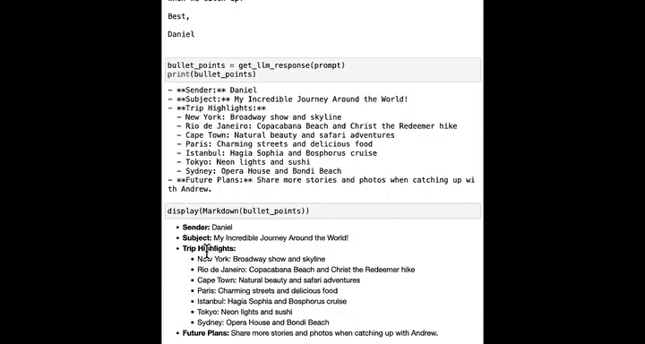
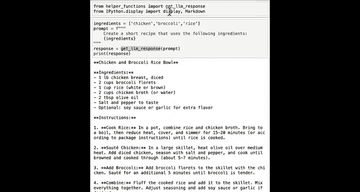
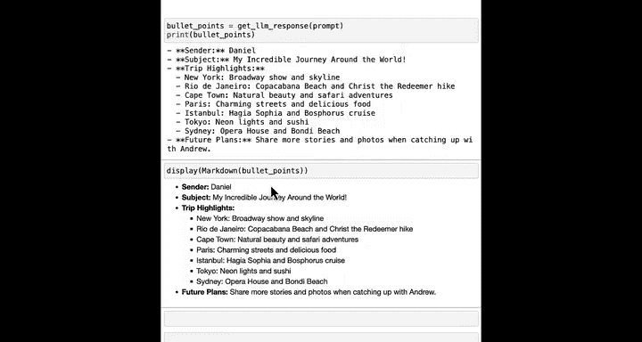
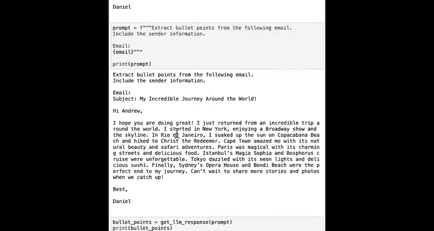

# 吴恩达亲授《给初学者的AI Python编程课（4课全）｜AI Python for Beginners》中英字幕（deepseek-R1 - P21：2.L1 using files in Python.zh_en - GPT中英字幕课程资源 - BV1qw4m1k7Lq

Data is often stored as files on your computer， such as your documents or your to do list or your notes that maybe you've jotted down in an application like Microsoft Notead or Mac T Edit。

I actually use an app called Obsidian to store my own to do this。

 and it turns out Obsidian stores my to do this in basically text files。

 technically something called a markdown file， but more or less a text file。

And it turns out you can use Python to read the data or read the text from these files so that you can write code to use AI to process the text in your own files Let's go see how to do that In the previous two clauses you worked with data that was created and assigned to variables right there in the Kpyter notebook。

So you saw how to create multiline strings， how to create lists and dictionaries。

And you saw how we can create a list of food ingredients In this code snippet。

 There is this new line from i Python display import display markdown。

 Don't worry about this for now and then create a prompt using an F string to ask a large language model to create a recipe using those ingredients and then sort the response in a variable called response and in prints out。

 Let's run。These two code cells。It turns out that instead of typing all the data into the notebook like this。

 chicken broccoli and rice。You can load data from a text file or maybe other solar file stored in your computer。

 Let's start by loading an email stored in a text file。 The command with users F equals open。

Brackets and then quotation mouses， email dot text。

 that's the name of the file I'm going to open and read the text from。

 and then in quotation mark are our sensor read， so this will open up the file email dot text for read mode。

That email is available。I'm going to store the text from the file email。

 T in and then when you're done reading a file， close it because this will free up some of the memory in your computer。

So by running this code， this just took all the text in email do text。

 read it and saved it in the variable email， so when now print email。

 it prints out the value of that variable， which is an email from Daniel to me about his incredible journey around the world。

 this sounds like he had a lot of fun。If I open up the email。t text file using text editit。

 this is exactly the file that is saved。And this is what？

Python has read in to the Jupin notebook here。So let's go through in detail what this code does。

 So the found name was email dot TXT。 The dot TXT was assigned that this slot was a plain text file。

 and so this command opens up the text file in reading mode and it assigns this open file to the variable F。

Next， email equals F Thought read， reads all of the text inside that file。

 and it storess it in a string variable called email。And then when we're done。

 we close this file and just as a reminder， if you are wondering what this code does exactly。

 you can always go to a friendly AI coding companion to ask and it can give us this description and if you're curious。

 what happens if I don't close a file。

D they can also give you a sense of what might happen。

Now that we've loaded this text into Python and saved it in this variable email。

 we use a large language model to pullproive。 So for example。

 I'm actually happy to read of the fun Daniel was having。

 but if I want a AI model to summarize it for me， I can write a prompt like extract bullet points from the following email and include the send information here's an F string to include the email text here。

And so this is the prompt。And then if I generally list of bullet points to summarize this email by get on response on the prompt and then let's print to bullet points。

After that。Then the AI model summarizes。Daniel's email for me。

You notice that this output has these double asterisks， which corresponds to this word in both ways。

This is a type of formatting called Markdown。 You can also friendly AI chatbot what Markdown means。

 If you want to display this， you can use display。Marock down。Bullet points。

And this causes Python to print all this text in this nicely formatted way。

 and that's why at the top of the notebook I previously imported display and markeddown because I knew I was going to run them later You learn more about this from an import。

Commands in the fourth and final course。 But for now， just remember。

 you have to run this line of code before you use the display and the markdown functions。

 You don't need to print it out in this nicer format。

 But if you were to ever show it to a friend or if you want to read over it more quickly yourself。

 you'll just just makes it a bit nicer to read。

So in this video， you saw how to load one specific file email do text in the next lesson we'll see how you could do this with your own text file。

 Let's go on to the next lesson。

