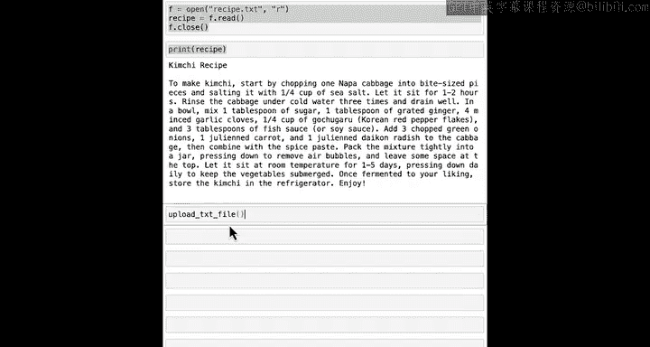
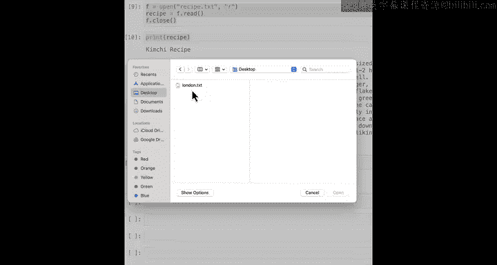
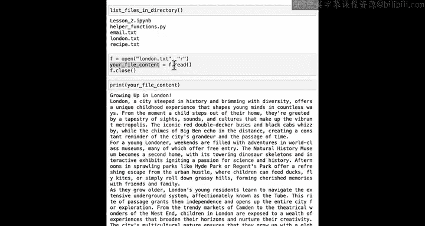
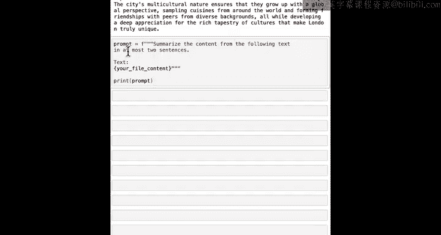
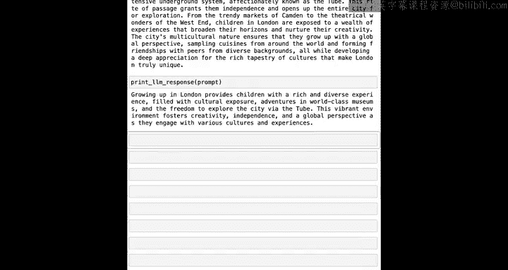
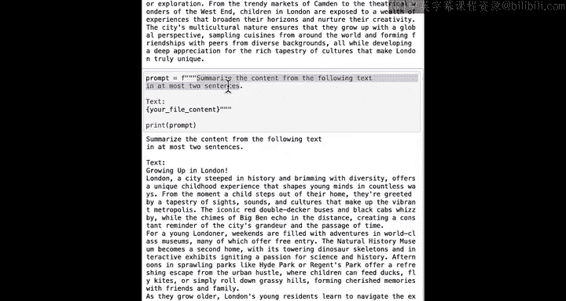

# 吴恩达亲授《给初学者的AI Python编程课（4课全）｜AI Python for Beginners》中英字幕（deepseek-R1 - P22：3.Lesson 2 Loading and using your own data.zh_en - GPT中英字幕课程资源 - BV1qw4m1k7Lq

This on the last lesson how to open and read a file and Python。

 as well as treat bullet points summaries of the key points in that document。

 that email using an AI largelight model。

One thing we'll discuss in this video is telling Python where your file is it turns out how and where filesus the thorn of a computer is actually an important part of how computers work。

Maybe you just keep many files on your desktop or maybe you're careful about organizing your files into folders。

 It turns out when you ask Python to read a file， you actually have to tell it where is that file precisely Let's dive more deeply into how all this works and how you can upload your own file to help Python summarize for you。

On your computer， you may have saved many different types of data in different files。

This might include documents that you save like reports and to do this and emails and spreadsheets with budgetges and other types of maybe company data in this notebook you see how to work with one of your own text files。

 files in your computer are organized in different folders。

Developers tend to use the word directories instead of folders。

 So if you hear me say this file is in that directory that basically means this file is in a particular folder and with the jupyter notebook that you're running on this website there is a set of folders that are storing different files for lesson one lesson2 and so on。

 right now we're lesson2 and in a lesson2 folder it turns out there's actually a list of files like this the code will run here and it' in a file called lesson 2 dot IPyn the part of the file name after the dot is called an extension Jupynter notebooks of files with a Iyn B extension IPyn B if you're curious stands for IP Python notebook and then when we were importing from helper functions。

 It turns out that save in a different file with a dot P which stands for Python extension。

Folder or directory in which Python looks first for files is also called the working directory。

 And so if you tell it to read emailt or recipetex this current working directory and listen to folder is the directory that Python will look in to read in the file that you want So to understand more about working directories。

 lets ask our AI companion， once the folder called where Python looks first for files and which folder is that by default And so Python looks first in the current working directory and as usual if you want more elaboration on any of this feel free to chat with your AI chatbot So let's go to the code in this notebook I'm going to load a few new functions from helpfuler functions。

 I'm going to upload text files this files in directory and also our usual print response。

 So let me run that and just as a reminder as you're executing。cold cells。

 please execute them in the same order as I am。 And now let's list files in。Diirreecty。

You see that these are the files in the current working directory。

 and in were to open and read this file。 when let's print the email， then， you know。

 we get this email that we saw from the last lesson， Similarlyly， if we were to。Open the recipe。

Run that when its print recipe， then you get this delicious recipe for kimchi。

Now let's upload text file to upload a file to the current working directory。

 so I'm going to run that， it creates this upload button which I'm going to click and this brings up a file browser and I' saved on my desktop a file about London which is where I was born。

So let me open up London dott and so now London dot has been uploaded and if I now list files in directory again。

 then a new file， London dot text has just popped up and now I can open up this file and read it into the variable your file content so let me run that。

And if I print your file content， it prints all the contents of London。tex。

 and here's a nice description of London。

And when you run this code， I encourage you to create some sort of text file。

Hit the upload button and upload it if you grab a paragraph or two from a recent email or from some news article online or something。

 if you' are running Windows， you can use Microsoft Word or in the Mac。

 you can use the text Ed program or you can also use Google Docs。Then go to file。

 download as plaintext。txT that you can then upload to the Jupyter notebook like so please don't upload anything confidential。

 you need to change London。tex to the name of whatever text file， you actually upload it。

 but if you do that then you were to see your own data run in Jupyter notebook。

And then for whatever text you provide， you can then create a prompt。

 like summarizemar content from the text in those two sentences。 So there's the prompt and。

Let's print our response to that prompt。And now this summarizes that long piece of text about London in two sentences in addition to providing a summary。

 you can also try different things such as RCL to extract the key bullet points or hope you brainstorm how to make a presentation on the content you just uploaded。

 So I hope these examples give you some ideas of the sorts of things you can accomplish when you use AI large language models or your text data I hope you find this fun and also maybe useful for projects you might have and in the next lesson will continue to explore how to handle text data in even more sophisticated ways in particular。

 you see how to read content from multiple pieces of text and determine whether or not the content is relevant for planning that dream vacation using AI after you've try running some of this code on your own text data let's go on the next。

Where we learn how to process takes in even more sophisticated ways。

