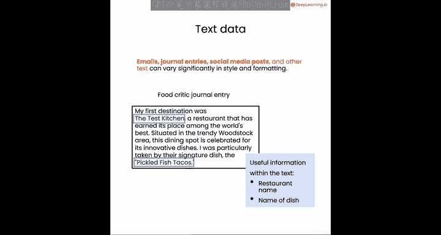
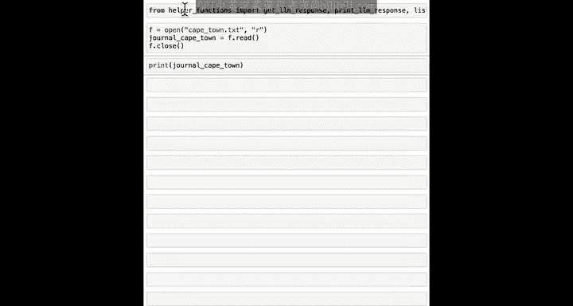
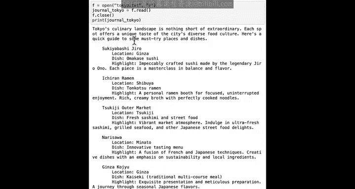
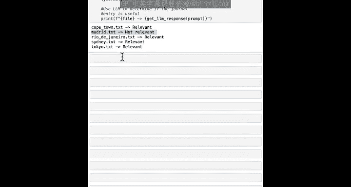
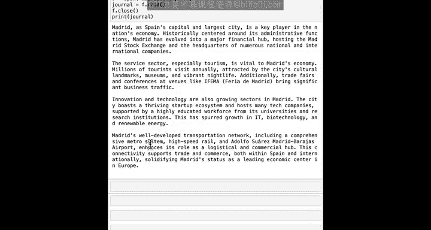
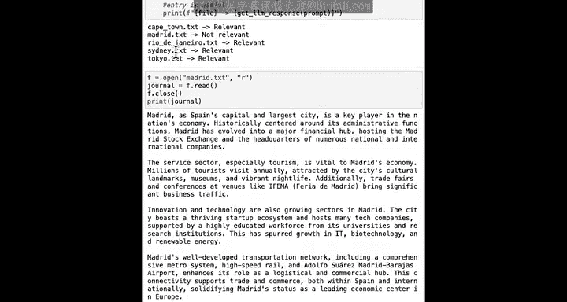
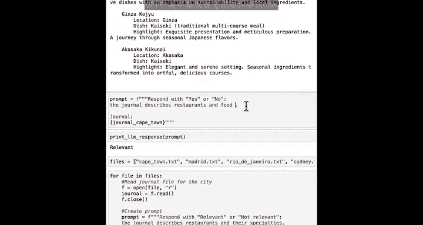
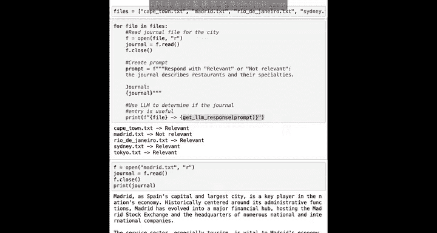

# 吴恩达亲授《给初学者的AI Python编程课（4课全）｜AI Python for Beginners》中英字幕（deepseek-R1 - P23：4.Lesson 3 Reading journals from food critics.zh_en - GPT中英字幕课程资源 - BV1qw4m1k7Lq

Many people work with a lot of text data， maybe reading tens of thousands of words per day in emails。

 articles， your own notes， and so on。

Depending on the task you're working on， you may want to have AI help you read and process some of these large volumes of text we may have。

For example， let's say you're planning out that dream vacation and you want to plan what restaurants to go to and what to eat in different cities。

As maybe you've been thinking about this vacation for a long time。

 you might have saved lots of long blog articles about different destinations。

 and some of these blogs or other articles you've saved might describe restaurants and dishess in different cities。

For the example we'll go through in this video， we'll say you want to incorporate some of this information into your food related itinerary for this upcoming trip。

But amid this large collection of files and articles and blogs。

 there might be a lot of unrelated documents as well that just don't relate to restaurants of food or where to eat。

If you're short time and don't want to open up and read every single file yourself one at a time to see if it's food related。

 you better use AI to look at all this text and help you process it。

Let's go see how you can accomplish this in Python。

Well use journal entries from food critics that contain recommended restaurants and dishes and see how can use a large language model to process this data。

 text data like emails， journal entries and social media posts can vary significantly in style and formatting。

 Some people who write using bullet points while others will write a long paragraphs。

 and the code will go through in this lesson。 You use Python and large language models extract relevant information from these text files。

Such as extracting the names of restaurants and the names of special dishes you might want to try out pick up fish tacos。

 that sounds delicious。 But prior to extracting restaurant names and names of dishes。

 you might want to doublet if this text document is even relevant。 For example。

 if you have an article about the history of a city。

 that may not have any current restaurant names that are worth trying to extract。

 Let's see how we can use Python code to do all this。

 So please remember to run the code sales in order but I wouldn put usual functions and then similar to what you sold in the last lesson let's load the file Cape Town do text and let's print the journal on Cape Town。

 Cape Town's a beautiful city with iconic table mountain and also lots of charming beaches。

 Cape Town dot text is a journal writtented by a food critic and this focuses on the test kitchen。

 the colo and so on。😊。

Let's look at Tokyo text actually travels to Tokyo lot。

 but here's a list of inspiring restaurants in Tokyo and this is formatted very differently than the Cap town documents which had paragraphs of text Now before processing text files like these in order to extract restaurant and dish names。

We'd like to use a large language model to check a document to see if it is relevant or not relevant to restaurants and their specialties。

 so here's a prompt。I'm going to then print a response to the prompt and indeed the Tokyo article is relevant and in fact。

So is the Cape Town one。I happen to know that I have five files in this directory。

 which are Caton Dts， Madrid， Ri de Janeiro， Sydney and Tokyo。

And so to write Python code to process all five files， do you remember what's the coding structure？

We can use a full loop to iterate through multiple files。

And so I'm going set files equals this list of five filess。

This square bracket here is how we create a list in Python， so thiss a square bracket。

 my five file names， and then close square bracket。And then we say for file in files。

 open and read the file， close the file as usual。And then we're going to create a prompt。

 respond if relevant or not relevant， depending on whether or not the journal describes restaurants and their specialties。

 and then my abstractstream put in the journal variable that we had just read above。

And then let's use a large English model to get own response from a prompt。

And we've going to print it dissolved， print a file name， and in the right arrow。

 and then get the own response and print out each file whether or not to is relevant to restaurants and their specialties。

 Let's run down and see what this is。 I hope this works。😊，All right。So Cape Town is relevant but Dr。

t text is not relevant and the others are relevant。

 so if you have a collection of 100 or 200 documents you can use a folder like this to get Python to automatically read all of them for you and just point out to you。

 which are the ones relevant to food。Majorid Dtt， Let's check that one out。

 So let's read and print Mad Dtt。 And you see that this is a really nice article on。😊。

Marit， but isn't focus on food specifically， which is why the large languagegg model has said Mad out Texas not rather。

 And by the way， I would encourage you also to try different prompts。 So， for example。

 you can say respond with。

Yes or no。Well， the journal describes restaurants and。Food dishes。

 There are multiple ways to do this。 Something more advanced would be to have it print out only the foul names of the ones that are relevant。

 That would be a pretty advanced exercise。 If you want to give it a shot。

 you can also ask the AI chatbo companion Va whole。 And just a fun。

 if you're curious about the name of what we just did。

 I'm using AI determine whether different textile relevant or not relevant。 This is task。

 have a specific name。 So what we just did here was build a text classification system。

So I'd encourage you to play with this code and modify it to do different things。

Do take the code and try out different prompts and see what different results you get。

 but I hope you see how a simpleulative code like this can read in this case five or maybe even more documents for you to quickly help you identify the most relevant ones。

The nice thing about coding is you can tell the computer to do any other huge range of things。

 so I hope you have fun with this and in the next lesson we'll see how to take one relevant article and extract key information such as the names of the restaurants and the dishes from that file。

I'll see you in the next lesson。

