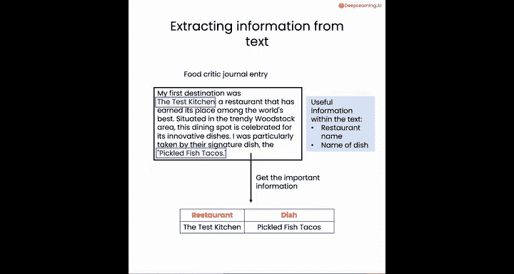
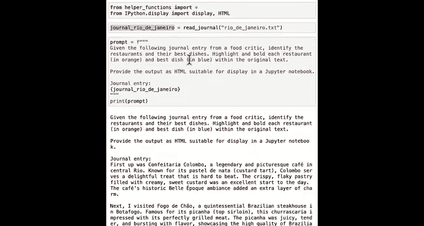
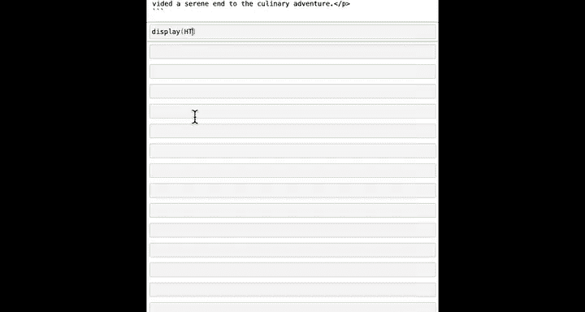
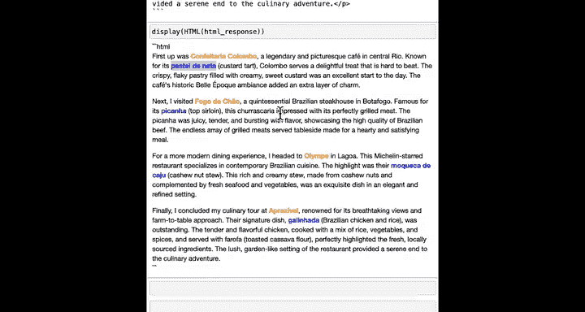
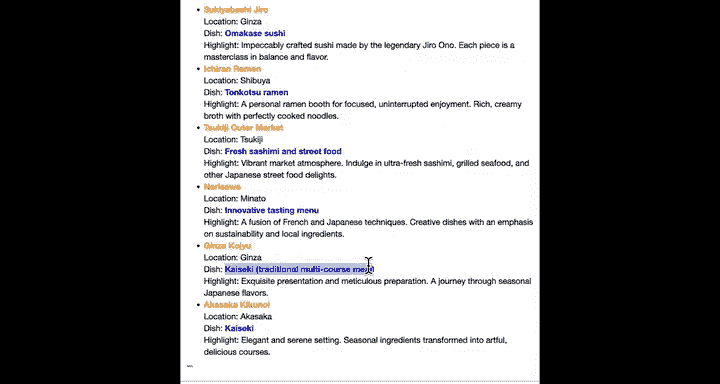
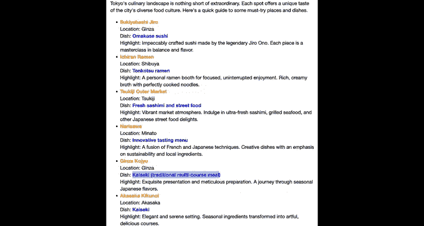
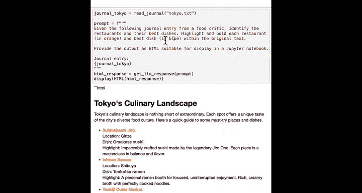
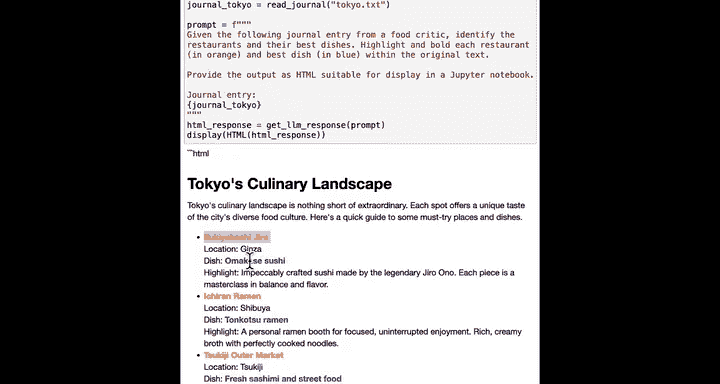
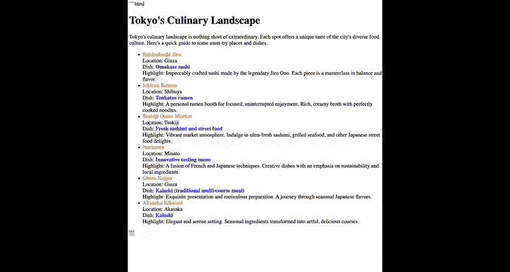

# 吴恩达亲授《给初学者的AI Python编程课（4课全）｜AI Python for Beginners》中英字幕（deepseek-R1 - P24：5.Lesson 4 Extracting restaurant information from journal entries.zh_en - GPT中英字幕课程资源 - BV1qw4m1k7Lq

In the last video， you saw how to carry out text classification that is to look at the piece of text and classify it as relevant or not relevant to food。

In this video， you see how the process takes in an even deeper way in which we have a large language model。

 look at the document and extract particular bits of information like restaurants and food dish names that you can then use elsewhere。

You see how you can highlight this extracted information and save it to a new file for easy reading。

Let's take a look at how to do that。😊，As you've seen the whole。

 the journal entries we have for different destinations may contain restaurants。

 as long as interesting dishes to try at guide restaurant and after extracting this information。

 you might want to save it in a little table that looks like this。

 that would make it easy when you're in that city to figure out where to go eat so let's run Discco to load Ri de deiro dot text。

Read journalnal is a function that opens up this text file and reads the text and in this case says it into the variable journal real de Janero。

 Later in this course， you see how to build a function like read journalnal。Now。

 given this there mode， she and say prompt， given the following journal entry for food traffic at tell by restaurants the best dishes。

 highlight and bone each restaurant and best dish within the original text。

 and we want the large language model to provide the output as HTML suitable for display in the juve the notebook。

 so web pages are formatted using HTML， so this lets us use a lot of rich formatting like write text in orange or in blue。

😊，So there's a prompt with the journal entry down here below Now let's call the large language model and get the response for that prompt and I'm going to go the response in HTML and this print is out。

And you see that the large anchor model has outputted HTML P tells it to start a paragraph。

 These are called HTML tags that specify the formatting。 If you want to display the actual HTML。

 you can use this commands， we're going to display HTML and in the response。

I had above。And now this prints out this nicely formatted HTML with the orange coat of the restaurants and then blue coding of the dish names。

 Now， let's do the same for the Tokyo journal entry。 Here's a code。 Let's read Tokyo L text。

 same prompt as before。 get the HTMLl response and then display that such as run that here。😊。

And Mils has done a pretty good job naming the restaurants and orange and the dishes in blue。

 even though this piece of text was formatted very differently than the Ro de Janeiro journal entry。

 the large language model was able to process that。

 I would encourage you to experiment with the prompt。😊。

Maybe here's one challenge for you。 Can you change this prompt to highlight any desserts in green or maybe try changing the code to add an emoji next to every ingredient let's see if instead of just highlighting certain pieces of information in different colors。

 we can modify the prompt to extract information from the text So here's the prompt I'm going to use things extract the comprehensiveness of the restaurant and their respective dishes mentioned the following journal entry and short the niche restaurant name is accurately identified and listed。

And here we saying， provide your answer in CSV format ready to save CSV stands for comma separated values CSV is a very common format for a computer to store information that looks like tables So I think a good way to understand this is just run it and look at bit example。

 so the first row of the CSV file tells you what is the data that will appear in each row each row will have a restaurant name comma and an additioning。

And the first restaurant is this followed by this dish name。

Nix's row is this restaurant followed by this dish name and so on。

 You can think of this as how the computer is representing a table with two columns where the first column is of restaurants and a second column or is of the dishes。

 Now with a prompt like this， you can also iterate through all the journal entries you have。

 So let's walk through this code step by step。I have here the ofphies， Cape Town， Istanbul， New York。

 and so on。And we're going to use a full loop so that for each file in this list of files。

Read the journal entry from that found name， and it will also extract the comprehensive list of the restaurants and the dishes。

And then I'll put it in CSV。And then。For every one of these files we print out the name of the file and then print the large language model response。

 and this command just prints an empty line。 so let's run it。Cape Town。Here are the dishes， Istanbul。

 When Istanbul is a teenager and loved it a great city。New York， fantastic restaurants in New York。

 Paris Ri de Janeiro， Sydney， Tokyo， and so you saw the code called through all of this data in just a few seconds。

 imagine how long and it taken you to open up these files one at a time and read through and extract the dishes。

 so I hope you can maybe imagine how large language models can become more and more useful as the volume of files you have to analyze increases I think all the time you save。

 you can maybe now have more time to spend in some of these delicious restaurants。

I'd encourage you to try out different versions of this prom， so for example。

 maybe you can try modify the prom to extract the restaurant and its neighborhood if known or extract the dish name and the main ingredients of that dish。

So we're almost to the end of this lesson。Before we wrap up。

 I just want to demonstrate how to open files to save data to files。

So recall that previously we had generated this HTML response。

And so to save the content of this variable HTML response into a file。

 here's the code you used to do so， I'm going to say F equals open highlighted learned to textile HTML。

 so that's my file name and now instead of R I'm going to write W because I want to write W for right rather than R for read。

An E thought， right？The content of HTML response and lastly when we're done， let's close the file。

The main difference between this and opening files to read them is。

W instead of R to write instead of read， and then you use F thought write to set F5 read。

 If you want to better understand what this code is doing， let's ask the AI chatbot。

So they explains what open does， what bright does and what closed does。If you want。

 you can also run Down file and type highlighted it。

Text H to download this file onto your local desktop click on this link if you open that file up in your web browser。

 you should see something like this， the HTML file that you generated so we've gone through a lot in this video to recognize certain terms and to highlight them or to extract them and save them to a CSV file。

And then also haul to write data out to a file that you can then download。In the next lesson。

 you see how to load data that is formatted in CSV format kind of like the data you created in this lesson with restaurants and their dishes。

And use that to help plan out your on vacation， so please try out the exercises at the end of this Jupyter notebook and after that。

 I look forward to seeing you in the next video。

