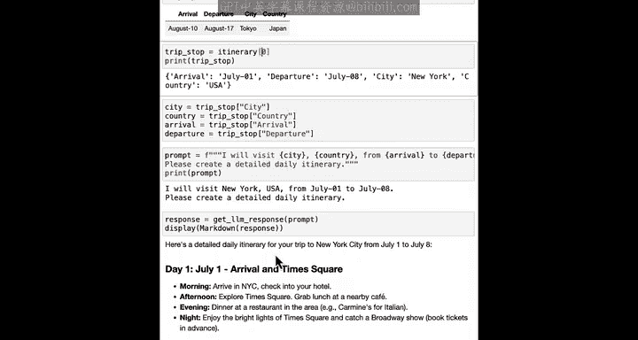
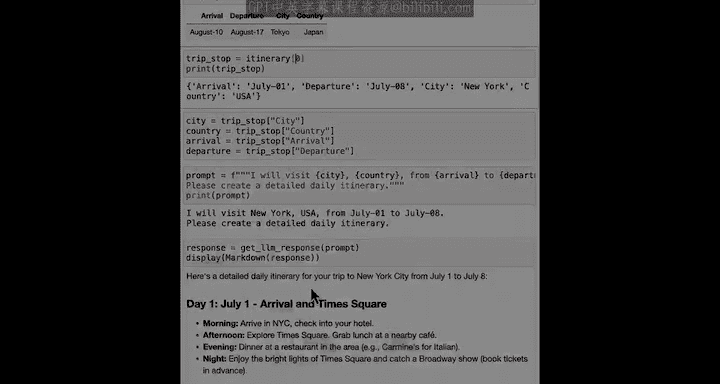

# 吴恩达亲授《给初学者的AI Python编程课（4课全）｜AI Python for Beginners》中英字幕（deepseek-R1 - P25：6.Lesson 5 Vacation planning using CSV files.zh_en - GPT中英字幕课程资源 - BV1qw4m1k7Lq

Text files are very versatile and can be formatted in lots of different ways。

 that's why we sometimes call themunstructured data there's little or no predefined structure to a text file。

In contrast， a spreadsheet has a well defined formatting or well defined structure with data li up neatly in rows and columns。

 this kind of data which looks like a table with rows and columns is called structured data。

Structured data like a spreadsheet is processed a bit differently in Python than unstructured data latex。

You can often use Python code to process it directly even without using an AI language model。

 For example， if you've been saving information for each destination for your dream vacation in a spreadsheet with one of the columns specify the country。

 you could then use Python to help you filter by location and see all the stops in a particular country like Japan。

Let's take a look at how to do all this。

In this lesson， we're going to use an example of processing an itinerary that looks like this in this table。

 each row corresponds to a destination with the arrival and departure tape。

 and if you were to take this table and express it in a CSV file。

 it might look like this where each row has commerce separating the four values corresponding to the four columns of this table So if you have a CSV file like this on your computer。

 you can load this data into Python。So let me import a few functions as before and the new command here is import CSv。

 My itinerary is saved in a file itinerary do CSv and so this will open up that file Next here is the code that will load the data into the itinerary variable we'll go over in detail what each of these lines does。

 but if I just run this for now you end up with。This。And so this is loading。I turn read our CSV。

 one row at a time and saving it in this list itinerary。 Let me close the file if I forget。

 if I print itinerary， then you see this Do you want you can confirm the type of itinerary。

 isn't this。They look at itineraries item zero。This is itself a dictionary where Keys arrival。

 departure， city， country， and so in fact， I were to use itinerary zero。And then， access the country。

I end up with USA。 Now you might be wondering what this code does。

 I'd encourage you to go ahead and try the chat monitor and read over the explanation and see if it makes sense to you。

But we'll go over everything together Here's the code we just used to read itinerary。 csv。

 This first line opens the file in reading mode and this is a code that reads the file contents and assigns them to the itinerary variable and in that closes the file。

 let's dig into what this middle portion of the code does The first line CSv reader equals csv。

d reader if uses CSv which we had imported， this will use a dictionary to store the data in each row。

Next's itinerary starts off as an empty list and then finally this iterates over each row in the CSV file and add to the end of the itinerary list。

 the contents of that row， Now print itinerary wound up with this which is a little bit hard to read and as I've also provided a display table which we had imported that prints out the table in a。

Nice looking way。Isn't that nice Now with structured data that is data in a table like this is often more feasible to filter information even without using an AI language model。

 for instance， if you want to get all the destinations that located in Japan。

 here's what you could do。Let me start with filtered data equals in empty list。

 and now let's filter my country。I wouldn to say for a trip， stop in。Itinerary。

 so this will go through the itinerary and trip stop in turn would be set to each row Zia dictionary if trip stop country equals。

Japan。Then faled data do append。Top stop， So I'm saying go through all of the roles in the itinerary and if the country is Japan。

 then append that stop to filter data。 and if I do that，And then， say， display。Table。Filtered。데터？

They end up with that one stop that corresponds to Japan。

Now let's use the itinerary to suggest trip activities。

 let's retrieve the first destination which is New York City in the USA。

 someone said trip stop equals itinerary zero because remember zero corresponds to the first entry in a list。

And there's a stop in New York in USA Now let's store all the key data for that stop in four new variable city country arrival and departure and just as a reminder。

 this is a code for accessing a specific key in a dictionary I'm then going to create an LM prompt that says I'll visit City country for arrivals departure。

 please create detailed daily itinerary and let's get a response for the arm and display it。

And this create a， you know pretty fun itinerary July 4th for the United States is the US Independence Day。

 So it is recommending going to the 4th of July fireworks。

 I encourage you after this video to try out your own variations。

 Why don't you make a difference and see if even can get a fun itinerary。

 So I hope you have fun thinking about potential vacations。

 and when you're done playing with this notebook， I look forward to seeing you in the next lesson where you see how to define your own functions。

 you've seen that there's some lines of code that we end up writing over and over， for example。

 to open a file read the text from that file and then the close that file。

 and you've seen the next lesson how defining your own function， lets you rerun sets of commands。

 whether having to write them over and over again in a way that's more flexible than a full loop。

 Look forward to seeing you in the next lesson。

