# 吴恩达亲授《给初学者的AI Python编程课（4课全）｜AI Python for Beginners》中英字幕（deepseek-R1 - P26：7.Lesson 6 Turning code blocks into reusable functions.zh_en - GPT中英字幕课程资源 - BV1qw4m1k7Lq

In this and the previous two courses， you may have noticed that there are occasionally steps that we would do over and over。

 such as opening， reading， and thenclo a file， or defining a few variables， then create a prompt。

 using an F string using those variables， and then getting a large language model to respond。

 using that prompt。

We've seen how full loops can help you with doing the same thing a few times in a row。

 but full loops expect you to do that operation multiple times one right after another in a row。

 rather than say loading read one file and then maybe do some other things and then read a different file as opposed to the move rigid structure of a full loop of loading one file right after another。

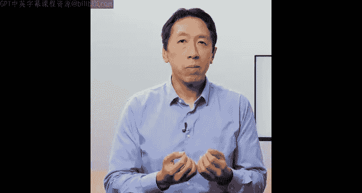

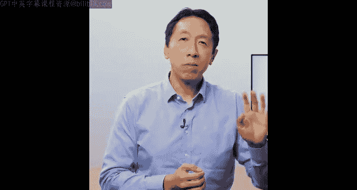

But it turns out Python has another very useful way of creating reusable plots of code called functions。

Functions are a very important concept in programming and all modern programming languages give you way to define and use functions。

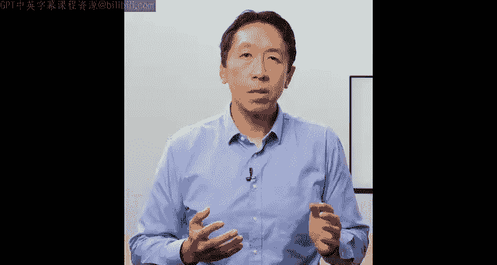

You've already encountered and used functions in many places in this and in the previous couple of courses。

 and in this lesson you see how they create your own functions and you see how they can help you avoid repeating code and avoid having to type the same thing over and over。

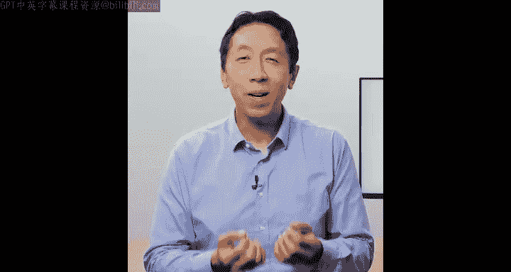

Functions are important， let's go see how to create them。

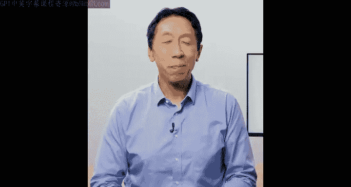

Functions are a reusable set of commands that help you perform a specific task。

 You seen the print function or the land function given list returns the length。

Or print earn response。Now， let's take a look at why you might want to define your own function。

Previous， we had written chunks of code like this that would open the file and read it and print out the text loaded from the sp。

 If I want to do this with a different city like Paris。

 I would have to do this and replace this with。

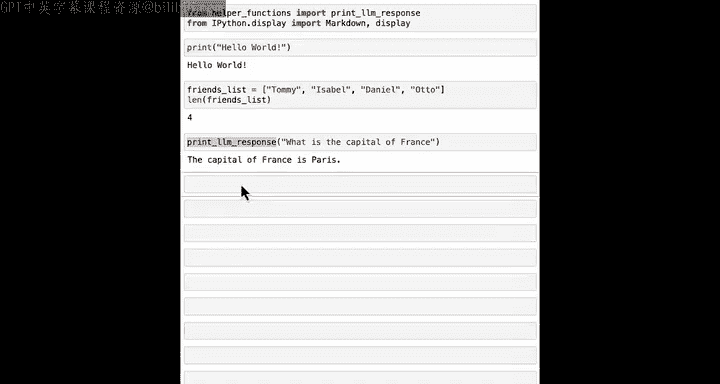

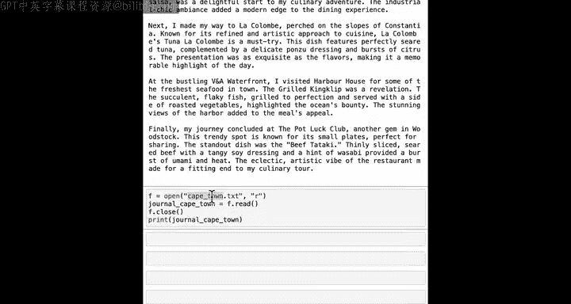

Paris， whether I don't want to do this over and over。

 I'm going to define the function print journal as follows。

 we'll go through later what every single line of this does。

 but now you can run print journal on say Sydney。Tt text and have it load and print out the file Sydney Dtex。

 And then if you wanted Paris Dt， you can do this and this prints out。P is not text。

 Let's take a look now at what every line of code here does。 Here's the code。

 D is a special command that tells Python you want to define a new function。

 printnt journal is the name of the function。 You then have parentheses and within the parentheses is the variable name file。

 file is called a parameter of this function。 and what this means is when you use or when you call this function。

 this function is expecting you to give it a file name。

 then there's a colon followed by an indentive block of code， and the function will then run。

 these four lines of code， which are to set f equal goes open a file journals if I read close a file and a print the journal。

 So all four lines of code here would be run every time you call the print journal function。

 and this is just the same four lines of code that would be using over and over。

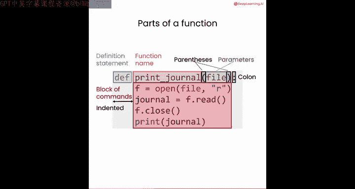

Now， here we define a function to load and print out the journal。

 What if you want a function that loads a journal， but doesn't print it out right away。

 Let me define a different function。 I'm going to put it down here so you can compare and contrastlytras these two functions First。

 instead of print journal I've added an lie return journal just no longer print out the journal that was just read。

 what the return command does is it makes the read the journal function。

 take the value journal and give this back。 If I call read。Journal。

Tokyo dot T this function will return a value。 And so I'm actually going to define a new variable journal。

Tokyo equals rejonal Tokyo， and if I run this， then journal Tokyo will be set equal to one the values returned here by the function。

It ever now prints Chdo。Tokyo， then you get that article that we had previously。

 and now that you saved this in the variable journal， Tokyo， we can also do things like maybe print。

 the length of this article and it turns out this article has 1 thousand points30 characters。

 just explain in detail what we just saw everything is the same as before。

 except weve converted the print statement and we have a new return statement。

 and the return statement takes a value of journal and gives it back In this case。

 the value gives back or the value of returns is the value of whatever is thought that the variable journal。

 Now let's look at one more example。 previously， you saw that Python unless you do calculations like converting from Fahrenheit to Celsius and you use code like this。

 72 degrees Fahrenheit is 22。22 degrees Celsius。 Now， if you want to convert another temperature。

 you could write this code again。 And so 68 degrees Fahrenheit is。

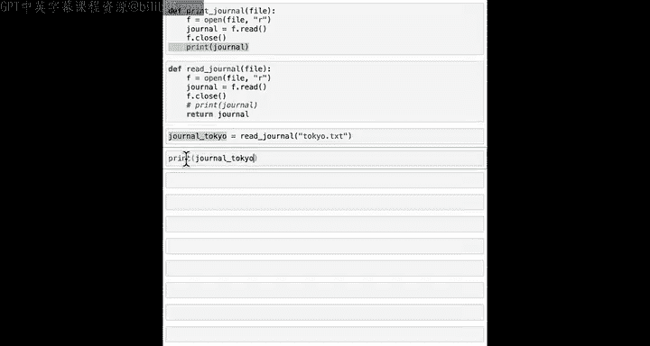

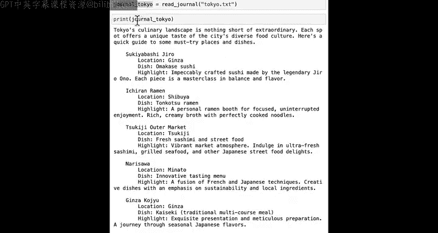

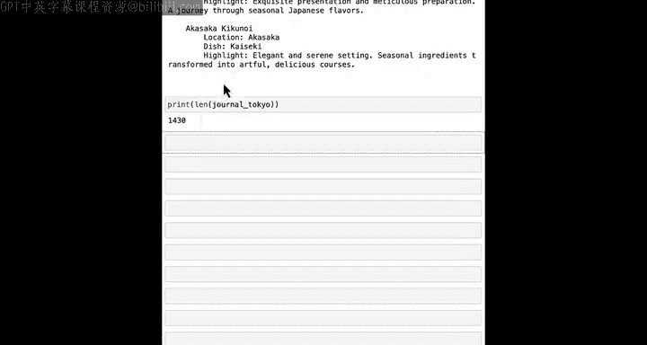

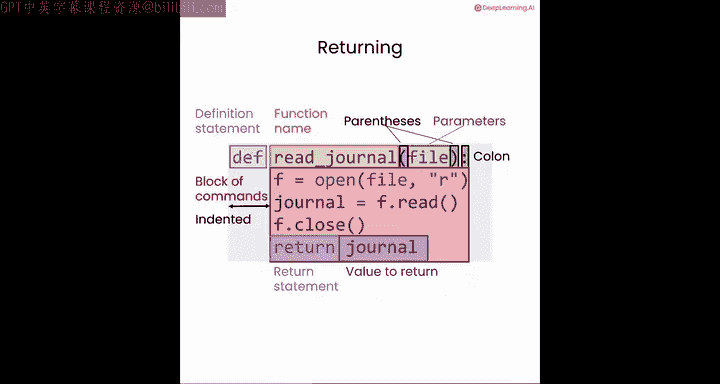

20 degrees Celsius。Ha how about 76 degrees。 Oh， that is 24。44 degrees。

 And so if you want to convert the lower temperatures。

 you might end up writing this code over and over。 Here's how you can define a function to do the conversion and define。

😊，There in height to。Celsius。And I'm going to input the parameter so its be number which is a temperature in Fahrenheit you have to have a colon and now it's the indented block of code and so to convert to Celsius。

 this is the formula and then we can just have this print statement over here and if I now run this block of code it now defines the Fahrenheit to Celsius function。

 and now if I call this Fahrenheit to Celsius on 71。

 it converts it or if I ask it to convert what is 70 degrees or if I want to convert 212 degrees Fahrenhe to Celsius that turns out to be 100 degrees。

So you notice that without functions if you wanted to convert different temperatures。

 we would write very similar code over and over， but with functions。

 you can define the function once and use the function over and over。

 and so the code on the right is much shorter in the previous example。

 this function didn't return any value。 it just printed the result to the screen。

 to to save the result from a temperature conversion。

 you can use a return statement So rather than having a print statement we can instead have it returned。

Celsius， let me just comment that out。 And now when I run this。

 I am defining a new Fahrenheit to Celsius function。 Now， if I were to say。

Fahrenheit equals 45 Celsius equals Frenheit to Celsius Fahrenheit。

 and then let's print the temperature in Celsius。

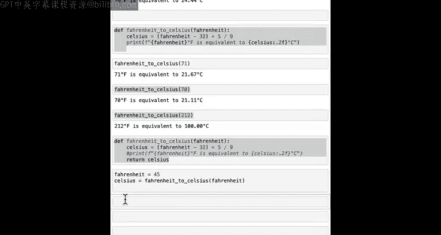

You get 7。222 and you can do other things with Celsius like us what is the type of Celsius which in this case is a floating point number here are written functions to convert from Fahrenheit to Celsius。

 can you modify this code to convert from Celsius to Fahrenheit or to convert from feet to meters？

I hope you have fun with functions， after all you can't spell function without fun and in the next lesson we'll take everything you've seen so far entitled together and we'll go plan the perfect vacation around the world using text and CSme files I'll see you in the next lessoner。

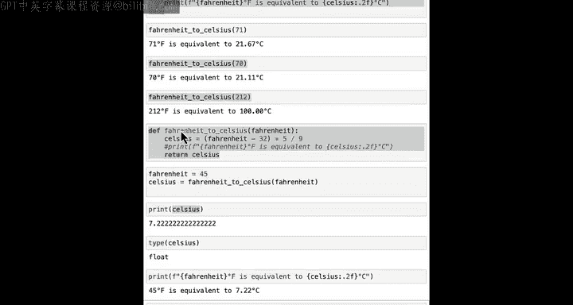