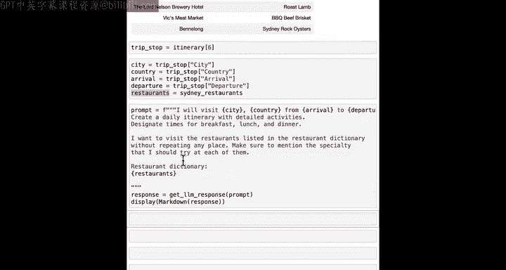
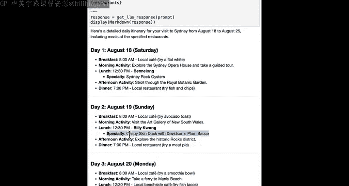
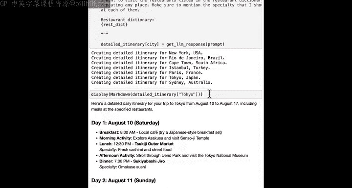
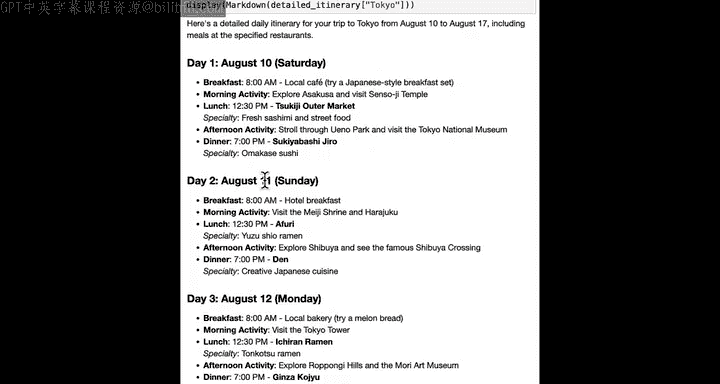
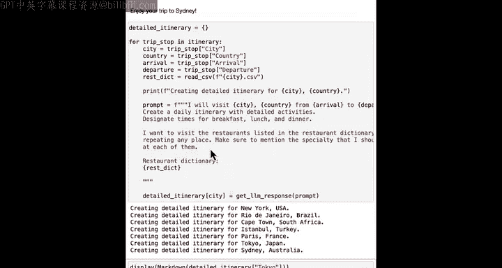

# 吴恩达亲授《给初学者的AI Python编程课（4课全）｜AI Python for Beginners》中英字幕（deepseek-R1 - P27：8.Lesson 7 Creating itineraries for multiple cities.zh_en - GPT中英字幕课程资源 - BV1qw4m1k7Lq

You have learned a lot about working with files， which is great because files can contain your own data so you can feed your own unique data into Python code and have a process that data。

You've seen how to open， read from， as well as write to files。

 and how to highlight key information using AI。

You've also seen how to work with structured data， that is a table of data stored in say CSV format and you've seen how to create your own functions to work with files and with data。

You can now build up more ofsquito workflows。

For example， we'll see in this video how you can itte through a set of files。

 extracting key information for each one and imp a large language model using that information and we'll see how to put all this together to plan out an entire graification around the world with the help of Python and AI Let's take a look。

In this lesson you use everything you've learned so far to plan a vacation around the world to get started。

 let me import my usual helper functions。 I'm going to define a new function for reading CSsv files that inputs the file opens it。

 load the data and then returns the data So let me run that So let's read iter read our CSv into this variable and then let's display it and so that's our vacation itinerary previously you define this read journal function and so as you saw before you can read the journal like so and you get the text of the file Sydney do text。

 and previously you saw how we can。Extract the restaurants and special dishes using the large English model。

 This is the same prompt。 And if I run that， you get this list of restaurants and dishes to consider。

😊，Now， I've already taken this CSV data and saved it in a file Sydney。 CSv。

 What they can do is send low Sydney restaurants via Re CSV Sydney。

And this is using the read CSsV function that we defined earlier， but if you run this。

 this loads the CSsV file into the variable Sydney restaurants and we can display them with this nicely formatted table Now let's look at how we can create a detailed itinerary and when we load the days for each stop let's also figure out what restaurants and specialties you want to try in that city so let's start by doing that for Sydney have've already loaded the restaurant information。

Sydney is the seventh trip destination and so to access its itinerary。

 it would be itinerary square brackets6， let's assign the city country arrival and departure to these variables where restaurants equal Sydney restaurants is this data we have from the CSV file。

 and now here's a prompt that you can use to in a large language model to create a detailed itinerary。

So our visit city country from Ra's departure traded daily Atery with detailed activities。

 including designated times of breakfast lunch and dinner。

 want to visit the restaurants listed in a restaurant dictionary here we're using the Fstream to insert restaurants which is actually a dictionary because we're enrolled in it from a CSV file and then we get a response the large language model and display the results so let's run that just might take a few seconds to run and this creates a detailed itinerary where suggests for breakfast try a fat white that's a classic Australian coffee that I think is delicious。

And then here's one of the recommendations， the restaurants， here's another one with that specialty。

 crispy skin duck。

And so on， so we've done a lot and you've seen the code to create a detailed itinerary for a single city。

 Let's see how you can do this for all the cities on your trip。

So I'm going to start off creating detailed iterary as an empty dictionary。

 that's what the curl braces here does， and then let's create a volume。

Where for each trip stop in the itinerary， let's set city country arrival departure to these variables and we're going to load a csv from a file city do csv So city is Sydney this F string would turn this file name into Sydney csv let's keep on building out the full loop So because it is gonna to run for a while I want to full loop to tell me creating detail itinerary for that city and then let's create this prompt a visit to city from this time to this time create the data it breakfast lunch and dinner and the restaurant dictionary will be inserted in here and then lastly we will set the detailed itinerary for that city to be get own response to this prompt So let's run this where you run this yourself or take a little bit longer or just speed of the video here and we're done。

 and now all the。Detail itineraries are saved in this dictionary detail itinerary city。

 And so if say you want to display the detailed itinerary for Tokyo。

 you can then display markdown detail itinerary。

Like so and this looks like an exciting holiday to take in Tongkyo we went through a lot in this Jupiter notebook and I know we went relatively quickly please do run the code yourself and be through the code to make sure that you understand I also encourage you to change the code maybe tell the large language model that your early riser and want an itinerary that sounds from 6 a every day or maybe you're on the riser and don't want get bed until 11 AM every day do check out the itineraries for different cities and remember as usual that if there's any code that you have a question about you can always talk to your AI chatbot。

Congratulations on completing this course， you've seen how to use text as CSV files in Python and how to leverage large language models to accomplish a lot of task。

😊。

A couple years ago， accomplishing what you're seeing in this course would have been really difficult or perhaps even impossible。

 even for very experienced programmers。But thanks to the availability of AI language models。

 a bigna code there can now build applications that even the best programmers in the world would have struggled with a couple years ago。

That's what makes it such an exciting time to learn how to program and how to use AI。

The several things that are now possible have expanded rapidly as though there are lots of things that the beginner programmer can do that just no one on the planet yet has gotten around to doing yet。

 And so the loss of opportunities for you to write code to help yourself。

 your family or friends at work and at home， I hope that after seeing some of what writing code can do。

 you continue exploring applications with your own data and interests。

 Now you've seen a lot of different helper functions in discourse that allow you， for example。

 to upload the download files or display data nicely like tables in a notebook。

Many of these functions use Python code that was written by someone else and there's available online free for you to use in your own programs in the fourth and final course of the sequence of short courses。

 you learn how to access these prewritten Python programs known as packages or sometimes libraries。

This will let you access a huge set of very powerful functions and will let you offer with just a few lines of code do really powerful things。

 the examples in the final course would be the most fun yet I look forward to seeing you there。😊。

