# 吴恩达亲授《给初学者的AI Python编程课（4课全）｜AI Python for Beginners》中英字幕（deepseek-R1 - P29：2.Lesson 1 Using functions from a local file.zh_en - GPT中英字幕课程资源 - BV1qw4m1k7Lq

In the previous course in the sequence， you saw how to define functions， for example。

 you saw how to define the Fahrenheit to Celsius conversion function using the de or the DEF command。

 So one way to get a function is to define yourself using de。

Another way to get the functions to your code is to use the import command。

 so you saw in a code from helper functions， import。

 print El response or display table or other things。

It turns out import is Python's command for loading in one or more functions that are stored somewhere on your computer。

Let's take a look at what's actually happening under hood with the import command。😊。

Recall that in Python， a function allows you to bundle together a chunk of code that can perform an action and perhaps also return a value。

 So here was the Frenhe Celsius function that we define This version prints out the answer rather than returns a value。

 and print out6 degrees Frenheit is 20 degrees Celsius And throughout the course。

 you saw code that looked like this from helper functions import print L response or import something else。

 It turns out what Python was doing when you ran this was it was looking for a file called helper functions with extension Py which stands for Python to load in the function print L and response from that file。

 Let me show you what helper functions do Py looks like。

 Here's code that we had written that defines a number of functions， including for example。

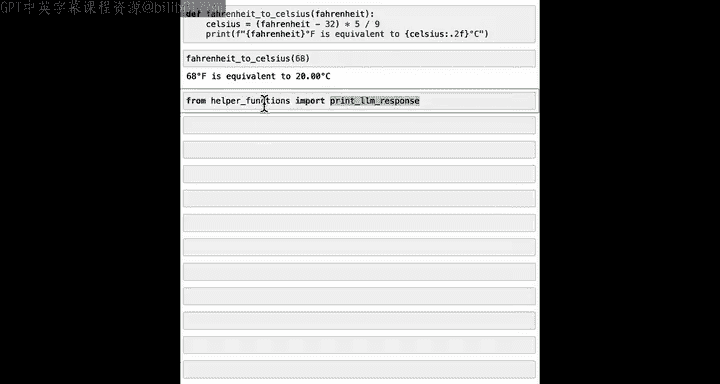

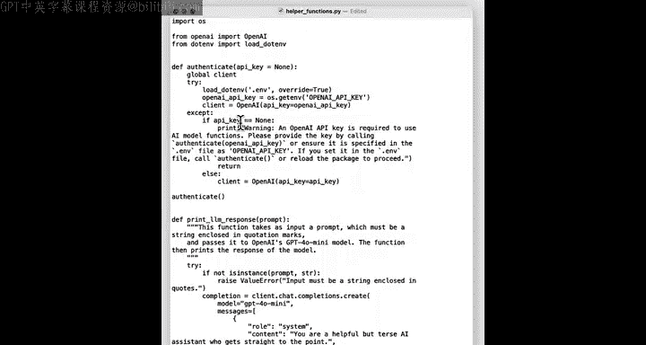

Deaf print LM response that inputs a prompt and then does some processing and eventually prints out the response Discco uses a few features a little bit more advanced in what we've gone through so far from these courses。

 but if it curious feel free to ask the AI chatbot what anything you see here at the A curiouss about means。

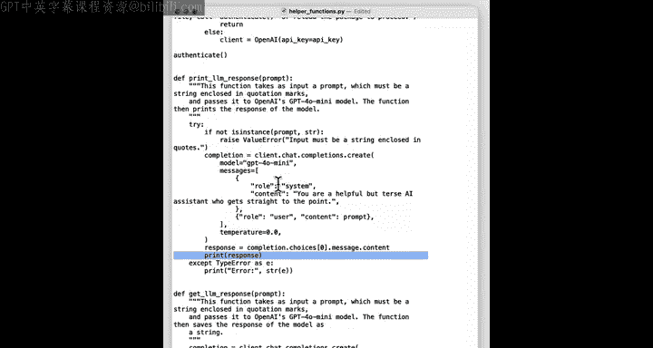

And ignoring most of this file for now， what we've put in this file is the definition of a function。

 Celsius to Fahrenheit， since instead Fahrenheit to Celsius with have a new function。

 Celsius to Fahrenheit that does a conversion and prints out the results over here。

So is there a way to get this function into your code？

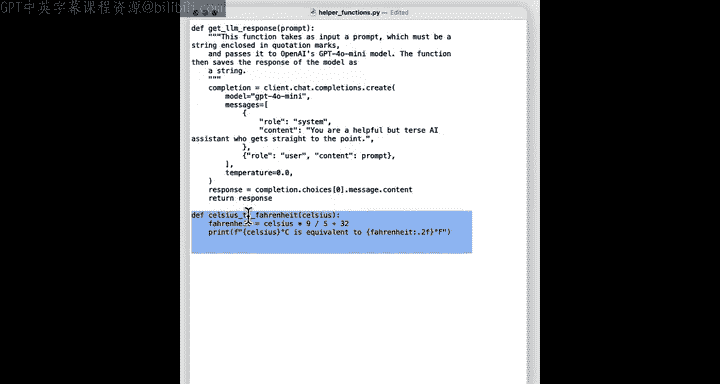

Notice that if I were to write Celsius to。Fahrenheit。春子。

This results in an error because Celsius ofphahrenheits is not currently defined。

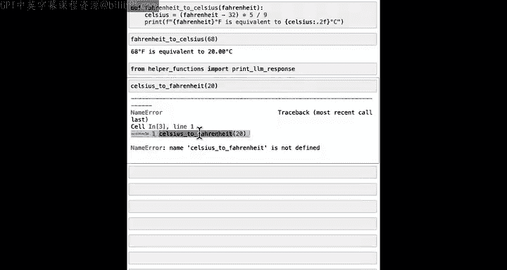

So let's also AI chatbot。 I have a Celsius Saphahrenheit function defined in the file。

 hopeper functions do pi， How do I load it into my Jupyter notebook。

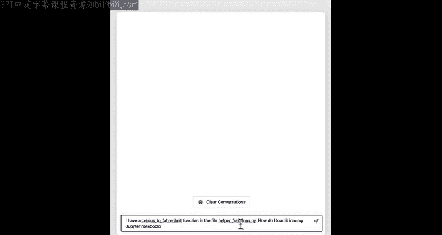

An says。From helper functions import Celsius to Fahrenheit。 Okay， let's give a try。

 I want to copy this code。

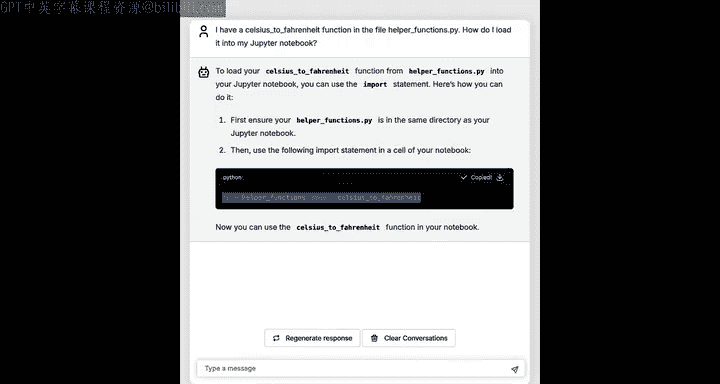

So let me paste a code here and run it。And now if I rerun Celsius to Fahrenheit。

 I get back a correct conversion because I've now imported from hyperper function do pi。

 dysfunction Celsius to Fahrenheit。It turns out that Python has a few different ways to use the import command。

Another one that you see in some taal is。 I can just say import helper functions。

 What this does is this will import all the functions defined in helper functions。

 But then to use a function， you need to。Call functions like this。 hopeper functions dot。

 and then print L response， What is the capital of France。

 And when I type hopeper functions dot print L response。

 this is a way to tell Python that it should look for the print Lm response function by looking at what it had imported from Hper functions dot pi server around this。

 Hopefully it should work。Now， let's look at one more example if I were to call。

Response equals get Elm response。 What is capital France。

 This won't work with what I've imported so far because it doesn't know where to find the Elm response。

 if I were to say。Hoper functions， dark response， this will work。

When I can print response here if I want， but whether I don't want to include this helper functions dot。

Here。So one way to get this to work would be to run from Her。Functions， import， get。Response。

And if I were to do this first， then it will load the get El response function directly so that this liner code will work wonder the if you trick。

 if you don't want to list everything you want to import one at the time。 print response。

 display table and so on。 if you want to just import everything you can say import star and this will imports all the functions defined in helper functions do pi and because get El response was defined in helper functions do pi。

 this should now work and I can print response。Says Harris。

I tend not to use the import star notation because it just loads a lot of functions。

 And if you don't know what exactly is loading from Her functions。

 it could end up loading more functions than you intended。 So I tend not to do this。

 but to instead import。

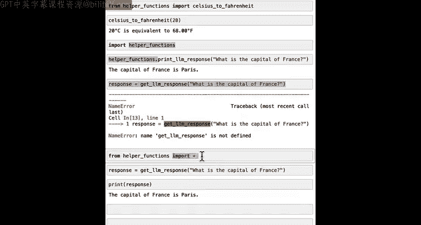

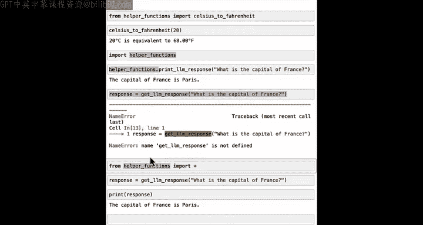

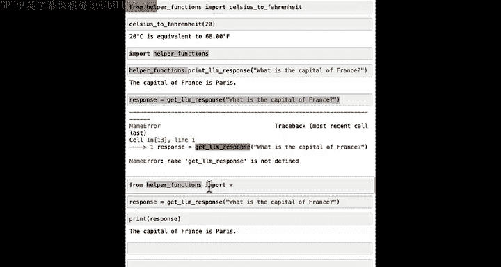

Only the functions that I want， such as get out response。Print response and so on。

 So I tend to do this。 Or sometimes I'll also import helper functions like so。 And again。

 if you do only the latter， then remember you need to do helper。Functions and then dot， you know。

The name的 function that you最 call。

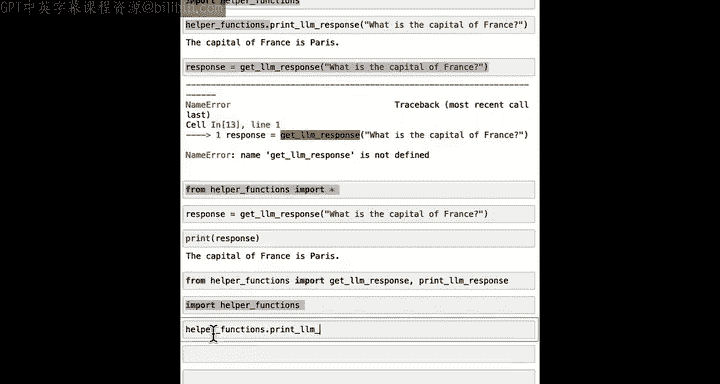

So to recap， this is how you can load functions from a file such as helper functionss。

pi or some other file that's saved locally on your computer。If you run from file import function。

 then this will look at file。 Py in the current working directory and import a specific function。

 or if you want to import all the functions， then I recommend importing file and this will look at file do Py and import all the functions there and to call a function。

 you need to run file do function。 And then lastly。

 you can also run from file import style which imports every single function。

 but I personally do this less often myself。In this lesson。

 you saw how to import functions from a specific file save on your computer。

 It turns out Python also has a number of packages that we call builtin packages that it already knows about and doesn't correspond to necessarily a file in your current working directory and that doesn't need to be installed in advance in the next video。

 let's take a look at how you can import functions from built in packages because it turns out there are a lot of functions in these builtin packages that you will use very quickly in your code。

 I'll see you in the next video。

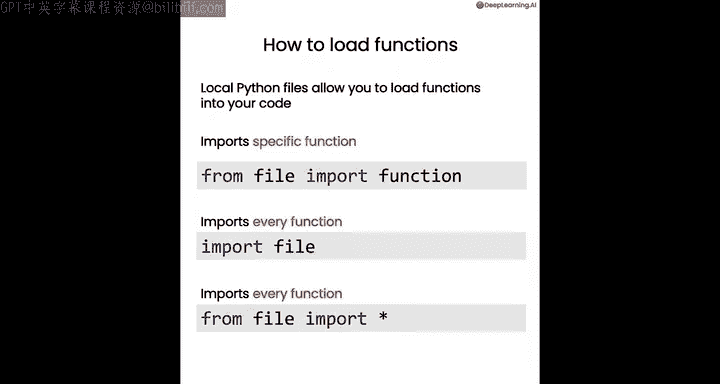