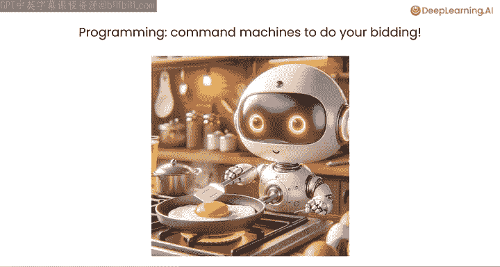
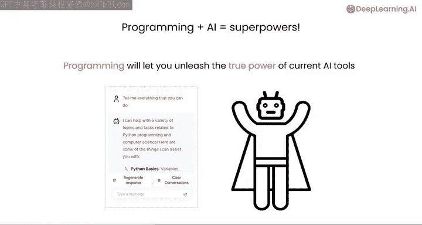
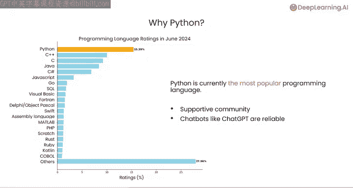
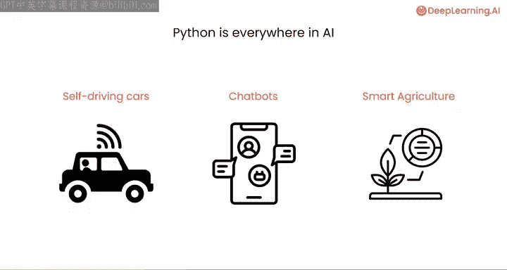
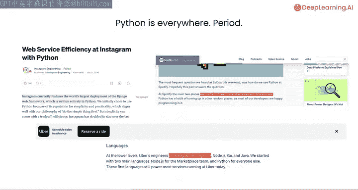

# 吴恩达亲授《给初学者的AI Python编程课（4课全）｜AI Python for Beginners》中英字幕（deepseek-R1 - P2：2.whats computer programming.zh_en - GPT中英字幕课程资源 - BV1qw4m1k7Lq

Computer programming is the art and science of writing very precise instructions to tell a computer what you wanted to do for you。

And it turns out that when you write good instructions， computers could do a lot。

 I was recently on an airplane and the person sitting next to me told me their career story。

 she used to have a job as an executive assistant and she told me that she had learned to code and wrote the program to monitor her executives calendar so that if you know her boss did something funny with his calendar。

 she would get a notification so that she could go fix it。So here's someone that had learned to code。

 then wrote a little bit of code and actually helped her do her job more efficiently。

 I think in almost all walks of life， learning to code。

 getting computers to do what you want will help you get a lot more done。😊。

Programming more broadly has helped advance vast humanity in so many ways。

 all of them driven by people writing code， the Hubble Space telescopes images that have helped us unravel the mysteries of the universe are processed and analyzed using computer programs written by scientists。

The particle accelerators that discovered the Hs Bson were only made possible because developers wrote software to analyze the data they collected in order to drive forward our understanding of physics Our daily use of the internet too was made possible only through people writing computer programs where you pick up your phone and sending a message to someone else Well you're using a computer program that someone else wrote。

If you use GPS to navigate or if you or someone you love uses assistive technology like speech recognition or eye tracking。

These are technologies that have changed the lives of so many people with a disability。

 all of these are programs that someone wrote。At the heart of computer programming is gaining the skill to command machines to do your bidding。

 Comp programs are sets of precise instructions that tell a computer how to perform a task。😊。

Just as a cooking recipe guides you through the steps needed to consistently achieve a delicious result。

 a computer program provides instructions for a computer to perform a specific task。

 being able to program will give you an edge in terms of what you will able accomplish。

 I see many people using programming to automate repetitive tasks like repeatedly taking。

 say PDF documents and extracting relevant data into a spreadsheet。😊。

And beyond analyzing data that you or your company may already have。

 programming also helps you gain brand new insights。I see many teams， including business analysts。

 for example， increasingly using AI tools like Chat GptT to automatically browse a web。

 download a bunch of web pages and synthesize a report to help them gain market insight to learn more about what's happening in some part of the world and as you learn to code you better identify and automate more and more of these types of tasks using AI yourself and it turns out that through programming you can tell your computer to use AI tools like chat GT or other AI language models by writing just a few lines of code not you but your computer can now also go use chat GptT to help it carry out tasks a core part of writing code in thiscourse would be to get your computer to use AI tools via Python so that it could do more for you most AI developers like me use Python prebch all the time and it turns out Python。

It actually the most popular programming language， Python has a very supportive community of developers。

If you have a question， there's so many Python developers around the world so you can often get someone to help you out or find someone that had the same question。

 and it turns out that chatbots like Chat GT and Anthropics Cloud and Google's Gemini also know Python pretty well and so they can help you out if you get stuck on a problem。

So when you're programming and you have a question。

 I encourage you to try asking a chatbot to help you find a solution as I'll show you in dis course today。

 Python is powering tons of AI applications Python code is running in many self-driving calls is using software that powers chatbots and in many other AI applications from smart agriculture to healthcare to financial services and on and on and on and the use of Python extends well beyond that many websites。

 smartphone applications， video games and more a run using Python so when you learn Python。

 you'll be learning one of the most important tools in programming。

 no matter what your goals are So I hope that discourse。

 AI Python beginners would be just your first step that will set you up to keep on taking more and more and more steps and doing more and more with Python and with programming in general so you too can help。

Advanced humanity through code， so that let's go into the next video。

 we'll start to take a look at how chatbots interact with Python。

