# 吴恩达亲授《给初学者的AI Python编程课（4课全）｜AI Python for Beginners》中英字幕（deepseek-R1 - P30：3.Lesson 2 Built-in packages.zh_en - GPT中英字幕课程资源 - BV1qw4m1k7Lq

Python itself has a lot of different tools， a lot of different functions For example。

 you've already seen some of the functions for reading CSV files Python also has a lot of math tools。

 for example， don't know if you've ever seen or use an oldchool calculator like this one for a long time I was using a calculator on my phone。

 but now these days if I need to do some math I pretty much always just do in Python。

And beyond that， Python also has functions to do statistics or to draw simple graphics and much more。

 These builtin packages are maintained by the team that supports the Python programming language。

 And you won't need all of these packages at once in most programs you might write。

 So you can choose which tools to import based on what you need for a given piece of code in this lesson we'll see how to import code that can help you with math and statistics and will also introduce randomness that is desirable randomness into your code。

 The concepts and code examples in this lesson will create a foundation for the next one to come。

 And which will then look at third party packages that you can download and install from the Internet。

 Let's take a look。😊。

Python comes with many packages that built in and preinstall for you to use You can think of each package in Python as akin to book and so Python comes with a lot of different books on different subjects just as if you're doing research in the library。

 you may not need to use every single book for every single piece of research you're doing when you're writing a specific piece of code you may need to use only a subset of the packages available Let's start by looking at an example of using Python to do math。

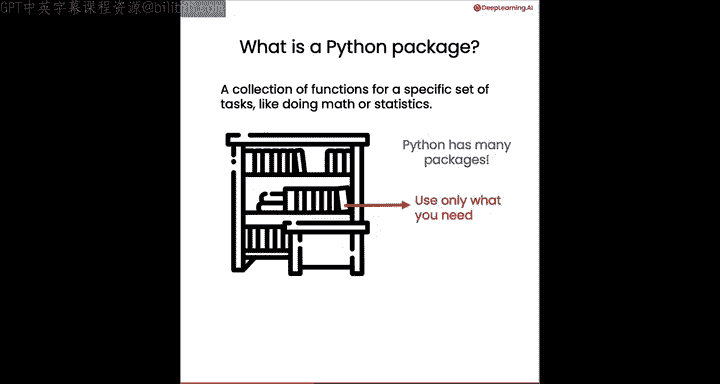

Here I'm going to import from the math package， the functions cosine sign as well turns out this is just a number。

 the floating point number pi in Python's terminology sometimes you hear the words module package and library and these terms aren't used completely consistently and technically you see online people call the math module but for the purpose of this course I'm going to use mainly the term package if you want to know the exact definition of what's a module versus a package versus a library do ask the AI chatbot and give you a clear definition So when I run this line of code I'm importing cosine signine and pi from the math package technically the math module but let's not worry about that。

And if I print pi turns out this is just a 14 point number。

 there's a pretty accurate value for pi the ratio between a circle circumference and diameter。

 and if I now set values to be equal to zero pi over2， which is 9 degrees pi which is 180 degrees。

 270 degrees and 360 degrees， then you can now do something like this where you can use the cosine function that we just imported to compute the value of the cosine of different angles。

And just for fun， feel free to rundicope and they changed this to print out the sign of these different angles using the s function that we had imported up here。

 Now， one more example， it turns out Python also has a function for rounding numbers down。

 So we want to take the number5。7 and round it down。 This should be five。

 you can use the floor function， which is also part of the math package or the map module。

 but vers this won't work because if not yet imported the floor function。

But if I were to save from math import floor and run that and then run this now。

 then disor this rounds it down to five。In addition to math。

 Python also has a built in package for statistics。

 so I'm going to from the statistics package import mean and standard deviation and if I have a set of friends whose heights are given in this list。

 these are height centimeters， they can compute。The mean of my friend's heights or compute the。

Stand the deviation of my friend's heights， the Python statistics package has a few other functions to compute the median。

 to compute quants of data and a few other things that you might find useful if you're doing simple statistics on data。

Lastly， here's one fun thing， there's also a Python package for introducing randomness into your code。

 so I'm going to from random import the sample function。Let's outside a chatbot。

 how do you use the function sample from the random module in Python。

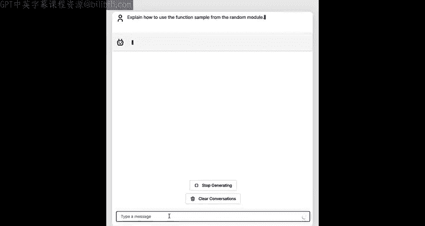

Okay from random important sample given the list， you can say what's a sample size。

 random samples equals and so on。 You can pause a video and read through these instructions in detail of you want。

 So'll say AI chat about yourself， but let me show you how you can use the sample function for a fun application of creating new recipes。

 You might remember one of the early examples you've seen was if you have spices。

 vegetables and proteins， we could feed some list of ingredients to a large language model and have it created recipe But what if you don't want to pick the spices and vegetables and proteins I'm going to say from the spices let's pick a set of random spices I'm going tell you sample from the list of spices that we define on top let's pick two spices and then similarly let's pick a set of random vegetables I'm going look at the list of vegetables that we define on top and let's pick two vegetables and lastly from the list of proteins we define here let's sample one。

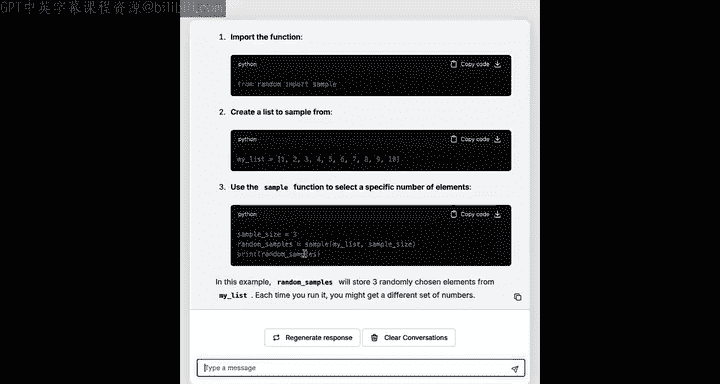

and proteinAnd if I run this， I actually have no idea what I'm going to get。

So that were to print random spices。Okay， we got Perpika and oro。Let's now print random vegetables。

 broccoli carrot， That sounds pretty good and protein beef。

 And so for these randomly chosen ingredients， let's use a large language model to suggest a recipe that uses spices。

 vegetables and。😊，Proteins。So this is a prompt。 And now。

Let's call the large language model get El response to prompt print recipe It turns out I've actually run this it won't work because in this notebook we've not yet imported。

 get El response so to actually make this work we need to run from p functions import get El response and it run this then it'll take the random ingredients we just generate it and create you know locular pretty plausible。

 pretty interesting recipe。

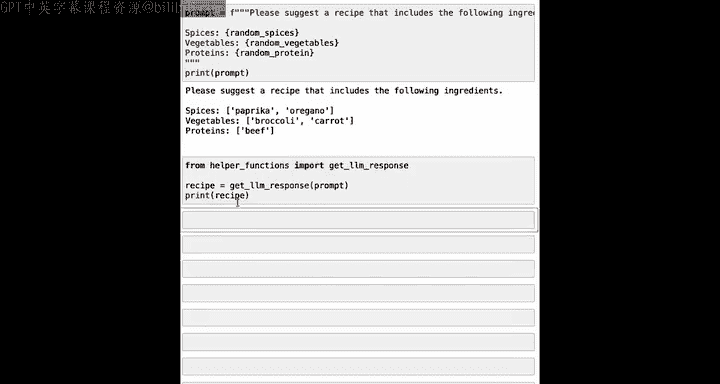

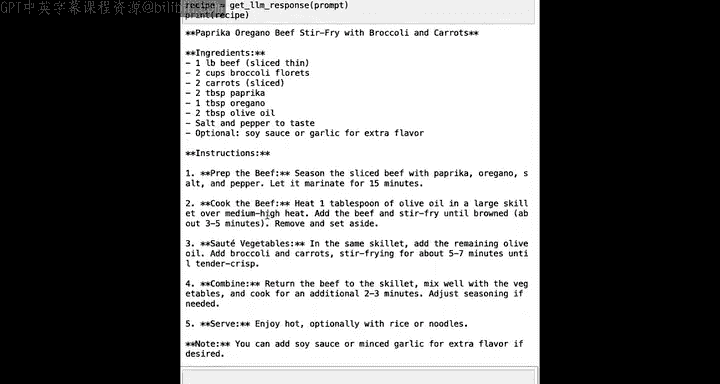

When you run this yourself， you probably get a different answer than I will because。

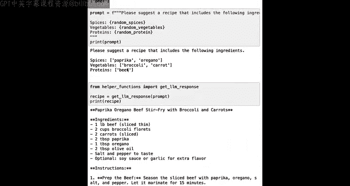

Importing the sample function from the random package allows you to write code that generates a different random result every time you run it。

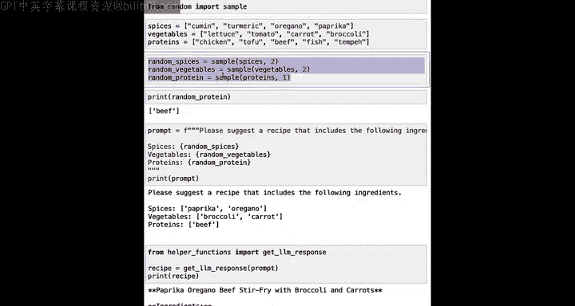

So here we are the paprika oro beef stir fry with broccn carrots。 In fact。

 if I were to rerun this cell again， I now have a different spices， vegetables and proteins。

 And if I were to。Gener a new prompt and rerun the response。

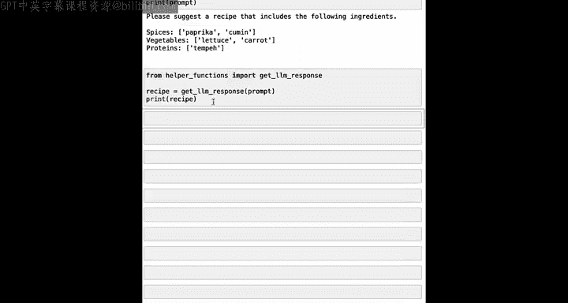

They end up with a spice temp that is wrappeds totally different recipe because weve got different random ingredients this time。

 So the sample function from the random package is a nice way to inject randomness into your code so that you can generate a new results every time。

 So that's how you can use builtin modules or builtin packages in Python。

 And I hope you have fun playing with these recipes and with these co samples in the next lesson will'll go beyond pythons builtin packages to thirdpart packages so you can download and install off the internet This will significantly open up the space of what you can get Python to do for you。

 I'll see you in the next video。😊。

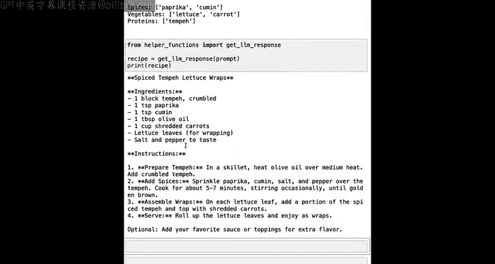

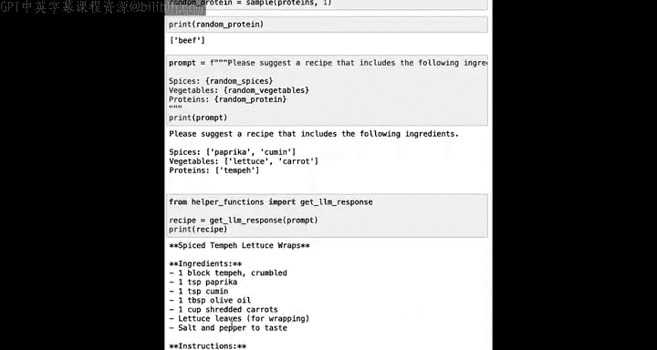

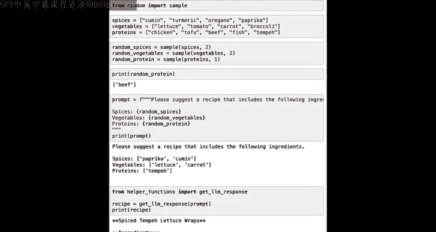

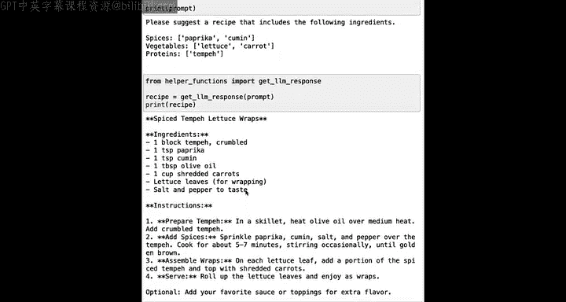

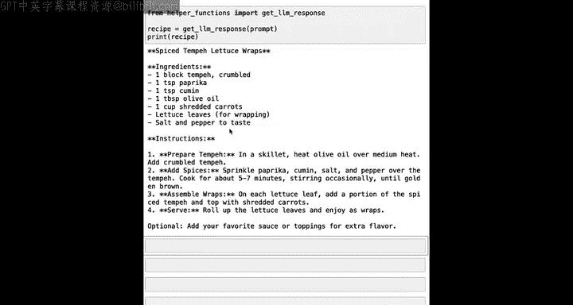