# 吴恩达亲授《给初学者的AI Python编程课（4课全）｜AI Python for Beginners》中英字幕（deepseek-R1 - P31：4.Lesson 3 Using third-party packages.zh_en - GPT中英字幕课程资源 - BV1qw4m1k7Lq

Many people have written Python code and shared it online free for anyone to use。

 maybe someday you do this too， it could be very cool， very satisfying to write code。

 share it online and see others use what you've created。

Thanks to many others already having shared their code online。

 you can take advantage of their work by downloading and installing their packages。

I will refer to these packages as third party packages because they're written by someone else that is not by you and not by the official maintenance of the Python programming language。

Today there are at least hundreds of thousands of these third party packages out there。

In this lesson， you see some of the most popular packages developed by third parties for working with data and drawing graphs。

 both of which are something that I use quite a bit in my work。

 The packages you'll see are called pandas and Matt plot them。 Let's take a look。

One of the most popular Python third party packages is called panndas and is often used for processing structured data。

 like kind slot in spreadsheets and CSV files。Paandndas unfortunately has nothing to do in this case with the acute cuddly animals。

 it comes from the shortening of the term。Pael data， which is a term from economics。

 You can also the chat bullet or search online if you want to know more。

 although if it brings you joy to picture a bunch of cute cutly pandas doing data science。

 feel free to have that picture in your head。 too。 The most common way to develop this import pandas is to use this command import pandas as P D。

 The SD is something new。

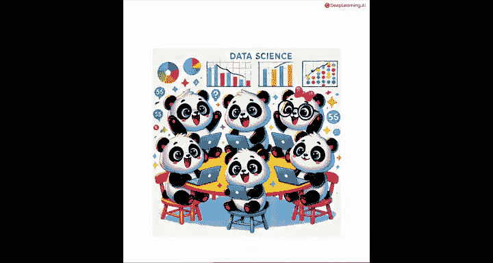

Let's also AI chatbot what this does， What does ads in the following code do。

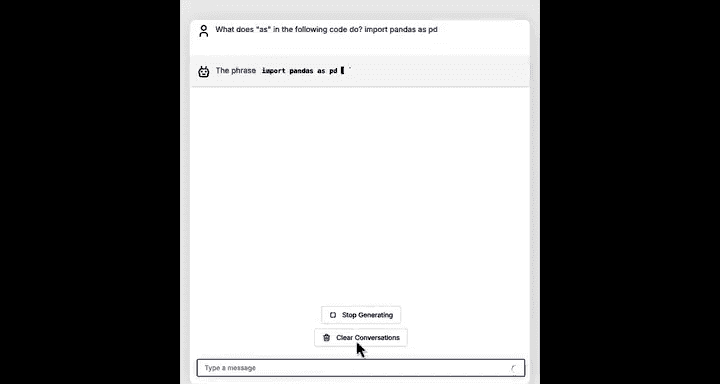

It turns out that if you had run import pandas， you need to write pandas dot and then the functioning。

 but if you don't want to type pandas you want to type just PD as a shortened alias。

 then import pandas as P tells it that you want a load pandas but called P going forward。

 if you to pause the video and readers in detail if you want。

 But what this let us do is write PDd dot function rather than pandas dot function and does save us some typing as we use functions from the pandas package and I want to mention this because if you ever have a chatbot right code for you that uses a pandas package it's very likely that it will import pandas as PD。

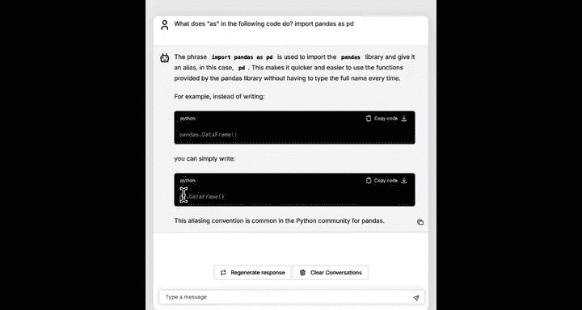

In this lesson， we'll use a data on used car sales prices。

 The data we'll use here is adapted from a data at this URL due to Nehalal Burer and others。

 and I'll read the data using the pandas read CSV function and then will print out the data after that。

 My first car ever was a blue Poer code that will simplify the data to have only。

Data from Honda of models。Pas also lets you filter important information。 For instance。

 you can get all the costs for which the selling price is above $10，000。

 Padas has a lot of different commands， and it's difficult to remember all of them。

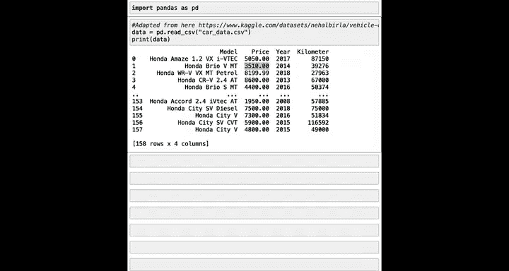

But it turns out our AI chatbot knows pandas pretty well load some data using this code。

 we tell the AI chatbot what the data looks like and we want to showing the conisseur price greater than equal to $10。

000。

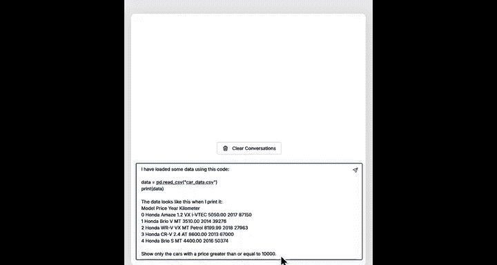

And we run it and it says you can get the filter data using this syntax。

If it occurss what this does exactly， feel free to ask AI chatbot to explain it to you。

 but I'm just going copy that snippet of code。

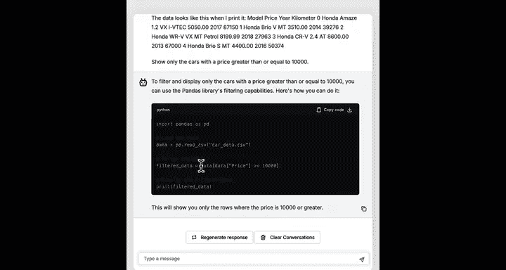

And let's go back to a Jupinter notebook book and say print。What we've got from the AI chatbo。

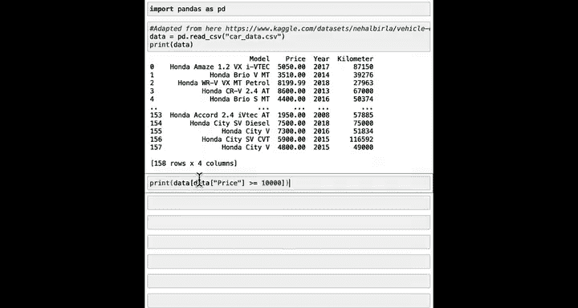

And now this prints out the substantive cost of price over $10，000。

 or if it turns out if you want to find all the costs whose year is， say， 2015。Model years 2015。

 you could do that and this print out the cause with model year 2015。

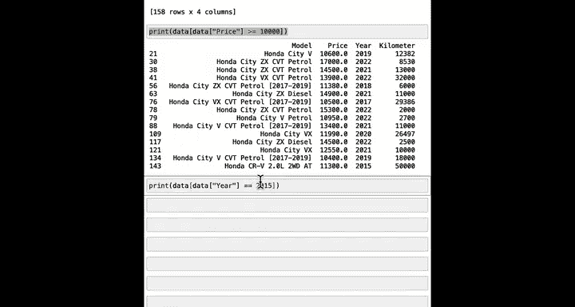

Here's something else you could do。 You could say filter data equals。

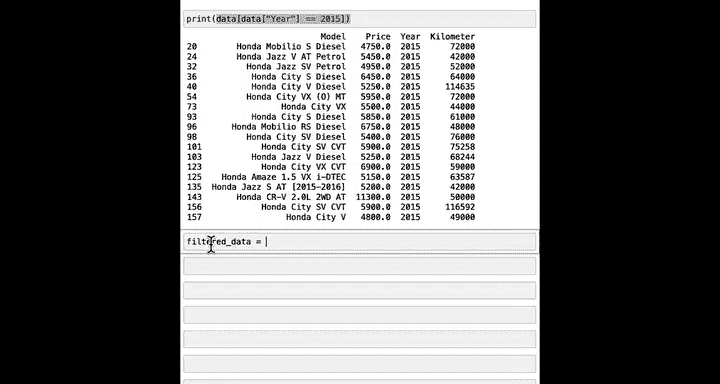

All the cause whose year is 2015。We can also print filtered data and we can take the filter data。

 look at the price of all the cars with model year 2015 and print out the median price。

 so that correspond to look at all these prices and printing out the median price of all the cause whose year is 2015 and it looks like $5。

465 is the median price of the cars from that year I know I went through quite a lot of different examples here。

 you don't need to remember any specific line of code because if ever you want to filter the data on computer mean computer median。

 I want encourage you to ask AI chatbot for hope pandas by the way。

 is a very powerful to their professional data scientists use daytoday in their work and is that exact same pandas package that you are using here in this example beyond manipulating data there's another very popular package for ploting data called map。

Ploot to import the plotting functions from matpl Lib。

 the most common line of code would be this import mappllib do pie plot as Pt。

 This particular package name is a little bit unusual because it is dot in the middle。

 But for our purposes， you don't need to worry about what that means。

 So having imported the Pt function， I can do P let's the scatter plot the plots the price versus the mileage and if I run that it shows a chart like this where the X axis is the mileing kilometers and the y axis is the price in US dollars。

 It turns out if you want to label the axis， you can add a few extra commands like this。

 And if I werun that you get the plot that looks like this。

 Sometimes you see developers as one more line P do show which explicitly tells Python to show the plot。

 let me just do that。 And so here's a nice looking plot on。addressessses。Moowledge。Now。

 one thing that you might want to do when manipulating data is change up the plot that you have。

So if you want to add the grid to the plot， maybe change the scatter plot color to red and maybe increase the title font size。

 how do you do that？This ask the AI chatbot of the following plot command， please all。

 change the scatter plot color to red and increase the title font size Let's see if we can solve this for us。

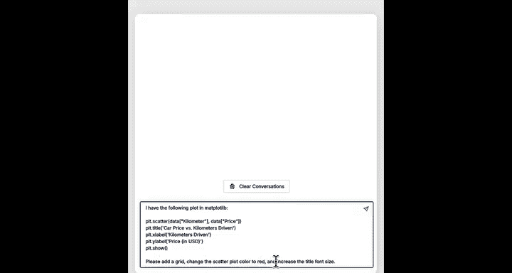

And I'm just going to take the code and run it and see if it works。

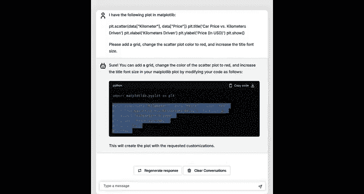

And then me run that。 and y chase the color of the red out of the grid and the title font size。

 AI chatbots don't always give you exactly the right code， but they often work quite well。

 So many developers will have AI chatbo the code Take a quick look make sure those kind of sensible and then run it to see if it works。

 and sometimes it won't work。 But if you go to AI chatbo to tell it hey thanks the but it didn't quite work the phone wasn't quite right。

 The column wasn't what thought you can then sometimes get the AI chatbo to try again and have a better chance to give you the right answer the second time round。

 but here it works just fine the first time round。 So in this lesson youve tried a couple of thirdpart packages。

 the pandas package and the packages and you saw how you needed to import the functions first before you can use This input command was very similar to what you use for builtin packages like the math package or the。

packageAs well as for functions that were saved in a file like the Hoer functions file。 Now。

 with Pythons built in packages， therere already a part of Python and you didn't need to install them In this Jupyter notebook we already made sure that pandas and that partlet were already installed。

But there are also lots of third party packages that are not yet installed on your computer or in a particularly Jupyter notebook environment。

 So how can you get your computer to go onto the internet to download and install some brand new third party Python package。

 Let's go to the next lesson to see how to do that。

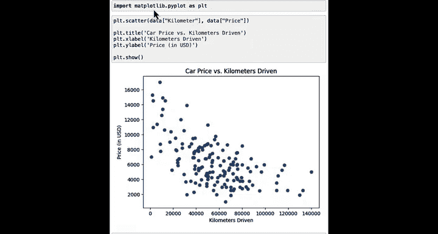