# 吴恩达亲授《给初学者的AI Python编程课（4课全）｜AI Python for Beginners》中英字幕（deepseek-R1 - P32：5.Lesson 4 Installing packages.zh_en - GPT中英字幕课程资源 - BV1qw4m1k7Lq

So far in all the Jupyter notebooks on this website。

 we preinstalled all the packages you need to run all the notebooks。

But if you're working in a separate Jupyter notebook。

 maybe on your own computer and not on this website。

 you might need to install some of the packages yourself。

If you're interested late in this course， you see how to set up Python to run on your own computer。

And in this lesson， you see what the process is like of downloading and installing packages。

 You go through the installation process for a package for interpreting HTML web pages。

If your code downloads a web page off the internet。

 you see that the raw webpage might have a lot of HTML tags that indicate where paragraphs sudden in。

 font sizes， and so on。

You learned how to download and install a package called B4 for extracting the text you want from this massive HTML。

In addition， you also learn how to install a package called AI setup， which is provided by Deeple AI。

 which contains all the key hopeer functions you've used throughout this and previous courses so that if you want。

 you can install AI setup and event functions yourself like print response in a different Jupyter notebook than the ones on this website。

 Let's go take a look at how to install Python packages。

There are many ways to install Python packages here。

 I like to go through how you could do it directly in the Jupyter notebook。

 There's a package that we want to use in this lesson called B4 for interpreting HTML web pages So to install the B4 package I'm to use it come on exclamation mark and often will say bang In exlamation mark because it's fast to say bangang So bang Pip install and in the package name which in this case is B4 and when I run this my computer will go online and look for the B4 package and then download it and looks like it successfully install B4 version 0。

0。2。PS4， by the way， stands for beautiful soup version 4 and beautifulful soup is an allusion to an Allison Wonderland poem you can search online or alsoI chatbot if you're curious about where this name comes from。

But this is a Python package for interpreting HTML web pages。 B4 is a relatively small package。

 so this installed in a few seconds。 Some packages may take minutes to install After installing this package。

 you can then import the package or any function it contains。

So I'm going to say from the package B4 that we just installed。

 let's import the beautiful soup function。 So here BS4 is the package name and beautiful soup is the function name and then it turns out for the examples we want to use today。

 we need to import a few other things import requests。

 which is going to be used for downloading web pages。

 then helper functions and then from ipyython display something here to print HTMLL web pages。

To scrape data from the web first you need to get a webage's contents。 So here's a URL。

 This is actually a letter that I have written in a weekly newsletter called the back that's a URL to it and to fetch this URL。

 I'm going to use request to say response equals request dot get URL。 remember we did import request。

 So here we need to use the dot notation request dot get URL。 we had done from request import get。

 then you could just write get URL but this is a more common way that program has used the request package and then let's print out the response。

Let's take a look at what the webage actually looks like。

 so this S of the code will show the web page addresses URL inside the Jupiter notebook technically and something called an iframe。

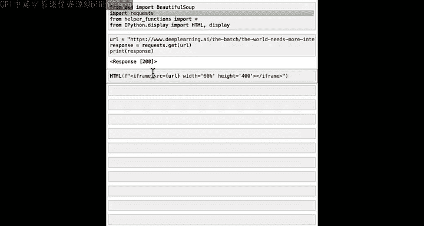

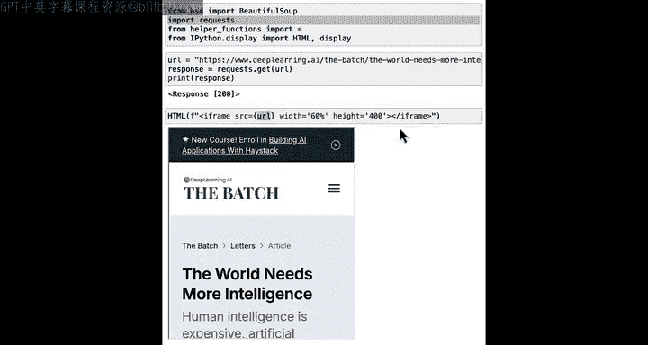

But this shows that letter that I had written that talks about why I think the world would be better off with more intelligence。

 and if you want， feel free to load this URL in your own web browser and you see the same web page as well。

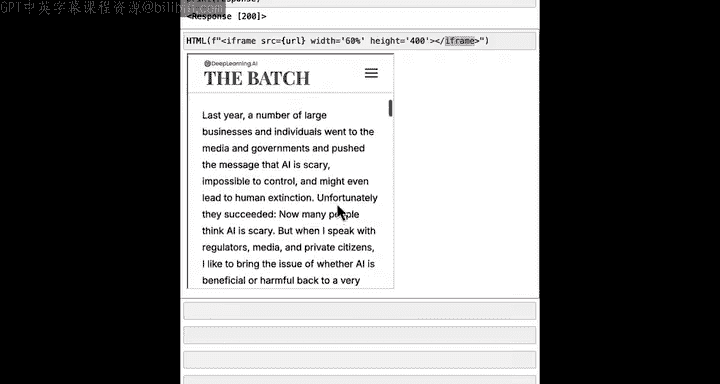

Now， this web page has many elements in it。 There's a menu bar。

 There is lots of different fonts as a picture for the logo， another picture down here。

It has a bunch of links to other the web pages。So it has quite a lot of different things here。

 but if you want to use your large model to maybe summarize this letter for you。

 you might want to extract just the main text of this。

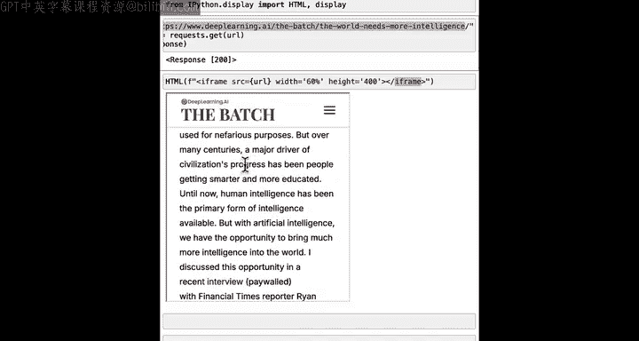

So a beautiful soup， you can take the response we had gotten up on top here and。

Pull out just the text of the web page。

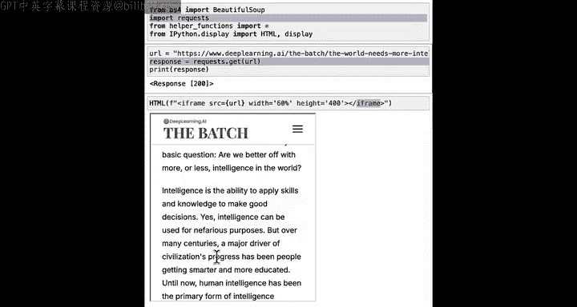

So don't worry too much about the code if you need to write code yourself like this。

 you can actually ask the AI chatbot to write the code for you。

But I'm going to use beautiful soup and get the text from the response and parse。

 meaning to interpret the HTML， and then find all the text that's in paragraphs in the Hl page and then combine everything into one giant text and then print out the result。

 And if I do this， you end up with。

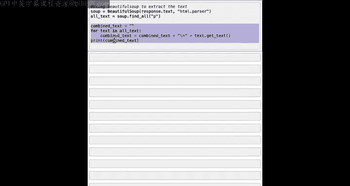

The text from the letter in case the web page has changed by the time you run this。

 you end up with a slightly different result when you run it yourself。

But hopefully you can see how you can take a piece of text like this and pass this to a large language model to have it generate bullet time points for you or something。

 because combined text that we're printing out here is just a string that you can then insert and to prompt for a large language model。

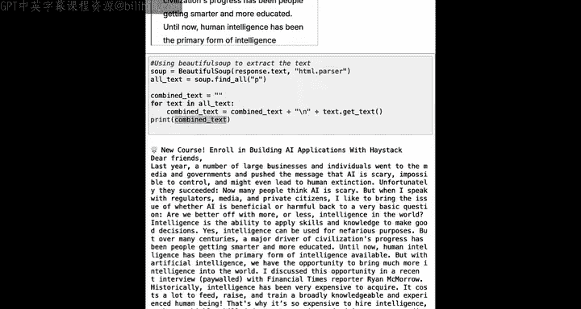

And in fact， if you want to do exactly that， here's a prompt and extract the keyboard the points from the text。

 there's a combined text， and then there's print El response。

 and so it pulls out the most important points from the letter。

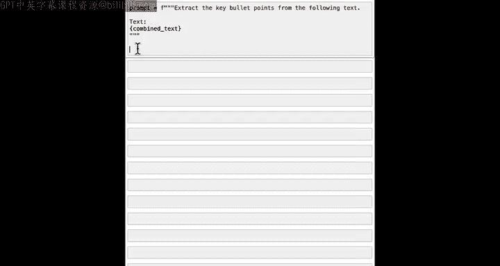

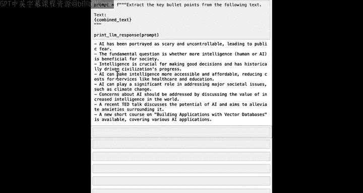

The main goal of my showing you this wasn't to show you beautiful suits specifically。

 although if you want to understand what this code exactly is doing， do RCLM chatbot。

 The key takeaway I hope you remember from this is bang Pi saw。

 then the package name and after you install the package。

 you can then import functions to the package and start using it right away in your own code。

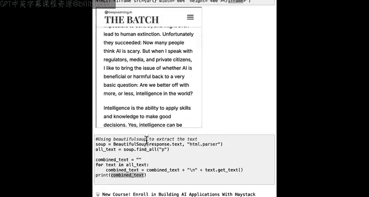

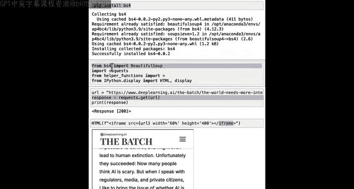

Let me just show you one more example of installing another package。 would run B H install AI setup。

 AI setup is a package made available by the deep or AI team。

 and it contains the key helper functions that you've seen in this and the previous course and it configures your computer to know whether the key helper functions you've been seeing。

 So you could use it in your own code。 So， for example。

 you can then run from AI setup imports Git El response。

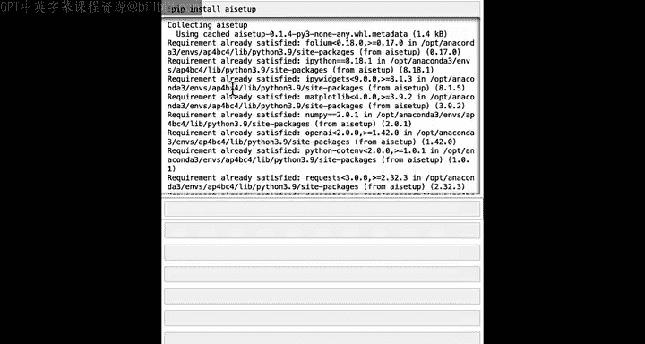

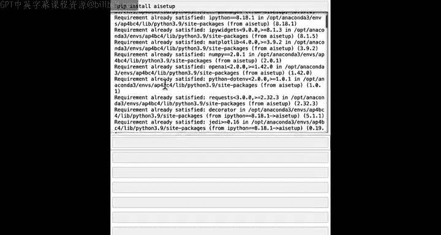

And now you can ask questions like why is a programming language called Python and you know get back the answer that I think it's kind of fun answerization inspired by a pretty funny TV show called Mon Python's F circus。

 But so to take away from this with bang install AI setup This lets you then import functions right away and start using them in your own code。

 This particular example of AI setup works on this website to actually use AI setup on your own computer as one more step they will talk about the later lesson It turns out that get response is using something called an API or application programming interface to go on the Internet to use one of the large language model providers websites actually open the eye in this case to get a response to this question。

 It turns out As are a very powerful way for you to use code to access someone else's computer with permission and get answers from someone else's computer。

ユザ？In the next video， we dive into what are APIs and how to use them in your own code。

 Let's go on to the next video to learn about APIs and why they can help you quickly make your programs much more powerful。

😊。

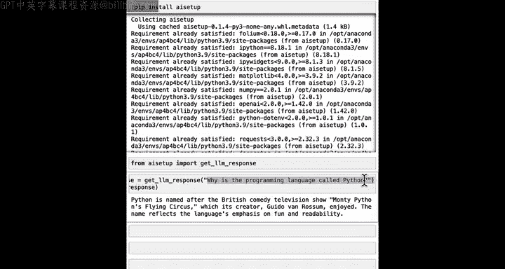