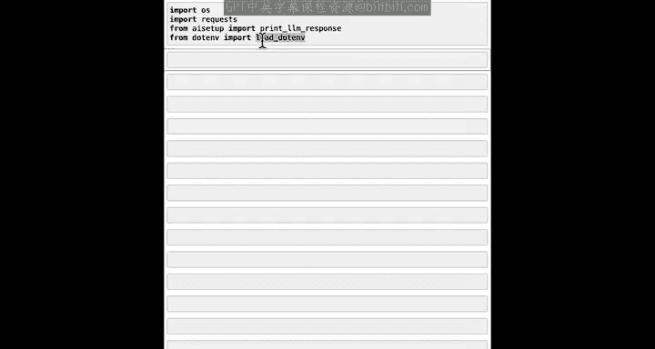
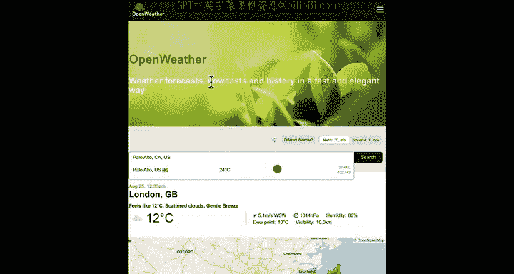
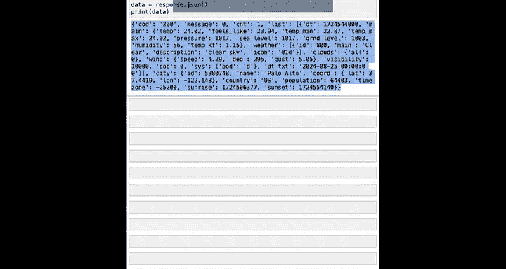
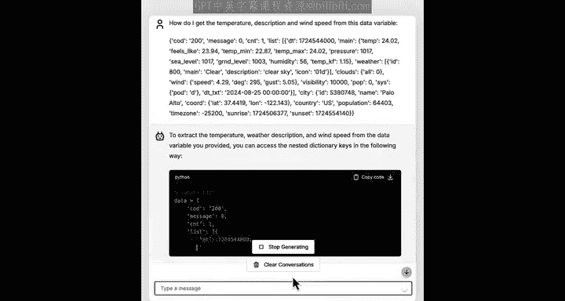
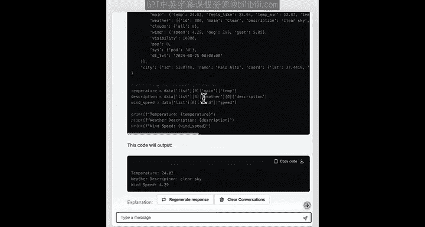
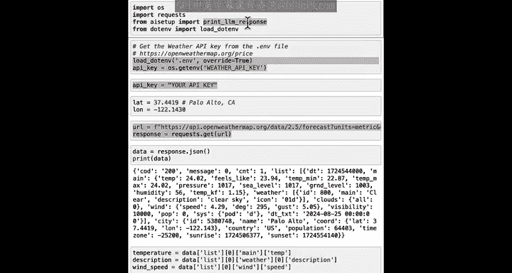

# 吴恩达亲授《给初学者的AI Python编程课（4课全）｜AI Python for Beginners》中英字幕（deepseek-R1 - P33：6.Lesson 5 APIs to get data from the web.zh_en - GPT中英字幕课程资源 - BV1qw4m1k7Lq

Sometimes a problem that you want to rank code to solve may involve real time data， for example。

 using weather data to plan an outfit for the day， maybe while you're on your green vacation。

In order to access data such as the current weather or stock prices or newsse or calling a web search engine to find relevant web pages。

 you need to use something called an API or application programming interface and API gives your computer a away to talk to a second computer to get that second computer to do something for you such as pull up a city's current weather and return that to your computer there are lots of APIs on the Internet Some are free and many that might require a fee since it often costs someone else something to run a computer and operate that API service。

But in contrast to downloading a package to run on your computer。

 APIs lets you get someone else's computer with permission to do work， to do something for you。

Let's take a look at how APIs work using a fun example of getting realtime weather data using an API to plan an outfit per the day。

APpis are a way for your computer to get a different computer to fetch some data or to do some work for you Think of this as akin to if you' are sitting in a restaurant and you would like some food。

You were talked in a nice waiter who will then kindly go to the kitchen to get and deliver the meal that you requested to you。

 so the waiter is the go between between you and the kitchen and that's what the API does is it go between between you and someone else's computer that provides data or provides a service。

So let's go through an example。I'm going to import OS， import requests。

 and now I'm going to from AI setup rather than H functions， import print El response。

 and I'm also going to use a package called dot N， which I'll say a little bit more about later。

I'm going to use an API provided by this website openweathermap。

org and I'm in Palo Altocafornia USA right now and so the weather right here at this moment is 24 degrees Celsius pretty nice out here。

 but rather than using the web interface to look up whether I'm going to see how to use an API for my computer to top the near computer to fetch the weather automatically it turns out most APIs will ask for something called a key or an API key you can think of an API key as a password that is unique to you this way the computer that is delivering on your request knows who the request is coming from。

So here's a simple of code to load the API key that is unique to me。

Don't worry too much for now what this code is doing。

 I'll come back and say a little bit more about this later and one our API keys。

I'm going to specify the latitude and longtitude of where I am and then here's some code so here's the URL F string。

 this is a URL to the API insert in the F string， the latitude and longtitude and then also the API key and then I'm going to get a response by fetching something to that URL and here's a syntax for printing out the data that we just got back from the response。

It turns out that this is a dictionary with a lot of values， temperature is 24。02 degrees。

 it feels like 23。98 degrees。And in this description， which is the skies are clear。

Here' the wind speed， degrees and so on。 So this is a pretty complicated dictionary here in order to extract out maybe the key information I want。

 the temperature， the description， as well as the wind speed。

 let me just ask my chatbot to write the code for me。I'm going to ask it。

 how do I get the temperature description and wind speed from this data variable。

And then let me go back and copy this。

And give all this to my AI chatbot and have it figured out for me。

Let's see， Okay， gives me a long explanation， but I'm just going to copy the code here。

And run it。 And they go is extracted the temperature into the temperature variable description and wind speed。

 And if you want a。Nice weather reports。 we can take this data that were extracted and。

Prin it all like this and when you run this code， feel free to look up the latitude。

 the longtitude for your own city and plug it in and look up the current weather for your own city。

And one fun thing。We can see based on the following weather suggests appropriate outdoor outfit and again。

 if you have specific clothing preferences， you can add to the prompt。

 but just to keep a bit generic you know lightweight re t-shirt and shorts sunglasses or sunscreen sunscreen is actually a good idea And so this is how you can call an API over the internet to get information from this other computer from this web server API。

opweerm。org for different types of data services， there will be different APIs and you may need to look online for documentation or other AI chatbot for help to figure out how to call different APIs The AI chatbot is more likely to know how to call the more popular APIs on the internet for the less popular ones you may need to look at the documentation yourself。

For not thing for many APIs， you need to provide a value for an API key。

 which is a secret string of numbers and letters that lets the website know that it is you making this API request call So we've already set up this Jupyter notebook environment to use this API But if you actually want to do this yourself on your own computer。

 you need to go to this website racist account and get a secret API key to then set the API key variable to be equal to one way to do that you have a line of code that says API key equals whatever that secret string of characters and numbers And if you run this line of code with an actual API key and then call the API that will work。

 But it turns out that even though this works， most programmers don't have a line of code like this because if you put your API key right there into your code。

 then if your code even leaks to someone else， then others will have access to your secret。

APpiI key and so what most programmers will do is use the dot end packages load dot end function。

 which goes through a couple extra steps to securely load and use the API key And if you want to understand what these two lines of code do。

 you can ask the AI chatbot to explain how to store API keys a bit more securely if you're interested。

So that's it In this lesson， we saw how to get real time data。 that is weather data。

 It turns out there are also many APIs that let you access advanced AI models。In fact。

 PriLM Response actually uses an API on the internet to access Open AI's chat GC large language model in the next lesson will dive into the guts of how print LM response actually works and how you can write code to access advanced AI models over the Internet。

Let's go see that in the next video。